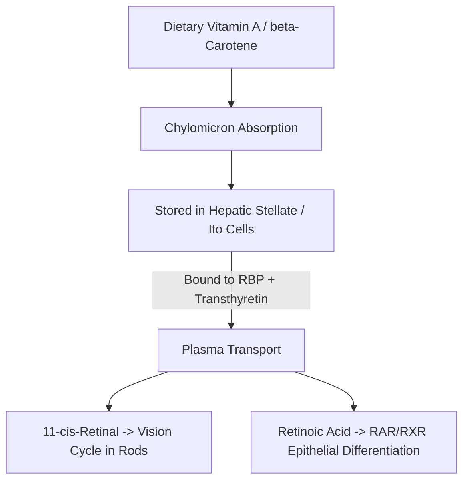
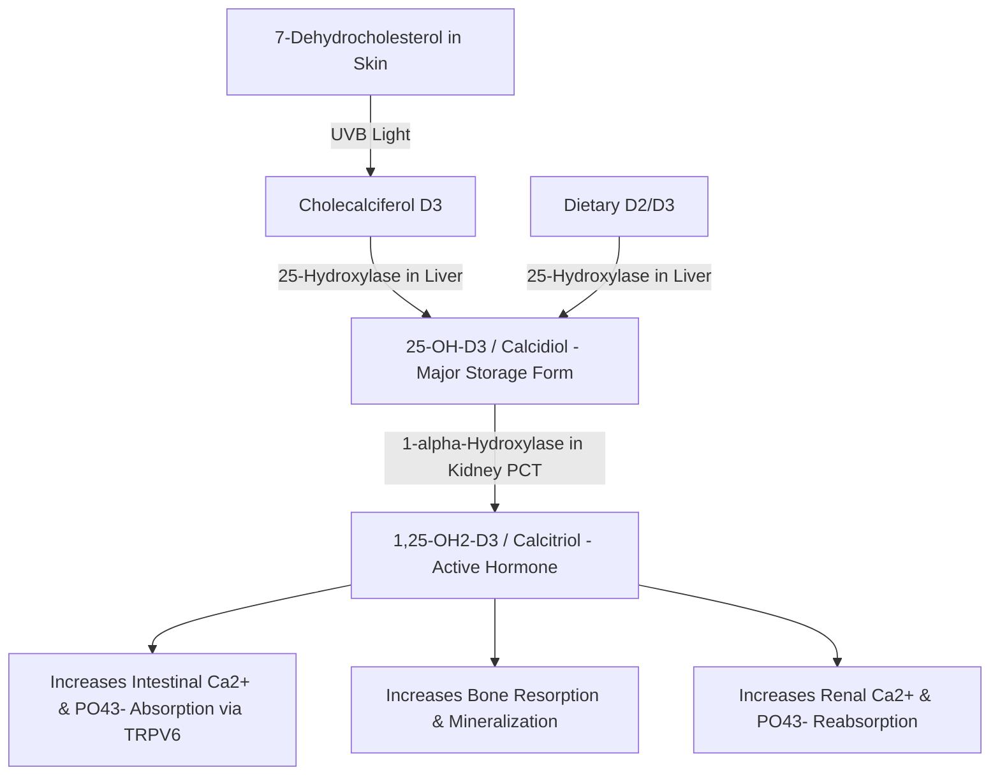

# 51. Fat-soluble Vitamins I: Vitamins A and D

## Overview of Fat-Soluble Vitamins
Fat-soluble vitamins (A, D, E, K) require adequate dietary fat digestion and micellar absorption. They are stored in tissues (liver and adipose tissue), making deficiencies develop slowly, but predisposing to hypervitaminosis toxicity upon excessive intake.

---

## 1. Vitamin A (Retinoids & Carotenoids)

### Active Forms & Physiological Roles
* **Retinol:** Storage and transport form.
* **Retinal (11-cis-retinal):** Essential prosthetic group for vision in rod cells (**Rhodopsin**).
* **Retinoic Acid:** Hormone-like signaling molecule binding nuclear receptors (**RAR** and **RXR**) to regulate gene transcription, epithelial cell differentiation, and mucus secretion.
* **$\beta$-Carotene:** Plant provitamin precursor and lipid-phase antioxidant.

### Wald's Visual Cycle Mechanics
1. **11-cis-retinal** binds opsin to form **Rhodopsin** in rod photoreceptors.
2. Absorption of a photon causes photoisomerization of 11-cis-retinal to **all-trans-retinal**.
3. Conformational change to **Metarhodopsin II** activates the G-protein **Transducin**, stimulating cGMP phosphodiesterase.
4. Drop in intracellular cGMP closes $\text{Na}^+$ channels, hyperpolarizing the photoreceptor and sending a visual nerve impulse to the brain.
5. All-trans-retinal is isomerized back to 11-cis-retinal in retinal pigment epithelium (RPE).

### Clinical Deficiency & Toxicity Spectrum

| Clinical State | Pathophysiology & Features |
| :--- | :--- |
| **Night Blindness (Nyctalopia)** | Earliest manifestation; impaired rod vision in dim light. |
| **Xerophthalmia & Bitot's Spots** | Dry conjunctiva; **Bitot's spots** (triangular foamy keratin plaques on bulbar conjunctiva due to squamous metaplasia). |
| **Keratomalacia** | Softening, ulceration, and irreversible corneal perforation leading to blindness. |
| **Follicular Hyperkeratosis** | Dry, rough skin ("phrynoderma" / toad skin) due to hyperkeratinization of hair follicles. |
| **Acute Toxicity** | Nausea, vomiting, vertigo, blurred vision, **papilledema** (pseudotumor cerebri). |
| **Chronic Toxicity** | Alopecia, dry peeling skin, hepatomegaly/cirrhosis, hypercalcemia, bone pain. |
| **Teratogenicity** | Isotretinoin (13-cis-retinoic acid) causes severe congenital malformations (**microtia/anotia, cardiac defects, cleft palate**). Absolute contraindication in pregnancy! |

---

## 2. Vitamin D (Calciferol)

### Activation Steps & Regulation
1. **Skin Synthesis:** 7-Dehydrocholesterol photolyzed by solar UVB to **Cholecalciferol ($\text{D}_3$)**.
2. **Hepatic 25-Hydroxylation:** Catalyzed by **25-Hydroxylase (CYP2R1)** to form **25-Hydroxyvitamin $\text{D}_3$ (Calcidiol)**. Calcidiol is the major circulating and storage form used to assess body vitamin D status.
3. **Renal 1-$\alpha$-Hydroxylation:** In PCT cells, **1-$\alpha$-Hydroxylase (CYP27B1)** converts calcidiol to **1,25-Dihydroxyvitamin $\text{D}_3$ (Calcitriol)**, the fully active steroid hormone.
   * **Stimulated by:** Parathyroid Hormone (PTH), low serum $\text{Ca}^{2+}$, low serum $\text{PO}_4^{3-}$.
   * **Inhibited by:** Calcitriol (feedback), FGF-23, high serum $\text{Ca}^{2+}/\text{PO}_4^{3-}$.

### Clinical Disorders of Vitamin D Metabolism

| Condition | Pathophysiology & Features | Laboratory Diagnostic Profile |
| :--- | :--- | :--- |
| **Rickets (Children)** | Impaired bone matrix mineralization at growth plates. Features: **Craniotabes**, **Rachitic rosary** (costochondral enlargement), **Pigeon chest (pectus carinatum)**, **bowed legs (genu varum)**, delayed fontanelle closure. | Low/normal $\text{Ca}^{2+}$, **Low $\text{PO}_4^{3-}$**, **Elevated Alkaline Phosphatase (ALP)**, High PTH, Low 25-OH-D. |
| **Osteomalacia (Adults)** | Impaired mineralization of remodeled mature osteoid. Features: Diffuse bone pain, muscle weakness, waddling gait, **pseudofractures (Looser's zones)** on X-ray. | Low/normal $\text{Ca}^{2+}$, Low $\text{PO}_4^{3-}$, **Elevated ALP**, High PTH. |
| **Vitamin D Toxicity** | Hypercalcemia, hypercalciuria, nephrocalcinosis, confusion, soft tissue calcification. | High $\text{Ca}^{2+}$, High $\text{PO}_4^{3-}$, Low PTH, High 25-OH-D. |
| **Granulomatous Disease** | Ectopic 1-$\alpha$-hydroxylase expression in activated macrophages in **Sarcoidosis** and **Tuberculosis**, causing PTH-independent hypercalcemia. | **High $\text{Ca}^{2+}$**, Low PTH, High $1,25\text{-(OH)}_2\text{-D}$. |

---

## High-Yield NEET PG / INI-CET Points
* **Storage Site of Vitamin A:** **Hepatic Stellate (Ito) Cells**.
* **Foamy Conjunctival Lesions:** **Bitot's Spots** (Vitamin A deficiency).
* **Major Circulating Form of Vitamin D:** **25-Hydroxyvitamin $\text{D}_3$ (Calcidiol)**.
* **Rate-limiting Enzyme of Active Vitamin D Synthesis:** Renal **1-$\alpha$-Hydroxylase** (in PCT).
* **Hypercalcemia in Sarcoidosis:** Caused by extra-renal **1-$\alpha$-hydroxylation** by alveolar macrophages.
* **Isotretinoin Teratogenicity:** Causes craniofacial and cardiac malformations; strict pregnancy prevention (iPLEDGE).

---
