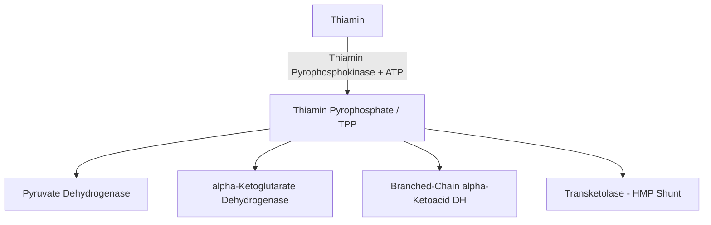
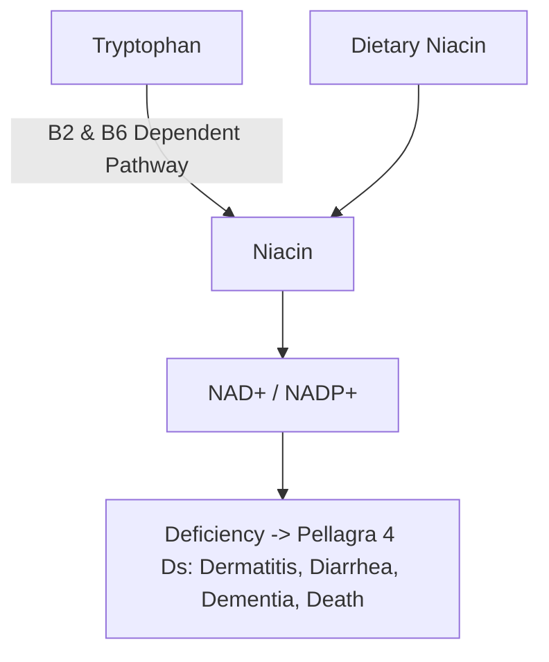

# 53. Water-soluble Vitamins I: Thiamin, Riboflavin, Niacin and Pantothenate

## Overview of B-Complex Energy-Releasing Vitamins
Water-soluble B-complex vitamins act as essential coenzymes in central metabolic pathways. Because they are not stored in significant quantities (except $B_{12}$), deficiencies develop rapidly upon dietary deprivation or malabsorption.

---

## 1. Vitamin $B_1$ (Thiamin)

### Active Coenzyme & Biochemical Functions
* **Active Form:** **Thiamin Pyrophosphate (TPP)**.
* **Key TPP-Dependent Enzymes:**
  1. **Pyruvate Dehydrogenase (PDH):** Glycolysis to TCA cycle link.
  2. **$\alpha$-Ketoglutarate Dehydrogenase ($\alpha$-KGDH):** TCA cycle step.
  3. **Branched-Chain $\alpha$-Ketoacid Dehydrogenase (BCKDH):** BCAA catabolism.
  4. **Transketolase:** Non-oxidative branch of Hexose Monophosphate (HMP) Shunt.

### Laboratory Assessment
* **Erythrocyte Transketolase Activity Assay:** Measured before and after addition of exogenous TPP. An increase in enzyme activity $>15-25\%$ confirms thiamin deficiency.

### Clinical Deficiency Syndromes

| Clinical Entity | Key Pathophysiology & Clinical Features |
| :--- | :--- |
| **Dry Beriberi** | Symmetric **peripheral neuropathy**, sensory loss, motor weakness, reflex loss, muscle wasting. |
| **Wet Beriberi** | **High-output heart failure**, dilated cardiomyopathy, peripheral edema, tachycardia, cardiomegaly. |
| **Wernicke Encephalopathy** | Acute, reversible emergency in chronic alcoholics. **Classic Triad: Confusion, Ophthalmoplegia/Nystagmus, Ataxia**. |
| **Korsakoff Psychosis** | Chronic, irreversible sequela. Anterograde/retrograde amnesia, **confabulation**, personality changes, **atrophy of mammillary bodies**. |

* **Clinical caution:** In people at risk of thiamine deficiency (for example, severe malnutrition or chronic alcohol dependence), give thiamine promptly **before or at the same time as glucose when feasible**. However, do **not delay urgent glucose** for clinically significant hypoglycaemia or other life-threatening indications while waiting for thiamine; administer thiamine as soon as possible. The concern is prolonged carbohydrate administration without thiamine in a deficient patient, not a reason to withhold emergency glucose.

---

## 2. Vitamin $B_2$ (Riboflavin)

### Active Forms & Functions
* **Active Coenzymes:** **Flavin Mononucleotide (FMN)** and **Flavin Adenine Dinucleotide (FAD)**.
* **Key Enzymes:** Complex I (FMN), Complex II / Succinate DH (FAD), Acyl-CoA DH ( $\beta$-oxidation), Glutathione Reductase.

### Clinical Deficiency Spectrum (Ariboflavinosis)
* **Angular Cheilitis / Stomatitis:** Painful fissures at mouth corners.
* **Glossitis:** Smooth **magenta-colored tongue**.
* **Corneal Neovascularization:** Vascular congestion and inflammation of cornea.
* Seborrheic dermatitis, scaly scrotal/labial dermatosis.

---

## 3. Vitamin $B_3$ (Niacin / Nicotinic Acid)

### Active Forms & Functions
* **Active Coenzymes:** **Nicotinamide Adenine Dinucleotide ($\text{NAD}^+$)** and **Nicotinamide Adenine Dinucleotide Phosphate ($\text{NADP}^+$)**.
* **Derived from:** Tryptophan (60 mg Tryptophan = 1 mg Niacin). Requires **$B_2$ and $B_6$**.

### Clinical Deficiency: Pellagra (The 4 Ds)
1. **Dermatitis:** Photosensitive, symmetric rash with hyperpigmentation and scaling on sun-exposed areas (**Casal's necklace** around neck; glove/boot distribution).
2. **Diarrhea:** Mucosal inflammation throughout GI tract.
3. **Dementia:** Encephalopathy, memory loss, hallucinations.
4. **Death:** If untreated.

* **Etiologies:** Corn/maize-dependent diets (niacin bound as niacytin); Hartnup disease; Carcinoid syndrome; **Isoniazid (INH) therapy** (depletes $B_6$, blocking tryptophan conversion).
* **Pharmacological Uses & Side Effects:** High-dose Niacin lowers VLDL/LDL and raises HDL. Causes **prostaglandin-mediated cutaneous flushing** and warmth (prevented by pretreatment with **Aspirin**).

---

## 4. Vitamin $B_5$ (Pantothenic Acid)
* **Active Coenzymes:** **Coenzyme A (CoA)** and **Acyl Carrier Protein (ACP)**.
* **Deficiency:** Extremely rare. Presents as **"Burning Feet" Syndrome** (paresthesias, dysesthesias), GI distress, and adrenal insufficiency.

---

## High-Yield NEET PG / INI-CET Points
* **Thiamine-deficient patients:** prolonged carbohydrate/glucose administration without thiamine can precipitate or worsen Wernicke encephalopathy; emergency glucose should not be delayed.
* **Diagnostic Test for Thiamin:** **Erythrocyte Transketolase Activity Assay**.
* **Wernicke Triad:** **Confusion, Ophthalmoplegia, Ataxia**.
* **Mammillary Body Atrophy:** **Korsakoff Psychosis**.
* **Magenta Tongue & Corneal Neovascularization:** **Vitamin $B_2$ Deficiency**.
* **Pellagra 4 Ds:** **Dermatitis, Diarrhea, Dementia, Death**.
* **Mechanism of Niacin Flush:** **Prostaglandin $D_2/E_2$ mediated** (blocked by Aspirin).

---

## Selected References for Clinical Updates

- [WHO. Consolidated Guidelines on Tuberculosis: Tuberculosis Preventive Treatment (pyridoxine with isoniazid in risk groups).](https://tbksp.who.int/sites/default/files/2022-07/2020%20TPT%20operational%20handbook.pdf)
