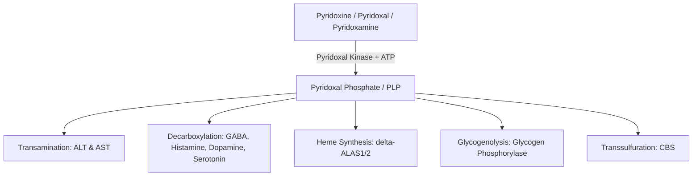

# 54. Water-soluble Vitamins II: Pyridoxal Phosphate (B6)

## Active Form & Chemical Structure
Vitamin $B_6$ comprises three natural vitamers: **pyridoxine** (plant origin), **pyridoxal**, and **pyridoxamine** (animal origin). All three are converted intracellularly by *pyridoxal kinase* into the master active coenzyme: **Pyridoxal Phosphate (PLP)**.



---

## 1. Master List of PLP-Dependent Enzymatic Pathways

| Metabolic Pathway | Specific Enzyme(s) | Reaction Mechanism & Significance |
| :--- | :--- | :--- |
| **Amino Acid Transamination** | **ALT, AST** (All transaminases except Lys, Thr, Pro) | Transfers amino groups via Schiff base intermediate to $\alpha$-ketoglutarate. |
| **Heme Biosynthesis** | **$\delta$-Aminolevulinic Acid Synthase ($\delta$-ALAS)** | **Rate-limiting step of heme synthesis**. Defect causes **Sideroblastic Anemia**. |
| **Neurotransmitter Synthesis** | **Glutamate Decarboxylase** | Converts Glutamate $\rightarrow$ **GABA** (inhibitory neurotransmitter). Defect causes **seizures**. |
| | **DOPA Decarboxylase** | Converts L-DOPA $\rightarrow$ **Dopamine**. |
| | **Histidine Decarboxylase** | Converts Histidine $\rightarrow$ **Histamine**. |
| | **Aromatic L-AA Decarboxylase** | Converts 5-HTP $\rightarrow$ **Serotonin**. |
| **Glycogen Breakdown** | **Glycogen Phosphorylase** | Requires PLP bound to Lys-680 as an acid-base catalyst ($>50\%$ of body PLP is in muscle). |
| **Transsulfuration** | **Cystathionine $\beta$-Synthase (CBS)** | Converts Homocysteine $\rightarrow$ Cystathionine. Defect causes **Homocystinuria**. |
| **Niacin Biosynthesis** | **Kynureninase** | Converts Tryptophan $\rightarrow$ Niacin. Defect causes secondary **pellagra**. |

---

## 2. Drug-Induced Vitamin $B_6$ Deficiency

Several important pharmacological agents form covalent adducts with PLP or inhibit pyridoxal kinase, inducing severe secondary $B_6$ deficiency:

```mermaid
graph LR
    INH[Isoniazid / INH] + PLP --> Hydrazone[Inactive Hydrazone Complex Excreted in Urine]
    INH --x|Inhibits| PyridoxalKinase[Pyridoxal Kinase]
    Hydrazone --> Deficiency[B6 Deficiency: Peripheral Neuropathy & Sideroblastic Anemia]
```

* **Isoniazid (INH):** Antitubercular drug that structurally resembles pyridoxine. Forms an inactive hydrazone complex excreted in urine and inhibits pyridoxal kinase. **Give pyridoxine prophylaxis to patients at increased risk of isoniazid-associated neuropathy** (for example, pregnancy, breastfeeding, HIV, diabetes, alcohol dependence, malnutrition, chronic renal failure, or advanced age); dose follows the applicable TB programme/local guideline. WHO sources commonly use 10–25 mg/day for high-risk preventive-treatment recipients, while other TB guidance uses 25–50 mg/day.
* **Penicillamine:** Used in Wilson's disease and cystinuria; chelates and inactivates PLP.
* **L-DOPA:** Competes with and depletes PLP.
* **Oral Contraceptive Pills (OCPs):** Increase hepatic tryptophan oxygenase, driving relative PLP deficiency.

---

## 3. Clinical Manifestations of $B_6$ Deficiency & Toxicity

### Deficiency Spectrum
1. **Sideroblastic Anemia:** Impaired $\delta$-ALAS activity blocks heme synthesis. Iron enters erythroid mitochondria but cannot be incorporated into protoporphyrin, forming **ringed sideroblasts** (visible on **Prussian blue stain**). Microcytic, hypochromic anemia with high serum iron and ferritin.
2. **Neurological Manifestations:** Peripheral neuropathy (glove-and-stocking paresthesias), confusion, irritability, and **convulsions/seizures** in infants (due to impaired GABA synthesis).
3. **Dermatological & Systemic:** Angular cheilitis, glossitis, seborrheic dermatitis, and **hyperhomocysteinemia** (vascular disease risk).

### Sensory Neuropathy Toxicity
* Chronic excess pyridoxine can cause a dose- and duration-related **sensory neuronopathy/ataxia**. Neuropathy has been reported with prolonged exposure at lower doses than older textbook thresholds; avoid unsupervised high-dose or long-term supplementation.

---

## High-Yield NEET PG / INI-CET Points
* **Master Coenzyme for Transamination & Decarboxylation:** **PLP (Vitamin $B_6$)**.
* **Enzyme in Heme Synthesis Requiring $B_6$:** **$\delta$-ALA Synthase**.
* **Microcytic Anemia with Ringed Sideroblasts:** **Sideroblastic Anemia** ($B_6$ deficiency / INH therapy).
* **Isoniazid and pyridoxine:** prophylaxis is particularly important in people with risk factors for peripheral neuropathy; follow the current national TB programme and patient-specific risk assessment.
* **Seizures in INH Overdose Mechanism:** Decreased **GABA** synthesis due to Glutamate Decarboxylase inhibition.
* **Vitamin $B_6$ toxicity:** excess supplementation is a recognised cause of sensory neuropathy; it is not accurate to describe it as the only water-soluble vitamin capable of toxicity.

---

## Selected References for Clinical Updates

- [WHO. Consolidated Guidelines on Tuberculosis: Tuberculosis Preventive Treatment.](https://tbksp.who.int/sites/default/files/2022-07/2020%20TPT%20operational%20handbook.pdf)
- [CDC. Treatment for Drug-Susceptible Tuberculosis Disease (pyridoxine for patients at risk of neuropathy).](https://www.cdc.gov/tb/hcp/treatment/tuberculosis-disease.html)
