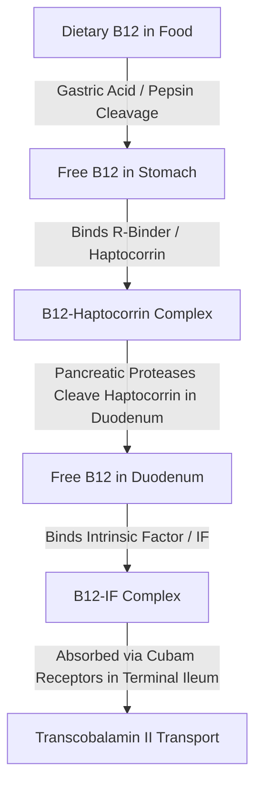
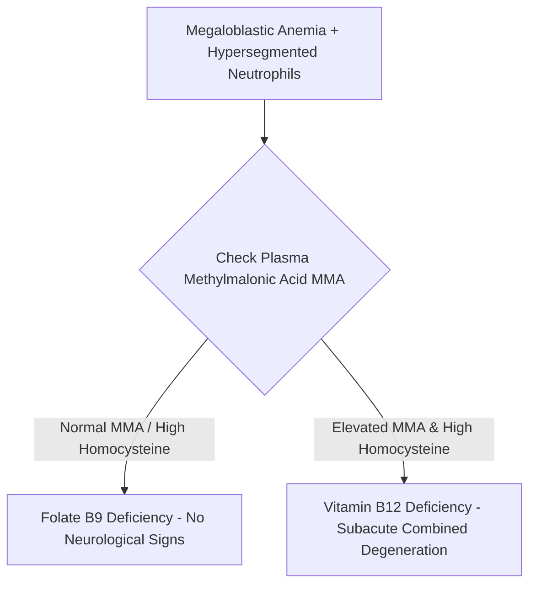

# 55. Water-soluble Vitamins III: Folate and Vitamin B12

## 1. Vitamin $B_9$ (Folate / Folic Acid)

### Active Form & One-Carbon Metabolism
* **Active Form:** **Tetrahydrofolate (THF)**, generated by **Dihydrofolate Reductase (DHFR)** using NADPH.
* **Role:** One-carbon donor/acceptor carrying methyl ( $-\text{CH}_3$), methylene ( $-\text{CH}_2-$), or formyl ( $-\text{CHO}$) groups required for:
  1. **dTMP Synthesis:** *Thymidylate Synthase* converts dUMP $\rightarrow$ dTMP (requires $N^5,N^{10}$-methylene-THF).
  2. **Purine De Novo Synthesis:** Formyl transfers by GAR and AICAR transformylases.
  3. **Methionine Synthesis:** *Methionine Synthase* transfers methyl from $N^5$-methyl-THF.

### Absorption, Storage & Pharmacological Antagonists
* **Absorption:** Dietary polyglutamates hydrolyzed to monoglutamates in **jejunum**.
* **Storage:** Low liver stores (lasts only **3–4 months**).
* **Inhibitors / Antagonists:**
  * **Methotrexate, Trimethoprim, Pyrimethamine:** Inhibit **DHFR**.
  * **Phenytoin, Valproate:** Impair intestinal conjugase / absorption.

---

## 2. Vitamin $B_{12}$ (Cobalamin)

### Structural Architecture & Absorption Mechanics
* **Structure:** Complex corrin ring containing a central **Cobalt ($\text{Co}^{3+}$)** atom.



* **Storage:** Massive hepatic storage (lasts **3–5 years**).

### Two Critical $B_{12}$-Dependent Reactions

```mermaid
graph TD
    subgraph Reaction 1: Methionine Synthase
    Hcy[Homocysteine] + N5MethylTHF[N5-Methyl-THF] -->|Methionine Synthase + Methylcobalamin B12| Met[Methionine] + FreeTHF[Free THF -> DNA Synthesis]
    end
    subgraph Reaction 2: Methylmalonyl-CoA Mutase
    MMCoA[Methylmalonyl-CoA] -->|Methylmalonyl-CoA Mutase + Adenosylcobalamin B12| SuccinylCoA[Succinyl-CoA -> TCA Cycle]
    end
```

1. **Methionine Synthase Reaction:** Transfers a methyl group from $N^5$-methyl-THF to Homocysteine, yielding Methionine and regenerating free THF.
   * **The Methyl-Folate Trap Hypothesis:** In $B_{12}$ deficiency, folate becomes permanently trapped as $N^5$-methyl-THF because Methionine Synthase is inactive. This secondary functional folate deficiency arrests dTMP/purine synthesis, causing **megaloblastic anemia**.
2. **Methylmalonyl-CoA Mutase Reaction:** Converts Methylmalonyl-CoA to Succinyl-CoA.
   * In $B_{12}$ deficiency, **methylmalonic acid (MMA)** accumulates and is a useful biochemical marker. The precise biochemical explanation for neurological injury is not fully settled; abnormal fatty-acid incorporation into myelin is a traditional proposed mechanism, not an established sole cause of demyelination.

---

## 3. Diagnostic Differentiation: Folate vs. $B_{12}$ Deficiency



### Comprehensive Diagnostic Comparison Table

| Diagnostic Feature | Folate ($B_9$) Deficiency | Vitamin $B_{12}$ Deficiency |
| :--- | :--- | :--- |
| **Anemia Type** | Megaloblastic (MCV $>100\text{ fL}$) + Pancytopenia | Megaloblastic (MCV $>100\text{ fL}$) + Pancytopenia |
| **Blood Film** | **Hypersegmented neutrophils** ($>5$ lobes); oval macrocytes | **Hypersegmented neutrophils** ($>5$ lobes); oval macrocytes |
| **Neurological Symptoms** | No characteristic subacute combined degeneration pattern is expected from isolated folate deficiency | **May occur:** classically subacute combined degeneration of spinal cord and peripheral neuropathy. |
| **Spinal Tracts Involved** | None | **Dorsal Columns** (loss of vibration/proprioception) + **Lateral Corticospinal** (spasticity, Babinski (+)) + **Spinocerebellar** (ataxia). |
| **Serum Homocysteine** | **ELEVATED** | **ELEVATED** |
| **Serum Methylmalonic Acid (MMA)** | **NORMAL** | **ELEVATED** (supports B12 deficiency; renal impairment and other factors can also raise MMA) |
| **Onset Time** | Rapid (months) | Slow (3–5 years) |
| **Etiologies** | Malnutrition, alcoholism, pregnancy, antifolates, celiac disease. | **Pernicious anemia** (anti-IF/anti-parietal cell Ab), vegan diet, gastrectomy, Crohn's/ileal resection, *D. latum*. |

* **WARNING MASKING EFFECT:** Treating $B_{12}$ deficiency with Folic Acid alone will correct the megaloblastic anemia (by bypassing the methyl-trap), but **allows irreversible neurological demyelination (SCD) to progress!**

---

## High-Yield NEET PG / INI-CET Points
* **Diagnostic Test Differentiating $B_{12}$ from Folate Deficiency:** Elevated **Methylmalonic Acid (MMA)** in $B_{12}$ deficiency.
* **Site of $B_{12}$ Absorption:** **Terminal Ileum** (requires Intrinsic Factor).
* **Methyl-Folate Trap Mechanism:** Folate trapped as **$N^5$-methyl-THF**.
* **Neurological Lesion in $B_{12}$ Deficiency:** **Subacute Combined Degeneration (SCD)**.
* **Risk of Folic Acid Monotherapy in $B_{12}$ Deficiency:** Corrects anemia but **worsens demyelination**.
* **Neural tube defect prevention:** For average-risk people planning or able to become pregnant, daily folic acid **0.4–0.8 mg (400–800 micrograms)** should begin at least 1 month before conception and continue through early pregnancy. Higher doses are reserved for selected high-risk situations and should follow the relevant national/obstetric guideline.

---

## Selected References for Clinical Updates

- [US Preventive Services Task Force. Folic Acid Supplementation to Prevent Neural Tube Defects. 2023.](https://www.uspreventiveservicestaskforce.org/uspstf/recommendation/folic-acid-for-the-prevention-of-neural-tube-defects-preventive-medication)
