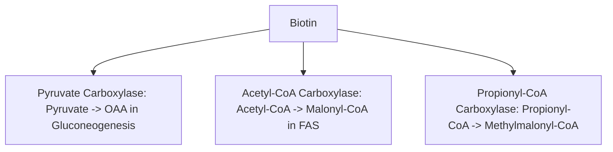
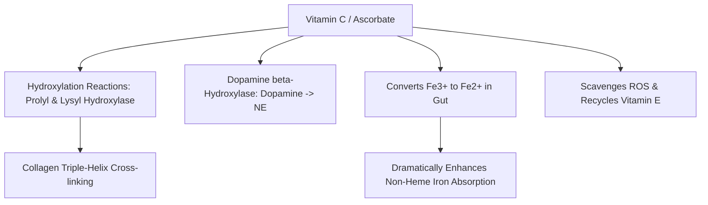
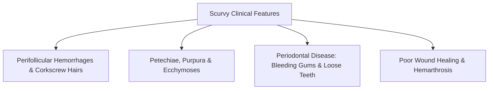

# 56. Water-soluble Vitamins IV: Biotin and Vitamin C

## 1. Vitamin $B_7$ (Biotin)

### Active Form & Reaction Mechanism
* **Active Form:** **Biocytin** (covalently attached to specific $\epsilon$-amino groups of lysine residues in target carboxylase enzymes via *biotin protein ligase / holocarboxylase synthetase*).
* **Biochemical Role:** Serves as a carrier of activated carbon dioxide ($\text{CO}_2$) in **ATP-dependent carboxylation reactions**.

### The 3 Master Biotin-Dependent Carboxylases

| Enzyme | Reaction Catalyzed | Metabolic Pathway & Significance |
| :--- | :--- | :--- |
| **Pyruvate Carboxylase** | $\text{Pyruvate (3C)} + \text{HCO}_3^- + \text{ATP} \rightarrow \text{Oxaloacetate (4C)} + \text{ADP} + \text{P}_i$ | **Anaplerotic reaction and an essential bypass step of gluconeogenesis**; pyruvate carboxylase is not generally the rate-limiting enzyme of the overall gluconeogenic pathway (FBPase-1 is a major rate-controlling step). |
| **Acetyl-CoA Carboxylase (ACC)** | $\text{Acetyl-CoA (2C)} + \text{HCO}_3^- + \text{ATP} \rightarrow \text{Malonyl-CoA (3C)} + \text{ADP} + \text{P}_i$ | **Rate-limiting step of Fatty Acid Synthesis**. |
| **Propionyl-CoA Carboxylase** | $\text{Propionyl-CoA (3C)} + \text{HCO}_3^- + \text{ATP} \rightarrow \text{Methylmalonyl-CoA (4C)} + \text{ADP} + \text{P}_i$ | Catabolism of Odd-Chain Fatty Acids and **VOMIT** amino acids. |

### Etiologies & Manifestations of Biotin Deficiency
* **Raw Egg White Ingestion:** Raw egg whites contain **Avidin**, a heat-labile glycoprotein that binds biotin with extraordinarily high affinity ($K_d \approx 10^{-15}\text{ M}$), preventing intestinal absorption.
* **Inborn Errors:** Holocarboxylase synthetase or biotinidase deficiency.
* **Clinical Presentation:** Periorificial dermatitis, alopecia, hypotonia, lethargy, sensory paresthesias, enteritis, and **lactic acidosis** (due to pyruvate accumulation secondary to pyruvate carboxylase block).

---

## 2. Vitamin C (Ascorbic Acid)

### Biochemical Functions & Enzymatic Actions
1. **Collagen Synthesis (Prolyl & Lysyl Hydroxylation):** Acts as an essential reducing agent to maintain iron in the reduced **$\text{Fe}^{2+}$** ferrous state required by *Prolyl Hydroxylase* and *Lysyl Hydroxylase* inside the ER lumen.
2. **Catecholamine Synthesis:** Cofactor for *Dopamine $\beta$-Hydroxylase* ($\text{Dopamine} \rightarrow \text{Norepinephrine}$).
3. **Iron Absorption Enhancement:** Reduces non-heme ferric iron ($\text{Fe}^{3+}$) to ferrous iron ($\text{Fe}^{2+}$) in the gastric and duodenal lumen, markedly increasing intestinal iron uptake.
4. **Antioxidant Action:** Scavenges aqueous reactive oxygen species and recycles oxidized vitamin E radicals.

### Clinical Deficiency: Scurvy (The 4 Ps)
Failure of prolyl/lysyl hydroxylation prevents stable collagen triple-helix formation, leading to capillary fragility and connective tissue breakdown:

* **Other Features:** Anemia (due to chronic blood loss and impaired iron absorption), subperiosteal hematomas in children.

### Toxicity & Excess Risks
* High-dose ascorbic acid supplementation metabolizes to **Oxalate**, precipitating **Calcium Oxalate Nephrolithiasis (Kidney Stones)**.
* Can trigger iron overload crises in patients with **Hemochromatosis**.

---

## High-Yield NEET PG / INI-CET Points
* **Raw Egg White Binding Protein:** **Avidin** (binds Biotin).
* **Biotin-Dependent Reaction Type:** **ATP-dependent Carboxylations**.
* **Vitamin C Role in Collagen:** Keeps iron in reduced **$\text{Fe}^{2+}$ state** for Prolyl/Lysyl Hydroxylase.
* **Four Ps of Scurvy:** **Perifollicular hemorrhage, Petechiae, Periodontal disease, Poor wound healing**.
* **Vitamin C Impact on Iron:** Converts $\text{Fe}^{3+} \rightarrow \text{Fe}^{2+}$ to enhance duodenal absorption.
* **Toxicity Risk of Vitamin C Overdose:** **Calcium Oxalate Kidney Stones**.

---
