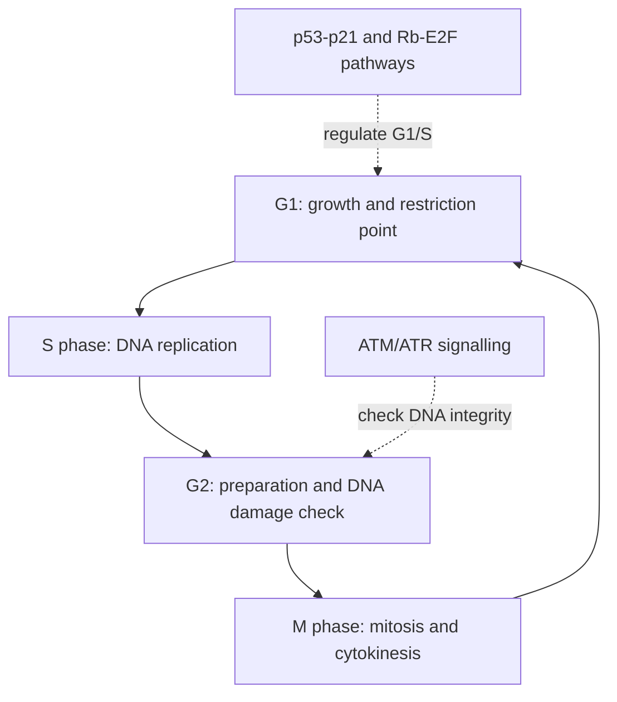
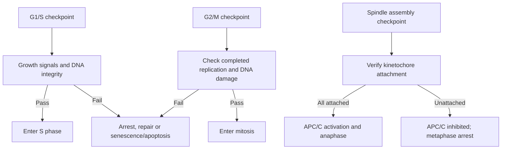
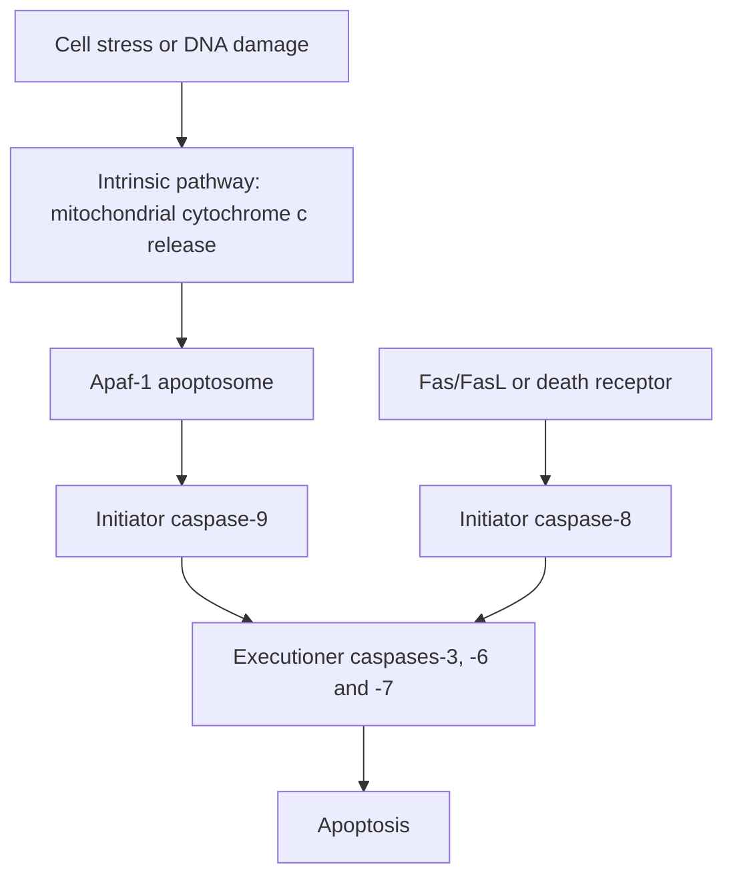

# 57. The Cell Cycle

The **cell cycle** is a tightly regulated, ordered sequence of events by which a cell duplicates its genetic material and divides into two daughter cells. Proper regulation is essential for tissue homeostasis, development, and genomic integrity; dysregulation is a central hallmark of carcinogenesis.

---

## 1. Phases of the Cell Cycle

### A. Interphase (95% of Cell Cycle Duration)
1. **$G_1$ Phase (Gap 1):**
   * *Events:* Rapid cell growth, organelle biogenesis, intense RNA and protein synthesis.
   * *Duration:* Most variable phase (determines overall cell cycle length).
   * *G0 Phase (Quiescence):* Non-dividing, metabolically active state entered from $G_1$. Can be reversible (e.g., hepatocytes upon partial hepatectomy) or permanent/terminal (e.g., neurons, cardiac myocytes).
2. **S Phase (Synthesis):**
   * *Events:* Nuclear **DNA replication** (DNA content doubles from 2C to 4C while the cell remains diploid, 2n, until chromosome segregation) and histone protein synthesis. Centrosomes duplicate.
   * *Duration:* $\sim 6–8\text{ hours}$.
3. **$G_2$ Phase (Gap 2):**
   * *Events:* Synthesis of proteins required for cell division (tubulin for mitotic spindle), growth verification, and DNA damage repair.
   * *Duration:* $\sim 3–4\text{ hours}$.

### B. M Phase (Mitosis and Cytokinesis)
* **Karyokinesis (Mitosis):** Divided into **Prophase** (chromatin condensation, centrosome migration), **Prometaphase** (nuclear envelope breakdown, kinetochore attachment), **Metaphase** (chromosomal alignment at equatorial plate), **Anaphase** (sister chromatid separation via cohesin cleavage), and **Telophase** (nuclear membrane reconstitution, chromatin decondensation).
* **Cytokinesis:** Cleavage furrow formation via actin-myosin contractile ring resulting in physical cell division.

---

## 2. Molecular Regulators: Cyclins and Cyclin-Dependent Kinases (CDKs)

Transition through the cell cycle is driven by serine/threonine protein kinases called **CDKs**, which are enzymatically active only when complexed with regulatory proteins called **Cyclins**.

| Phase Transition | Cyclin | CDK Partner | Key Substrates & Functions |
| :--- | :--- | :--- | :--- |
| **Early $G_1$** | **Cyclin D** | **CDK4 / CDK6** | Phosphorylates Retinoblastoma protein ($Rb$), releasing $E2F$ |
| **Late $G_1 \rightarrow S$** | **Cyclin E** | **CDK2** | Hyperphosphorylates $Rb$; promotes $S$-phase entry |
| **$S$ Phase** | **Cyclin A** | **CDK2** | Activates replication origins (pre-RC activation); drives DNA synthesis |
| **$G_2 \rightarrow M$** | **Cyclin B** | **CDK1 (CDC2)** | Forms **Mitosis-Promoting Factor (MPF)**; drives nuclear envelope breakdown & spindle assembly |

### Regulation of CDK Activity
1. **Phosphorylation/Dephosphorylation:**
   * **CAK (CDK-Activating Kinase):** Phosphorylates thr-160 residue to activate CDK.
   * **Wee1 Kinase:** Phosphorylates inhibitory sites (Thr-14, Tyr-15) to keep MPF inactive during $G_2$.
   * **Cdc25 Phosphatase:** Removes inhibitory phosphates to trigger rapid $M$-phase entry.
2. **CDK Inhibitors (CKIs):**
   * **INK4 Family ($p16^{INK4a}, p15, p18, p19$):** Specifically inhibit CDK4 and CDK6 in early $G_1$. Mutation/loss of $p16$ is frequent in melanoma and pancreatic cancer.
   * **CIP/KIP Family ($p21^{CIP1/WAF1}, p27^{KIP1}, p57$):** Broadly inhibit Cyclin E-CDK2, Cyclin A-CDK2, and Cyclin B-CDK1 complexes. Expression of $p21$ is directly induced by **$p53$**.

---

## 3. Cell Cycle Checkpoints

Checkpoints are quality-control mechanisms that arrest the cell cycle if DNA is damaged or cellular processes are incomplete.

1. **$G_1/S$ Checkpoint (Restriction Point / R-Point):**
   * *Mechanism:* Unphosphorylated $Rb$ binds and sequesters the $E2F$ transcription factor. Mitogenic growth factors induce **Cyclin D**, which complex with **CDK4/6** to partially phosphorylate $Rb$. **Cyclin E-CDK2** then hyperphosphorylates $Rb$, releasing active $E2F$. $E2F$ transactivates genes for $S$-phase entry (DNA Polymerase $\alpha$, Thymidine kinase, DHFR).
   * *DNA Damage Response:* $p53$ is stabilized by ATM/ATR phosphorylation, transactivating $p21$, which arrests the cycle in $G_1$.
2. **$G_2/M$ Checkpoint:**
   * *Mechanism:* Prevents mitotic entry in the presence of uncorrected DNA damage or incomplete DNA replication.
   * *Sensors:* **ATM** (double-strand breaks) and **ATR** (RPA-coated single-stranded DNA/replication stress, including stalled forks) activate **Chk1/Chk2** kinases, which phosphorylate and inhibit **Cdc25**, keeping Cyclin B-CDK1 inactive.
3. **Spindle Assembly Checkpoint (SAC / M-Checkpoint):**
   * *Mechanism:* Ensures all kinetochores are properly attached to spindle microtubules at the metaphase plate before anaphase initiation.
   * *Effector:* Unattached kinetochores activate the Mitotic Checkpoint Complex (MCC / Mad2-BubR1), inhibiting **APC/C (Anaphase-Promoting Complex/Cyclosome)**. Once attached, APC/C ubiquitinates **Securin**, releasing **Separase** to cleave **Cohesin** and allow chromatid segregation.

---

## 4. Tumor Suppressor Genes and Oncogenes

| Category | Normal Function | Mechanism of Activation/Loss | Clinical Examples |
| :--- | :--- | :--- | :--- |
| **$p53$ (Guardian of Genome)** | Transcription factor triggering $p21$ (growth arrest), DNA repair, or Bax/Puma (apoptosis) | Loss-of-function mutation on chromosome 17p | **Li-Fraumeni Syndrome** (sarcomas, breast, brain, adrenal cancers); present in $>50\%$ human tumors |
| **$Rb$ (Retinoblastoma)** | $E2F$ sequestration; negative regulator of $G_1 \rightarrow S$ | Two-hit loss of 13q14 | **Retinoblastoma** (leukocoria), **Osteosarcoma** |
| **Proto-Oncogenes** | Promote normal cell growth/proliferation | Gain-of-function point mutation, amplification, or translocation | **Ras** (GTPase), **Myc** (translocation $t(8;14)$ in Burkitt lymphoma), **HER2/neu** ($ERBB2$ amplification in breast cancer) |

---

## 5. Apoptosis (Programmed Cell Death)

Apoptosis is an energy-dependent ($ATP$-requiring) pathway of cell death characterized by cell shrinkage, pyknosis (nuclear condensation), karyorrhexis (fragmentation), membrane blebbing, and formation of apoptotic bodies without surrounding inflammation.

### Key Differences: Apoptosis vs. Necrosis

| Feature | Apoptosis | Necrosis |
| :--- | :--- | :--- |
| **Mechanism** | Gene-regulated, $ATP$-dependent execution | Uncontrolled, $ATP$-depleted cell lysis |
| **Cell Volume** | Shrinkage, membrane blebbing | Swelling, membrane disruption |
| **Chromatin** | Internucleosomal DNA fragmentation ($180–200\text{ bp}$ ladder on agarose gel) | Smear pattern of random DNA degradation |
| **Inflammation** | **Absent** (phagocytosis by macrophages via phosphatidylserine exposure) | **Present** (pro-inflammatory cellular contents released) |

---

## High-Yield NEET PG / INI-CET Clinical Facts

* **E7 Protein of HPV:** Binds and inactivates $Rb$.
* **E6 Protein of HPV:** Binds and targets $p53$ for ubiquitin-mediated proteasomal degradation.
* **Flow Cytometry / DNA Content:** $G_1/G_0$ cells have 2C DNA content, S-phase cells range from 2C to 4C, and $G_2/M$ cells have 4C DNA content. These are DNA-content (C-value) descriptions; ploidy remains 2n in ordinary diploid somatic cells before anaphase.
* **Bcl-2 Overexpression:** $t(14;18)$ translocation in **Follicular Lymphoma** places $BCL2$ under the heavy-chain Ig promoter, blocking cytochrome c release and preventing apoptosis.

---

## Related Notes
* 60 Structure of DNA
* 63 Replication of DNA Part 1
* 65 DNA Damage and Repair
* 08 Tertiary Quaternary Structure and Collagen
