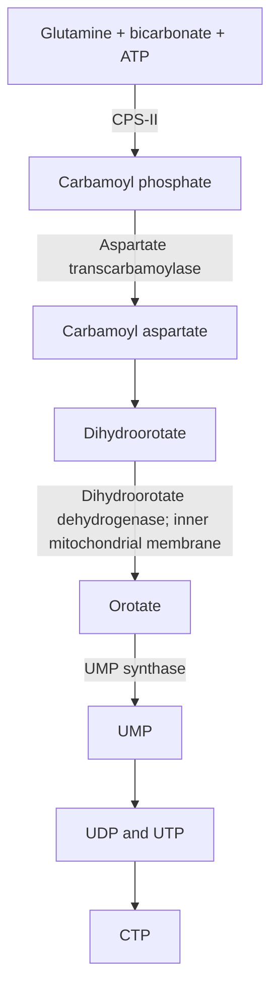
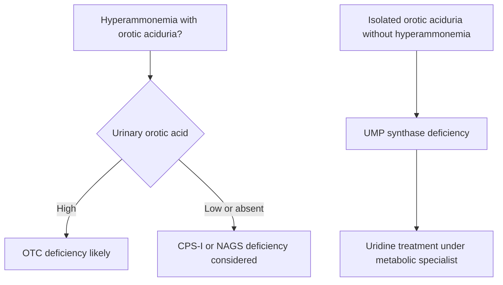

# 58. Pyrimidine Metabolism

Pyrimidines (**Cytosine, Thymine, Uracil**) are six-membered heterocyclic aromatic rings containing two nitrogen atoms and four carbon atoms. Unlike purine de novo synthesis where the purine ring is constructed directly upon a ribose-5-phosphate base, **the pyrimidine ring is synthesized first as a free base (orotate) and subsequently attached to PRPP**.

---

## 1. De Novo Pyrimidine Biosynthesis Pathway

The pyrimidine ring atoms are derived from three simple precursors:
* **Glutamine:** Contributes $N3$.
* **$CO_2$ (Bicarbonate):** Contributes $C2$.
* **Aspartate:** Contributes $C4, C5, C6$, and $N1$.

### Detailed Enzymatic Steps
1. **Formation of Carbamoyl Phosphate:**
   $$\text{Glutamine} + \text{CO}_2 + 2\text{ ATP} \xrightarrow{\text{CPS-II}} \text{Carbamoyl Phosphate} + \text{Glutamate} + 2\text{ ADP} + P_i$$
   * **Rate-limiting enzyme:** **Carbamoyl Phosphate Synthetase II (CPS-II)** located in the **cytosol**.
   * *Regulation:* Activated by **PRPP** and **ATP**; inhibited by **UTP**.
2. **Condensation with Aspartate:**
   * Catalyzed by **Aspartate Transcarbamoylase (ATCase)** to yield carbamoyl aspartate.
3. **Ring Closure:**
   * **Dihydroorotase** closes the ring to form Dihydroorotate.
4. **Oxidation:**
   * **Dihydroorotate Dehydrogenase** oxidizes dihydroorotate to **Orotate**.
   * *Unique Feature:* This is the **only mitochondrial enzyme** in pyrimidine de novo synthesis (located on the inner mitochondrial membrane). Target of the disease-modifying antirheumatic drug **Leflunomide**.
5. **Conversion to UMP by UMP Synthase:**
   * A single bifunctional cytosolic polypeptide enzyme **UMP Synthase** contains two catalytic domains:
     1. *Orotate Phosphoribosyltransferase:* Transfers orotate onto PRPP to yield **OMP**.
     2. *Orotidylate Decarboxylase:* Decarboxylates OMP to yield **UMP**.

---

## 2. Comparison: CPS-I vs. CPS-II

| Parameter | CPS-I | CPS-II |
| :--- | :--- | :--- |
| **Metabolic Pathway** | **Urea Cycle** | **De Novo Pyrimidine Synthesis** |
| **Subcellular Location** | Mitochondria | Cytosol |
| **Nitrogen Source** | Free Ammonium ($\text{NH}_4^+$) | Amide nitrogen of **Glutamine** |
| **Allosteric Activator** | **$N$-Acetylglutamate (NAG)** | **PRPP**, **ATP** |
| **Allosteric Inhibitor** | None significant | **UTP** |

---

## 3. Production of dTMP and Folate Cycle Interdependence

Synthesis of **dTMP** from **dUMP** is catalyzed by **Thymidylate Synthase**, using $N^5,N^{10}$-methylene-THF as the methyl group donor and reducing agent, generating Dihydrofolate (DHF).

$$\text{dUMP} + N^5,N^{10}\text{-methylene-THF} \xrightarrow{\text{Thymidylate Synthase}} \text{dTMP} + \text{DHF}$$

* **DHF Reductase (DHFR):** Converts DHF back to THF using $NADPH$.
* **5-Fluorouracil (5-FU):** Converted intracellularly to 5-FdUMP, which acts as a **suicide inhibitor** of Thymidylate Synthase.
* **Methotrexate / Trimethoprim / Pyrimethamine:** Competitive inhibitors of **DHFR**, draining $N^5,N^{10}$-methylene-THF pools and halting dTMP and purine synthesis.

---

## 4. Inborn Errors and Clinical Correlations

### A. Hereditary Orotic Aciduria (Autosomal Recessive)
* **Enzyme Defect:** Deficiency of bifunctional **UMP Synthase** (Orotate phosphoribosyltransferase and/or Orotidylate decarboxylase).
* **Pathophysiology:** Inability to convert orotate to UMP leads to massive accumulation and urinary excretion of orotic acid, alongside UTP deficiency (removing feedback inhibition on CPS-II, driving further orotate overproduction).
* **Clinical Features:**
  1. Severe **Megaloblastic Anemia** refractory to Vitamin $B_{12}$ and Folate therapy.
  2. Developmental delay, physical retardation, and failure to thrive.
  3. Excretion of white orotic acid needle-like crystals in urine.
* **Treatment:** Oral **Uridine** administration. Uridine is phosphorylated to UMP via salvage pathways, bypassing the enzymatic block and feedback-inhibiting CPS-II to stop orotate overproduction.

### B. Pharmacological Inhibitors of Pyrimidine Synthesis

| Drug | Target Enzyme | Clinical Indication |
| :--- | :--- | :--- |
| **Leflunomide** | Dihydroorotate Dehydrogenase | Rheumatoid Arthritis, Psoriatic Arthritis |
| **Hydroxyurea** | Ribonucleotide Reductase | Sickle Cell Anemia ($HbF$ induction), Myeloproliferative Neoplasms |
| **5-Fluorouracil (5-FU)** | Thymidylate Synthase (via 5-FdUMP) | Colorectal, Gastric, and Breast Cancers |
| **Methotrexate** | Dihydrofolate Reductase (DHFR) | Acute Lymphoblastic Leukemia, Choriocarcinoma, RA |

---

## Related Notes
* 44 Urea Cycle and Overview of Amino Acid Catabolism
* 55 Water Soluble Vitamins III Folate and Vitamin B12
* 59 Purine Metabolism
* 60 Structure of DNA
