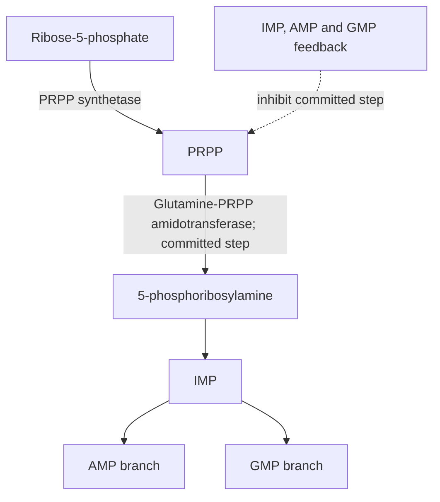
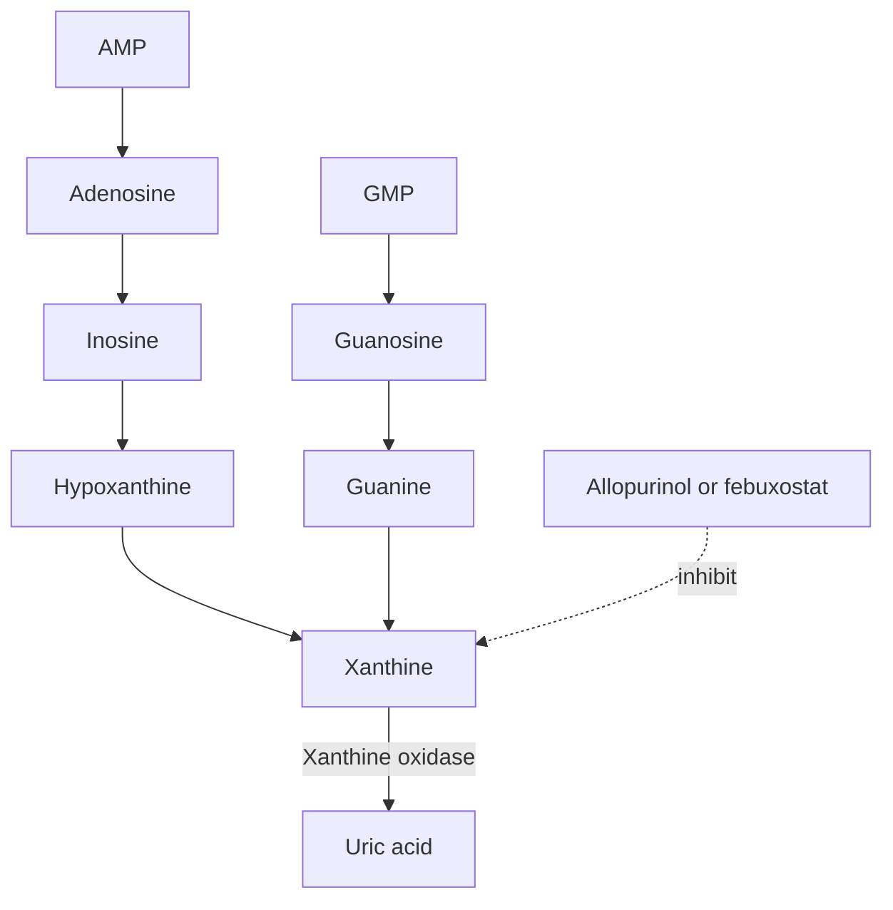

# 59. Purine Metabolism

Purines (**Adenine and Guanine**) consist of a fused bicyclic pyrimidine-imidazole ring system. Purine nucleotides serve as essential building blocks for DNA and RNA, cellular energy carriers ($ATP, GTP$), coenzymes ($NAD^+, FAD, CoA$), and second messengers ($cAMP, cGMP$).

---

## 1. De Novo Purine Biosynthesis

De novo purine synthesis occurs predominantly in the **liver cytosol**. Unlike pyrimidine synthesis, **the purine ring is assembled directly step-by-step onto a pre-existing Ribose-5-Phosphate scaffold**.



### Origin of Ring Atoms in Purines
* **$N1$:** Aspartate.
* **$C2$ & $C8$:** $N^{10}$-Formyl-THF.
* **$N3$ & $N9$:** Glutamine (amide nitrogen).
* **$C4, C5, N7$:** **Glycine** (entire molecule incorporated).
* **$C6$:** Respiratory $CO_2$ (bicarbonate).

### Key Enzymatic Steps & Regulation
1. **PRPP Formation:** Ribose-5-phosphate (from Pentose Phosphate Pathway) is converted to PRPP by **PRPP Synthetase**.
2. **Committed Step:** **PRPP Glutamyl Amidotransferase** replaces the pyrophosphate of PRPP with the amide group of glutamine.
   * *Inhibition:* Feedback-inhibited by end-products **AMP, GMP, and IMP**.
   * *Activation:* Feed-forward activated by high concentrations of **PRPP**.
3. **Branch Point at IMP:**
   * **IMP $\rightarrow$ AMP:** Requires **GTP** and Aspartate (catalyzed by Adenylosuccinate Synthetase).
   * **IMP $\rightarrow$ GMP:** Requires **ATP** and Glutamine (catalyzed by IMP Dehydrogenase; targeted by **Mycophenolate Mofetil**).

---

## 2. Purine Salvage Pathway

Brain and bone marrow have limited capacity for de novo purine synthesis and rely heavily on the **Salvage Pathway**, which recycles free purine bases released during nucleic acid breakdown.

```
Free Base + PRPP ------------> Nucleotide + PPi
```

| Enzyme | Reaction Catalyzed | Clinical Significance |
| :--- | :--- | :--- |
| **HGPRT** (Hypoxanthine-Guanine Phosphoribosyltransferase) | $\text{Hypoxanthine} + \text{PRPP} \rightarrow \text{IMP} + PP_i$<br>$\text{Guanine} + \text{PRPP} \rightarrow \text{GMP} + PP_i$ | Defect causes **Lesch-Nyhan Syndrome** or **Kelley-Seegmiller Syndrome** |
| **APRT** (Adenine Phosphoribosyltransferase) | $\text{Adenine} + \text{PRPP} \rightarrow \text{AMP} + PP_i$ | Defect causes 2,8-dihydroxyadenine urolithiasis |

---

## 3. Degradation of Purines to Uric Acid

Purine nucleotides are degraded to the end-product **Uric Acid** in humans (humans lack uricase due to evolutionary gene inactivation).

$$\text{Adenosine} \xrightarrow{\text{ADA}} \text{Inosine} \rightarrow \text{Hypoxanthine} \xrightarrow{\text{Xanthine Oxidase}} \text{Xanthine} \xrightarrow{\text{Xanthine Oxidase}} \mathbf{\text{Uric Acid}}$$
$$\text{Guanosine} \rightarrow \text{Guanine} \rightarrow \text{Xanthine} \xrightarrow{\text{Xanthine Oxidase}} \mathbf{\text{Uric Acid}}$$



---

## 4. Inborn Errors and Clinical Correlations

### A. Lesch-Nyhan Syndrome (X-Linked Recessive)
* **Enzyme Defect:** Complete absence of **HGPRT**.
* **Pathophysiology:** Inability to salvage hypoxanthine and guanine leads to accumulation of PRPP. Unused PRPP drives massive overactivation of de novo purine synthesis, resulting in extreme **Hyperuricemia**.
* **Clinical Manifestations:**
  1. **Severe Gouty Arthritis** and tophi.
  2. **Mental Retardation**, choreoathetosis, and spasticity.
  3. **Compulsive Self-Mutilation** (biting of lips and fingers).
  4. Orange "sand-like" sodium urate crystals in diapers causing nephrolithiasis.

### B. Adenosine Deaminase (ADA) Deficiency (Autosomal Recessive)
* **Pathophysiology:** Absence of ADA causes accumulation of adenosine and $dATP$. High $dATP$ toxic levels inhibit **Ribonucleotide Reductase**, preventing DNA synthesis in proliferating lymphocytes.
* **Clinical Manifestation:** Accounts for $15–20\%$ of **Severe Combined Immunodeficiency (SCID)** cases, characterized by total absence of functional T-cells and B-cells, profound lymphopenia, and early fatal opportunistic infections.

### C. Gout (Hyperuricemia)
Defined as serum urate $>6.8\text{ mg/dL}$ (saturation threshold). Deposition of **monosodium urate (MSU)** crystals in joints triggers acute inflammatory arthritis.
* **Arthrocentesis:** **Needle-shaped crystals** exhibiting **strong negative birefringence** under polarized light (yellow when parallel to red compensator axis).
* **Etiology:**
  * *Underexcretion ($90\%$ of cases):* Renal failure, thiazide diuretics, lead nephropathy ("saturnine gout").
  * *Overproduction ($10\%$ of cases):* Tumor lysis syndrome, psoriasis, Lesch-Nyhan syndrome, PRPP synthetase superactivity.
* **Pharmacotherapy:**
  * *Acute Gout:* NSAIDs (Indomethacin), Colchicine (inhibits neutrophil microtubule polymerization), Glucocorticoids.
  * *Chronic / Prophylactic Gout:* **Allopurinol** and **Febuxostat** (Xanthine Oxidase inhibitors; Allopurinol is metabolized to oxypurinol, a suicide inhibitor); **Probenecid** (uricosuric agent blocking URAT1 renal reabsorption); **Pegloticase** (recombinant uricase converting uric acid to soluble allantoin).

---

## Related Notes
* 58 Pyrimidine Metabolism
* 60 Structure of DNA
* 72 Diagnostic Clinical Biochemistry
