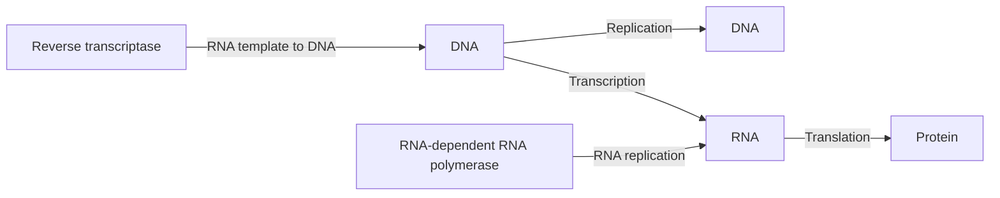
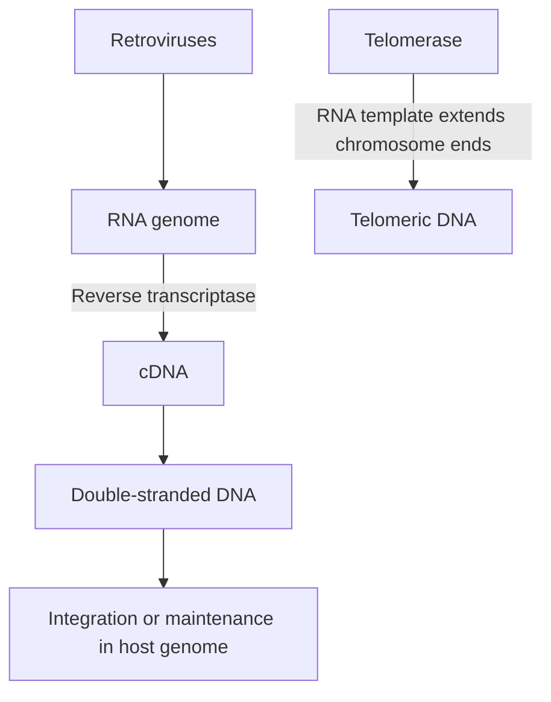

# 61. The Central Dogma of Molecular Biology

Formulated by Francis Crick in 1958, the **Central Dogma of Molecular Biology** describes the directional flow of genetic information within a biological system: **DNA makes RNA, and RNA makes Protein**.

---

## 1. Classical Information Flow

1. **Replication:** Duplication of genomic DNA prior to cell division ($DNA \rightarrow DNA$).
2. **Transcription:** Enzymatic synthesis of RNA complementary to a DNA template ($DNA \rightarrow RNA$).
3. **Translation:** Ribosomal decoding of $mRNA$ sequences into amino acid polypeptide chains ($RNA \rightarrow Protein$).

---

## 2. Revisions and Exceptions to the Central Dogma

Subsequent discoveries expanded the classical linear paradigm:

### A. Reverse Transcription ($RNA \rightarrow DNA$)
* Executed by the enzyme **Reverse Transcriptase** (RNA-dependent DNA Polymerase).
* Discovered by Howard Temin and David Baltimore in retroviruses (e.g., **HIV**, HTLV-1).
* Essential component of human **Telomerase** (TERT subunit) and retrotransposons ($LINEs, SINEs$).

### B. RNA Replication ($RNA \rightarrow RNA$)
* Executed by **RNA-dependent RNA Polymerases (RdRP)**.
* Utilized by RNA viruses (e.g., Poliovirus, Influenza, Rabies, SARS-CoV-2) to replicate their viral RNA genomes within host cells.

### C. Prion Diseases ($Protein \rightarrow Protein$ Conformational Transfer)
* Infectious proteins (**PrP$^{Sc}$**) induce non-covalent conformational misfolding of endogenous normal cellular prion proteins (**PrP$^C$**) into pathogenic $\beta$-sheet aggregates without altering genetic nucleic acid sequences.

---

## 3. Functional Classification of RNA Molecules

While only coding RNA ($mRNA$) is translated into protein, non-coding RNAs (ncRNAs) play crucial regulatory and structural roles:

| RNA Type | Abundance / Size | Functional Role |
| :--- | :--- | :--- |
| **Messenger RNA (mRNA)** | $\sim 3–5\%$ of cellular RNA | Coding template carrying genetic codons from nucleus to cytoplasm |
| **Ribosomal RNA (rRNA)** | **$\sim 80\%$ of total cellular RNA** (Most abundant) | Structural and catalytic core of ribosomes; peptidyl transferase ribozyme activity |
| **Transfer RNA (tRNA)** | $\sim 15\%$ of total cellular RNA | Small adapter RNA ($73–93\text{ nt}$); transfers specific amino acids to ribosome during translation |
| **snRNA** (Small Nuclear) | Nucleus | Forms snRNPs ($U1, U2, U4, U5, U6$) within the **Spliceosome** to process pre-mRNA |
| **snoRNA** (Small Nucleolar) | Nucleolus | Directs site-specific chemical base modifications (methylation, pseudouridylation) of pre-rRNA |
| **miRNA / siRNA** | $21–23\text{ nt}$ | Post-transcriptional gene silencing via RISC complex (RNA Interference) |

---

## Related Notes
* 60 Structure of DNA
* 63 Replication of DNA Part 1
* 66 Transcription of DNA to Make Messenger RNA Part 1
* 70 Translation and Protein Synthesis
