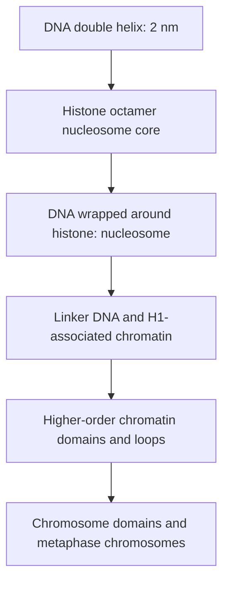

# 62. Organisation of DNA in Chromosomes

Human diploid cells contain approximately 2 meters of linear DNA ($6 \times 10^9\text{ bp}$) packaged within a nucleus only $5–10\text{ }\mu\text{m}$ in diameter. Achieving a **condensation ratio of over $10,000$-fold** requires precise hierarchical packaging into **Chromatin**.

---

## 1. Structural Packaging Hierarchy



1. **2 nm:** Naked double-stranded DNA double helix.
2. **11 nm ("Beads-on-a-String"):** Core nucleosome chain.
3. **30 nm Fiber:** Solenoid coiled structure stabilized by Linker Histone **H1**.
4. **300 nm Loop Domains:** Chromatin loops anchored to nuclear scaffold proteins (topoisomerase II, condensin).
5. **1400 nm Metaphase Chromosome:** Fully condensed mitotic state.

---

## 2. The Nucleosome: Fundamental Unit of Chromatin

```
                         [Histone Octamer Core]
                   (2x H2A, 2x H2B, 2x H3, 2x H4)
                                 |
                 Wrapped by 1.65 Left-Handed Turns 
                   of dsDNA (~146-147 base pairs)
                                 |
                        [Linker Histone H1]
                    Binds ~20 bp Linker DNA Region
```

### Histone Proteins
* **Basic Properties:** Small, highly conserved proteins rich in positively charged basic amino acids (**Lysine and Arginine**), allowing electrostatic binding to the negatively charged polyanionic phosphate backbone of DNA.
* **Core Octamer:** Composed of two molecules each of **H2A, H2B, H3, and H4** ($[H2A-H2B]_2 \cdot [H3-H4]_2$).
* **Linker Histone:** **H1** binds to linker DNA ($\sim 20–80\text{ bp}$) between nucleosome cores, sealing DNA at the entry/exit site to promote 30 nm fiber folding. (Note: H1 is **not** part of the nucleosome octamer core).

---

## 3. Euchromatin vs. Heterochromatin

| Feature | Euchromatin | Heterochromatin |
| :--- | :--- | :--- |
| **Structure & Density** | Uncondensed, open configuration | Highly condensed, dense configuration |
| **Transcriptional State** | **Active** (accessible to transcription factors) | **Inactive / Silent** |
| **Location** | Central nuclear interior | Nuclear periphery (attached to lamina) |
| **DNA Methylation** | Low (hypomethylated CpG islands) | High (**hypermethylated**) |
| **Histone Acetylation** | **High** (hyperacetylated via HATs) | **Low** (deacetylated via HDACs) |
| **Histone Methylation Marks** | H3K4me3, H3K36me3 | **H3K9me3**, **H3K27me3** |
| **Examples** | Housekeeping and active tissue genes | **Barr Body** (inactivated female X chromosome), Centromeres, Telomeres |

---

## 4. Telomeres and the Shelterin Complex

**Telomeres** are specialized non-coding nucleoprotein caps at the ends of eukaryotic linear chromosomes consisting of tandem repetitive sequences (**$5'\text{-TTAGGG-3'}$** in humans) terminating in a single-stranded $3'$ overhang.

```
       3' TTAGGG TTAGGG TTAGGG TTAGGG ---> Single-strand 3' Overhang
                                              |
                                      Invades dsDNA Region 
                                      to form T-Loop Structure
                                              |
                                      Stabilized by SHELTERIN
```

* **Functions:**
  1. Prevents double-stranded chromosome ends from being recognized as double-strand DNA breaks by cellular repair machinery.
  2. Protects chromosomal integrity against end-degradation and end-to-end fusion.
* **Shelterin Complex:** Six-protein complex (TRF1, TRF2, POT1, TIN2, TPP1, RAP1) that sequesters the single-stranded $3'$ overhang into a protective **T-loop** structure.

---

## Related Notes
* 60 Structure of DNA
* 63 Replication of DNA Part 1
* 71 Comparison of DNA Replication Transcription Translation
