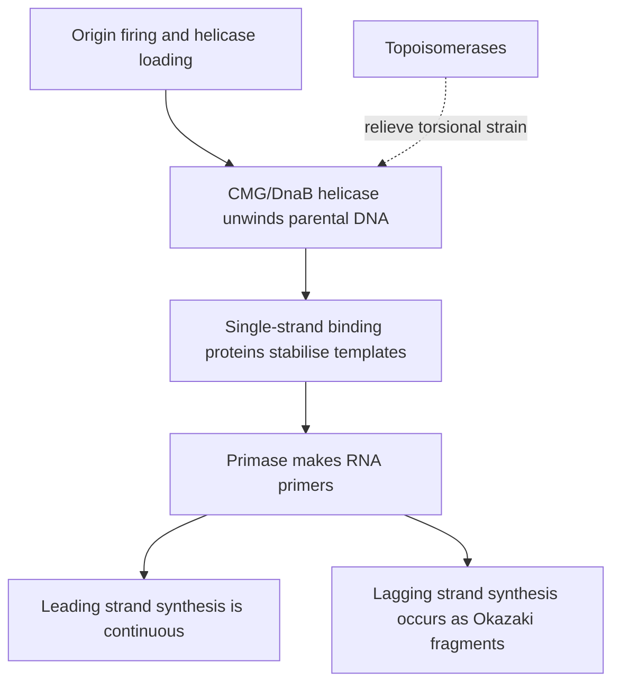

# 63. Replication of DNA (Part 1)

DNA replication is the biological process by which a cell duplicates its entire double-stranded genome with high fidelity prior to cell division. Replication is **semiconservative** (demonstrated by Meselson and Stahl using $^{15}N/^{14}N$ isotopic density labeling), **bidirectional**, and **semidiscontinuous**.

---

## 1. General Principles and Replication Fork Mechanics



* **Origins of Replication:** Specific genomic locus where replication initiates.
  * *Prokaryotes:* Single origin ($oriC$ in *E. coli*).
  * *Eukaryotes:* Multiple tandem origins per chromosome ($\sim 30,000–50,000$ origins in human genome) to ensure complete replication during S-phase.
* **Bidirectionality:** Replication proceeds in opposite directions from each origin, forming two active **Replication Forks**.

---

## 2. Key Initiation and Unwinding Machinery

| Protein / Enzyme (Prokaryote) | Eukaryotic Equivalent | Function |
| :--- | :--- | :--- |
| **DnaA** | **ORC** (Origin Recognition Complex) | Recognizes origin sequences and initiates local unwinding |
| **DnaB (Helicase)** | **CMG helicase (Cdc45–MCM2-7–GINS complex)** | ATP-dependent unwinding of the parental double helix at the eukaryotic replication fork; MCM2–7 is the helicase core |
| **DnaC** | **Cdc6 / Cdt1** | Helicase loader protein |
| **SSB** (Single-Stranded Binding) | **RPA** (Replication Protein A) | Prevents single-stranded DNA from re-annealing or forming secondary structures |
| **DnaG (Primase)** | **Pol $\alpha$ / Primase** | Synthesizes short RNA primers ($\sim 10–20\text{ nt}$) providing free $3'$-OH |
| **DNA Topoisomerase** | **Topoisomerase I & II** | Relieves positive supercoiling strain generated ahead of replication fork |

---

## 3. Mechanics of DNA Topoisomerases

Unwinding of DNA by helicase induces severe positive torsional supercoiling ahead of the fork. Topoisomerases resolve topological stress by cleaving phosphodiester bonds:

```
Topoisomerase I:  Cuts 1 strand  ---> No ATP required  ---> Relieves supercoils
Topoisomerase II: Cuts BOTH strands -> ATP-Dependent     ---> Passes DNA strand through break
```

### Pharmacological & Chemotherapeutic Inhibitors

| Drug Class | Target Enzyme | Clinical Application |
| :--- | :--- | :--- |
| **Fluoroquinolones** (Ciprofloxacin, Levofloxacin) | **Bacterial DNA Gyrase (Topo II)** & Topo IV | Broad-spectrum antibacterial therapy |
| **Etoposide / Teniposide** | **Human Topoisomerase II** | Testicular cancer, Small cell lung cancer, Lymphomas |
| **Irinotecan / Topotecan** | **Human Topoisomerase I** | Colorectal cancer, Ovarian cancer |

---

## Related Notes
* 60 Structure of DNA
* 64 Replication of DNA Part 2
* 71 Comparison of DNA Replication Transcription Translation
