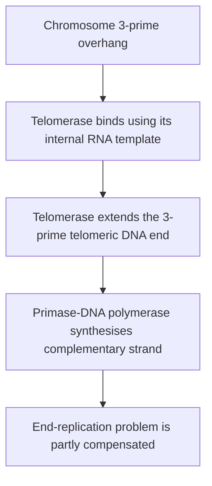

# 64. Replication of DNA (Part 2)

Elongation of new DNA strands is catalyzed by **DNA Polymerases**, which add deoxyribonucleoside triphosphates ($dNTPs$) to the free $3'$-hydroxyl ($3'$-OH) group of a pre-existing primer strand. Synthesis **always proceeds in the $5' \rightarrow 3'$ direction**.

---

## 1. Prokaryotic vs. Eukaryotic DNA Polymerases

```
                 Polymerase Catalytic Reaction
                 
  (DNA)_n + dNTP ------------> (DNA)_{n+1} + PPi (Pyrophosphate)
                       ^
                       +-- Requires 3'-OH Primer and Mg2+ Cofactors
```

### A. Prokaryotic DNA Polymerases (*E. coli*)
* **DNA Polymerase III:** Primary replicative enzyme.
  * $5' \rightarrow 3'$ Polymerase activity (high processivity imparted by $\beta$-clamp subunit).
  * **$3' \rightarrow 5'$ Exonuclease activity** (proofreading and editing mismatched bases).
* **DNA Polymerase I:** Helper enzyme during lagging strand synthesis.
  * **$5' \rightarrow 3'$ Exonuclease activity** (removes RNA primers ahead of it).
  * $5' \rightarrow 3'$ Polymerase activity (fills gaps left after primer removal).
  * $3' \rightarrow 5'$ Exonuclease activity (proofreading).
* **DNA Polymerases II, IV, V:** Involved in translesion synthesis and SOS DNA repair.

### B. Major Eukaryotic DNA Polymerases

| Enzyme | Primary Subcellular Role | Exonuclease ($3' \rightarrow 5'$) |
| :--- | :--- | :--- |
| **Pol $\alpha$** | Initiator: Synthesizes RNA primer + $20\text{ nt}$ DNA stretch | No |
| **Pol $\delta$** | Replicative: **Lagging strand** synthesis (associates with PCNA) | **Yes** |
| **Pol $\epsilon$** | Replicative: **Leading strand** synthesis (associates with PCNA) | **Yes** |
| **Pol $\gamma$** | Mitochondrial DNA replication and repair | **Yes** |
| **Pol $\beta$** | Base Excision Repair (BER) gap filling | No |

*Note:* **PCNA (Proliferating Cell Nuclear Antigen)** functions as the eukaryotic sliding clamp, dramatically increasing processivity of Pol $\delta$ and Pol $\epsilon$.

---

## 2. Leading vs. Lagging Strand Synthesis

Because DNA strands are antiparallel and polymerase synthesizes exclusively $5' \rightarrow 3'$:
* **Leading Strand:** Synthesized **continuously** toward the advancing replication fork (requires only 1 primer).
* **Lagging Strand:** Synthesized **discontinuously** away from the replication fork as short fragments called **Okazaki Fragments** ($\sim 1000–2000\text{ nt}$ in bacteria; $\sim 100–200\text{ nt}$ in eukaryotes).

### Okazaki Fragment Processing & Ligation
1. RNA Primers are removed by **DNA Pol I** (prokaryotes) or **FEN1 / RNase H** (eukaryotes).
2. Gaps are filled by **DNA Pol I** (prokaryotes) or **DNA Pol $\delta$** (eukaryotes).
3. Final phosphodiester nick sealed by **DNA Ligase** (requires $NAD^+$ in bacteria; $ATP$ in eukaryotes).

---

## 3. The End-Replication Problem and Telomerase

Eukaryotic linear chromosomes cannot completely replicate the extreme $5'$ end of lagging strands following RNA primer removal, leading to progressive chromosomal shortening with each cell division.

```
       5' -------------- [RNA Primer] ======> 3'
       3' <--------------------------------- 5'
                           |
                     Primer Removed
                           v
       5' -------------- [GAP AT 5' END] ====> 3'  (Telomere Shortening)
```



* **Telomerase:** Ribonucleoprotein complex composed of **TERT** (reverse transcriptase enzyme) and **TERC** (built-in RNA template $3'\text{-CAAUCCCAAUC-5'}$).
* **Mechanism:** TERT uses its integral RNA template to synthesize $5'\text{-TTAGGG-3'}$ telomeric tandem repeats onto the $3'$ overhang, allowing primase and polymerase to complete lagging strand extension.
* **Clinical Significance:** Active in stem cells, germline cells, and $>85\%$ of human **cancer cells** (conferring cellular immortality); absent or low in somatic cells (driving replicative senescence).

---

## Related Notes
* 60 Structure of DNA
* 62 Organisation of DNA in Chromosomes
* 63 Replication of DNA Part 1
* 65 DNA Damage and Repair
