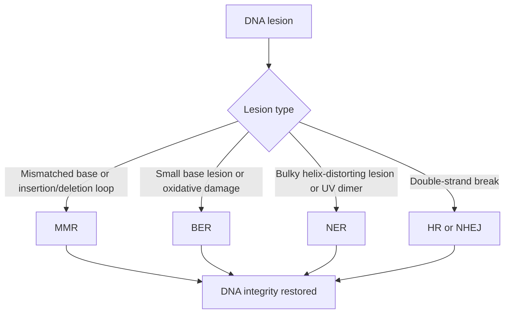
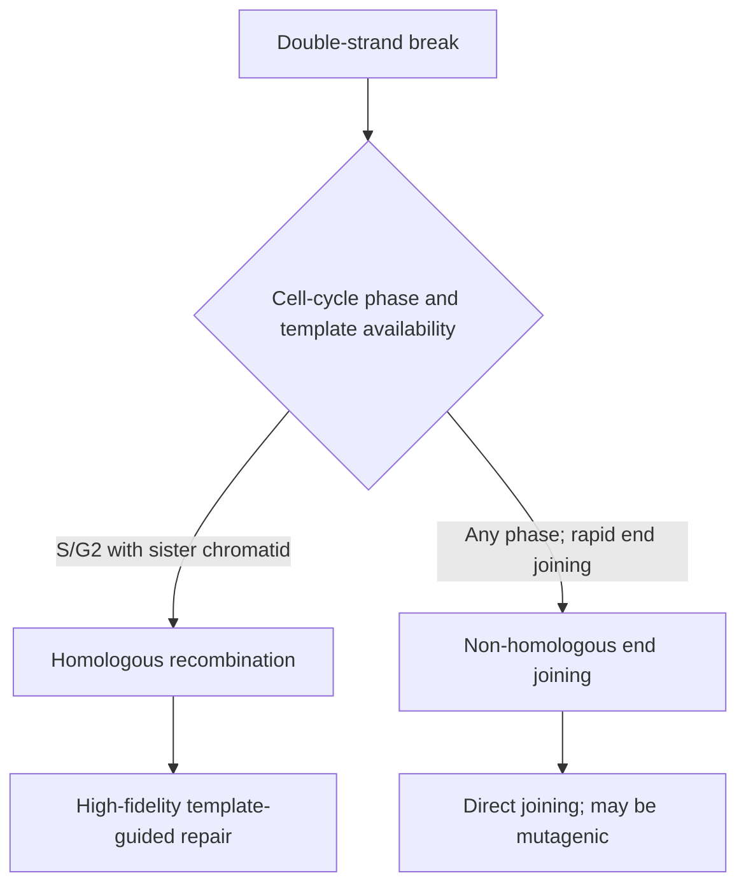

# 65. DNA Damage and Repair

Maintenance of genomic integrity is paramount for cellular survival and prevention of carcinogenesis. Human cells undergo thousands of DNA lesions daily caused by endogenous metabolic oxidants and exogenous environmental agents.

---

## 1. Types of DNA Lesions and Etiology

| Lesion Type | Cause / Etiology | Primary Repair Mechanism |
| :--- | :--- | :--- |
| **Mismatched Bases / Insertion-Deletion Loops** | Replication errors by DNA Polymerase | **Mismatch Repair (MMR)** |
| **Single Base Damage** (Deamination, Depurination, Oxidation) | Spontaneous Cytosine $\rightarrow$ Uracil deamination, $ROS$ | **Base Excision Repair (BER)** |
| **Bulky Pyrimidine / Thymine Dimers** | **UV Light Exposure** ($UV-B$) | **Nucleotide Excision Repair (NER)** |
| **Double-Strand Breaks (DSBs)** | Ionizing Radiation ($\text{X-rays}, \gamma\text{-rays}$), Radiomimetics | **NHEJ** or **Homologous Recombination** |

---

## 2. Major DNA Repair Pathways

### A. Mismatch Repair (MMR)
* **Function:** Corrects non-complementary base pairs and insertion-deletion loops escaping proofreading during replication.
* **Mechanism:** In humans, **MSH2/MSH6** recognises base–base mismatches and small insertion/deletion loops, while **MSH2/MSH3** is particularly important for larger insertion/deletion loops. **MLH1/PMS2** coordinates downstream repair, including strand incision; exonuclease removes the error-containing tract, and DNA polymerase/ligase restore the strand.
* **Associated Clinical Disorder:** **Lynch Syndrome (HNPCC - Hereditary Non-Polyposis Colorectal Cancer)** caused by germline mutation in $MSH2$ or $MLH1$. Characterized by **Microsatellite Instability (MSI)** and high risk of proximal colon, endometrial, and ovarian carcinomas.

### B. Base Excision Repair (BER)
* **Function:** Repairs non-bulky altered single bases (e.g., Cytosine deamination yielding Uracil, $8\text{-oxo-Guanine}$).
* **Mechanism ("GEL-PL"):**
  1. **$DNA\ Glycosylase$:** Recognizes and cleaves altered base from sugar-phosphate backbone, leaving an **AP site** (Apurinic/Apyrimidinic site).
  2. **$AP\ Endonuclease$:** Cleaves phosphodiester backbone at $5'$ end of AP site.
  3. **$AP\ Lyase\ / \text{Phosphodiesterase}$:** Cleaves $3'$ end.
  4. **$DNA\ Polymerase\ \beta$:** Fills single-nucleotide gap.
  5. **$DNA\ Ligase$:** Seals phosphodiester nick.

### C. Nucleotide Excision Repair (NER)
* **Function:** Removes large, helix-distorting bulky lesions (e.g., **UV-induced Pyrimidine/Thymine Dimers**).
* **Mechanism:**
  1. Specific endonuclease (Excinuclease / XP proteins) makes dual cuts on damaged strand flanking lesion ($\sim 24–32\text{ nt}$ apart).
  2. Damaged oligonucleotide fragment is released by helicase.
  3. Gap filled by DNA Polymerase ($\delta/\epsilon$) and sealed by DNA Ligase.
* **Associated Clinical Disorder:** **Xeroderma Pigmentosum (XP)** (Autosomal Recessive mutation in *XPA-XPG* genes).
  * *Clinical Features:* Extreme photosensitivity, dry skin (poikiloderma), severe freckling, and $>1000\times$ risk of skin cancers (basal cell, squamous cell, melanoma) in early childhood.

### D. Double-Strand Break (DSB) Repair Pathways

* **Homologous recombination (HR):** High-fidelity repair using an undamaged homologous template, usually the sister chromatid in S/G2. **BRCA1, BRCA2, and RAD51** are central HR factors; **ATM** is an upstream DNA-damage signalling kinase that coordinates the response rather than a strand-exchange protein.
  * *Clinical Association:* $BRCA1 / BRCA2$ mutations impair HR, predisposing to familial **Breast and Ovarian Cancers**.
* **Non-Homologous End Joining (NHEJ):** Directly ligates broken ends without homologous template. Requires **Ku70/80, DNA-PKcs, and Artemis**.
  * *Clinical Association:* Mutated in **Ataxia-telangiectasia** (ATM kinase defect causing impaired DNA-damage signalling/checkpoint coordination; cerebellar ataxia, oculocutaneous telangiectasias, immunodeficiency, and radiation sensitivity).

---

## Summary Matrix of DNA Repair Disorders

| Inherited Disease | Defective Repair Pathway | Major Clinical Manifestations |
| :--- | :--- | :--- |
| **Xeroderma Pigmentosum** | Nucleotide Excision Repair (NER) | Severe sun sensitivity, $1000\times$ skin cancer risk |
| **Lynch Syndrome (HNPCC)** | Mismatch Repair (MMR) | Colorectal cancer (proximal colon), Endometrial cancer |
| **Ataxia-Telangiectasia** | DNA double-strand-break response/signalling (ATM kinase) | Ataxia, telangiectasias, IgA deficiency, lymphoma risk |
| **BRCA1 / BRCA2 Defect** | Homologous Recombination (HR) | Hereditary breast and ovarian carcinoma |
| **Bloom Syndrome** | BLM Helicase ($RecQ$ family) | Short stature, butterfly facial rash, chromosomal instability |

---

## Related Notes
* 60 Structure of DNA
* 63 Replication of DNA Part 1
* 64 Replication of DNA Part 2
