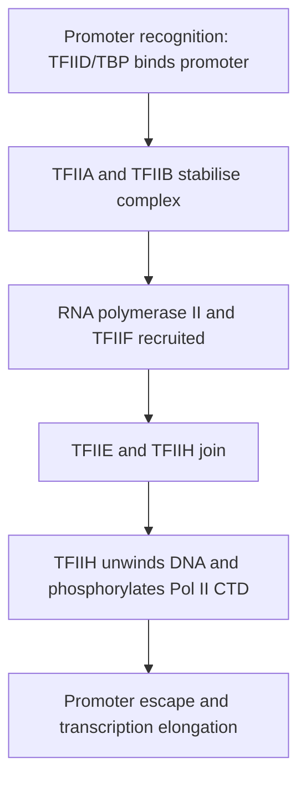

# 66. Transcription of DNA to Make Messenger RNA (Part 1)

**Transcription** is the enzymatic synthesis of RNA using one strand of double-stranded DNA as a template. Catalyzed by **RNA Polymerases**, transcription proceeds in the **$5' \rightarrow 3'$ direction** without requiring a pre-existing primer.

---

## 1. Prokaryotic vs. Eukaryotic RNA Polymerases

### A. Prokaryotic RNA Polymerase
Prokaryotes utilize a **single RNA Polymerase** to synthesize all RNA classes ($mRNA, tRNA, rRNA$).
* **Core Enzyme ($\alpha_2 \beta \beta' \omega$):** Capable of elongation and termination, but cannot recognize specific promoter sequences.
* **Holoenzyme ($\alpha_2 \beta \beta' \omega \mathbf{\sigma}$):** Core enzyme + **Sigma ($\sigma$) factor**. The $\sigma$-factor confers sequence-specific binding to promoter regions.

### B. Eukaryotic RNA Polymerases

| Enzyme | Principal Products | Subcellular Location | Sensitivity to $\alpha$-Amanitin |
| :--- | :--- | :--- | :--- |
| **RNA Polymerase I** | **rRNA** ($28S, 18S, 5.8S$) | Nucleolus | **Insensitive** |
| **RNA Polymerase II** | **mRNA**, $snRNA$, $miRNA$ | Nucleoplasm | **Extremely Sensitive** (Inhibited by low concentration) |
| **RNA Polymerase III** | **tRNA**, **$5S$ rRNA** | Nucleoplasm | Sensitive at high concentration |

* **$\alpha$-Amanitin Toxicity:** Produced by *Amanita phalloides* ("death cap" mushroom). Strong inhibitor of eukaryotic **RNA Polymerase II**, causing severe hepatotoxicity and fulminant liver failure following ingestion.

---

## 2. Promoter Elements and Transcriptional Signals

A **Promoter** is a non-coding regulatory DNA sequence located upstream ($5'$) of the transcription start site ($+1$) that directs binding of RNA polymerase.

```
       Prokaryotic Promoter:
       5' ------ [-35 Box] ------------ [-10 Pribnow Box] -------- [+1 Start] ------ 3'
                 TTGACA                    TATAAT

       Eukaryotic Promoter:
       5' -- [GC / CAAT Box] ---------- [-25 TATA / Hogness Box] -- [+1 Start] ------ 3'
              (-100 to -75)                 TATAAA
```

### A. Prokaryotic Promoters
* **$-10$ Region (Pribnow Box):** Consensus sequence **$5'\text{-TATAAT-3'}$**. Site of initial DNA duplex melting.
* **$-35$ Region:** Consensus sequence **$5'\text{-TTGACA-3'}$**. Recognized by $\sigma$-factor.

### B. Eukaryotic Promoters
* **TATA Box (Hogness Box):** Consensus sequence **$5'\text{-TATAAA-3'}$** located $\sim -25$ to $-30\text{ bp}$ upstream of start site ($+1$). Bound by TBP (TATA-Binding Protein).
* **CAAT Box ($-75$) & GC Box ($-90$):** Upstream promoter elements influencing transcription frequency.
* **Enhancers and Silencers:** Regulatory elements that increase or decrease transcription rate, respectively.
  * *Features:* Can function over vast distances ($>10\text{ kb}$ away), can be located upstream, downstream, or within introns, and operate in **either orientation** ($5'\rightarrow3'$ or $3'\rightarrow5'$).

---

## 3. General Transcription Factors (GTFs) and Pre-Initiation Complex

Eukaryotic RNA Polymerase II cannot bind directly to promoter DNA and requires a assembly of **General Transcription Factors** ($TFIIA, TFIIB, TFIID, TFIIE, TFIIF, TFIIH$).



* **TFIIH Functions:**
  1. **Helicase activity:** Unwinds promoter double helix to form open complex.
  2. **Kinase activity:** Phosphorylates C-Terminal Domain (CTD) of RNA Pol II, triggering promoter clearance and transition into elongation.

---

## Related Notes
* 61 The Central Dogma of Molecular Biology
* 67 Transcription of DNA to Make Messenger RNA Part 2
* 71 Comparison of DNA Replication Transcription Translation
