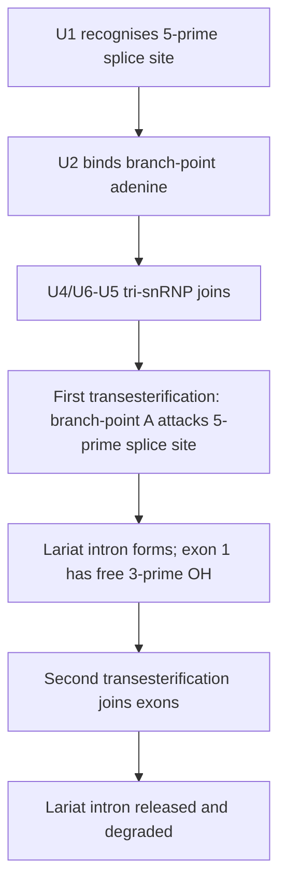
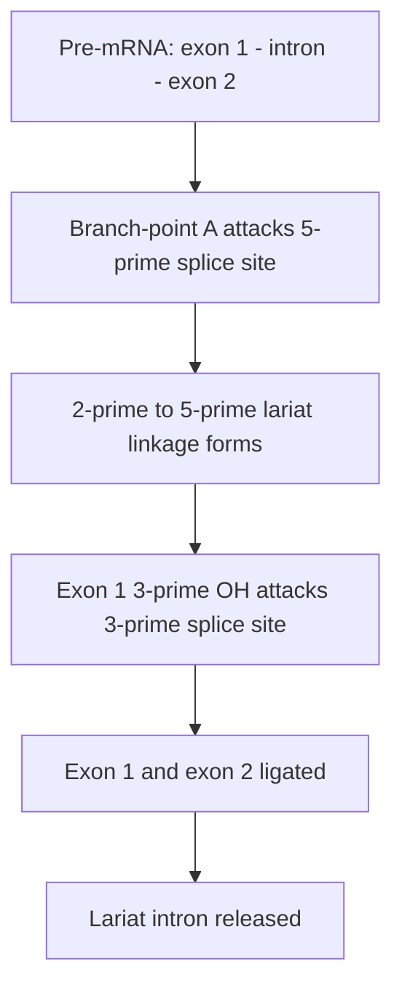

# 67. Transcription of DNA to Make Messenger RNA (Part 2)

In eukaryotes, primary transcripts (**pre-mRNA / heterogeneous nuclear RNA [hnRNA]**) are non-functional and must undergo extensive **co-transcriptional and post-transcriptional processing** inside the nucleus before export to the cytoplasm for translation.

---

## 1. Co-Transcriptional 5' Capping

```
  5' End:  7-methylguanosine --- 5'-5' Triphosphate Linkage --- First Nucleotide of pre-mRNA
```

* **Timing:** Occurs early during transcription when pre-mRNA chain is $\sim 20–30\text{ nt}$ long.
* **Reaction:**
  1. $\gamma$-Phosphate removed from $5'$ end of pre-mRNA.
  2. Guanylyltransferase adds $GMP$ from $GTP$ in an unusual **$5' \rightarrow 5'$ triphosphate linkage**.
  3. Guanine-$7$-methyltransferase methylates $N7$ position of guanine using **$S$-Adenosylmethionine (SAM)** as methyl donor, forming **7-methylguanosine ($m^7G$) cap**.
* **Functions:** Protects mRNA from $5' \rightarrow 3'$ exonucleolytic degradation, promotes nuclear export, and serves as binding signal for $eIF4E$ during translation initiation.

---

## 2. 3' Polyadenylation

* **Cleavage Signal:** Sequence **$5'\text{-AAUAAA-3'}$** near $3'$ end recognized by cleavage factors.
* **Reaction:** Endonuclease cleaves transcript $\sim 10–30\text{ nt}$ downstream of AAUAAA. **Poly(A) Polymerase (PAP)** then adds a tail of **$\sim 150–250$ Adenine residues** to the $3'$-OH end without requiring a template.
* **Functions:** Enhances mRNA stability, prevents $3'$ exonucleolytic degradation, and aids nucleocytoplasmic transport.

---

## 3. Pre-mRNA Splicing

Eukaryotic genes are mosaic structures consisting of coding regions (**Exons**) interrupted by non-coding intervening sequences (**Introns**). **Splicing** precisely excises introns and ligates exons together.

```
       5' Exon1 --- [GU] ---------- (Branch Point A) ---------- [AG] --- Exon2 3'
                     ^                                          ^
                     |                                          |
                5' Splice Site                             3' Splice Site
```

### Conserved Splicing Signals
* **$5'$ Splice Donor Site:** Invariant **$5'\text{-GU-3'}$** at $5'$ end of intron.
* **$3'$ Splice Acceptor Site:** Invariant **$5'\text{-AG-3'}$** at $3'$ end of intron.
* **Branch Point Sequence:** Conserved Adenine residue located $\sim 20–50\text{ nt}$ upstream of $3'$ splice site.

### Splicing Mechanism via Spliceosome
The **Spliceosome** is a massive dynamic ribonucleoprotein complex composed of five **small nuclear ribonucleoproteins (snRNPs: U1, U2, U4, U5, U6)**.





### Clinical Correlations
1. **Systemic Lupus Erythematosus (SLE):** Patients generate **Anti-Smith (Anti-Sm) autoantibodies** directed against core proteins of $snRNPs$.
2. **$\beta$-Thalassemia:** Many non-deletion cases result from point mutations in $\beta$-globin $5'$ GU or $3'$ AG splice sites, creating aberrant cryptic splice sites that cause improper splicing and defective $\beta$-globin synthesis.
3. **Alternative Splicing:** Allows a single pre-mRNA gene transcript to produce multiple distinct protein isoforms in different tissues (e.g., Tropomyosin, Calcitonin vs. CGRP).

---

## Related Notes
* 61 The Central Dogma of Molecular Biology
* 66 Transcription of DNA to Make Messenger RNA Part 1
* 70 Translation and Protein Synthesis
