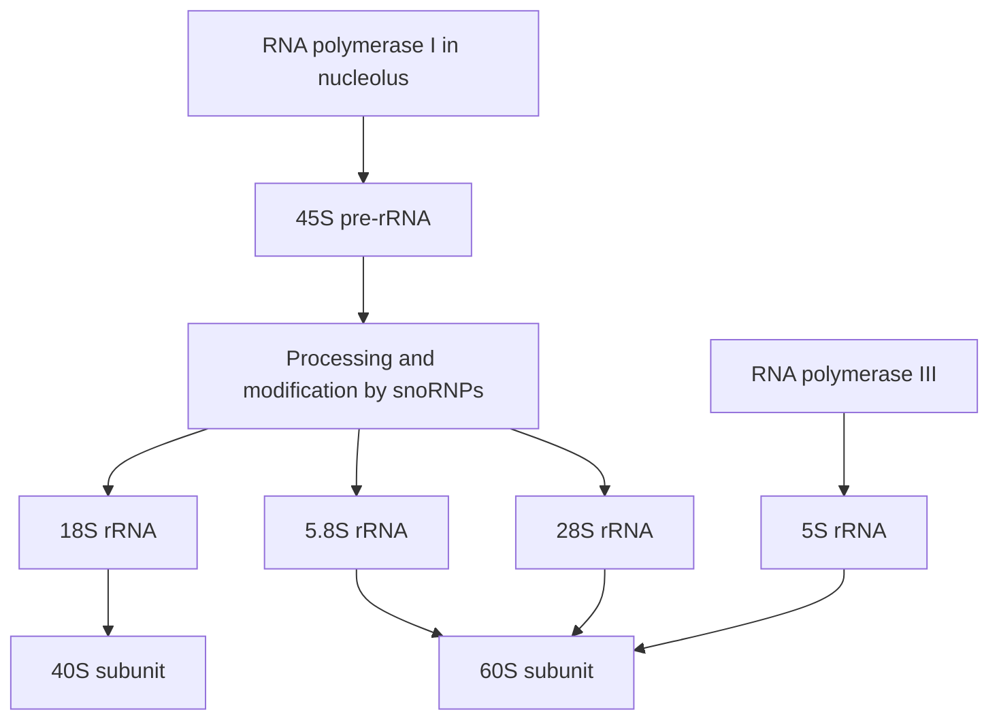

# 69. Transcription of DNA to Make Ribosomal RNA

Ribosomal RNA (**rRNA**) constitutes approximately **$80\%$ of total cellular RNA**. rRNAs assemble with ribosomal proteins to construct the structural and catalytic framework of **Ribosomes**.

---

## 1. Eukaryotic vs. Prokaryotic Ribosome Architecture

```
                  PROKARYOTIC RIBOSOME (70S)
         +------------------------------------------+
         |                                          |
    50S Subunit                                30S Subunit
   (23S, 5S rRNA + 31 Proteins)               (16S rRNA + 21 Proteins)
   * 23S rRNA = Peptidyl Transferase

                  EUKARYOTIC RIBOSOME (80S)
         +------------------------------------------+
         |                                          |
    60S Subunit                                40S Subunit
   (28S, 5.8S, 5S rRNA + 49 Proteins)         (18S rRNA + 33 Proteins)
   * 28S rRNA = Peptidyl Transferase
```

| Parameter | Prokaryote ($70S$) | Eukaryote ($80S$) |
| :--- | :--- | :--- |
| **Small Subunit** | **$30S$** | **$40S$** |
| *Small Subunit rRNA* | **$16S$ rRNA** (binds Shine-Dalgarno sequence) | **$18S$ rRNA** |
| **Large Subunit** | **$50S$** | **$60S$** |
| *Large Subunit rRNA* | **$23S$ rRNA**, $5S$ rRNA | **$28S$ rRNA**, $5.8S$ rRNA, $5S$ rRNA |
| **Peptidyl Transferase** | **$23S$ rRNA** (Ribozyme) | **$28S$ rRNA** (Ribozyme) |

---

## 2. Transcription and Nucleolar Assembly



1. **$45S$ Pre-rRNA Synthesis:** **RNA Polymerase I** transcribes tandemly repeated rRNA gene clusters in the **Nucleolus** into a single large $45S$ primary pre-rRNA transcript.
2. **Processing & Chemical Modification:**
   * Guided by **snoRNAs (Small Nucleolar RNAs)** complexed with proteins (**snoRNPs**).
   * Undergoes extensive $2'$-$O$-ribose methylation and pseudouridylation.
   * Cleaved by endo- and exonucleases into mature **$18S$** (for $40S$ subunit), **$5.8S$**, and **$28S$** rRNAs (for $60S$ subunit).
3. **$5S$ rRNA Exception:** $5S$ rRNA is transcribed **outside the nucleolus** in the nucleoplasm by **RNA Polymerase III**, then imported into the nucleolus for assembly.

---

## Related Notes
* 61 The Central Dogma of Molecular Biology
* 66 Transcription of DNA to Make Messenger RNA Part 1
* 70 Translation and Protein Synthesis
