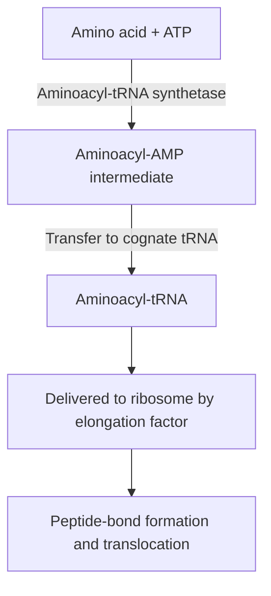

# 70. Translation and Protein Synthesis

**Translation** is the mRNA-directed synthesis of polypeptide chains. The linear nucleotide sequence of mRNA is decoded into a sequence of amino acids according to the **Genetic Code**.

---

## 1. Characteristics of the Genetic Code

```
5' --- [AUG] --- [CCC] --- [UAC] --- [UAA] --- 3'
       Met       Pro       Tyr       STOP
```

1. **Triplet Code:** 3 consecutive mRNA bases (a codon) code for 1 amino acid ($4^3 = 64\text{ codons}$).
   * **Start Codon:** **AUG** (codes for Methionine in eukaryotes; $N$-formylmethionine/fMet in prokaryotes).
   * **Stop (Nonsense) Codons:** **UAA** (Ochre), **UAG** (Amber), **UGA** (Opal).
2. **Unambiguous:** Each specific codon codes for *only one* amino acid.
3. **Degenerate / Redundant:** An amino acid can be specified by *multiple* different codons (61 sense codons code for 20 amino acids; Arg, Leu, Ser have 6 codons each). Trp (UGG) and Met (AUG) are unique with only 1 codon.
4. **Non-overlapping and Commaless:** Read continuously 3 nucleotides at a time without gaps or shared bases.
5. **Universal:** Nearly identical across all organisms (minor exceptions in mitochondrial DNA: e.g., UGA codes for Trp instead of Stop).

---

## 2. Wobble Hypothesis (Crick, 1966)

The $5'$ base of the tRNA anticodon can form non-standard hydrogen bonds with the $3'$ base ("wobble position") of the mRNA codon, allowing a single tRNA to recognize multiple degenerate codons.

| $1^{\text{st}}$ Base of tRNA Anticodon ($5'$) | $3^{\text{rd}}$ Base of mRNA Codon ($3'$) Paired |
| :--- | :--- |
| **C** | **G** |
| **A** | **U** |
| **U** | **A** or **G** |
| **G** | **C** or **U** |
| **Inosine (I)** | **U, C, or A** |

---

## 3. Stages of Translation



### A. Charging of tRNA (Amino Acid Activation)
$$\text{Amino Acid} + \text{ATP} + \text{tRNA} \xrightarrow{\text{Aminoacyl-tRNA Synthetase}} \text{Aminoacyl-tRNA} + \text{AMP} + PP_i$$
* Executed by **Aminoacyl-tRNA Synthetases** ($20$ enzymes; one per amino acid). Possesses proofreading hydrolytic capability to ensure fidelity.

### B. Initiation
* **Prokaryotes:** $30S$ subunit binds **Shine-Dalgarno sequence** ($5'\text{-AGGAGG-3'}$) upstream of start codon on mRNA via complementary $16S$ rRNA pairing. Initiator tRNA is **$fMet\text{-tRNA}_i^{fMet}$**.
* **Eukaryotes:** $40S$ subunit complexed with $eIF2\text{-GTP}$ and **$Met\text{-tRNA}_i^{Met}$** binds $5'$ $m^7G$ cap and scans mRNA for **Kozak consensus sequence** ($5'\text{-GCCGCC(A/G)CCAUGG-3'}$).

### C. Elongation
Ribosome contains 3 functional sites: **A-site** (Aminoacyl), **P-site** (Peptidyl), **E-site** (Exit).
1. **Binding:** Incoming charged tRNA delivered to A-site by $EF\text{-Tu-GTP}$ ($eEF1A$).
2. **Peptidyl Transferase:** Catalyzes peptide bond formation between P-site AA and A-site AA. Executed by **$23S$ rRNA** (prokaryotes) or **$28S$ rRNA** (eukaryotes).
3. **Translocation:** $EF\text{-G}$ ($eEF2$) hydrolyzes GTP, shifting ribosome 1 codon downstream ($3'$ direction), moving uncharged tRNA to E-site and peptidyl-tRNA to P-site.

### D. Termination
Release factors ($RF1/RF2$ in bacteria; $eRF1$ in eukaryotes) recognize Stop codons in A-site, hydrolyzing ester bond and releasing completed polypeptide.

---

## 4. Inhibitors of Translation (Antibiotics & Toxins)

```
                            TRANSLATION INHIBITORS
                                       |
          +----------------------------+----------------------------+
          |                                                         |
 [Prokaryotic Targets (30S / 50S)]                           [Eukaryotic Targets]
 • Streptomycin (30S Initiation)                              • Diphtheria Toxin (eEF-2)
 • Tetracyclines (30S A-Site)                                 • Exotoxin A (eEF-2)
 • Chloramphenicol (50S Peptidyl Transferase)                • Ricin (28S rRNA)
 • Erythromycin / Macrolides (50S Translocation)              • Cycloheximide (80S)
 • Puromycin (Both Prokaryotes & Eukaryotes)
```

| Agent | Target Organism | Specific Mechanism of Action |
| :--- | :--- | :--- |
| **Streptomycin / Aminoglycosides** | Prokaryote | Binds **$30S$ subunit**; causes mRNA misreading and blocks initiation |
| **Tetracyclines** | Prokaryote | Binds **$30S$ subunit**; blocks entry of aminoacyl-tRNA into A-site |
| **Chloramphenicol** | Prokaryote | Binds **$50S$ subunit**; inhibits **Peptidyl Transferase** |
| **Erythromycin / Macrolides** | Prokaryote | Binds **$50S$ subunit**; inhibits translocation step ($EF\text{-G}$) |
| **Clindamycin** | Prokaryote | Binds **$50S$ subunit**; blocks peptide bond formation |
| **Puromycin** | **Pro & Eukaryotes** | Tyrosyl-tRNA structural analog; causes **premature chain termination** |
| **Diphtheria Toxin / Exotoxin A** | Eukaryote | ADP-ribosylates and inactivates **$eEF-2$**, halting translocation |
| **Ricin** | Eukaryote | Castor bean toxin; depurinates $28S$ rRNA of $60S$ subunit |

---

## Related Notes
* 68 Transcription of DNA to Make Transfer RNA
* 69 Transcription of DNA to Make Ribosomal RNA
* 71 Comparison of DNA Replication Transcription Translation
