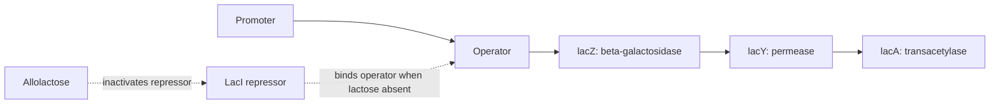
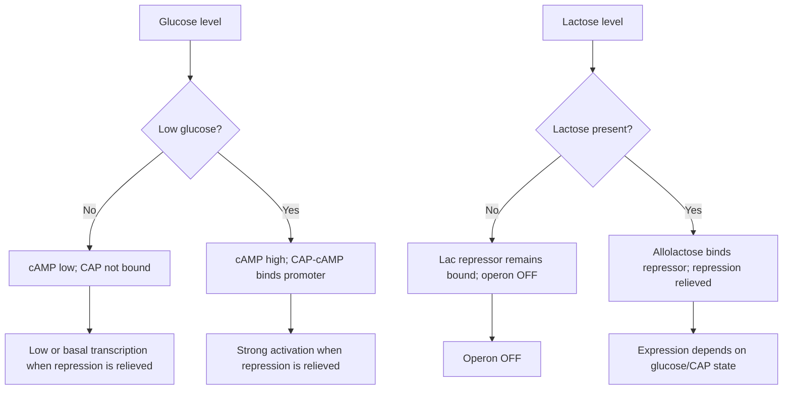

# 71. Comparison of DNA Replication, Transcription and Protein Synthesis

This chapter provides a comprehensive comparative analysis of central dogma processes between **Prokaryotes** and **Eukaryotes**, along with fundamental paradigms of gene regulation (e.g., Operon concept).

---

## 1. Master Comparative Matrix: Prokaryotes vs. Eukaryotes

| Feature | Prokaryotes (*E. coli*) | Eukaryotes (Human) |
| :--- | :--- | :--- |
| **DNA REPLICATION** | | |
| *Location* | Cytosol | Nucleus (S-phase) |
| *Origins of Replication* | **Single** ($oriC$) | **Multiple** per chromosome |
| *Replicative Polymerases* | **DNA Pol III** (Main), DNA Pol I | **Pol $\delta$** (Lagging), **Pol $\epsilon$** (Leading), **Pol $\alpha$** (Primer) |
| *Primer Removal* | DNA Pol I ($5' \rightarrow 3'$ exonuclease) | FEN1 / RNase H |
| *Telomeres / Telomerase* | Absent (Circular genome) | Present (Linear genome) |
| **TRANSCRIPTION** | | |
| *RNA Polymerase* | **Single** RNA Pol ($\alpha_2\beta\beta'\omega + \sigma$) | **RNA Pol I** (rRNA), **Pol II** (mRNA), **Pol III** (tRNA/$5S$) |
| *Promoter Elements* | $-10$ (Pribnow), $-35$ Box | TATA Box ($-25$), CAAT Box, Enhancers |
| *Post-Transcriptional Processing* | Minimal/Absent (Occurs concurrently) | Extensive ($5'$ Cap, $3'$ Poly-A Tail, Intron Splicing) |
| *Coupling* | **Coupled** Transcription-Translation | **Decoupled** (Transcription in nucleus, Translation in cytosol) |
| **TRANSLATION** | | |
| *Ribosome Size* | **$70S$** ($30S + 50S$) | **$80S$** ($40S + 60S$) |
| *Initiation Signal* | **Shine-Dalgarno sequence** ($16S$ rRNA) | $5'$ $m^7G$ Cap & **Kozak sequence** ($18S$ rRNA) |
| *Initiator Amino Acid* | **$N$-formylmethionine (fMet)** | **Methionine (Met)** |
| *Release Factors* | RF1, RF2, RF3 | eRF1 |

---

## 2. Regulation of Gene Expression: The Lac Operon

The **Lac Operon** (*E. coli*) is the classic model of **polycistronic inducible gene regulation** controlling lactose catabolism.

### Structural Genes
* **Lac Z:** Encodes **$\beta$-Galactosidase** (hydrolyzes lactose into glucose + galactose).
* **Lac Y:** Encodes **Lactose Permease** (membrane transport of lactose).
* **Lac A:** Encodes **Thiogalactoside Transacetylase**.

1. **Repressor Control (Negative Regulation):** **Lac I** gene produces Lac Repressor protein that binds the Operator site, physically blocking RNA Pol. **Allolactose** (inducer) binds repressor, causing conformational release.
2. **Catabolite Activator Protein / CAP (Positive Regulation):** Low glucose stimulates Adenylate Cyclase $\rightarrow$ **$cAMP$ levels rise**. $cAMP\text{-CAP}$ complex binds upstream promoter site, recruiting RNA Polymerase for **maximum transcriptional activation**.

---

## Related Notes
* 63 Replication of DNA Part 1
* 66 Transcription of DNA to Make Messenger RNA Part 1
* 70 Translation and Protein Synthesis
