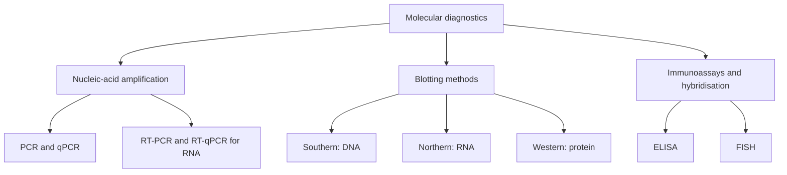

# 72. Diagnostic Clinical Biochemistry

Diagnostic Clinical Biochemistry applies biochemical and molecular laboratory methodologies to evaluate organ function, diagnose metabolic and genetic disorders, monitor therapeutic responses, and guide clinical decision-making.

---

## 1. Organ Function Profiles

**Current reference standard for MI (2026):** Use an assay-specific, sex-specific 99th-percentile upper reference limit and serial change in cardiac troponin. Acute myocardial injury is not synonymous with myocardial infarction; MI requires additional evidence of acute ischaemia. The 2026 Fifth Universal Definition of MI updates the classification framework and supports imaging to clarify aetiology.

### A. Liver Function Tests (LFTs)
* **Hepatocellular Injury:**
  * **ALT (SGPT):** More liver-associated than AST and useful for hepatocellular injury, but not absolutely liver-specific (can rise with skeletal-muscle or other tissue injury).
  * **AST (SGOT):** Present in liver, cardiac/skeletal muscle, kidney (cytosol and mitochondria).
  * **De Ritis Ratio ($\text{AST}/\text{ALT}$):** $>2.0$ can support alcohol-associated liver disease in the appropriate context, but is not diagnostic; many other conditions and disease stages alter the ratio.
* **Cholestasis / Biliary Obstruction:**
  * **Alkaline Phosphatase (ALP):** Elevated in biliary tract obstruction and bone disorders (Paget disease, bone metastases).
  * **Gamma-Glutamyl Transferase (GGT):** Elevated in cholestasis and may be induced by alcohol or medications; it is not specific for alcohol exposure. *Key Distinction:* High ALP + High GGT = Liver origin; High ALP + Normal GGT = Bone origin.
* **Hepatic Synthetic Capacity:** **Serum Albumin** (long half-life $\sim 20\text{ days}$) and **Prothrombin Time / INR** (short half-life, sensitive for acute liver failure).

### B. Renal Function Tests (RFTs)
* **Serum Creatinine:** Derived from muscle creatine breakdown; inversely proportional to GFR.
* **Blood Urea Nitrogen (BUN):** Synthesized in liver urea cycle. $\text{BUN}/\text{Cr}$ ratio above about 20 (when both are expressed in mg/dL) may support prerenal physiology, but is a heuristic affected by GI bleeding, catabolism, protein intake, liver function, and muscle mass; it cannot independently distinguish prerenal from intrinsic kidney injury.
* **eGFR (Calculated GFR):** Estimated with validated equations (a current CKD-EPI equation is commonly used; MDRD is older and less accurate at higher GFR). Cystatin C is less dependent on muscle mass than creatinine, but can be affected by inflammation, glucocorticoids, thyroid status, and other non-GFR factors; combined creatinine–cystatin C equations can improve accuracy when needed.

### C. Cardiac Biomarkers for Myocardial Infarction

**Current diagnostic principle:** Myocardial injury is defined by cardiac troponin above the assay-specific 99th-percentile upper reference limit; acute injury requires a rise and/or fall. **Myocardial infarction additionally requires evidence of acute myocardial ischaemia** (clinical, ECG, imaging, or coronary evidence). An elevated troponin alone is myocardial injury, not automatically MI. The 2026 Fifth Universal Definition uses sex-specific troponin thresholds and updates the clinical classification of MI. Follow the assay-specific serial-testing pathway and current local ACS guidance.

```
Serum Marker Level
  ^
  |        -- Cardiac Troponin I / T (Stays elevated 7-10 days)
  |       /  \
  |      /    -- CK-MB (Peaks 24h, returns to baseline 48-72h)
  |     /      \
  |    /-- Myoglobin (Earliest rise 1-2h, non-specific)
  +---------------------------------------------------------> Time (Days)
```

| Biomarker | Initial Rise | Peak Level | Duration / Baseline Return | Clinical Utility |
| :--- | :--- | :--- | :--- | :--- |
| **Cardiac troponin I & T** | Detectable earlier with high-sensitivity assays; exact timing varies by assay and onset | Often peaks within the first day | Remains elevated for days (assay/analyte dependent) | **Preferred biomarker**; interpret serial change, assay-specific 99th percentile, symptoms, ECG and imaging |
| **CK-MB** | Historically rises within several hours | Often peaks within about a day | Usually returns towards baseline in 2–3 days | Historical marker; not the preferred reinfarction test when high-sensitivity troponin is available |
| **Myoglobin** | Can rise early | Variable | Usually normalises relatively quickly | Nonspecific and not routinely used for contemporary MI diagnosis |

---

## 2. Molecular Diagnostic Techniques



### A. Polymerase Chain Reaction (PCR)
* **Principle:** Exponential $2^n$ enzymatic amplification of specific DNA sequences using thermal cycling.
* **3 Steps per Cycle:**
  1. **Denaturation ($94–95^\circ\text{C}$):** Disconnects double-stranded DNA.
  2. **Annealing ($50–65^\circ\text{C}$):** Specific oligonucleotide primers bind flanking target regions.
  3. **Extension ($72^\circ\text{C}$):** Heat-stable **Taq Polymerase** synthesizes new strands.
* **Variants:**
  * **RT-PCR (reverse-transcription PCR):** Converts RNA to cDNA using reverse transcriptase before amplification.
  * **qPCR (real-time quantitative PCR):** Monitors amplification in real time using fluorescence.
  * **RT-qPCR:** Combines reverse transcription with real-time quantitative PCR and is widely used for RNA targets. HIV viral-load testing is generally performed with validated nucleic-acid amplification platforms rather than described generically as an RT-PCR assay.

### B. Blotting Techniques
* **Southern blot:** DNA detection.
* **Northern blot:** RNA detection/expression.
* **Western blot:** Protein detection, usually with specific antibodies.

**Clinical update:** Western blot is a protein-detection method, but it should not be memorised as the current routine confirmatory HIV algorithm. Modern HIV diagnosis uses antigen/antibody screening followed by an HIV-1/HIV-2 differentiation assay and nucleic-acid testing when indicated; Lyme testing uses current guideline-based two-tier serology.

### C. Enzyme-Linked Immunosorbent Assay (ELISA)
* **Direct / Indirect:** Detects antigen or antibody, respectively.
* **Sandwich ELISA:** Primary antibody coated on plate captures target antigen; enzyme-linked secondary antibody detects captured antigen. Exceptional sensitivity and specificity.

---

## 3. Laboratory Quality Control and Analytical Metrics

$$\text{Beer-Lambert Law:} \quad A = \epsilon \cdot c \cdot l$$
*Where $A$ is Absorbance, $\epsilon$ is Molar Absorptivity, $c$ is Concentration, $l$ is Path Length ($1\text{ cm}$).*

* **Precision:** Agreement among repeated measurements (random error; often expressed as coefficient of variation, $\%CV$).
* **Trueness:** Closeness of the mean measurement to a reference value (systematic error/bias).
* **Accuracy:** Overall closeness of a result to the true value; it reflects both systematic and random error.
* **Diagnostic sensitivity:** $\frac{TP}{TP + FN} \times 100\%$ (proportion of people with the target condition who test positive).
* **Diagnostic specificity:** $\frac{TN}{TN + FP} \times 100\%$ (proportion without the target condition who test negative).

Sensitivity and specificity depend on the chosen threshold and reference standard; their screening/confirmation roles are useful heuristics, not absolute rules.

---

## Related Notes
* 58 Pyrimidine Metabolism
* 59 Purine Metabolism
* 65 DNA Damage and Repair

## Selected References for Clinical Updates

- [ESC/ACC/AHA/WHF. Fifth Universal Definition of Myocardial Infarction. 2026.](https://www.escardio.org/guidelines/clinical-practice-guidelines/pocket-guidelines/universal-definition-of-myocardial-infarction/)
- [ESC. Fifth Universal Definition of Myocardial Infarction: full guideline overview. 2026.](https://www.escardio.org/guidelines/clinical-practice-guidelines/all-esc-practice-guidelines/universal-definition-myocardial-infarction/)
