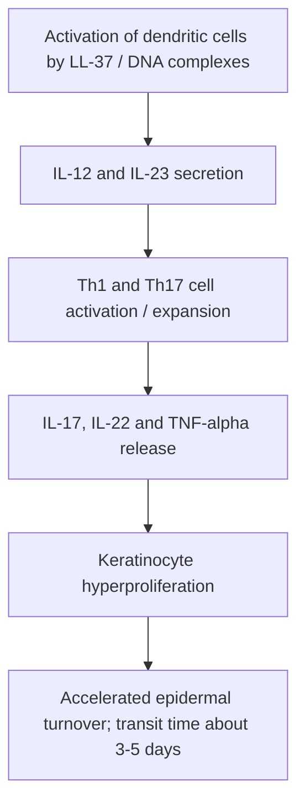

# Chapter 04: Psoriasis & Related Psoriasiform Dermatoses

Psoriasis is a chronic, non-contagious, immune-mediated inflammatory papulosquamous disease of the skin, joints, and nails. It affects approximately 2–3% of the global population and carries significant cardiovascular and metabolic comorbidities.

---

## 4.1 Etiology, Pathophysiology & Genetics

### 1. Immunopathogenesis
Psoriasis is driven by an auto-amplifying inflammatory cascade involving dendritic cells, T-lymphocytes, and keratinocytes:

**Psoriasis immunopathogenesis**

- Keratinocyte transit time from stratum basale to stratum corneum accelerates from a normal **28 days down to 3–5 days**, causing incomplete cornification (**parakeratosis**).

### 2. Genetic Susceptibility
- Strongest genetic association is with **PSORS1** locus containing **HLA-Cw6**.
- **Type 1 Psoriasis**: HLA-Cw6 positive, early age of onset ($<40$ years), positive family history, more severe clinical course, strong association with psoriatic arthritis.
- **Type 2 Psoriasis**: HLA-Cw6 negative, late age of onset ($>40$ years), negative family history, milder course.

### 3. Triggers & Drug Aggravations (Mnemonic: *PLABS*)
- **Drugs that Trigger or Worsen Psoriasis**:
  - **P**: **P**ainkillers (NSAIDs)
  - **L**: **L**ithium
  - **A**: **A**ntimalarials (Chloroquine, Hydroxychloroquine)
  - **B**: **B**eta-blockers
  - **S**: **S**ystemic Steroids (abrupt withdrawal precipitates rebound **Pustular** or **Erythrodermic Psoriasis**)
- **Infections**: Group A $\beta$-hemolytic Streptococcal pharyngitis (classic trigger for **Guttate Psoriasis**).
- **Environmental**: Alcohol consumption, cigarette smoking, emotional stress, physical trauma (**Koebnerization**).

---

## 4.2 Clinical Types & Morphological Patterns

### 1. Chronic Plaque Psoriasis (Psoriasis Vulgaris)
- Most common clinical variant ($>85\%$ of cases).
- **Morphology**: Symmetrical, sharply demarcated erythematous plaques covered by profuse, dry, **silvery-white scales**.
- **Predilection Sites**: **Extensor surfaces** (knees, elbows, scalp, lumbosacral region, gluteal cleft).

| Feature | Classic plaque psoriasis (extensor) | Inverse / flexural psoriasis |
| :--- | :--- | :--- |
| Typical sites | Knees, elbows, scalp and sacral region. | Axillae, groin and inframammary folds. |
| Morphology | Well-demarcated plaques with prominent silvery-white scale. | Smooth, erythematous plaques with minimal scaling. |

### 2. Flexural / Inverse Psoriasis
- Involves intertriginous spaces (axillae, groin, perineum, inframammary folds).
- Presents as smooth, brilliant red, well-demarcated plaques with **minimal or absent scaling** due to local friction and moisture.

### 3. Guttate Psoriasis
- Characterized by sudden eruption of multiple small, salmon-pink, drop-like scaly papules ($<1\text{ cm}$) over the trunk and extremities.
- Occurs predominantly in children and young adults **1–3 weeks after Streptococcal pharyngitis**.

### 4. Pustular Psoriasis
- **Generalized Pustular Psoriasis (von Zumbusch Syndrome)**: Life-threatening acute eruption of widespread sterile pustules on background erythematous skin, accompanied by high fever, leukocytosis, and toxicity.
- **Localized Pustular Psoriasis**: Palmoplantar pustulosis (confined to palms and soles).

### 5. Erythrodermic Psoriasis
- Generalized inflammatory involvement affecting **$\ge 90\%$ of Total Body Surface Area (TBSA)** with diffuse erythema and scaling.
- High risk of hypothermia, fluid loss, electrolyte imbalance, high-output cardiac failure, and sepsis.

### 6. Nail Psoriasis (Psoriatic Onychopathy)
Present in up to 50% of skin psoriasis patients and 90% of those with psoriatic arthritis:
- **Deep, Coarse Nail Pitting**: Matrix involvement (most common feature).
- **Oil-Drop / Salmon-Patch Sign**: Yellow-brown discoloration of nail bed due to exuded lipids.
- **Subungual Hyperkeratosis**: Accumulation of scale under distal nail plate.
- **Onycholysis**: Separation of nail plate from nail bed.

### 7. Psoriatic Arthritis (PsA)
- Seronegative spondyloarthropathy (RA factor negative).
- Classic features: Distal Interphalangeal (DIP) joint involvement, **dactylitis ("sausage digits")**, enthesitis, and radiographic **"pencil-in-cup" deformity**.

---

## 4.3 Histopathology of Psoriasis

Histology exhibits pathognomonic changes across all epidermal and dermal compartments:

| Site / compartment | Characteristic histopathology |
| :--- | :--- |
| Stratum corneum | Hyperkeratosis and parakeratosis; Munro microabscesses (neutrophils). |
| Stratum spinosum | Acanthosis with regular elongation of rete ridges (“camel-foot” appearance); Kogoj spongiform pustules; reduced or absent granular layer. |
| Dermis and papillary capillaries | Dilated, tortuous papillary dermal capillaries; suprapapillary thinning, contributing to the Auspitz sign. |

1. **Stratum Corneum**: Marked hyperkeratosis with **parakeratosis** (retained pyknotic nuclei). Contains **Munro's microabscesses** (neutrophil clusters).
2. **Stratum Granulosum**: Markedly reduced or completely absent.
3. **Stratum Spinosum**: Acanthosis with characteristic **regular elongation of rete ridges** ("camel-toe" or "test-tube" appearance). Contains **Kogoj spongiform pustules** (neutrophils in upper spinous layer).
4. **Dermis & Capillaries**: **Dilated and tortuous capillary loops** in dermal papillae with overlying **suprapapillary thinning** of the epidermis (anatomical basis of the Auspitz sign).

---

## 4.4 Therapeutic Management Protocols

Treatment is stratified based on Body Surface Area (BSA) involvement and disease severity.

### 1. Topical Therapy ($<10\%$ BSA Involvement)
- **Topical Corticosteroids**: High-potency agents (Clobetasol propionate) for active plaques.
- **Vitamin D3 Analogs**: **Calcipotriene (Calcipotriol)** or Calcitriol; inhibits keratinocyte proliferation. Often combined with topical steroids (e.g., Clobetasol + Calcipotriene).
- **Tazarotene**: Topical retinoid.
- **Coal Tar & Dithranol (Anthralin)**: Traditional keratolytic agents.
- **Topical Calcineurin Inhibitors**: Tacrolimus / Pimecrolimus (preferred for facial and flexural inverse psoriasis to avoid steroid atrophy).

### 2. Phototherapy ($>10\%$ BSA Involvement)
- **Narrowband UVB (NB-UVB, 311 nm)**: First-line phototherapy modality.
- **PUVA (Psoralen + UVA)**: Oral/topical 8-methoxypsoralen followed by UVA exposure.

### 3. Systemic Pharmacotherapy (Severe / Refractory Disease)
- **Methotrexate (MTX)**: Folate antagonist (15–25 mg/week). Monitor CBC and LFTs (hepatotoxicity risk).
- **Cyclosporine**: Calcineurin inhibitor providing rapid clearance. Monitor renal function and blood pressure (nephrotoxicity risk; limited to 1-year continuous use).
- **Acitretin**: Oral second-generation retinoid. Highly effective for pustular and erythrodermic psoriasis. **Strictly teratogenic**; pregnancy contraindicated during treatment and for 3 years post-discontinuation.

### 4. Biologic & Targeted Therapies (Gold Standard for PsA & Moderate-to-Severe Plaque Psoriasis)
- **Anti-TNF-$\alpha$ Agents**: Infliximab, Adalimumab, Etanercept (Drug of choice for Psoriatic Arthritis).
- **Anti-IL-17 Inhibitors**: **Secukinumab**, Ixekizumab (rapid skin clearance).
- **Anti-IL-23 Inhibitors**: Risankizumab, Guselkumab, Ustekinumab (Anti-IL-12/23).
