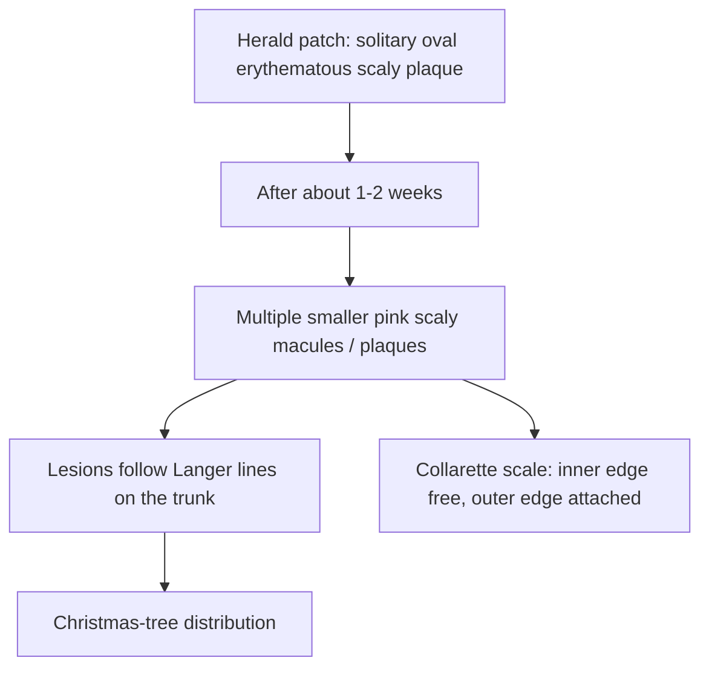

# Chapter 05: Lichen Planus & Pityriasis Disorders

Lichen planus and pitryiasic dermatoses represent major inflammatory papulosquamous conditions characterized by distinct clinical morphology, characteristic scale patterns, and unique histopathological signatures.

---

## 5.1 Lichen Planus (LP)

Lichen planus is a chronic, autoimmune, cell-mediated inflammatory disorder affecting skin, mucous membranes, hair, and nails.

### 1. Etiology & Pathogenesis
- **Immunopathogenesis**: CD8+ cytotoxic T-lymphocytes initiate immune-mediated apoptosis of basal layer keratinocytes expressing altered self-antigens.
- **Systemic Association**: Strong clinical correlation with **Hepatitis C Virus (HCV)** infection and chronic liver disease. Also triggered by dental amalgam (mercury) restorations.

### 2. Clinical Features — The 6 Ps of Lichen Planus
- **P**urple (Violaceous color)
- **P**olygonal (Angular margins)
- **P**apules and Plaques
- **P**ruritic (Intense itching)
- **P**lain-topped (Flat-topped surface)

**The 6 Ps of lichen planus**

- **Purple:** violaceous hue.
- **Polygonal:** angular shape.
- **Papules and plaques.**
- **Pruritic:** often intensely itchy.
- **Plain-topped:** flat surface.
- **Peripheral / flexural distribution:** classically wrists and ankles.

### 3. Morphological Highlights
- **Wickham Striae**: A network of fine, white, reticular lines on the surface of papules/plaques, caused by hypergranulosis.
- **Distribution**: Symmetrical involvement of **flexor surfaces** (volar wrists, ankles, lumbar region).
- **True Koebner Phenomenon Positive**: Linear arrangement of papules along scratch marks.

### 4. Mucosal & Appendageal Variants
- **Oral Lichen Planus** (occurs in 40–60% of LP patients):
  - <strong>*Reticular Pattern* (most common)</strong>: Lacy white reticular striae on buccal mucosa, usually asymptomatic.
  - <strong>*Erosive Pattern*</strong>: Painful mucosal ulcerations; carries a small risk of malignant transformation to **Oral Squamous Cell Carcinoma**.
- **Nail Lichen Planus**: Longitudinal ridging, splitting, trachyonychia, and pathognomonic **Pterygium formation** (scarring fusion of proximal nail fold to nail bed, splitting the nail plate).
- **Scalp LP (Lichen Planopilaris)**: Follicular hyperkeratotic papules resulting in **cicatricial (scarring) alopecia**.

### 5. Histopathology of Lichen Planus
- **Stratum Corneum**: Hyperkeratosis without parakeratosis (**orthokeratosis**).
- **Stratum Granulosum**: **Wedge-shaped hypergranulosis** (directly corresponds to clinical Wickham striae).
- **Stratum Spinosum**: Irregular acanthosis.
- **Rete Ridges**: Irregular, pointed elongation of rete ridges (**"Saw-Tooth" Rete Ridges**).
- **Dermoepidermal Junction**: **Liquefaction degeneration of the basal cell layer** with a dense, band-like lymphocytic infiltrate in the upper dermis (**Interface Dermatitis**).
- **Civatte / Colloid Bodies**: Eosinophilic, apoptotic, necrotic keratinocytes at the dermal-epidermal junction.

| Histopathological feature | Description / correlation |
| :--- | :--- |
| Orthokeratosis | Compact stratum corneum without retained nuclei. |
| Wedge-shaped hypergranulosis | Associated clinically with Wickham striae. |
| Acanthosis | Epidermal thickening. |
| Saw-tooth rete ridges | Pointed rete ridges. |
| Basal-cell liquefaction degeneration | Interface injury at the basal layer. |
| Civatte bodies | Apoptotic / necrotic keratinocytes. |
| Band-like lymphocytic infiltrate | Dense superficial lymphocytic infiltrate at the dermoepidermal junction (interface dermatitis). |

### 6. Treatment Protocols
- Disease is self-limiting (usually resolves over 1–2 years), leaving post-inflammatory hyperpigmentation.
- **Localized Lesions**: High-potency **topical corticosteroids** (Clobetasol propionate) are the treatment of choice.
- **Oral Mucosal LP**: Topical **Tacrolimus** or topical steroid gels.
- **Extensive / Refractory LP**: Short course of systemic corticosteroids (Prednisolone) or phototherapy (NB-UVB).

---

## 5.2 Pityriasis Rosea (PR)

Pityriasis rosea is an acute, self-limiting papulosquamous eruption occurring primarily in adolescents and young adults.

**Typical pityriasis rosea sequence**

- **Etiology**: Linked to reactivation of **Human Herpesvirus 7 (HHV-7)** and HHV-6. Drug triggers include Metronidazole and NSAIDs.
- **Clinical Sequence**:
  1. **Herald Patch (Mother Patch)**: Initial solitary 2–10 cm oval, salmon-pink erythematous plaque with a fine scaly border, located on the trunk.
  2. **Secondary Exanthem** (1–2 weeks later): Eruption of multiple smaller oval pink scaly macules/plaques distributed along Langer's lines of skin cleavage, producing a classic **"Christmas Tree" / V-shaped pattern** on the back.
- **Collarette Scale**: Characteristic inward-facing ring of scale where the inner edge is free and the outer edge is attached.
- **Course & Management**: Self-resolving within 6–8 weeks. Requires symptomatic management (emollients, antihistamines).

---

## 5.3 Pityriasis Rubra Pilaris (PRP)

Pityriasis rubra pilaris is a rare, chronic inflammatory papulosquamous disorder of unknown etiology.

- **Perifollicular Scaly Papules**: Red-orange follicular papules originating on the scalp and face, spreading in a **cephalocaudal** direction.
- **Nutmeg-Grater Papules**: Rough, red, scaly follicular papules on the dorsum of hands and fingers.
- **Sandal Keratoderma**: Thick, waxy, orange-red palmoplantar hyperkeratosis.
- **Islands of Sparing**: Generalized erythrodermic redness ($>90\%$ BSA) characteristically containing well-demarcated **skip areas / islands of normal skin**.
- **Management**: Systemic retinoids (Acitretin), Methotrexate, or Anti-TNF biologics.

---

## 5.4 Lichen Nitidus & Lichen Sclerosus

### 1. Lichen Nitidus
- Characterized by multiple pinpoint to pinhead-sized, uniform, shiny, hypopigmented or flesh-colored papules.
- Histopathology shows a focal, circumscribed lymphohistiocytic infiltrate in a expanded dermal papilla closely embraced by elongated rete ridges (**"Claw Clutching a Ball"** appearance).

### 2. Lichen Sclerosus et Atrophicus
- Chronic inflammatory dermatosis showing white, porcelain-like macules and parchment-like / **"cigarette-paper" skin atrophy**, predominantly in the anogenital region.
- Histopathology reveals epidermal atrophy, hyperkeratosis, hydropic basal degeneration, and a broad band of edematous/sclerotic dermal collagen.
