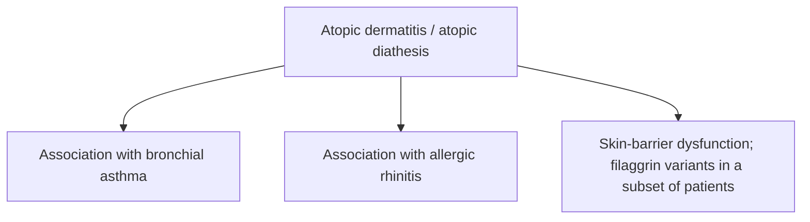

# Chapter 06: Eczematous Dermatoses and Atopic Disorders

## 6.1 Eczema Overview & Morphological Stages

Eczema (dermatitis) represents an inflammatory epidermal reaction pattern characterized clinically by pruritus, erythema, scaling, and vesiculation, and histopathologically by **spongiosis** (intercellular edema of the stratum spinosum).

> [!NOTE]
> **Eczema vs. Dermatitis**: The terms "eczema" and "dermatitis" are used synonymously in clinical practice. Eczema literally translates from Greek as "to boil over", reflecting the acute vesicular weeping phase.

### Morphological Classification Across Phases

| Clinical Phase | Morphological Characteristics | Primary Histopathological Feature |
| :--- | :--- | :--- |
| **Acute Eczema** | Intense pruritus, bright erythema, edematous papules, marked vesiculation, weeping, oozing, and crusting. | Marked **spongiosis** (intercellular epidermal edema stretching desmosomes), intraepidermal vesicles, dermal papillary edema, and perivascular lymphocytic infiltrate. |
| **Subacute Eczema** | Erythematous scaling plaques, mild vesiculation, weeping crusts, and early epidermal thickening. | Moderate spongiosis, hyperkeratosis, mild parakeratosis, and moderate acanthosis. |
| **Chronic Eczema** | Thickened, leathery, hyperpigmented plaques with exaggerated skin markings (**lichenification**), excoriations, and painful fissures. | Marked **acanthosis** (epidermal hyperplasia), prominent **hyperkeratosis**, minimal to absent spongiosis, and dermal fibrosis. |

| Stage | Clinical morphology | Typical histopathology |
| :--- | :--- | :--- |
| Acute eczema | Bright erythema; vesicles; weeping / exudation. | Marked spongiosis; intraepidermal vesiculation may occur. |
| Subacute eczema | Erythematous plaques with scaling and crusting. | Less prominent spongiosis with developing acanthosis. |
| Chronic eczema | Lichenification and thickened skin. | Prominent acanthosis and chronic epidermal thickening. |

---

## 6.2 Atopic Dermatitis (AD)

Atopic Dermatitis is a chronic, intensely pruritic, relapsing inflammatory skin disease primarily affecting infants and children. It forms a central component of the **Atopic Triad**.

### Pathophysiology & Immunological Axis
1. **Epidermal Barrier Dysfunction**: Driven by loss-of-function mutations in the **Filaggrin (*FLG*) gene** (located on chromosome 1q21.3). Filaggrin deficiency leads to disrupted stratum corneum integrity, increased transepidermal water loss (TEWL), and enhanced allergen penetration.
2. **Immunological Axis**: Biphasic T-cell response.
   * *Acute Phase*: Dominated by **T-helper 2 (Th2) cells** secreting **IL-4, IL-13, and IL-31** (the primary mediator of itch), leading to elevated serum **IgE** levels and eosinophilia.
   * *Chronic Phase*: Shifts toward a **Th1 and Th17/Th22** inflammatory pattern.

**Atopic triad and skin-barrier association**

### Age-Specific Clinical Distribution

> [!IMPORTANT]
> **Diagnostic Clinical Rule**: Atopic dermatitis changes its anatomical predilection predictably with age. Flexural fold involvement is characteristic of older children and adults, whereas infants present with facial and extensor distribution.

* **Infantile Phase (Birth to 2 Years)**:
  * Erythematous, weeping, crusted papules and vesicles on the **cheeks, forehead, and scalp**, characteristically **sparing the diaper area** (due to moisture retention).
  * Extensor surfaces of extremities are involved as the infant begins to crawl.
* **Childhood Phase (2 Years to Puberty)**:
  * Lesions become more papular and lichenified.
  * Classic predilection for **flexural folds**: antecubital fossae, popliteal fossae, flexor wrists, neck, and eyelids.
* **Adult Phase (Puberty Onward)**:
  * Prominent flexural lichenification, hand and foot dermatitis, and facial erythrosis.

### Associated Clinical Stigmata
* **Dennie-Morgan Fold**: Double fold/crease under the lower eyelid.
* **Hertoghe Sign**: Loss or thinning of the lateral third of the eyebrows.
* **Pityriasis Alba**: Hypopigmented, finely scaly macules on the cheeks of children.
* **Keratosis Pilaris**: Hyperkeratotic follicular papules on the outer upper arms and thighs.
* **Hyperlinear Palms**: Exaggerated palmar creases.

### Severe Complications
* **Eczema Herpeticum (Kaposi Varicelliform Eruption)**:
  * Disseminated, life-threatening viral infection caused by **Herpes Simplex Virus (HSV-1)** superimposing on eczematous skin.
  * Manifests as widespread, monomorphic, punched-out umbilicated vesicles that rapidly evolve into pustules and crusted erosions accompanied by high fever and lymphadenopathy.
* **Secondary Bacterial Superinfection**: Primarily by ***Staphylococcus aureus*** (colonizes $>90\%$ of AD lesions).

### Therapeutic Management
1. **Topical Maintenance**: Frequent emollients to restore the lipid barrier.
2. **Topical Anti-Inflammatory**: Low-to-mid potency topical corticosteroids for acute flares; **Topical Calcineurin Inhibitors (Tacrolimus 0.03%/0.1%, Pimecrolimus)** as steroid-sparing agents (ideal for facial and flexural sites).
3. **Targeted Biological Therapy**: **Dupilumab** (a fully human monoclonal antibody targeting the **IL-4R$\alpha$ subunit**, inhibiting both IL-4 and IL-13 signaling) for moderate-to-severe refractory AD.

---

## 6.3 Contact Dermatitis

Contact dermatitis is an inflammatory skin condition triggered by direct exposure to external chemical or physical substances, classified into Allergic and Irritant types.

### Allergic vs. Irritant Contact Dermatitis

| Parameter | Allergic Contact Dermatitis (ACD) | Irritant Contact Dermatitis (ICD) |
| :--- | :--- | :--- |
| **Immunological Mechanism** | **Type IV Delayed-Type Hypersensitivity** (T-cell mediated). Requires prior sensitization (10–14 days) and re-exposure challenge (24–48 hours). | **Non-immunological direct chemical damage** to keratinocytes and stratum corneum lipid disruption. No prior sensitization required. |
| **Common Causative Agents** | **Nickel sulphate** (#1 overall cause, jewelry/snaps), **Urushiol** (Poison ivy/oak), **Neomycin**, **Fragrance mix**, **Paraphenylenediamine (PPD)** (hair dyes), **Chromate** (cement/leather). | Strong acids, alkalis, detergents, solvents, soaps, water (frequent handwashing). |
| **Lesion Borders** | Indistinct, spreading beyond the exact contact zone. | Sharply demarcated, strictly confined to the site of chemical contact. |
| **Diagnostic Test** | **Patch Testing** (read at 48 hours and 96 hours). | Clinical diagnosis (Patch test is negative). |

---

## 6.4 Seborrheic Dermatitis

Seborrheic Dermatitis is a common, chronic inflammatory papulosquamous disorder affecting sebaceous gland-rich regions of the head and trunk.

### Etiopathogenesis & Clinical Features
* **Pathophysiology**: Associated with an abnormal inflammatory host response to cutaneous commensal ***Malassezia* yeasts** (*Malassezia globosa* and *M. restricta*), which metabolize sebum triglycerides into irritating free fatty acids.
* **Anatomical Distribution**: Scalp, glabellar complex, eyebrows, nasolabial folds, retroauricular folds, sternum, and interscapular space.
* **Morphology**: Erythematous, ill-defined plaques covered by **greasy, oily, yellowish scales**.
* **Infantile Seborrheic Dermatitis**:
  * **Cradle Cap**: Thick, yellow, adherent greasy scales over the infant scalp.
  * **Leiner Disease**: Generalized erythrodermic seborrheic dermatitis associated with complement deficiencies (C3/C5) and severe diarrhea.
* **HIV Association**: Sudden-onset, severe, extensive, or recalcitrant seborrheic dermatitis serves as an important cutaneous marker of advanced **HIV infection** (CD4 count $<200/\mu\text{L}$).

---

## 6.5 Summary Checklist for Eczematous Disorders

* [x] Spongiosis is the histopathological hallmark of acute eczema.
* [x] Atopic dermatitis involves *FLG* gene mutations, elevated IgE, and Th2 cytokine activation (IL-4, IL-13, IL-31).
* [x] Eczema herpeticum is an HSV-1 superinfection presenting as monomorphic punched-out umbilicated vesicles.
* [x] Allergic contact dermatitis is a Type IV reaction (Patch test positive at 48h/96h); Irritant contact dermatitis is direct chemical damage.
* [x] Seborrheic dermatitis presents with greasy yellow scales on sebaceous areas linked to *Malassezia* yeast overgrowth.
