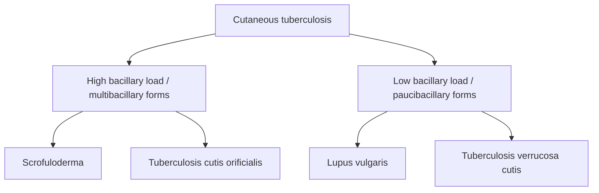
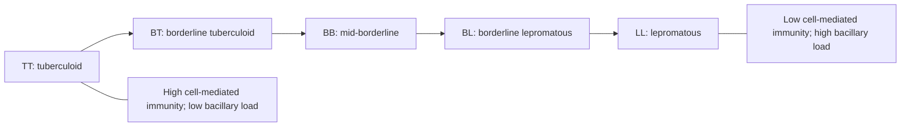

# Chapter 09: Bacterial Infections, Pyodermas, and Mycobacteria

## 9.1 Superficial Pyodermas & Staphylococcal Toxinoses

Pyodermas are cutaneous bacterial infections primarily caused by ***Staphylococcus aureus*** and ***Streptococcus pyogenes* (Group A Streptococcus)**.

### Impetigo Variants
* **Non-Bullous Impetigo (Impetigo Contagiosa)**:
  * Etiology: *S. aureus* ($>80\%$) or *S. pyogenes*.
  * Morphology: Transient thin-walled vesicles/pustules that rupture rapidly to leave characteristic **honey-colored (amber) adherent crusts** on the face and extremities.
* **Bullous Impetigo**:
  * Etiology: *S. aureus* belonging to **phage group 2 (types 55 and 71)**.
  * Mechanism: Secretion of **Exfoliative Toxin A (ETA)** and **ETB**, which selectively cleave **Desmoglein 1** in the stratum granulosum, resulting in flaccid, clear-to-purulent subcorneal bullae.
* **Staphylococcal Scalded Skin Syndrome (SSSS / Ritter Disease)**:
  * Widespread hematogenous dissemination of exfoliative toxins (ETA/ETB) from a focal staphylococcal infection in neonates and young children ($<5$ years).
  * Clinical Presentation: Diffuse tender erythema starting periorificially, followed by widespread flaccid sterile bullae and sheet-like epidermal sloughing.
  * Physical Marker: **Nikolsky Sign Positive $\oplus$**. Spares mucous membranes because exfoliative toxin targets Dsg1 (absent in mucosa).

| Anatomical level / process | Representative disease | Key point |
| :--- | :--- | :--- |
| Subcorneal / superficial epidermis | Non-bullous impetigo | Superficial infection. |
| Stratum granulosum cleavage | Bullous impetigo / SSSS | Exfoliative toxins ETA/ETB cleave desmoglein 1. |
| Epidermis with dermal extension | Ecthyma | Ulcerative form of impetigo. |
| Superficial dermis and lymphatics | Erysipelas | Raised, sharply demarcated erythema. |
| Deep dermis and subcutaneous tissue | Cellulitis | Ill-defined erythema and swelling. |

### Deep Bacterial Infections

| Feature | Erysipelas | Cellulitis |
| :--- | :--- | :--- |
| **Primary Pathogen** | *Streptococcus pyogenes* (Group A Strep) | *Staphylococcus aureus* or *Streptococcus pyogenes* |
| **Anatomic Depth** | Upper dermis and superficial cutaneous lymphatics | Deep dermis and subcutaneous fat |
| **Lesion Border** | **Sharply demarcated**, raised, bright red border | **Indistinct, ill-defined**, merging into normal skin |
| **Classic Location** | Face (malar) and lower extremities | Lower extremities |

---

## 9.2 Cutaneous Tuberculosis & Tuberculids

Cutaneous Tuberculosis manifests as true bacterial infections (containing viable *Mycobacterium tuberculosis*) or tuberculids (sterile hypersensitivity reactions).

### True Cutaneous Tuberculosis

**Examples of cutaneous tuberculosis by bacillary burden**

* **Lupus Vulgaris**:
  * Most common post-primary form in previously sensitized individuals with moderate-to-high immunity.
  * Clinical Morphology: Reddish-brown, gelatinous plaque ("apple-jelly" color on **diascopy** / vitropression).
  * Complication: Longstanding lesions carry a risk of developing **Squamous Cell Carcinoma** within the scar tissue (Marjolin-like ulcer).
* **Scrofuloderma**:
  * Direct extension and breakdown of skin overlying an underlying active tuberculous focus (most commonly **cervical lymph nodes**, bone, or joint).
  * Presents with cold abscesses, sinus tracts, and puckered, undermined scar tissue.
* **Tuberculosis Verrucosa Cutis (TVC)**:
  * Exogenous direct inoculation of *M. tuberculosis* into the skin of a previously sensitized person with high immunity ("prosector's wart" in pathologists).

### Tuberculids (Hypersensitivity Reactions)
Sterile cutaneous eruptions in patients with high immunity to *M. tuberculosis*:
* **Erythema Induratum of Bazin**: Tender, violaceous, indurated subcutaneous nodules on the **posterior lower legs (calves)** that frequently ulcerate; histopathology shows lobular panniculitis with vasculitis.
* **Lichen Scrofulosorum**: Minute, perifollicular, lichenoid papules on the trunk.

---

## 9.3 Leprosy (Hansen's Disease)

Leprosy is a chronic granulomatous disease caused by ***Mycobacterium leprae*** and ***Mycobacterium lepromatosis***, exhibiting a unique tropism for peripheral nerves and skin.

### Ridley-Jopling Classification Spectrum

**Ridley-Jopling spectrum of leprosy**

| Parameter | Tuberculoid (TT) | Borderline Tuberculoid (BT) | Borderline Borderline (BB) | Borderline Lepromatous (BL) | Lepromatous (LL) |
| :--- | :--- | :--- | :--- | :--- | :--- |
| **Cell-Mediated Immunity (CMI)** | **High (Th1 response)** | Moderate | Low-Moderate | Low | **Absent / Specific Anergy (Th2)** |
| **Lesion Count** | Solitary or $<3$ | Few ($3-10$) | Multiple | Numerous | **Countless, symmetrical** |
| **Sensation Loss** | **Complete anesthesia** | Marked loss | Moderate loss | Slight / Late | Preserved early, late stocking-glove |
| **Nerve Involvement** | Single, asymmetric, enlarged | Few asymmetric | Multiple | Multiple symmetric | Diffuse, symmetric, late |
| **Slit-Skin Smear (BI)** | **Negative (BI = 0)** | BI $0-1+$ | BI $2-3+$ | BI $4-5+$ | **High (BI = 5-6+)** |
| **Lepromin Test** | **Strongly Positive $\oplus$** | Positive | Negative | Negative | **Strongly Negative $\ominus$** |

### Classic Clinical Markers of Lepromatous Leprosy
* **Leonine Facies**: Thickening and nodular infiltration of facial skin (forehead, cheeks, chin, and earlobes).
* **Madarosis**: Loss of eyebrows (especially the lateral third) and eyelashes.
* **Nasal Collapse**: Destruction of nasal septum leading to saddle-nose deformity.
* **Gloving-and-Stocking Anesthesia**: Symmetrical peripheral sensory neuropathy.

### Lepra Reactions
1. **Type 1 Lepra Reaction (Reversal Reaction)**:
   * **Mechanism**: **Type IV Cell-Mediated Delayed Hypersensitivity** flare due to spontaneous enhancement of CMI. Seen in borderline spectrum (BT, BB, BL) following therapy initiation.
   * **Clinical Signs**: Pre-existing skin lesions become acutely inflamed, edematous, and erythematous; acute **neuritis** with severe pain and rapid nerve function loss.
   * **Treatment**: High-dose systemic corticosteroids.
2. **Type 2 Lepra Reaction (Erythema Nodosum Leprosum - ENL)**:
   * **Mechanism**: **Type III Immune-Complex Hypersensitivity** (Arthus phenomenon). Occurs in high-bacillary-load leprosy (BL, LL) due to massive antigen release.
   * **Clinical Signs**: Eruption of crop-like, tender, erythematous subcutaneous nodules accompanied by high fever, iridocyclitis, orchitis, dactylitis, and glomerulonephritis.
   * **Treatment**: **Thalidomide** (drug of choice for ENL), systemic corticosteroids, Clofazimine.

### WHO Multi-Drug Therapy (MDT) Regimens

* **Paucibacillary (PB) Leprosy** (Single or 2–5 lesions, 1 nerve trunk):
  * **Rifampicin**: $600\text{ mg}$ once monthly (supervised).
  * **Dapsone**: $100\text{ mg}$ daily (unsupervised).
  * **Duration**: **6 months**.
* **Multibacillary (MB) Leprosy** ($>5$ lesions or $>1$ nerve trunk or positive smear):
  * **Rifampicin**: $600\text{ mg}$ once monthly (supervised).
  * **Clofazimine**: $300\text{ mg}$ once monthly (supervised) AND $50\text{ mg}$ daily (unsupervised).
  * **Dapsone**: $100\text{ mg}$ daily (unsupervised).
  * **Duration**: **12 months**.
