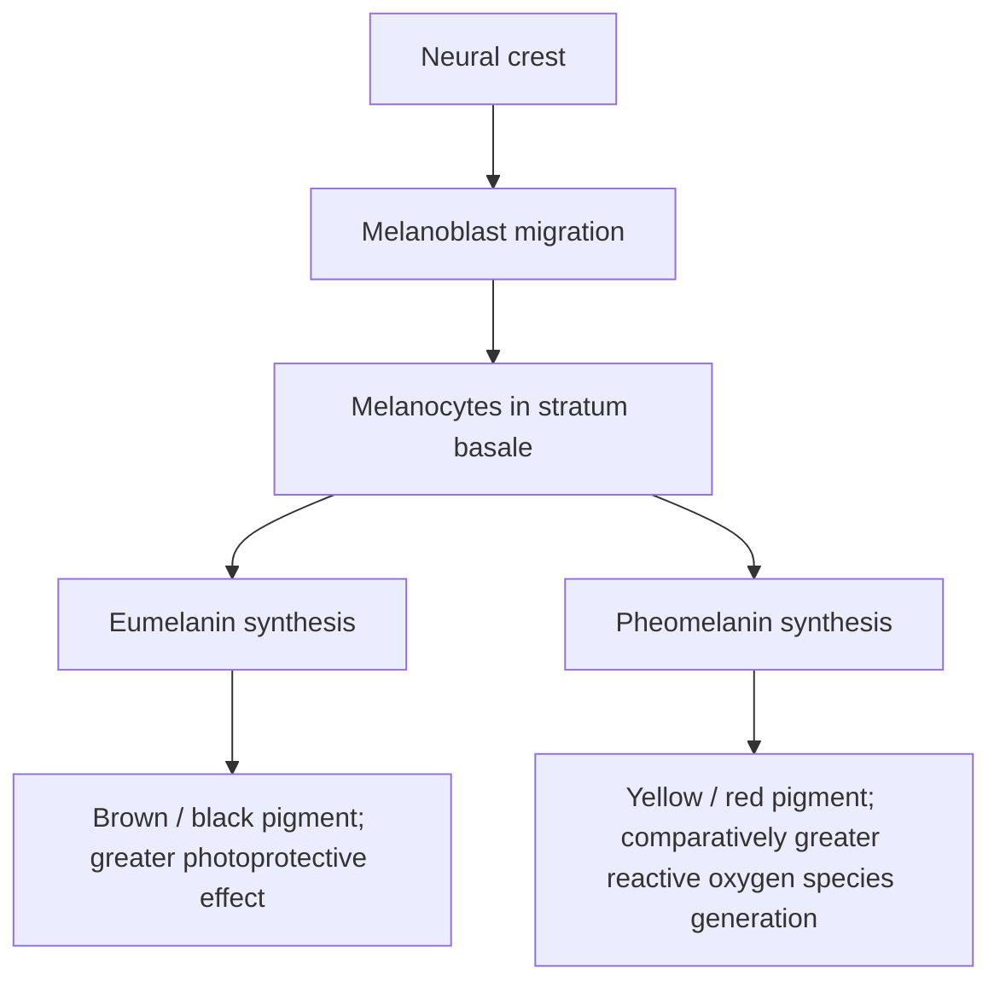
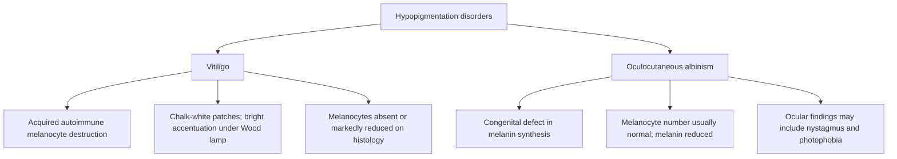

# Chapter 11: Disorders of Pigmentation and Melanocyte Biology

## 11.1 Melanocyte Biology & Melanin Synthesis

Melanocytes are specialized, neural crest-derived pigment-producing cells located in the **stratum basale** of the epidermis (at a ratio of approximately 1 melanocyte per 6 to 10 basal keratinocytes).

**Melanocyte development and pigment pathways**

### Key Biological Features
* **Epidermal Melanin Unit**: A functional unit comprising **1 melanocyte and approximately 36 associated basal/spinous keratinocytes** to which melanosomes are transferred via dendritic processes.
* **Enzymatic Pathway**:
  $$\text{L-Tyrosine} \xrightarrow{\text{Tyrosinase}} \text{L-DOPA} \xrightarrow{\text{Tyrosinase}} \text{Dopaquinone}$$
  * Dopaquinone branches into:
    1. **Eumelanin**: Brown-black, highly photoprotective polymer that scavenges reactive oxygen species (ROS).
    2. **Pheomelanin**: Yellow-red, cysteine-containing sulfurylated pigment that generates ROS upon UV exposure.
* **Melanosome Stages**:
  * **Stage I**: Unpigmented membrane-bound spherical vesicle with internal matrix filaments.
  * **Stage II**: Oval vesicle with distinct longitudinal striations; tyrosinase present, no melanin deposited.
  * **Stage III**: Active melanin deposition along internal striations; partial opacity.
  * **Stage IV**: Mature, fully electron-dense melanosome with complete melanin saturation and absent tyrosinase activity.
* **Racial Pigmentation Differences**: Skin color differences are **NOT driven by melanocyte count** (which is identical across races), but rather by melanosome size, number, distribution, and degradation rate:
  * *Darkly pigmented skin*: Larger, single, stage IV melanosomes transferred individually into keratinocytes; slower degradation.
  * *Lightly pigmented skin*: Smaller, clustered (packaged in membrane-bound groups) stage II/III melanosomes; rapid lysosomal degradation.

> [!NOTE]
> **Key Clinical Concept**: Melanocytes produce pigment inside organelles called melanosomes, but transfer them to keratinocytes via cytocrine secretion. It is the epidermal keratinocytes that hold the bulk of protective melanin above their nuclei ("nuclear parasols") to shield DNA from UV damage.

---

## 11.2 Hyperpigmentation Disorders

Hyperpigmentation results from increased melanin production (melanotic), increased melanocyte proliferation (melanocytic), or dermal melanin deposition.

| Disorder | Mechanism / association | Typical clinical features |
| :--- | :--- | :--- |
| Melasma (chloasma) | Hormonal influences and ultraviolet exposure. | Facial, often malar, brown macules or patches. |
| Acanthosis nigricans | Insulin resistance; may be associated with malignancy in selected clinical contexts. | Velvety hyperpigmented plaques in flexures. |
| Ephelides (freckles) | Normal melanocyte number with increased melanin production. | Sun-exposed macules that darken with sun exposure and may fade in winter. |
| Lentigines | Increased melanocyte number / basal melanocytic hyperplasia. | Persistent pigmented macules that do not show the same seasonal fading. |

### 1. Melasma (Chloasma / Mask of Pregnancy)
* **Definition**: An acquired, symmetric, macular hyperpigmentation involving sun-exposed facial areas.
* **Etiology & Risk Factors**:
  * Female predominance (90%), higher prevalence in Fitzpatrick skin types III–V.
  * Driven by **estrogen and progesterone** (pregnancy, oral contraceptives, HRT) combined with **UV radiation**.
* **Clinical Patterns**:
  1. *Centrofacial* (63%): Forehead, cheeks, upper lip, nose, and chin.
  2. *Malar* (21%): Cheeks and nose.
  3. *Mandibular* (16%): Ramus of the mandible.
* **Wood's Lamp Examination**:
  * **Epidermal Type**: Pigment accentuated under Wood's lamp (best response to topical therapy).
  * **Dermal Type**: Pigment not accentuated under Wood's lamp (dermal melanophages present).
  * **Mixed Type**: Partial accentuation.
* **Treatment Protocols**:
  * Strict photoprotection (broad-spectrum SPF $\ge 50$ containing Zinc Oxide / Titanium Dioxide).
  * **Kligman's Triple Combination Cream** (Gold Standard):
    * **Hydroquinone 4%** (inhibits Tyrosinase) + **Tretinoin 0.05%** (increases cell turnover) + **Fluocinolone acetonide 0.01%** (reduces irritation).
  * Oral Tranexamic Acid (plasminogen inhibitor) for refractory cases.

### 2. Acanthosis Nigricans
* **Definition**: A dermatosis characterized by hyperpigmented, velvety, hyperkeratotic plaques located symmetrically in flexural folds.
* **Anatomical Distribution**: Axillae (most common), posterior neck, groin, inframammary folds, and antecubital fossae.
* **Pathophysiology**: Hyperinsulinemia or tumor-derived growth factors stimulate **Insulin-like Growth Factor-1 (IGF-1) receptors** and EGFR on epidermal keratinocytes and dermal fibroblasts, inducing cellular proliferation.
* **Clinical Classification**:
  * **Benign / Metabolic**: Associated with obesity, Type 2 Diabetes Mellitus, PCOS, Cushing syndrome, and metabolic syndrome.
  * **Malignant**: Sudden, explosive onset of extensive lesions in older non-obese adults; strongly associated with **GI Adenocarcinomas (especially Gastric Adenocarcinoma)**.
    * Often accompanied by **Tripe Palms** (velvety rugose palmar keratoderma) and the **Sign of Leser-Trélat** (eruptive seborrheic keratoses).

### 3. Ephelides (Freckles) vs. Lentigines

| Diagnostic Feature | Ephelides (Freckles) | Lentigines (Lentigo Simplex / Solar) |
| :--- | :--- | :--- |
| **Melanocyte Number** | **Normal count** (increased melanin synthesis) | **Increased count** (linear basal hyperplasia) |
| **Sunlight Response** | **Darkens with sun**; fades in winter | **Does NOT change** with sun exposure |
| **Anatomical Site** | Sun-exposed areas (nose, cheeks, shoulders) | Any site (including non-exposed skin/mucosa) |
| **Histopathology** | Hyperpigmented basal layer; no rete elongation | Elongated, club-shaped rete ridges with melanocyte proliferation |

| Pattern | Melanocyte / pigment finding | Histological or clinical distinction |
| :--- | :--- | :--- |
| Ephelides | Normal melanocyte number; increased melanin in basal layer. | No characteristic rete-ridge elongation. |
| Lentigines | Increased melanocyte number / hyperplasia. | Elongated, club-shaped rete ridges with melanocytic proliferation. |
| Dermal post-inflammatory hyperpigmentation | Melanin in dermal melanophages after pigment incontinence. | Free / phagocytosed melanin in the dermis. |
---

## 11.3 Hypopigmentation and Depigmentation Disorders
**Hypopigmentation disorders: key distinctions**

### 1. Vitiligo
* **Definition**: An acquired autoimmune disorder characterized by circumscribed depigmented macules and patches resulting from the destruction of functional epidermal melanocytes.
* **Pathophysiology**:
  * **Autoimmune Theory** (Primary): Cytotoxic CD8+ T cells target melanocytic antigens (Melan-A/MART-1, tyrosinase, gp100); associated with circulating autoantibodies.
  * Strongly linked with other autoimmune diseases: **Autoimmune Thyroiditis (Hashimoto / Graves - most common)**, Type 1 DM, Alopecia Areata, Pernicious Anemia, Addison's disease.
  * **True Koebner Phenomenon $\oplus$**: Depigmented macules develop at sites of mechanical trauma or friction.
* **Clinical Subtypes**:
  * *Non-Segmental / Generalized (Vulgaris)*: Symmetric distribution on acrofacial sites, extensor bony prominences, and flexural folds.
  * *Segmental*: Unilateral, dermatomal/pseudo-dermatomal distribution; early onset, stable, resistant to medical therapy.
  * *Universal*: Depigmentation involving $>80\%$ of total body surface area.
* **Diagnostic Features**:
  * **Wood's Lamp**: Demonstrates **bright chalk-white / ivory-white fluorescence** with sharp, well-defined margins.
  * **Histopathology**: Complete absence of melanocytes and melanin pigment in the basal layer (confirmed negative by Fontana-Masson stain and MART-1/Melan-A immunohistochemistry).
* **Therapeutic Protocols**:
  1. *Localized disease ($<10\%$ BSA)*: High-potency topical corticosteroids or topical calcineurin inhibitors (Tacrolimus 0.1% / Pimecrolimus).
  2. *Generalized disease ($>10\%$ BSA)*: **Narrowband UVB (NB-UVB 311 nm)** phototherapy (Gold Standard) or PUVA.
  3. *Refractory / Stable disease ($>1$ year)*: Autologous punch grafting, suction blister epidermal grafting, or non-cultured melanocyte-keratinocyte cell transplantation (MKCT).
  4. *Universal Vitiligo ($>80\%$ BSA)*: Permanent depigmentation of remaining pigmented skin using **Monobenzyl Ether of Hydroquinone (MBEH 20%)**.

### 2. Oculocutaneous Albinism (OCA)
* **Definition**: A group of autosomal recessive congenital metabolic disorders characterized by a complete or partial loss of melanin synthesis in the skin, hair, and eyes.
* **Key Feature**: **Melanocyte count is NORMAL**, but melanin production is absent or severely diminished due to enzymatic defects.
* **Major Subtypes**:
  * **OCA Type 1**: Caused by mutations in the *TYR* gene encoding **Tyrosinase** (Chromosome 11q).
    * *OCA1a*: Complete absence of tyrosinase activity; snow-white hair, pink skin, translucent light-blue irides, severe nystagmus, photophobia, and profound loss of visual acuity.
    * *OCA1b*: Reduced tyrosinase activity (temperature-sensitive variants).
  * **OCA Type 2**: Most common globally; caused by mutations in the *P* gene (Chromosome 15q).
* **Clinical Complications**: Extreme susceptibility to UV damage, actinic keratoses, and early development of **Squamous Cell Carcinoma (SCC)** and Basal Cell Carcinoma (BCC).

### 3. Pityriasis Alba
* **Definition**: A mild, self-limiting low-grade eczematous dermatosis occurring predominantly in children with an atopic diathesis.
* **Clinical Presentation**: Ill-defined, hypopigmented macules with **fine, branny scales** located on the cheeks and lateral arms.
* **Wood's Lamp**: Shows **faint, non-accentuated hypopigmentation** (crucial for differentiating from the bright chalk-white fluorescence of vitiligo).

---

## 11.4 Comparative Summary Matrix

> [!IMPORTANT]
> **Diagnostic Differentiation Matrix**:

| Parameter | Vitiligo | Oculocutaneous Albinism | Pityriasis Alba | Post-Inflammatory Hypopigmentation |
| :--- | :--- | :--- | :--- | :--- |
| **Etiology** | Autoimmune CD8+ T-cell attack | Autosomal recessive *TYR* / *P* gene mutation | Atopic eczematous reaction | Prior inflammatory injury (psoriasis, eczema) |
| **Melanocyte Count** | **ABSENT (0%)** | **NORMAL** | Normal to slightly reduced | Normal |
| **Melanin Content** | **ABSENT** | **ABSENT / Severely low** | Temporarily reduced | Reduced epidermal transfer |
| **Wood's Lamp** | **Chalk-white fluorescence** | No diagnostic change | Non-accentuated faint signal | Faint, non-fluorescent |
| **Prognosis** | Variable; repigmentation via hair follicle reservoir | Permanent | Self-resolving | Self-resolving over months |
