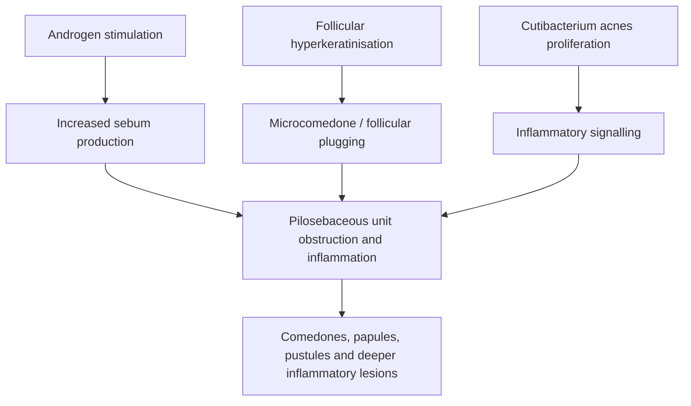
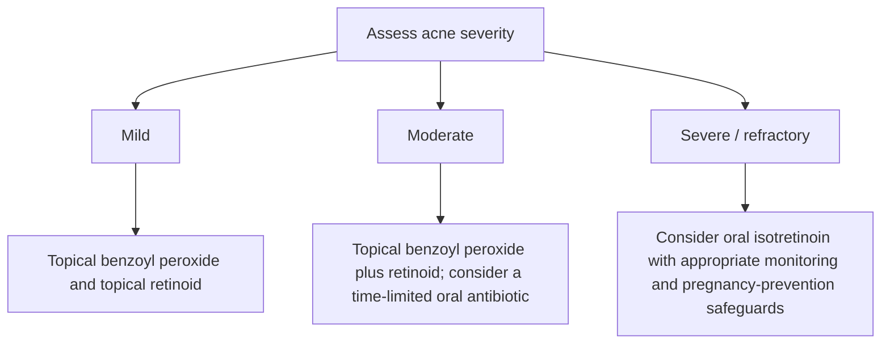
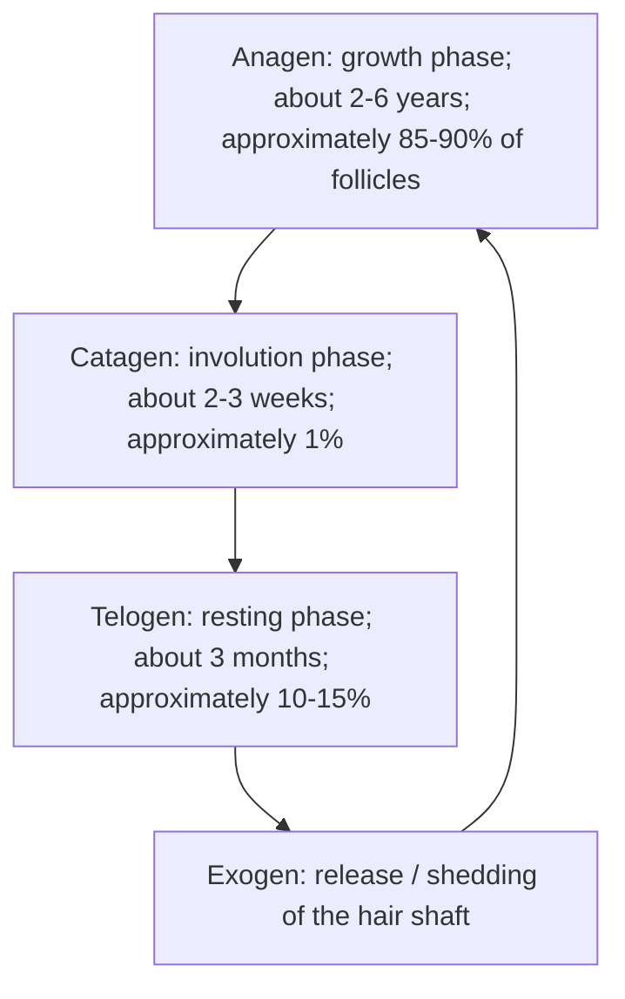

# Chapter 12: Appendageal Disorders (Acne, Hair, and Nails)

## 12.1 Acne Vulgaris & Rosacea

### 1. Acne Vulgaris
Acne vulgaris is a chronic inflammatory disease of the **pilosebaceous unit**, predominantly affecting adolescents and young adults in seborrheic zones (face, chest, upper back).

**Acne vulgaris: key interacting pathogenic factors**

#### The Four Pillars of Pathogenesis
1. **Androgen-Driven Seborrhea**: Dihydrotestosterone (DHT) binds androgen receptors on sebocytes, increasing sebum production.
2. **Abnormal Follicular Keratinization**: Hyperproliferation and cohesion of corneocytes in the follicular infundibulum obstruct the pore, forming a **microcomedone**.
3. **Colonization by *Cutibacterium acnes***: Anaerobic, Gram-positive diphtheroid (*C. acnes*) proliferates within the lipid-rich, obstructed follicle.
4. **Perifollicular Inflammation**: *C. acnes* secretes lipases that cleave sebum triglycerides into free fatty acids, triggering Toll-like receptor 2 (TLR-2) pathways, neutrophil chemotaxis, and follicular wall rupture.

#### Lesion Classification & Grading

| Lesion group | Lesion | Morphology |
| :--- | :--- | :--- |
| Non-inflammatory | Open comedone | Open follicular plug; clinically a blackhead. |
| Non-inflammatory | Closed comedone | Closed follicular plug; clinically a whitehead. |
| Inflammatory | Papule | Small, solid inflammatory elevation (often <5 mm). |
| Inflammatory | Pustule | Pus-containing inflammatory lesion. |
| Inflammatory | Nodule / cyst | Deeper, larger inflammatory lesion; nodules are typically >5 mm. |

* **Non-Inflammatory Lesions**:
  * **Open Comedones (Blackheads)**: Wide follicular orifice plugged with oxidized melanin, lipids, and keratinaceous debris (dark color is due to **oxidized melanin**, NOT dirt).
  * **Closed Comedones (Whiteheads)**: Tiny, microscopic follicular opening with trapped keratin and sebum; high risk of rupture into inflammatory lesions.
* **Pillsbury / Leeds Grading System**:
  * *Grade 1 (Mild)*: Comedones with occasional small papules.
  * *Grade 2 (Moderate)*: Papules and pustules predominantly on the face.
  * *Grade 3 (Severe)*: Extensive inflammatory papules, pustules, and occasional deep nodules.
  * *Grade 4 (Nodulocystic)*: Severe nodulocystic lesions, sinus tracts, and extensive scarring.

#### Therapeutic Protocols

**Acne treatment by severity (general framework)**

1. **Mild Acne**: Topical Benzoyl Peroxide (BPO 2.5–5%) + Topical Retinoid (Adapalene 0.1% or Tretinoin 0.025%). BPO generates free radicals and prevents bacterial resistance.
2. **Moderate Acne**: Topical BPO + Topical Retinoid + **Oral Antibiotic (Doxycycline 100 mg/day or Lymecycline)** for a maximum duration of 12 weeks.
   * *Rule*: **Never use oral or topical antibiotics as monotherapy** due to rapid development of resistant *C. acnes* strains; always combine with BPO.
3. **Severe Nodulocystic / Refractory Acne**: **Oral Isotretinoin (13-cis-retinoic acid)**.
   * *Dosage*: $0.5\text{--}1.0 \text{ mg/kg/day}$ to achieve a target cumulative dose of **$120\text{--}150 \text{ mg/kg}$**.
   * *Mechanism*: Induces sebocyte apoptosis, reduces sebum production by $>90\%$, normalizes keratinization, and indirectly suppresses *C. acnes*.

> [!WARNING]
> **Isotretinoin Safety Warnings & Side Effects**:
> * **Absolute Teratogen**: Causes severe central nervous system, craniofacial, and cardiovascular fetal malformations. Requires dual contraception and 2 negative pregnancy tests prior to initiation (**iPLEDGE program**).
> * **Mucocutaneous**: Cheilitis (100% of patients; marker of compliance), xerosis, epistaxis, dry eyes.
> * **Systemic**: Hypertriglyceridemia, elevated transaminases (LFTs), premature epiphyseal closure in adolescents.
> * **Drug Interaction**: **Absolute contraindication to combine Isotretinoin with Tetracyclines** due to the high risk of inducing **Pseudotumor Cerebri (Idiopathic Intracranial Hypertension)**.

#### Special Clinical Variants of Acne
* **Acne Conglobata**: Highly destructive form with interconnecting abscesses, draining sinus tracts, and severe keloidal scarring.
* **Acne Fulminans**: Acute, febrile, ulcerating form presenting with painful hemorrhagic nodules, polyarthralgias, leukocytosis, and osteolytic bone lesions.
* **Drug-Induced Acne**: Caused by Systemic Corticosteroids, Lithium, Isoniazid (INH), or Phenytoin. Characterized by **monomorphic papulopustules without comedones**.

---

### 2. Rosacea
* **Definition**: A chronic inflammatory vascular and appendageal dermatosis affecting the central face of middle-aged individuals (30–50 years).
* **Pathophysiology**: Neurovascular dysregulation, innate immune hyperreactivity (elevated **Cathelicidin LL-37**), and colonization by the follicular mite ***Demodex folliculorum***.
* **Clinical Subtypes**:
  1. *Erythematotelangiectatic*: Persistent central facial erythema, flushing, and telangiectasias.
  2. *Papulopustular*: Central facial erythematous papules and pustules **WITHOUT COMEDONES** (key feature distinguishing it from acne vulgaris).
  3. *Phymatous*: Tissue hypertrophy and irregular nodular thickening; most commonly presents as **Rhinophyma** (bulbous enlargement of the nose due to sebaceous hyperplasia in males).
  4. *Ocular*: Blepharitis, conjunctivitis, and episcleritis.
* **Triggers**: Alcohol, hot beverages, spicy foods, thermal extremes, and UV light.
* **Treatment**: Topical Metronidazole 0.75%, Topical Ivermectin 1%, Topical Azelaic acid 15%; Oral Doxycycline (sub-antimicrobial dose 40 mg/day); Surgical debulking or CO2 laser for Rhinophyma.

---

## 12.2 Hair & Scalp Disorders

### 1. The Hair Growth Cycle

**Hair growth cycle**

### 2. Alopecia Areata
* **Definition**: An autoimmune non-scarring hair loss disorder characterized by patchy hair loss targeting anagen hair follicles.
* **Pathophysiology**: Loss of immune privilege in the hair follicle bulge/bulb driven by an inflammatory infiltrative attack of CD4+ and CD8+ T lymphocytes.
* **Clinical Features**:
  * Smooth, circumscribed, non-scarring patches of hair loss on the scalp or beard.
  * **Exclamatory Mark Hairs**: Short, broken hairs at the expanding border of active patches, with a narrow, attenuated proximal shaft and normal distal tip.
  * *Alopecia Totalis*: Complete loss of all scalp hair.
  * *Alopecia Universalis*: Complete loss of all body hair (scalp, eyebrows, eyelashes, pubic hair).
* **Histopathology**: Dense peribulbar lymphocytic infiltrate surrounding anagen hair bulbs, classic **"swarm of bees"** appearance.
* **Associations**: Autoimmune thyroiditis, Vitiligo, Atopic Dermatitis, Down Syndrome.
* **Treatment**: Intralesional Triamcinolone Acetonide (ILK $5 \text{ mg/mL}$), Topical Minoxidil, Systemic Steroids, or Oral JAK Inhibitors (**Baricitinib / Ritlecitinib**).

| Finding | Alopecia areata |
| :--- | :--- |
| Hair morphology | Exclamation-mark hairs may be seen at the active edge of a patch. |
| Hair follicle phase | The immune attack predominantly targets anagen hair follicles. |
| Histopathology | Peribulbar lymphocytic infiltrate around anagen hair bulbs (“swarm of bees”). |
### 3. Androgenetic Alopecia (Pattern Hair Loss)
* **Pathophysiology**: Genetically determined sensitivity of hair follicles to **Dihydrotestosterone (DHT)**, synthesized locally from testosterone by **5$\alpha$-Reductase Type 2**.
  * DHT induces progressive **follicular miniaturization** (conversion of large terminal hairs into tiny, unpigmented vellus hairs) and shortens the anagen phase duration.
* **Clinical Patterns**:
  * *Males (Hamilton-Norwood Scale)*: Bitemporal recession followed by vertex thinning.
  * *Females (Ludwig Scale)*: Diffuse central scalp thinning with preservation of the frontal hairline.
* **Pharmacotherapy**:
  * **Oral Finasteride (1 mg/day)**: Selective 5$\alpha$-Reductase Type 2 inhibitor. Halts progression and promotes regrowth in males. (Side effects: decreased libido, erectile dysfunction, gynecomastia).
  * **Topical Minoxidil (2% or 5% solution)**: Direct K+ channel opener and vasodilator; prolongs anagen duration and increases follicular blood flow.

### 4. Telogen Effluvium
* **Pathophysiology**: Acute, synchronized shift of a high percentage of anagen hair follicles into the telogen phase following a severe systemic stressor.
* **Triggers**: High fever, severe infection, major surgery, post-childbirth (telogen gravidarum), severe caloric restriction, or acute emotional shock.
* **Clinical Timing**: Diffuse hair shedding occurring **2 to 3 months AFTER the inciting stressor**.
* **Diagnostic Marker**: Hair pull test is positive ($>6$ telogen hairs extracted per pull); light microscopy reveals characteristic **club-shaped telogen bulbs**. Fully reversible over 6–12 months.

---

## 12.3 Nail Pathology & Clinical Signs
| Nail-unit structure | Contribution to nail unit | Clinical association listed in source |
| :--- | :--- | :--- |
| Proximal matrix | Forms the dorsal nail plate. | Matrix pathology may produce nail pitting. |
| Distal matrix | Contributes to the ventral nail plate. | Distal matrix pathology may produce leukonychia. |
| Nail bed | Supports and adheres the nail plate to the distal phalanx. | Nail-bed pathology may produce onycholysis. |

### High-Yield Clinical Nail Signs

| Clinical Sign | Morphological Appearance | Associated Disease Conditions |
| :--- | :--- | :--- |
| **Nail Pitting** | Small, shallow punctate depressions in nail plate | **Psoriasis (#1)**, Alopecia Areata, Eczema |
| **Oil-Drop / Salmon-Patch** | Yellow-red translucent discoloration under nail plate | **Psoriasis** (pathognomonic) |
| **Pterygium Formation** | Forward extension of eponychium fusing with nail bed | **Lichen Planus** (pathognomonic) |
| **Koilonychia** | Concave, spoon-shaped nail plate deformation | **Iron Deficiency Anemia**, Hemochromatosis |
| **Digital Clubbing** | Lovibond angle $>180^\circ$; Schamroth window sign positive | Cyanotic Heart Disease, Lung Cancer, IPF, IBD |
| **Yellow Nail Syndrome** | Thickened yellow nails + Lymphedema + Pleural Effusion | Chronic respiratory disease, lymphatic hypoplasia |
| **Splinter Hemorrhages** | Longitudinal red-brown lines in distal nail bed | **Infective Endocarditis**, Vasculitis, Trauma |
| **Beau's Lines** | Transverse linear grooves across nail plates | Arrest of matrix mitotic activity (severe infection, chemo) |
