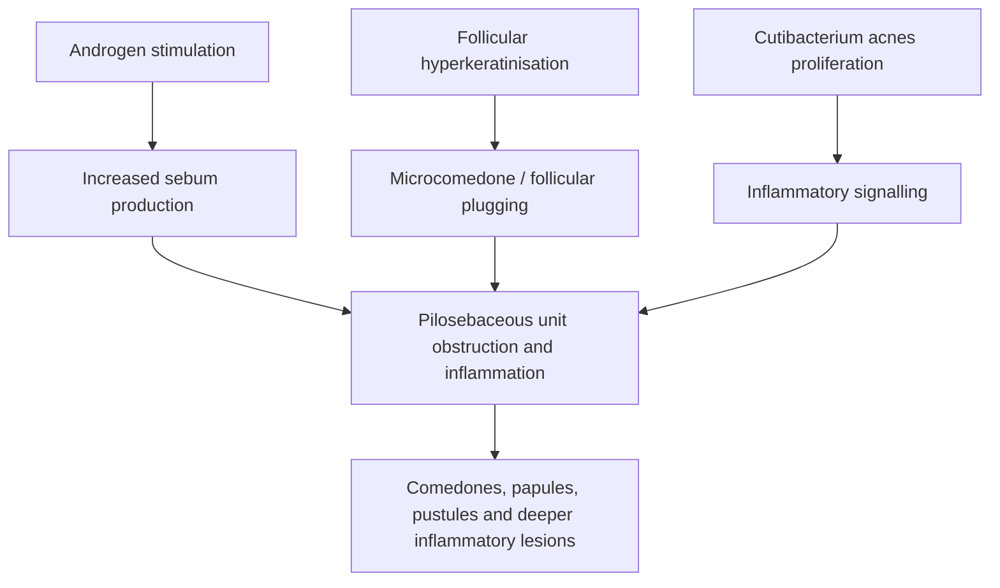
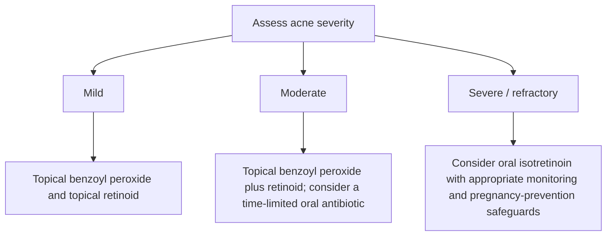
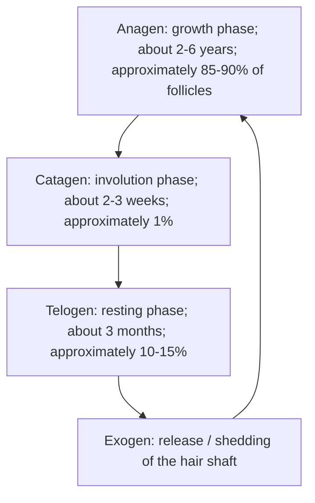

# Chapter 12: Appendageal Disorders (Acne, Hair, and Nails)

## 12.1 Acne Vulgaris & Rosacea

### 1. Acne Vulgaris
Acne vulgaris is a chronic inflammatory disease of the **pilosebaceous unit**, predominantly affecting adolescents and young adults in seborrheic zones (face, chest, upper back).

**Acne vulgaris: key interacting pathogenic factors**



#### The Four Pillars of Pathogenesis
1. **Androgen-Driven Seborrhea**: Dihydrotestosterone (DHT) binds androgen receptors on sebocytes, increasing sebum production.
2. **Abnormal Follicular Keratinization**: Hyperproliferation and cohesion of corneocytes in the follicular infundibulum obstruct the pore, forming a **microcomedone**.
3. **Colonization by *Cutibacterium acnes***: Anaerobic, Gram-positive diphtheroid (*C. acnes*) proliferates within the lipid-rich, obstructed follicle.
4. **Perifollicular Inflammation**: *C. acnes* secretes lipases that cleave sebum triglycerides into free fatty acids, triggering Toll-like receptor 2 (TLR-2) pathways, neutrophil chemotaxis, and follicular wall rupture.

#### Lesion Classification & Grading

| Lesion group | Lesion | Morphology |
| :--- | :--- | :--- |
| Non-inflammatory | Open comedone | Open follicular plug; clinically a blackhead. |
| Non-inflammatory | Closed comedone | Closed follicular plug; clinically a whitehead. |
| Inflammatory | Papule | Small, solid inflammatory elevation (often <5 mm). |
| Inflammatory | Pustule | Pus-containing inflammatory lesion. |
| Inflammatory | Nodule / cyst | Deeper, larger inflammatory lesion; nodules are typically >5 mm. |

* **Non-Inflammatory Lesions**:
  * **Open Comedones (Blackheads)**: Wide follicular orifice plugged with oxidized melanin, lipids, and keratinaceous debris (dark color is due to **oxidized melanin**, NOT dirt).
  * **Closed Comedones (Whiteheads)**: Tiny, microscopic follicular opening with trapped keratin and sebum; high risk of rupture into inflammatory lesions.
* **Pillsbury / Leeds Grading System**:
  * *Grade 1 (Mild)*: Comedones with occasional small papules.
  * *Grade 2 (Moderate)*: Papules and pustules predominantly on the face.
  * *Grade 3 (Severe)*: Extensive inflammatory papules, pustules, and occasional deep nodules.
  * *Grade 4 (Nodulocystic)*: Severe nodulocystic lesions, sinus tracts, and extensive scarring.

#### Therapeutic Protocols

**Acne treatment by severity (general framework)**



1. **Mild Acne**: Topical Benzoyl Peroxide (BPO 2.5–5%) + Topical Retinoid (Adapalene 0.1% or Tretinoin 0.025%). BPO generates free radicals and prevents bacterial resistance.
2. **Moderate Acne**: Topical BPO + Topical Retinoid + **Oral Antibiotic (Doxycycline 100 mg/day or Lymecycline)** for a maximum duration of 12 weeks.
   * *Rule*: **Never use oral or topical antibiotics as monotherapy** due to rapid development of resistant *C. acnes* strains; always combine with BPO.
3. **Severe Nodulocystic / Refractory Acne**: **Oral Isotretinoin (13-cis-retinoic acid)**.
   * *Dosage*: $0.5\text{--}1.0 \text{ mg/kg/day}$ to achieve a target cumulative dose of **$120\text{--}150 \text{ mg/kg}$**.
   * *Mechanism*: Induces sebocyte apoptosis, reduces sebum production by $>90\%$, normalizes keratinization, and indirectly suppresses *C. acnes*.

> [!WARNING]
> **Isotretinoin Safety Warnings & Side Effects**:
> * **Absolute Teratogen**: Causes severe central nervous system, craniofacial, and cardiovascular fetal malformations. Requires dual contraception and 2 negative pregnancy tests prior to initiation (**iPLEDGE program**).
> * **Mucocutaneous**: Cheilitis (100% of patients; marker of compliance), xerosis, epistaxis, dry eyes.
> * **Systemic**: Hypertriglyceridemia, elevated transaminases (LFTs), premature epiphyseal closure in adolescents.
> * **Drug Interaction**: **Absolute contraindication to combine Isotretinoin with Tetracyclines** due to the high risk of inducing **Pseudotumor Cerebri (Idiopathic Intracranial Hypertension)**.

#### Special Clinical Variants of Acne
* **Acne Conglobata**: Highly destructive form with interconnecting abscesses, draining sinus tracts, and severe keloidal scarring.
* **Acne Fulminans**: Acute, febrile, ulcerating form presenting with painful hemorrhagic nodules, polyarthralgias, leukocytosis, and osteolytic bone lesions.
* **Drug-Induced Acne**: Caused by Systemic Corticosteroids, Lithium, Isoniazid (INH), or Phenytoin. Characterized by **monomorphic papulopustules without comedones**.

---

### 2. Rosacea
* **Definition**: A chronic inflammatory vascular and appendageal dermatosis affecting the central face of middle-aged individuals (30–50 years).
* **Pathophysiology**: Neurovascular dysregulation, innate immune hyperreactivity (elevated **Cathelicidin LL-37**), and colonization by the follicular mite ***Demodex folliculorum***.
* **Clinical Subtypes**:
  1. *Erythematotelangiectatic*: Persistent central facial erythema, flushing, and telangiectasias.
  2. *Papulopustular*: Central facial erythematous papules and pustules **WITHOUT COMEDONES** (key feature distinguishing it from acne vulgaris).
  3. *Phymatous*: Tissue hypertrophy and irregular nodular thickening; most commonly presents as **Rhinophyma** (bulbous enlargement of the nose due to sebaceous hyperplasia in males).
  4. *Ocular*: Blepharitis, conjunctivitis, and episcleritis.
* **Triggers**: Alcohol, hot beverages, spicy foods, thermal extremes, and UV light.
* **Treatment**: Topical Metronidazole 0.75%, Topical Ivermectin 1%, Topical Azelaic acid 15%; Oral Doxycycline (sub-antimicrobial dose 40 mg/day); Surgical debulking or CO2 laser for Rhinophyma.

---

## 12.2 Hair & Scalp Disorders

### 1. The Hair Growth Cycle

**Hair growth cycle**



* **Exogen (shedding phase):** release of the hair shaft. A commonly cited normal daily shed is approximately **50–100 hairs/day**, although counts vary between individuals and with washing and grooming habits.

### 2. Classification of Alopecia

Alopecia is broadly divided into **non-scarring (non-cicatricial)** and **scarring (cicatricial)** forms according to whether permanent damage to the follicular stem-cell region occurs.

```text
ALOPECIA
├── Non-scarring (regrowth possible)
│   ├── Patterned: androgenetic alopecia
│   ├── Patchy: alopecia areata, trichotillomania, non-inflammatory tinea capitis,
│   │           secondary syphilis
│   └── Diffuse: anagen effluvium, telogen effluvium
└── Scarring (permanent follicular destruction)
    ├── Primary
    │   ├── Lymphocytic: lichen planopilaris, DLE, pseudopelade of Brocq
    │   └── Neutrophilic: folliculitis decalvans, dissecting cellulitis
    └── Secondary: traction alopecia, inflammatory tinea capitis,
                   morphea, burns and other destructive injury
```

* **Non-scarring alopecia:** follicular capacity for regrowth is preserved.
* **Scarring alopecia:** irreversible destruction of stem cells in the follicular bulge/isthmus region leads to permanent loss without potential for regrowth.

### 3. Non-Scarring (Non-Cicatricial) Alopecia

#### A. Patterned Alopecia — Androgenetic Alopecia (AGA)

* **Pathophysiology:** genetically determined follicular sensitivity to **dihydrotestosterone (DHT)**. Testosterone is converted locally by **5α-reductase (especially type 2)**; DHT shortens anagen and causes progressive **follicular miniaturization**, converting terminal hairs into smaller, thinner vellus-like hairs.
* **Male Pattern Hair Loss (MPHL):** frontotemporal recession followed by vertex involvement; graded using the **Norwood–Hamilton scale (I–VII)**.
* **Female Pattern Hair Loss (FPHL):** widening of the central parting / diffuse central scalp thinning with preservation of the frontal hairline; a **Christmas-tree pattern** may be seen; graded using the **Ludwig scale (I–III)**.
* **Treatment:**
  1. **Topical minoxidil:** a vasodilator and ATP-sensitive K⁺-channel opener; prolongs anagen and increases follicular blood flow. Commonly used concentrations include 5% in men and 2% in women (formulations and recommendations vary).
  2. **Oral 5α-reductase inhibitors:** finasteride 1 mg/day or dutasteride 0.5 mg/day. Finasteride inhibits type 2 5α-reductase; counsel regarding sexual adverse effects and pregnancy-related handling precautions.

#### B. Patchy Alopecia

**1. Alopecia Areata**

* **Etiology / pathophysiology:** T-cell-mediated autoimmune disease involving loss of hair-follicle immune privilege. CD4⁺ and CD8⁺ T lymphocytes attack anagen hair bulbs (classically the pigmented/black anagen bulb); the peribulbar infiltrate is the classic **“swarm of bees”**.
* **Clinical features:** well-defined, smooth, round-to-oval, non-scarring patches of complete hair loss on scalp or beard. Grey hairs may be relatively spared, producing the described **“going grey overnight” (*canities subita*)** phenomenon.
* **Diagnostic markers:**
  * **Exclamation-mark hairs:** short hairs at the active margin, broader distally and tapered proximally.
  * **Dermoscopy:** yellow dots (empty follicular openings) and characteristic short broken hairs may be seen.
* **Clinical subtypes:** **ophiasis** (band-like involvement along the occipital/temporal margin; poorer prognostic indicator), **alopecia totalis** (complete scalp-hair loss), and **alopecia universalis** (loss of all body hair).
* **Associations:** autoimmune thyroiditis / Hashimoto thyroiditis, vitiligo, atopic dermatitis and other autoimmune conditions; Down syndrome is also described as an association.
* **Nails:** fine, superficial, regular/geometric pitting (“sandpaper nails”) and **trachyonychia** (roughness / twenty-nail dystrophy).
* **Histopathology:** dense peribulbar lymphocytic infiltrate around anagen bulbs — **“swarm of bees.”**
* **Treatment:** localized disease may be treated with intralesional triamcinolone (e.g. 5 mg/mL in scalp lesions); topical therapies may be used. Extensive disease may require systemic treatment, including corticosteroids or oral JAK inhibitors such as baricitinib / ritlecitinib, depending on indication and eligibility.

| Finding | Alopecia areata |
| :--- | :--- |
| Pattern | Smooth, sharply demarcated, non-scarring patches |
| Hair morphology | Exclamation-mark hairs at active margins |
| Follicular phase | Predominantly anagen hair follicles |
| Dermoscopy | Yellow dots; short broken hairs |
| Histopathology | Peribulbar lymphocytic infiltrate (“swarm of bees”) |
| Nail association | Geometric pitting / trachyonychia |

**2. Trichotillomania (Hair-Pulling Disorder)**

* **Classification:** psycho-cutaneous disorder within the obsessive-compulsive and related disorders; characterized by recurrent hair pulling, often preceded by tension or urge and followed by temporary relief. It may cause distress, disfigurement and social or occupational impairment. It is reported more commonly in females; the temporo-parietal scalp is a frequent site.
* **Morphology:** patchy alopecia with **bizarrely shaped, ill-defined patches** and incomplete hair loss within the affected area.
* **Hair-shaft examination:** broken hairs of **varying lengths**, longitudinal splitting and perifollicular haemorrhages.
* **Clinical signs:**
  * **Friar Tuck / Robin Hood sign:** loss of hair over the crown with a narrow rim of preserved peripheral hair.
  * **Card test:** placing a contrasting card beneath a lock of hair makes irregular broken shafts of different lengths easier to identify.
* **Trichophagia:** swallowing pulled hair can produce a **trichobezoar**, potentially causing gastric outlet or small-bowel obstruction and requiring surgical intervention.
* **Histopathology:** broken and distorted hair shafts (**trichomalacia**) with perifollicular haemorrhage / extravasated red cells.
* **Management:** **cognitive behavioural therapy with habit-reversal training** (awareness training, relaxation and competing-response training) is the principal behavioural treatment. SSRIs may be used as pharmacotherapy in selected cases; response is variable.

**3. Tinea Capitis (Non-Inflammatory Forms)**

* A fungal scalp infection seen particularly in prepubertal children.
* **Grey-patch type:** classically ectothrix infection (arthroconidia outside the hair shaft), commonly associated with *Microsporum* species such as *M. canis*.
* **Black-dot type:** classically endothrix infection (arthroconidia within the hair shaft), associated with *Trichophyton* species such as *T. tonsurans* and *T. violaceum*; broken hairs at scalp level produce black dots.
* **Inflammatory forms** are included under secondary cicatricial alopecia below.

**4. Secondary Syphilis**

* May produce patchy, non-scarring **“moth-eaten” alopecia**, a characteristic clinical pattern.

#### C. Diffuse Alopecia (Effluvium)

**1. Anagen Effluvium**

* **Timing:** abrupt hair shedding typically **2–3 weeks** after a major insult such as cytotoxic chemotherapy or radiotherapy.
* **Mechanism:** direct injury / arrest of mitotic activity in rapidly dividing hair-matrix cells produces dystrophic anagen hairs that break or fall out.
* **Severity:** may cause marked, rapid hair loss; the supplied teaching material describes loss of approximately 80–85% of hair in severe cases.

**2. Telogen Effluvium**

* **Mechanism:** a systemic or physiological stressor causes premature transition of an increased proportion of anagen follicles into telogen, followed by synchronized shedding.
* **Timing:** diffuse shedding usually begins about **2–4 months** after the trigger (often taught as 2–3 months; some descriptions give 3–4 months).
* **Triggers:** childbirth / postpartum state (telogen gravidarum), high fever or severe infection (including typhoid, dengue or COVID-19), major surgery, trauma, heparin therapy, severe caloric restriction and acute emotional stress.
* **Diagnosis:** hair-pull test may be positive (the supplied notes cite >6 telogen hairs per pull); microscopy shows **club-shaped telogen bulbs**. A telogen fraction >30% and an anagen:telogen ratio <7:1 are described in the supplied teaching material.
* **Course:** acute telogen effluvium is usually self-limited with preserved follicular capacity; regrowth commonly occurs over 6–12 months. Chronic shedding warrants evaluation for ongoing triggers such as iron deficiency / iron-deficiency anaemia and thyroid dysfunction.

### 4. Scarring (Cicatricial) Alopecia

Scarring alopecia results from irreversible inflammatory or destructive damage to follicular stem cells in the **bulge area (isthmus)**, causing permanent loss of follicular openings and inability to regrow hair.

#### A. Primary Cicatricial Alopecia

**1. Lymphocytic infiltrate**

* **Lichen planopilaris:** lichen planus involving hair follicles; perifollicular erythema / violaceous papules and scale may progress to hyperpigmented scarring alopecia.
  * **Frontal fibrosing alopecia:** a variant, classically in postmenopausal women, with progressive frontotemporal scarring hairline recession and **madarosis** (eyebrow loss).
* **Discoid lupus erythematosus (DLE / chronic cutaneous lupus):** follicular plugging; adherent scale may show the **carpet-tack / tin-tack sign** when lifted.
* **Pseudopelade of Brocq:** idiopathic, relatively non-inflammatory scarring alopecia with small smooth areas resembling **“footprints in snow”**; histology may show perifollicular concentric lamellar fibrosis.

**2. Neutrophilic infiltrate**

* **Folliculitis decalvans / tufted folliculitis:** chronic neutrophilic folliculitis, often associated with *Staphylococcus aureus*. Multiple hair shafts emerge from one dilated follicular opening — **“doll’s hair” sign**.
* **Dissecting cellulitis of the scalp:** chronic inflammatory nodules and sinus tracts; part of the **follicular occlusion tetrad** with hidradenitis suppurativa, acne conglobata and pilonidal sinus.

#### B. Secondary Cicatricial Alopecia

* **Traction alopecia:** chronic mechanical pulling from tight braids, ponytails or other hairstyles; often affects the temporal hairline. Early disease may be reversible; longstanding traction can scar.
* **Inflammatory tinea capitis:**
  * **Kerion:** intense inflammatory reaction, often to zoophilic dermatophytes such as *T. mentagrophytes* complex or *T. verrucosum*; boggy, painful swelling with pustules, easily pluckable hairs and regional lymphadenopathy.
  * **Favus:** caused by *T. schoenleinii*; yellow, cup-shaped sulphur crusts (**scutula**) around follicles and may lead to scarring.
* **Morphea (linear morphea / en coup de sabre):** localized scleroderma producing a linear sclerotic, sometimes depressed, band over the forehead and scalp.
* **Other destructive causes:** burns, trauma and severe inflammatory or infectious injury may cause secondary scarring alopecia.

### 5. Systemic, Nutritional and Genetic Causes of Hair Changes

| Condition | Primary etiology / feature | Characteristic hair finding |
| :--- | :--- | :--- |
| **Acrodermatitis enteropathica** | Autosomal recessive zinc-transporter defect (*SLC39A4* / ZIP4) | Alopecia (sometimes reddish hair), diarrhoea and periorificial / perineal dermatitis |
| **Scurvy** | Vitamin C deficiency with defective collagen synthesis | Corkscrew hairs with perifollicular haemorrhages |
| **Kwashiorkor** | Severe protein-energy malnutrition | **Flag sign:** alternating light and dark bands along hair shafts |
| **Trichothiodystrophy** | Defective sulfur-containing keratin synthesis | Brittle hair with **“tiger-tail”** banding under polarizing microscopy |
| **Hypothyroidism** | Thyroid hormone deficiency | Diffuse alopecia; coarse, dry and brittle hair |
| **Adrenal insufficiency** | Reduced adrenal androgen production | Loss of pubic and axillary hair in females |
| **PCOS / SAHA syndrome** | Hyperandrogenism | Early androgenetic alopecia with seborrhoea, acne and hirsutism |
| **Valproate therapy** | Anticonvulsant adverse effect | Transient hair loss; regrowth may be curly after discontinuation |

## 12.3 Nail Pathology & Clinical Signs
| Nail-unit structure | Contribution to nail unit | Clinical association listed in source |
| :--- | :--- | :--- |
| Proximal matrix | Forms the dorsal nail plate. | Matrix pathology may produce nail pitting. |
| Distal matrix | Contributes to the ventral nail plate. | Distal matrix pathology may produce leukonychia. |
| Nail bed | Supports and adheres the nail plate to the distal phalanx. | Nail-bed pathology may produce onycholysis. |

### High-Yield Clinical Nail Signs

| Clinical Sign | Morphological Appearance | Associated Disease Conditions |
| :--- | :--- | :--- |
| **Nail Pitting** | Small, shallow punctate depressions in nail plate | **Psoriasis (#1)**, Alopecia Areata, Eczema |
| **Oil-Drop / Salmon-Patch** | Yellow-red translucent discoloration under nail plate | **Psoriasis** (pathognomonic) |
| **Pterygium Formation** | Forward extension of eponychium fusing with nail bed | **Lichen Planus** (pathognomonic) |
| **Koilonychia** | Concave, spoon-shaped nail plate deformation | **Iron Deficiency Anemia**, Hemochromatosis |
| **Digital Clubbing** | Lovibond angle $>180^\circ$; Schamroth window sign positive | Cyanotic Heart Disease, Lung Cancer, IPF, IBD |
| **Yellow Nail Syndrome** | Thickened yellow nails + Lymphedema + Pleural Effusion | Chronic respiratory disease, lymphatic hypoplasia |
| **Splinter Hemorrhages** | Longitudinal red-brown lines in distal nail bed | **Infective Endocarditis**, Vasculitis, Trauma |
| **Beau's Lines** | Transverse linear grooves across nail plates | Arrest of matrix mitotic activity (severe infection, chemo) |
