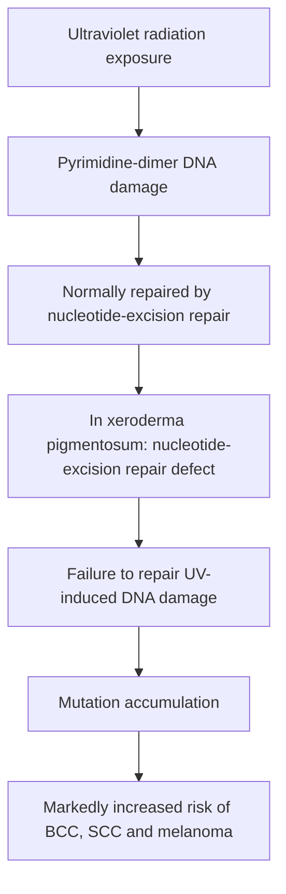

# Chapter 13: Photodermatology and Genodermatoses

## 13.1 Photodermatology & Porphyrias

### 1. The Ultraviolet Spectrum

| UV band | Approximate wavelength | Key properties / effects in the source note |
| :--- | :--- | :--- |
| UVC | 200-290 nm | Absorbed by the ozone layer; germicidal lamps. |
| UVB | 290-320 nm | Principal sunburn wavelength; predominantly epidermal absorption; pyrimidine dimers; stimulates vitamin D3 synthesis. |
| UVA | 320-400 nm | Photoaging wavelength; deeper dermal penetration; reactive oxygen species generation; penetrates window glass. |

---

### 2. Polymorphous Light Eruption (PMLE)
* **Definition**: The most common idiopathic immunologic photodermatosis, characterized by delayed abnormal cutaneous reactions to UV light (predominantly UVA).
* **Pathophysiology**: Delayed Type IV hypersensitivity reaction targeting UV-induced cutaneous neoantigens.
* **Clinical Features**:
  * Onset in spring or early summer, developing **24 to 48 hours after sun exposure**.
  * Presents as intensely pruritic erythematous papules, vesicles, or plaques on sun-exposed sites (arms, chest, v-neck of neck), characteristically **sparing the face**.
  * **"Hardening" Effect**: Lesions resolve over several days and severity diminishes as summer progresses due to UV-induced stratum corneum thickening and melanogenesis.

---

### 3. Drug-Induced Photosensitivity

| Feature | Phototoxic reaction | Photoallergic reaction |
| :--- | :--- | :--- |
| Mechanism | Non-immunologic direct phototoxic cell injury. | Delayed type IV immune response. |
| Clinical pattern | Exaggerated sunburn-like reaction. | Eczematous dermatitis. |
| Dose / exposure | Dose-dependent; may occur on first exposure. | Requires sensitisation; not directly dose-dependent in the same way. |
| Distribution | Usually restricted to sun-exposed skin. | May extend beyond sun-exposed skin. |
| Examples listed | Doxycycline, thiazides, amiodarone. | Promethazine, sunscreens, NSAIDs. |

---

### 4. Porphyria Cutanea Tarda (PCT)
* **Definition**: The most common form of porphyria, caused by a quantitative deficiency of the enzyme **Uroporphyrinogen Decarboxylase (UROD)** in the heme biosynthetic pathway.

**Simplified porphyria cutanea tarda pathway relevant to photosensitivity**

```mermaid
flowchart TD
    A[Uroporphyrinogen III] -->|Uroporphyrinogen decarboxylase (UROD)| B[Coproporphyrinogen III]
    B --> C[Downstream heme-biosynthesis intermediates]
    X[UROD deficiency in porphyria cutanea tarda] -. impairs .-> B
    X --> D[Accumulation of porphyrin precursors / porphyrins]
    D --> E[Absorption of light near the Soret band]
    E --> F[Reactive oxygen species generation]
    F --> G[Cutaneous fragility and blistering]
```

* **Exogenous Precipitating Triggers**:
  * **Alcohol consumption**, **Iron overload / Hemochromatosis (*HFE* mutations)**, **Hepatitis C Virus (HCV) infection**, and **Estrogen therapy**.
* **Pathophysiology**: Accumulated uroporphyrins circulate to cutaneous capillaries, absorb Soret band light ($\sim 400 \text{ nm}$), generate reactive oxygen species, and cause microvascular damage and subepidermal blistering.
* **Clinical Features**:
  * Extreme cutaneous fragility on sun-exposed dorsal hands and face.
  * **Fluid-filled tense bullae, erosions, crusted scarring, and milia formation**.
  * Facial hypertrichosis (especially temporal/malar zones) and hyperpigmentation.
  * **Tea-colored / Port-wine urine** showing **coral-red fluorescence under Wood's lamp**.
* **Laboratory Diagnosis**:
  * Elevated urinary uroporphyrins (Uroporphyrin I > Coproporphyrin III ratio).
  * High serum ferritin and transferrin saturation.
* **Treatment Protocol**:
  1. *Avoidance of triggers*: Complete cessation of alcohol, estrogens, and iron supplements.
  2. *Low-dose Hydroxychloroquine or Chloroquine* ($100 \text{ mg}$ twice weekly): Solubilizes accumulated hepatic porphyrins to promote urinary excretion.
  3. *Therapeutic Phlebotomy*: Performed every 2–4 weeks to reduce hepatic iron stores to a target serum ferritin level of $<50 \text{ ng/mL}$.

---

## 13.2 Genodermatoses & DNA Repair Disorders

### 1. The Ichthyoses (Inherited Disorders of Cornification)

| Disorder | Molecular defect | Inheritance / typical features |
| :--- | :--- | :--- |
| Ichthyosis vulgaris | Filaggrin (FLG) defect. | Usually autosomal dominant / semidominant; fine white scale with flexural sparing. |
| X-linked recessive ichthyosis | Steroid sulfatase deficiency. | X-linked recessive; large, dirty-brown scales; often neck / preauricular involvement. |
| Harlequin ichthyosis | ABCA12 mutation. | Autosomal recessive; armour-like plates; severe ectropion and eclabium. |

#### A. Ichthyosis Vulgaris
* **Inheritance**: Autosomal Dominant ($1:250$ live births; most common ichthyosis).
* **Gene Defect**: Loss-of-function mutations in the **Filaggrin (*FLG*) gene** on chromosome 1q21.
* **Clinical Features**:
  * Fine, dry, white-to-gray scales predominantly on extensor extremities.
  * **Prominent flexural sparing** (antecubital and popliteal fossae remain completely clear).
  * Palmar hyperlinearity and keratosis pilaris.
  * **Strong association with Atopic Dermatitis** and asthma.

#### B. X-Linked Recessive Ichthyosis (XLRI)
* **Inheritance**: X-linked Recessive (affects males; female carriers).
* **Enzyme Defect**: Deficiency of **Steroid Sulfatase (STS)** / Arylsulfatase C, leading to accumulation of cholesterol sulfate in the stratum corneum and impaired desquamation.
* **Clinical Features**:
  * Large, dark brown, adherent polygonal scales giving a **"dirty skin" appearance**.
  * **Involves the neck, trunk, and preauricular areas** ("dirty neck").
  * *Systemic Associations*: Corneal comma-shaped opacities, cryptorchidism (high testicular cancer risk), and **refractory prolonged labor** in pregnant mothers carrying affected fetuses (due to low placental estriol production).

#### C. Lamellar Ichthyosis
* **Inheritance**: Autosomal Recessive (*TGM1* gene mutation encoding **Transglutaminase-1**).
* **Clinical Features**:
  * Born as a **Collodion Baby** (encased in a shiny, taut, cellophane-like membrane).
  * Evolves into large, dark, coarse, plate-like scale sheets covering the entire body without flexural sparing.
  * Severe **ectropion** (eyelid eversion), **eclabium** (lip eversion), palmar/plantar keratoderma, and heat intolerance due to anhidrosis.

#### D. Harlequin Ichthyosis
* **Inheritance**: Autosomal Recessive (mutations in the ***ABCA12* gene** encoding an ATP-binding cassette lipid transporter in lamellar granules).
* **Clinical Features**:
  * Most severe congenital ichthyosis; neonates born encased in massive, thick, **armor-like, diamond-shaped geometric hyperkeratotic plates** separated by deep red fissures.
  * Severe bilateral ectropion, eclabium, flattened ears, microcephaly, and contractures.
  * High early neonatal mortality due to respiratory restriction, hypothermia, and sepsis.
  * *Treatment*: Systemic **Oral Acitretin** in neonatal ICU improves survival.

---

### 2. Xeroderma Pigmentosum (XP)
* **Definition**: An autosomal recessive genodermatosis characterized by extreme cutaneous photosensitivity, early carcinogenesis, and premature aging due to defective DNA repair.
* **Pathophysiology**: Defect in **Nucleotide Excision Repair (NER)** pathway enzymes (genes *XPA* through *XPG*), preventing excision of UV-induced **pyrimidine/thymine dimers**.

**Xeroderma pigmentosum: DNA-repair mechanism**



* **Clinical Triad & Course**:
  1. *Severe Photosensitivity*: Exaggerated sunburn with blistering occurring upon minimal sun exposure in early infancy ($<1-2$ years).
  2. *Pigmentary Changes*: Prominent freckling, telangiectasias, skin atrophy, and poikiloderma on sun-exposed skin.
  3. *Early Onset Cutaneous Malignancies*: **$>1000$-fold increased incidence of BCC, SCC, and Malignant Melanoma**, often appearing before age 10.
* **Neurological Manifestations**: 20% of cases exhibit progressive sensorineural deafness, ataxia, microcephaly, and intellectual disability (**De Sanctis-Cacchione Syndrome**).
* **Management**: Absolute, rigorous UV protection (protective clothing, UV-blocking face shields, broad-spectrum sunscreen), regular skin cancer surveillance every 3 months, and prompt surgical excision of suspicious lesions.
