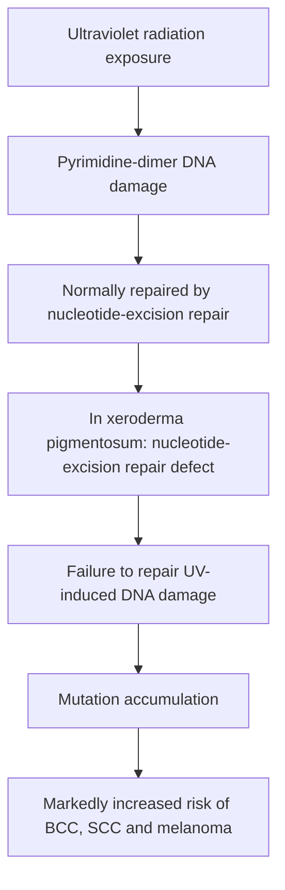

# Chapter 13: Photodermatology and Genodermatoses

## 13.1 Photodermatology & Porphyrias

### 1. The Ultraviolet Spectrum

| UV band | Approximate wavelength | Key properties / effects in the source note |
| :--- | :--- | :--- |
| UVC | 200-290 nm | Absorbed by the ozone layer; germicidal lamps. |
| UVB | 290-320 nm | Principal sunburn wavelength; predominantly epidermal absorption; pyrimidine dimers; stimulates vitamin D3 synthesis. |
| UVA | 320-400 nm | Photoaging wavelength; deeper dermal penetration; reactive oxygen species generation; penetrates window glass. |

---

### 2. Polymorphous Light Eruption (PMLE)
* **Definition**: The most common idiopathic immunologic photodermatosis, characterized by delayed abnormal cutaneous reactions to UV light (predominantly UVA).
* **Pathophysiology**: Delayed Type IV hypersensitivity reaction targeting UV-induced cutaneous neoantigens.
* **Clinical Features**:
  * Onset in spring or early summer, developing **24 to 48 hours after sun exposure**.
  * Presents as intensely pruritic erythematous papules, vesicles, or plaques on sun-exposed sites (arms, chest, v-neck of neck), characteristically **sparing the face**.
  * **"Hardening" Effect**: Lesions resolve over several days and severity diminishes as summer progresses due to UV-induced stratum corneum thickening and melanogenesis.

---

### 3. Drug-Induced Photosensitivity

| Feature | Phototoxic reaction | Photoallergic reaction |
| :--- | :--- | :--- |
| Mechanism | Non-immunologic direct phototoxic cell injury. | Delayed type IV immune response. |
| Clinical pattern | Exaggerated sunburn-like reaction. | Eczematous dermatitis. |
| Dose / exposure | Dose-dependent; may occur on first exposure. | Requires sensitisation; not directly dose-dependent in the same way. |
| Distribution | Usually restricted to sun-exposed skin. | May extend beyond sun-exposed skin. |
| Examples listed | Doxycycline, thiazides, amiodarone. | Promethazine, sunscreens, NSAIDs. |

---

### 4. Porphyria Cutanea Tarda (PCT)
* **Definition**: The most common form of porphyria, caused by a quantitative deficiency of the enzyme **Uroporphyrinogen Decarboxylase (UROD)** in the heme biosynthetic pathway.

**Simplified porphyria cutanea tarda pathway relevant to photosensitivity**

```mermaid
flowchart TD
    A[Uroporphyrinogen III] -->|Uroporphyrinogen decarboxylase (UROD)| B[Coproporphyrinogen III]
    B --> C[Downstream heme-biosynthesis intermediates]
    X[UROD deficiency in porphyria cutanea tarda] -. impairs .-> B
    X --> D[Accumulation of porphyrin precursors / porphyrins]
    D --> E[Absorption of light near the Soret band]
    E --> F[Reactive oxygen species generation]
    F --> G[Cutaneous fragility and blistering]
```

* **Exogenous Precipitating Triggers**:
  * **Alcohol consumption**, **Iron overload / Hemochromatosis (*HFE* mutations)**, **Hepatitis C Virus (HCV) infection**, and **Estrogen therapy**.
* **Pathophysiology**: Accumulated uroporphyrins circulate to cutaneous capillaries, absorb Soret band light ($\sim 400 \text{ nm}$), generate reactive oxygen species, and cause microvascular damage and subepidermal blistering.
* **Clinical Features**:
  * Extreme cutaneous fragility on sun-exposed dorsal hands and face.
  * **Fluid-filled tense bullae, erosions, crusted scarring, and milia formation**.
  * Facial hypertrichosis (especially temporal/malar zones) and hyperpigmentation.
  * **Tea-colored / Port-wine urine** showing **coral-red fluorescence under Wood's lamp**.
* **Laboratory Diagnosis**:
  * Elevated urinary uroporphyrins (Uroporphyrin I > Coproporphyrin III ratio).
  * High serum ferritin and transferrin saturation.
* **Treatment Protocol**:
  1. *Avoidance of triggers*: Complete cessation of alcohol, estrogens, and iron supplements.
  2. *Low-dose Hydroxychloroquine or Chloroquine* ($100 \text{ mg}$ twice weekly): Solubilizes accumulated hepatic porphyrins to promote urinary excretion.
  3. *Therapeutic Phlebotomy*: Performed every 2–4 weeks to reduce hepatic iron stores to a target serum ferritin level of $<50 \text{ ng/mL}$.

---

## 13.2 Genodermatoses & DNA Repair Disorders

### 1. The Ichthyoses (Inherited Disorders of Cornification)

| Disorder | Molecular defect | Inheritance / typical features |
| :--- | :--- | :--- |
| Ichthyosis vulgaris | Filaggrin (FLG) defect. | Usually autosomal dominant / semidominant; fine white scale with flexural sparing. |
| X-linked recessive ichthyosis | Steroid sulfatase deficiency. | X-linked recessive; large, dirty-brown scales; often neck / preauricular involvement. |
| Harlequin ichthyosis | ABCA12 mutation. | Autosomal recessive; armour-like plates; severe ectropion and eclabium. |

#### A. Ichthyosis Vulgaris
* **Inheritance**: Autosomal Dominant ($1:250$ live births; most common ichthyosis).
* **Gene Defect**: Loss-of-function mutations in the **Filaggrin (*FLG*) gene** on chromosome 1q21.
* **Clinical Features**:
  * Fine, dry, white-to-gray scales predominantly on extensor extremities.
  * **Prominent flexural sparing** (antecubital and popliteal fossae remain completely clear).
  * Palmar hyperlinearity and keratosis pilaris.
  * **Strong association with Atopic Dermatitis** and asthma.

#### B. X-Linked Recessive Ichthyosis (XLRI)
* **Inheritance**: X-linked Recessive (affects males; female carriers).
* **Enzyme Defect**: Deficiency of **Steroid Sulfatase (STS)** / Arylsulfatase C, leading to accumulation of cholesterol sulfate in the stratum corneum and impaired desquamation.
* **Clinical Features**:
  * Large, dark brown, adherent polygonal scales giving a **"dirty skin" appearance**.
  * **Involves the neck, trunk, and preauricular areas** ("dirty neck").
  * *Systemic Associations*: Corneal comma-shaped opacities, cryptorchidism (high testicular cancer risk), and **refractory prolonged labor** in pregnant mothers carrying affected fetuses (due to low placental estriol production).

#### C. Lamellar Ichthyosis
* **Inheritance**: Autosomal Recessive (*TGM1* gene mutation encoding **Transglutaminase-1**).
* **Clinical Features**:
  * Born as a **Collodion Baby** (encased in a shiny, taut, cellophane-like membrane).
  * Evolves into large, dark, coarse, plate-like scale sheets covering the entire body without flexural sparing.
  * Severe **ectropion** (eyelid eversion), **eclabium** (lip eversion), palmar/plantar keratoderma, and heat intolerance due to anhidrosis.

#### D. Harlequin Ichthyosis
* **Inheritance**: Autosomal Recessive (mutations in the ***ABCA12* gene** encoding an ATP-binding cassette lipid transporter in lamellar granules).
* **Clinical Features**:
  * Most severe congenital ichthyosis; neonates born encased in massive, thick, **armor-like, diamond-shaped geometric hyperkeratotic plates** separated by deep red fissures.
  * Severe bilateral ectropion, eclabium, flattened ears, microcephaly, and contractures.
  * High early neonatal mortality due to respiratory restriction, hypothermia, and sepsis.
  * *Treatment*: Systemic **Oral Acitretin** in neonatal ICU improves survival.

---

### 2. Xeroderma Pigmentosum (XP)
* **Definition**: An autosomal recessive genodermatosis characterized by extreme cutaneous photosensitivity, early carcinogenesis, and premature aging due to defective DNA repair.
* **Pathophysiology**: Defect in **Nucleotide Excision Repair (NER)** pathway enzymes (genes *XPA* through *XPG*), preventing excision of UV-induced **pyrimidine/thymine dimers**.

**Xeroderma pigmentosum: DNA-repair mechanism**



* **Clinical Triad & Course**:
  1. *Severe Photosensitivity*: Exaggerated sunburn with blistering occurring upon minimal sun exposure in early infancy ($<1-2$ years).
  2. *Pigmentary Changes*: Prominent freckling, telangiectasias, skin atrophy, and poikiloderma on sun-exposed skin.
  3. *Early Onset Cutaneous Malignancies*: **$>1000$-fold increased incidence of BCC, SCC, and Malignant Melanoma**, often appearing before age 10.
* **Neurological Manifestations**: 20% of cases exhibit progressive sensorineural deafness, ataxia, microcephaly, and intellectual disability (**De Sanctis-Cacchione Syndrome**).
* **Management**: Absolute, rigorous UV protection (protective clothing, UV-blocking face shields, broad-spectrum sunscreen), regular skin cancer surveillance every 3 months, and prompt surgical excision of suspicious lesions.

* **Additional molecular/management pearls**: Classic XP complementation groups *XPA–XPG* involve nucleotide-excision repair; **XP variant (*POLH*, DNA polymerase η)** results from impaired translesion synthesis rather than classic NER deficiency. UV lesions include cyclobutane pyrimidine dimers and 6–4 photoproducts. Management also includes **UV-filtering window film**, sun-protective clothing and ophthalmologic surveillance; **systemic retinoids (e.g., isotretinoin)** can reduce new skin cancers in selected high-risk patients, but toxicity limits use. Major causes of mortality include **cutaneous malignancy, neurologic degeneration and internal cancer**—melanoma is **not** invariably the leading cause. [GeneReviews](https://www.ncbi.nlm.nih.gov/books/NBK1397/).

---

## 13.3 Cutaneous Mosaicism and Blaschkoid Disorders

### Blaschko's Lines: Embryological Basis
- **Blaschko's lines** map clonal migration/proliferation of epidermal precursor cells during embryogenesis; they are **not** dermatomes or skin-tension (Langer) lines.
- **Patterns:** V-shaped over upper back, S-shaped/whorled on trunk and abdomen, longitudinal along limbs, spiral/whorled on scalp.
- **Cutaneous mosaicism:** Two or more genetically distinct cell populations resulting from postzygotic mutations, chromosomal abnormalities or functional mosaicism (e.g., random X-inactivation/lyonization). Phenotype reflects the distribution of the affected clone.

### Incontinentia Pigmenti (Bloch–Sulzberger Syndrome)
- **Genetics:** X-linked dominant, usually *IKBKG* (*NEMO*, Xq28) loss of function, disrupting NF-κB signaling. Predominantly affects females; many hemizygous affected male pregnancies are nonviable, but affected surviving males occur (e.g., mosaicism or sex chromosome aneuploidy).
- **Mechanism:** Skewed/random X-inactivation creates alternating NEMO-deficient and normal keratinocyte clones; increased TNF-mediated apoptosis/inflammation produces Blaschko-linear lesions.
- **Four stages (may overlap; not necessarily all present):**
  1. **Vesicular (newborn):** Linear erythematous vesicles/bullae, often with **eosinophilic spongiosis/intraepidermal eosinophilic vesicles**.
  2. **Verrucous (weeks–months):** Linear warty hyperkeratotic papules/plaques; acanthosis, hyperkeratosis and dyskeratosis.
  3. **Hyperpigmented (infancy–childhood):** Whorled, streaked **marble-cake** brown pigmentation, sometimes extending beyond sites of initial inflammation; **pigment incontinence** with dermal melanophages.
  4. **Hypopigmented/atrophic (later childhood–adult):** Pale, atrophic, sometimes hairless streaks, often lower legs; adnexal/eccrine hypoplasia can occur.
- **Extracutaneous:** Hypodontia, delayed eruption and conical teeth; retinal vascular disease/tractional detachment; strabismus; seizures, focal motor deficits and developmental difficulties. **Early ophthalmologic screening** is crucial.

### Hypomelanosis of Ito (Pigmentary Mosaicism)
- **Pattern:** Blaschko-linear/whorled **hypopigmented** patches, often present in infancy; a descriptive phenotype, **not a single-gene disease**.
- **Basis:** Chromosomal or somatic mosaicism (including aneuploidy/rearrangements) in a subset of patients.
- **Associations:** Variable neurodevelopmental, seizure, ocular and skeletal findings (including body or limb asymmetry); assess for extracutaneous abnormalities rather than assuming they are universal.

### Linear and Whorled Nevoid Hypermelanosis (LWNH)
- **Pattern:** Blaschko-linear, swirled or reticulate **hyperpigmented** macules arising in infancy, typically **without prior vesicular or inflammatory phases** (unlike incontinentia pigmenti).
- **Histology:** Increased basal pigmentation without the characteristic pigment incontinence of IP; underlying mosaicism may be demonstrable.

### Inflammatory Linear Verrucous Epidermal Nevus (ILVEN)
- **Presentation:** Early-onset, **markedly pruritic**, erythematous and psoriasiform/verrucous **linear** plaque, often on a lower limb following Blaschko's lines; may be treatment-resistant.
- **Histopathology:** Alternating **orthokeratosis + hypergranulosis** with **parakeratosis + absent/reduced granular layer**.

### McCune–Albright Syndrome
- **Genetics:** Non-inherited **postzygotic activating *GNAS* mutation** (20q13.3), constitutively activating Gsα → adenylate cyclase → cAMP signaling; variable mosaic distribution.
- **Triad:** **Polyostotic fibrous dysplasia** (fractures, deformity including shepherd's-crook femur), **café-au-lait pigmentation** (large irregular **coast-of-Maine** patches, often unilateral and respecting midline), and **autonomous endocrine hyperfunction** (especially precocious puberty; also hyperthyroidism, growth hormone excess or Cushing syndrome).
- **Contrast:** NF1 café-au-lait lesions usually have smoother **coast-of-California** borders.

## 13.4 Neurocutaneous Syndromes (Phakomatoses)

### Neurofibromatosis Type 1 (NF1; von Recklinghausen Disease)
- **Genetics:** Autosomal dominant (many de novo cases); *NF1* on **17q11.2** encodes **neurofibromin**, a RAS-GTPase activating tumor suppressor; highly variable expression.
- **Cutaneous clues:** ≥6 café-au-lait macules (**>5 mm prepubertal**, **>15 mm postpubertal**); axillary/inguinal **Crowe freckling**; ≥2 neurofibromas or one **plexiform neurofibroma** (**bag-of-worms**).
- **Ocular/osseous clues:** Optic pathway glioma; ≥2 **Lisch nodules** (iris hamartomas) **or** ≥2 **choroidal abnormalities** on appropriate retinal imaging; sphenoid dysplasia, anterolateral tibial bowing or pseudarthrosis.
- **Revised 2021 diagnosis:** In a person **without an affected parent**, need **≥2** of the listed pigmentary, neurofibroma, optic, ocular, osseous or pathogenic-*NF1*-variant criteria. A child with a parent meeting NF1 criteria needs **≥1** criterion. A first-degree sibling alone is **not** a diagnostic criterion. When pigmentary features alone are present, consider **Legius syndrome** (*SPRED1*).
- **Other features:** T2-bright foci of uncertain significance (historically **UBOs**) may be seen on MRI in children; learning difficulties, scoliosis, hypertension and vascular disease. Risks include **malignant peripheral nerve sheath tumour (MPNST)**, pheochromocytoma and GIST. Painful/rapidly enlarging plexiform lesion warrants evaluation for MPNST.
- **Source:** [2021 international NF1 diagnostic consensus](https://pmc.ncbi.nlm.nih.gov/articles/PMC8354850/).

### NF2-Related Schwannomatosis (formerly Neurofibromatosis Type 2)
- **Genetics:** Autosomal dominant or mosaic variants in *NF2* (**22q12.2**) encoding **merlin/schwannomin**.
- **Hallmark:** **Bilateral vestibular schwannomas** with progressive sensorineural hearing loss, tinnitus and imbalance; associated **meningiomas, ependymomas** and other schwannomas (historical **MISME**).
- **Distinction from NF1:** Lisch nodules are not characteristic; café-au-lait lesions and cutaneous findings are much less prominent. Contemporary classification favors **NF2-related schwannomatosis**.

### Tuberous Sclerosis Complex (TSC; Bourneville Disease)
- **Genetics:** Autosomal dominant/de novo *TSC1* (**9q34, hamartin**) or *TSC2* (**16p13, tuberin**) loss of function → disinhibited **mTORC1** growth signaling.
- **Cutaneous signs:** **Ash-leaf hypomelanotic macules** (often early; Wood lamp can help), facial **angiofibromas** (historic misnomer **adenoma sebaceum**), lumbosacral **shagreen patch** (connective-tissue nevus), **Koenen periungual fibromas** and small **confetti** hypomelanotic macules.
- **Neurological:** Cortical tubers, **subependymal nodules** (sometimes calcified, candle-dripping appearance), **subependymal giant-cell astrocytoma (SEGA)**, epilepsy/infantile spasms, autism and variable cognitive impairment. The historical **Vogt triad** (seizures, intellectual disability, facial angiofibromas) is **not present in every patient**.
- **Other organs:** Cardiac **rhabdomyoma** (often regresses), renal **angiomyolipomas** (vascular/smooth-muscle/fat; PEComa family, often HMB-45+), and pulmonary **lymphangioleiomyomatosis (LAM)**.
- **2021 diagnostic criteria:** Definite TSC: **2 major** or **1 major + ≥2 minor** features, or a pathogenic *TSC1/TSC2* variant. Major cutaneous criteria include **≥3 hypomelanotic macules each ≥5 mm**, **≥3 facial angiofibromas or a fibrous cephalic plaque**, a shagreen patch, or **≥2 ungual fibromas**; **confetti lesions are minor**. LAM plus renal angiomyolipomas **alone** is insufficient.
- **Treatment pearls:** **Vigabatrin** is first-line for TSC-associated infantile spasms; **everolimus** may treat growing SEGA/renal angiomyolipoma; **topical sirolimus** can improve facial angiofibromas.
- **Source:** [GeneReviews TSC diagnostic and management overview](https://www.ncbi.nlm.nih.gov/books/NBK1220/).

### Sturge–Weber Syndrome (Encephalotrigeminal Angiomatosis)
- **Genetics:** Sporadic, **postzygotic activating *GNAQ*** mosaicism; vascular malformations of skin, leptomeninges and eye.
- **Cutaneous:** Congenital **port-wine birthmark** (capillary malformation), initially pink/red and usually **blanchable** (may become thicker/darker with age). **Forehead and upper-eyelid involvement**, rather than strict trigeminal V1/V2 boundaries, best predicts brain/ocular risk.
- **Ocular/CNS:** Ipsilateral glaucoma/choroidal vascular malformation; leptomeningeal angiomatosis causes focal seizures, contralateral weakness and developmental difficulties. CT may show **gyriform tram-track calcifications** and cerebral atrophy.
- **Pearl:** Facial capillary malformation does **not** necessarily mean Sturge–Weber; high-risk forehead/upper eyelid lesions merit ophthalmologic and neurological assessment.
- **Source:** [Consensus statement on port-wine birthmarks in Sturge–Weber](https://pmc.ncbi.nlm.nih.gov/articles/PMC8547264/).

## 13.5 Ectodermal Dysplasias

### Hypohidrotic Ectodermal Dysplasia (Christ–Siemens–Touraine)
- **Genetics:** Commonly X-linked *EDA* (ectodysplasin A) pathway defect; autosomal dominant/recessive forms also occur (*EDAR*, *EDARADD*, others); disrupted ectodermal appendage development.
- **Classic triad:** **Hypohidrosis/anhidrosis** (risk of infant hyperthermia and unexplained fever), **hypodontia/anodontia** (conical or peg-shaped teeth), and **hypotrichosis** (sparse fine scalp hair, brows and lashes).
- **Facies:** Frontal bossing, depressed nasal bridge, periorbital pigmentation and prominent lips.
- **Care:** Prevent overheating and provide dental, skin and hair care.

## 13.6 Rapid Differentiation of Genetic Pigmentary Disorders

| Disorder | Genetics | Skin clue | Important systemic association |
| :--- | :--- | :--- | :--- |
| Incontinentia pigmenti | X-linked dominant *IKBKG* | Vesicular → verrucous → whorled hyperpigmented → atrophic stages | Retinal disease, abnormal teeth, CNS involvement |
| Hypomelanosis of Ito | Variable mosaicism | Whorled **hypo**pigmentation without staged inflammation | Variable neurologic/skeletal findings |
| LWNH | Often mosaic | Whorled **hyper**pigmentation without prior vesicles | Variable/usually isolated |
| McCune–Albright | Somatic *GNAS* | Jagged unilateral café-au-lait patch | Fibrous dysplasia, endocrine hyperfunction |
| NF1 | AD *NF1* | Multiple café-au-lait spots, axillary freckles, neurofibromas | Lisch nodules, optic pathway glioma, MPNST |
| TSC | AD *TSC1/TSC2* | Ash-leaf spots, angiofibromas, shagreen, Koenen fibromas | Seizures, renal angiomyolipomas, cardiac rhabdomyoma |
| Sturge–Weber | Somatic *GNAQ* | Forehead/upper eyelid port-wine birthmark | Glaucoma, leptomeningeal malformation |

> [!NOTE]
> **Blaschkoid distinction:** Incontinentia pigmenti has an inflammatory **four-stage history**; hypomelanosis of Ito is **hypopigmented**; linear/whorled nevoid hypermelanosis is **hyperpigmented without a preceding vesicular phase**.
