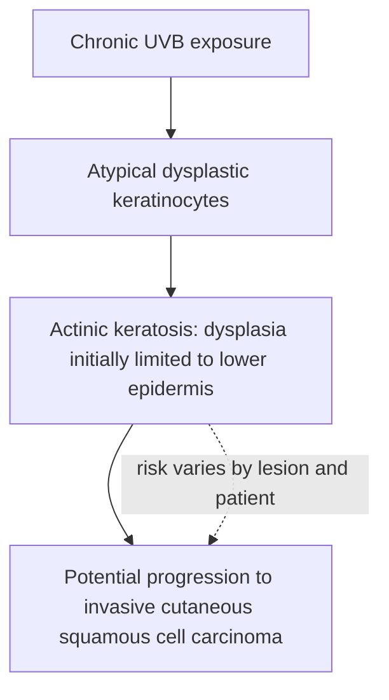

# Chapter 14: Benign and Premalignant Cutaneous Tumors

## 14.1 Benign Epithelial & Dermal Neoplasms

| Tumour | Clinical features | Histopathology / associations |
| :--- | :--- | :--- |
| Seborrheic keratosis | Waxy, “stuck-on” plaque. | Horn pseudocysts; sign of Leser-Trélat. |
| Keratoacanthoma | Rapidly growing crateriform nodule with central keratin plug; may involute. | Well-differentiated squamous proliferation; clinically overlaps with SCC. |
| Dermatofibroma | Firm dermal spindle-cell nodule; positive dimple sign. | Spindle-cell proliferation with collagen trapping. |

### 1. Seborrheic Keratosis (SK)
* **Definition**: The most common benign epithelial cutaneous tumor in older adults.
* **Clinical Features**:
  * Well-demarcated, waxy, hyperpigmented, verrucous papules or plaques with a classic **"stuck-on" appearance**.
  * Color ranges from tan to dark brown or black; surface exhibits prominent follicular kerato-plugging.
  * Commonly located on the face, trunk, and upper extremities; **spares the palms, soles, and mucous membranes**.

| Histopathological feature | Seborrheic keratosis |
| :--- | :--- |
| Epidermal architecture | Acanthotic epidermis with a flat, well-demarcated lower border. |
| Horn pseudocysts | Intraepidermal keratin-filled pseudocysts; characteristic feature. |
| Basaloid cells | Monomorphic basaloid keratinocytes. |
* **Histopathology**:
  * Marked acanthosis, hyperkeratosis, and papillomatosis with a flat, uniform lower border.
  * Composed of a monomorphic proliferation of small basaloid keratinocytes.
  * **Pathognomonic Feature**: Presence of intraepidermal keratin-filled **Horn Pseudocysts**.
* **Clinical Variant - Dermatosis Papulosa Nigra (DPN)**: Multiple small, dark brown-black papules on the malar face in individuals with dark skin phototypes (Fitzpatrick IV–VI).
* **Paraneoplastic Marker - Sign of Leser-Trélat**:
  * The sudden, rapid eruption of multiple seborrheic keratoses on the trunk.
  * Serves as a cutaneous paraneoplastic sign of an underlying internal malignancy, most commonly **Gastric Adenocarcinoma**.

---

### 2. Keratoacanthoma (KA)
* **Definition**: A rapidly growing cutaneous neoplasm originating from hair follicle pilosebaceous units, considered a low-grade / well-differentiated variant of **Squamous Cell Carcinoma (SCC)**.
* **Clinical Course**:
  1. *Proliferative Phase*: Rapid expansion over 4–6 weeks into a dome-shaped, erythematous nodule with a **characteristic central keratin-filled crater**.
  2. *Mature Phase*: Stable crateriform lesion.
  3. *Involutional Phase*: Spontaneous regression over 6–12 months, leaving a depressed scar.
* **Histopathology**: Cup-shaped invagination with a massive central keratin plug bounded by overhanging epidermal lips; composed of large, well-differentiated pale eosinophilic keratinocytes.
* **Treatment**: Complete surgical excision (preferred to exclude invasive SCC) or intralesional 5-Fluorouracil / Methotrexate.

---

### 3. Dermatofibroma (Benign Fibrous Histiocytoma)
* **Definition**: A common benign dermal nodule composed of an indolent proliferation of fibroblasts, histiocytes, and collagen.
* **Clinical Features**: Firm, solitary, hyperpigmented or red-brown dermal papule/nodule, most commonly occurring on the lower extremities of young adult females.
* **Pathognomonic Clinical Sign**:
  * **Dimple Sign (Fitzpatrick Sign) Positive $\oplus$**: Lateral compression or pinching of the lesion causes the central surface to invaginate / dimple inward.
* **Histopathology**: Unencapsulated dermal proliferation of spindle-shaped fibroblasts dissecting between pre-existing dermal collagen bundles (**"collagen trapping"**), with overlying epidermal acanthosis and basal hyperpigmentation.

---

### 4. Cutaneous Cysts
| Feature | Epidermoid cyst | Trichilemmal (pilar) cyst |
| :--- | :--- | :--- |
| Typical site | Face, neck and trunk. | Scalp; the source states that >90% occur on the scalp. |
| Central punctum | Usually present. | Usually absent. |
| Histology | Stratified squamous epithelium with a granular layer. | Stratified squamous epithelium without a granular layer; abrupt trichilemmal keratinisation. |
| Contents | Cheesy keratinaceous debris. | Compact keratin. |
---

## 14.2 Premalignant Cutaneous Lesions

### 1. Actinic Keratosis (Solar Keratosis)
* **Definition**: The most common premalignant cutaneous lesion, arising on sun-damaged skin as a direct result of chronic UV radiation.
* **Risk of progression to invasive SCC:** AK is premalignant, but the risk from an individual lesion is generally low and estimates vary substantially between studies. A systematic review reported **0–0.075% per lesion-year** in the studied populations and up to **0.53% per lesion** in people with a prior history of non-melanoma skin cancer; the AAD guideline review notes a much wider range of published estimates (**less than 0.1% to 20%**) and emphasises the limitations of follow-up. Multiple lesions / field cancerization increase cumulative patient-level risk. ([Werner et al., *British Journal of Dermatology*, 2013](https://pubmed.ncbi.nlm.nih.gov/23647091/); [AAD Guidelines of Care, 2021](https://pmc.ncbi.nlm.nih.gov/articles/PMC12255292/)).

**Actinic keratosis: conceptual progression**

* **Clinical Features**:
  * Dry, rough, scaly, erythematous or brown papules or plaques on sun-exposed sites (face, balding scalp, ears, dorsum of hands).
  * Characteristically described as **"better felt than seen"**, possessing a distinct **sandpaper-like texture**.
  * May develop an elongated hyperkeratotic projection known as a **Cutaneous Horn**.
* **Histopathology**:
  * Hyperkeratosis with alternating parakeratosis (**"flag sign"**).
  * Atypical, dysplastic keratinocytes with hyperchromatic nuclei **restricted to the lower one-third to two-thirds of the epidermis**.
  * Solar elastosis (degraded basophilic collagen) in the upper dermis.
  * **Basement membrane remains intact**.
* **Treatment Protocols**:
  * *Single / Isolated Lesions*: Cryotherapy with liquid nitrogen (Gold Standard) or lesion curettage.
  * *Field Cancerization (Multiple lesions)*: Topical **5-Fluorouracil (5-FU 5%)**, topical **Imiquimod 5%**, or Photodynamic Therapy (PDT).

---

### 2. Bowen's Disease (Squamous Cell Carcinoma In-Situ)
* **Definition**: A full-thickness intraepidermal Squamous Cell Carcinoma that has **NOT breached the basement membrane**.
* **Etiology**: Chronic sun exposure, arsenic exposure, immunosuppression, and high-risk HPV (HPV 16, 18).
* **Clinical Features**: Slowly enlarging, well-demarcated, erythematous, scaly or crusted plaque resembling eczema or psoriasis, but refractory to topical steroids.
* **Histopathology**:
  * **Full-thickness epidermal dysplasia** with complete loss of normal maturation architecture ("windblown appearance").
  * Atypical dysplastic keratinocytes, frequent mitotic figures, and dyskeratotic cells throughout all epidermal layers.
  * **Basement membrane is strictly INTACT** (no dermal invasion).
* **Clinical Variant - Erythroplasia of Queyrat**: Bowen's disease involving the glans penis or prepuce, presenting as a shiny, velvety red plaque.

---

### 3. Arsenical Keratosis
* **Etiology**: Chronic exposure to inorganic arsenic (e.g., contaminated well drinking water, medicinal Fowler's solution).
* **Clinical Features**: Multiple hard, corn-like, hyperkeratotic papules occurring characteristically on the **palms and soles**.
* **Malignant Potential**: High rate of transformation into invasive Squamous Cell Carcinoma (SCC) and strong association with internal malignancies (lung, urinary bladder, and hepatic angiosarcoma).
