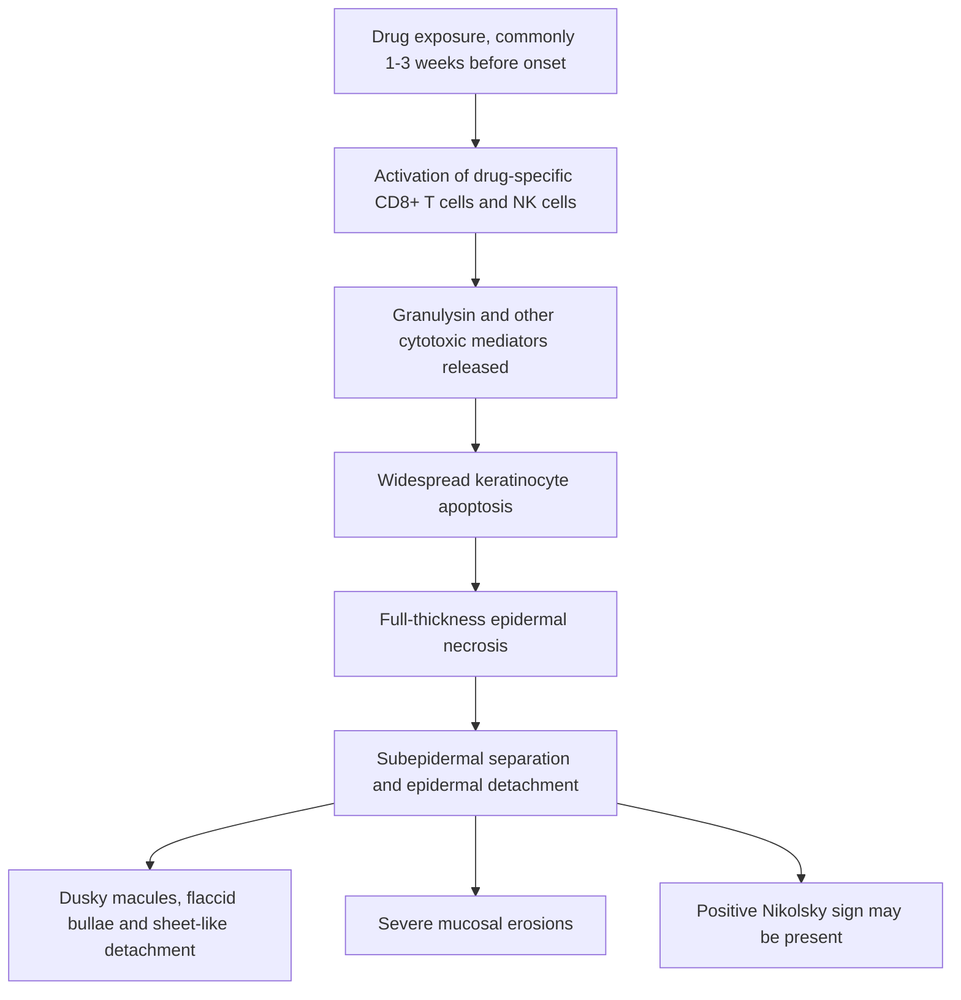

# Chapter 16: Cutaneous Manifestations of Systemic Disease and Drug Reactions

## 16.1 Nutritional & Metabolic Dermatoses

### 1. Pellagra (Niacin / Vitamin B3 Deficiency)
* **Etiology**: Deficiency of **Niacin (Vitamin B3)** or its precursor amino acid **Tryptophan**. Causes include diet dependent strictly on corn/maize (niacin is bound/niacytin), alcoholism, malabsorption, **Carcinoid Syndrome** (diversion of tryptophan to serotonin synthesis), and drugs (**Isoniazid**, 6-Mercaptopurine, Azathioprine).
* **The Classic 4 Ds Triad**:
  1. **Dermatitis**: Photosensitive, bilaterally symmetrical, hyperpigmented, scaly rash with sharp margins on sun-exposed sites.
  2. **Diarrhea**: Mucosal inflammation throughout GI tract causing glossitis, stomatitis, and watery diarrhea.
  3. **Dementia**: Encephalopathy, depression, memory loss, confusion, ataxia.
  4. **Death**: If untreated.
* **Pathognomonic Cutaneous Signs**:
  * **Casal's Necklace (Casal's Collar)**: Well-demarcated hyperpigmented, scaly band around the neck in the $C3\text{--}C4$ dermatomal distribution.
  * **Gauntlet Sign**: Symmetrical hyperpigmented desquamating eruption over the dorsum of hands and forearms.

| Deficiency / condition | Pathophysiology / cause | Classic cutaneous features |
| :--- | :--- | :--- |
| Niacin (vitamin B3) deficiency | Low niacin / tryptophan availability; associated contexts include maize-based diet, isoniazid and carcinoid syndrome. | Four Ds; Casal necklace; gauntlet distribution. |
| Vitamin C deficiency | Scurvy due to impaired collagen hydroxylation. | Perifollicular haemorrhages; corkscrew hairs; splinter haemorrhages; bleeding gums. |
| Zinc deficiency / acrodermatitis enteropathica | SLC39A4 mutation or acquired deficiency (e.g. bowel resection). | Periorificial / acral dermatitis, alopecia and diarrhoea. |
| Glucagonoma | Glucagon-secreting pancreatic islet-cell tumour. | Necrolytic migratory erythema. |

### 2. Scurvy (Vitamin C Deficiency)
* **Pathophysiology**: Vitamin C is an essential cofactor for **prolyl and lysyl hydroxylase**, enzymes required for collagen triple-helix cross-linking. Deficiency weakens vascular capillary walls and connective tissue.
* **Clinical Features**:
  * **Perifollicular Hemorrhages**: Petechiae and purpura surrounding hair follicles, particularly on lower extremities.
  * **Corkscrew Hairs**: Twisted, coiled, fragile body hairs ("swan-neck" hairs).
  * **Gingival Involvement**: Swollen, spongy, purple, bleeding gums with tooth loss.
  * Impaired wound healing, subperiosteal hematomas, hemarthrosis.

### 3. Acrodermatitis Enteropathica (Zinc Deficiency)
* **Etiology**: Autosomal recessive mutation in the **$SLC39A4$** gene encoding the intestinal zinc transporter (ZIP4), or acquired zinc deficiency (total parenteral nutrition without zinc, severe malabsorption).
* **Clinical Triad**:
  1. **Periorificial and Acral Dermatitis**: Well-demarcated, erythematous, vesicobullous, crusted, and psoriasiform plaques surrounding mouth, eyes, anogenital area, hands, and feet.
  2. **Alopecia**: Diffuse loss of scalp hair, eyebrows, and eyelashes.
  3. **Diarrhea**: Chronic watery diarrhea, irritability, and growth retardation.

### 4. Necrolytic Migratory Erythema (NME)
* **Pathognomonic Paraneoplastic Sign**: Associated with **Glucagonoma** (alpha-cell tumor of the pancreatic islet cells).
* **Features**: Erythematous, annular plaques with central bullae and necrosis that expand and clear centrally, migrating across the abdomen, perineum, and distal extremities. Accompanied by diabetes mellitus, anemia, weight loss, and hyperglucagonemia.

---

## 16.2 Connective Tissue & Autoimmune Cutaneous Markers

### 1. Systemic Lupus Erythematosus (SLE)
* **Malar "Butterfly" Rash**: Fixed erythematous, maculopapular eruption over the malar eminences and nasal bridge, **characteristically sparing the nasolabial folds**. Induced or exacerbated by sunlight (photosensitive).
* **Discoid Lupus Erythematosus (DLE)**: Chronic cutaneous form. Erythematous, hyperkeratotic scaly plaques with follicular plugging, central atrophy, telangiectasia, and hyper/hypopigmentation. Removal of scale reveals undersurface keratin plugs (**"Carpet-Tack" Sign / Cat's tongue sign**). Leaves permanent scarring and scarring alopecia.
* **Subacute Cutaneous Lupus (SCLE)**: Non-scarring, highly photosensitive annular or psoriasiform eruption; strongly associated with **Anti-Ro/SSA** antibodies and HLA-DR3.

| Connective-tissue disease | Characteristic cutaneous signs |
| :--- | :--- |
| Systemic lupus erythematosus | Malar erythema over nose and cheeks, typically sparing nasolabial folds; photosensitivity. |
| Dermatomyositis | Gottron papules over extensor joints; heliotrope rash; shawl sign; V-sign. |
| Systemic sclerosis | Sclerodactyly, Raynaud phenomenon, mat telangiectasias and calcinosis cutis. |
### 2. Dermatomyositis
* **Pathognomonic Cutaneous Markers**:
  * **Gottron's Papules**: Violaceous, flat-topped, scaly papules over the dorsal interphalangeal (DIP), metacarpophalangeal (MCP), elbow, and knee joints.
  * **Heliotrope Rash**: Violaceous (heliotrope) macular erythema and edema affecting the upper eyelids, often with periorbital swelling.
  * **Shawl Sign**: Macular erythema across the posterior neck, upper back, and shoulders.
  * **V-Sign**: Erythema over the anterior neck and upper chest.
  * **Holster Sign**: Erythema over the lateral hips/thighs.
  * **Mechanic's Hands**: Hyperkeratotic, cracked, scaling skin on the palmar and lateral surfaces of the digits (associated with **Anti-Jo-1** antisynthetase syndrome).
  * Periungual telangiectasias and capillary loop dropout on nailfold dermoscopy.

---

## 16.3 Severe Cutaneous Adverse Drug Reactions (SCARs)

### Spectrum of Drug Eruptions
Severe Cutaneous Adverse Reactions (SCARs) represent life-threatening, immunologically mediated drug hypersensitivity states that require rapid recognition and hospitalization.
| Entity | Epidermal detachment (BSA) | Mucosal involvement | Mortality rate stated in source |
| :--- | :--- | :--- | :--- |
| Erythema multiforme | Minimal or no detachment. | Mild or absent. | <1%. |
| Stevens-Johnson syndrome | <10% BSA. | Severe; at least 2 sites in the source table. | 1-5%. |
| SJS / TEN overlap | 10-30% BSA. | Severe; at least 2 sites in the source table. | 10-25%. |
| Toxic epidermal necrolysis | >30% BSA. | Severe; at least 2 sites in the source table. | 30-50%. |
### 1. Erythema Multiforme (EM)
* **Features**: Acute, self-limiting Type IV hypersensitivity reaction characterized by **target / iris lesions** (three concentric zones: central dark purpuric/vesicular center, middle pale edematous ring, outer erythematous halo).
* **Distribution**: Acral distribution (palms, soles, forearms, extensor surfaces).
* **Etiology**:
  * **Herpes Simplex Virus (HSV-1 and HSV-2)** is the **single most common trigger** ($>70\%$ of EM Minor/Major).
  * *Mycoplasma pneumoniae* is the second most common trigger (often causes severe mucosal involvement).

### 2. Stevens-Johnson Syndrome (SJS) & Toxic Epidermal Necrolysis (TEN)
* **Pathophysiology**: T-cell-mediated (CD8+ cytotoxic T-lymphocytes) immune reaction against drug-bound keratinocytes. Cytotoxic T-cells release **Granulysin**, Perforin/ Granzyme B, and Fas-FasL, inducing mass apoptosis of full-thickness epidermal keratinocytes.
* **Common Trigger Drugs** (Mnemonic: **SATAN**):
  * **S**: **S**ulfonamides (Trimethoprim-Sulfamethoxazole / Cotrimoxazole).
  * **A**: **A**llopurinol (highest individual risk agent).
  * **T**: **T**etracylines & Anticonvulsants.
  * **A**: **A**nticonvulsants (**Carbamazepine, Lamotrigine, Phenytoin, Phenobarbital**).
  * **N**: **N**SAIDs (Oxicam derivatives like Piroxicam, Meloxicam).
**SJS / TEN pathophysiology and clinical sequence**

**Clinical features described in the source note:** prodromal fever, malaise and myalgias; dusky erythematous macules progressing to flaccid bullae and sheet-like epidermal detachment; mucosal involvement may affect the eyes, mouth and genitalia.

* **Clinical Presentation**:
  * Prodrome: High fever, malaise, sore throat, myalgias 1 to 3 weeks after starting drug.
  * Cutaneous: Painful, dusky red/purpuric macules that coalesce rapidly into flaccid blisters, leading to **sheet-like epidermal sloughing/detachment** leaving raw, weeping dermis resembling a second-degree burn.
  * **Nikolsky Sign Positive $\oplus$**: Lateral tangential traction on unblistered skin causes sloughing of the epidermis.
  * Mucosal: Severe erosive, hemorrhagic mucositis involving **at least 2 mucosal sites** (oropharynx, eyes/conjunctiva, anogenital tract). Ocular involvement carries high risk of permanent blindness, symblepharon, and sicca syndrome.

* **Histopathology**: Full-thickness epidermal necrosis with basal layer vacuolization, subepidermal separation, and sparse inflammatory infiltrate in the dermis ("ghost-like" necrotic epidermis).

* **SCORTEN (TEN Mortality Prediction Score)**:
  * Measured within 24 hours of admission; 1 point for each:
    1. Age $> 40$ years.
    2. Presence of underlying malignancy.
    3. Heart rate $> 120\text{ bpm}$.
    4. Initial detached BSA $> 10\%$.
    5. Serum Urea $> 28\text{ mg/dL}$ ($> 10\text{ mmol/L}$).
    6. Serum Glucose $> 252\text{ mg/dL}$ ($> 14\text{ mmol/L}$).
    7. Serum Bicarbonate $< 20\text{ mEq/L}$.
  * Score $0\text{--}1$: Mortality $<3\%$; Score $\ge 5$: Mortality $>90\%$.

* **Management**:
  * **Immediate Discontinuation** of the culprit drug (single most important step).
  * Transfer to an Intensive Care Unit (ICU) or **Burn Unit**.
  * Aggressive fluid/electrolyte resuscitation, temperature control, barrier nursing, sterile skin care without aggressive debridement, and intensive ophthalmology consultation (topical steroids/antibiotics, amniotic membrane grafting).
  * Systemic Therapies: Cyclosporine, IVIG, and Anti-TNF Agents (Etanercept) are used in specialized burn centers.

### 3. DRESS Syndrome (Drug Reaction with Eosinophilia and Systemic Symptoms)
* **Definition**: Severe, multi-organ drug reaction characterized by long latency (2 to 8 weeks post-drug exposure), facial edema, morbilliform eruption, fever, atypical lymphocytosis, **eosinophilia**, and visceral organ involvement (**Hepatitis #1 cause of mortality**, interstitial nephritis, pneumonitis, myocarditis). Associated with HHV-6 reactivation.
* **Common Triggers**: Allopurinol, Anticonvulsants (Carbamazepine, Phenytoin, Lamotrigine), Sulfonamides, Vancomycin.
