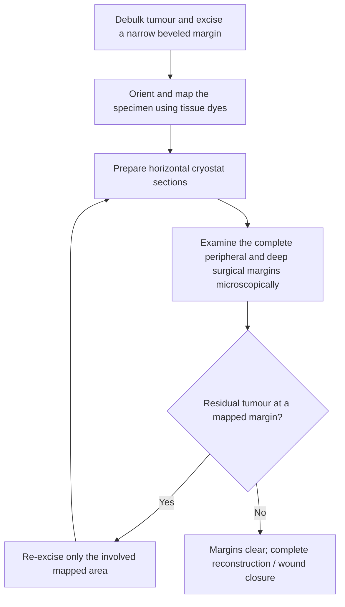

# Chapter 17: Dermatological Therapeutics and Procedural Dermatology

## 17.1 Topical & Systemic Pharmacotherapy

### 1. Topical Corticosteroids
* **Mechanism**: Binds cytoplasmic glucocorticoid receptors, translocates to nucleus, inhibits $NF-\kappa B$, downregulates pro-inflammatory cytokines (IL-1, IL-2, IL-6, TNF-$\alpha$), and induces Lipocortin-1 (inhibiting Phospholipase A2 and arachidonic acid cascade).

| Potency class (source classification) | Representative agents | Clinical use / cautions stated in source |
| :--- | :--- | :--- |
| Class 1 — ultra-high | Clobetasol propionate 0.05%; halobetasol propionate 0.05%. | Thick resistant plaques (e.g. psoriasis, lichen planus, severe palmoplantar eczema); avoid face and intertriginous areas; limit duration as clinically appropriate. |
| Class 2/3 — high | Betamethasone dipropionate 0.05%; fluocinonide 0.05%. | Severe eczema, discoid lupus and severe contact dermatitis. |
| Class 4/5 — medium | Triamcinolone acetonide 0.1%; hydrocortisone valerate 0.2%. | Selected atopic / intertriginous dermatitis and body / extremity use in adults. |
| Class 6/7 — low | Hydrocortisone 1% or 2.5%; desonide 0.05%. | Sensitive sites (face, eyelids, scrotum, axilla, groin) and paediatric patients, with appropriate clinical supervision. |

* **Adverse Effects of Topical Steroids**:
  * **Cutaneous Atrophy**: Dermal collagen thinning and epidermal flattening.
  * **Striae Distensae**: Permanent irreversible stretch marks.
  * **Telangiectasias & Purpura**: Capillary fragility.
  * **Steroid Rosacea & Perioral Dermatitis**: Rebound flare on face following withdrawal.
  * **Tachyphylaxis**: Progressive loss of therapeutic response over time.
  * **Systemic Absorption**: HPA axis suppression, Cushing syndrome, glaucoma/cataracts (eyelid application).

### 2. Systemic & Topical Retinoids
* **Mechanism**: Synthetic derivatives of Vitamin A. Bind nuclear Retinoic Acid Receptors (RARs) and Retinoid X Receptors (RXRs), modulating gene transcription to normalize keratinocyte differentiation, inhibit sebum production, reduce inflammation, and promote cell turnover.

| Generation | Drug | Primary indications stated in source |
| :--- | :--- | :--- |
| First | Tretinoin (all-trans retinoic acid). | Acne vulgaris; photoaging. |
| First | Isotretinoin (13-cis retinoic acid). | Severe recalcitrant nodulocystic acne. |
| Second | Acitretin. | Severe psoriasis (plaque or pustular). |
| Third | Adapalene. | Comedonal and papular acne. |
| Third | Tazarotene. | Acne vulgaris; plaque psoriasis. |

* **Oral Isotretinoin Protocol**:
  * **Indication**: Severe, recalcitrant nodulocystic acne, or acne causing scarring or severe psychological distress.
  * **Dosage**: $0.5\text{--}1.0\text{ mg/kg/day}$ given over 15–20 weeks to reach a cumulative target dose of **$120\text{--}150\text{ mg/kg}$** (reduces long-term relapse rate).
  * **Teratogenicity & the iPLEDGE Program**:
    * **Severe Teratogen**: Causes **Retinoic Acid Embryopathy** (craniofacial anomalies, microtia/otia, CNS defects, conotruncal heart defects, thymic hypoplasia).
    * **iPLEDGE Requirements**: Females of childbearing potential must use **two concurrent forms of effective contraception** starting 1 month before treatment, throughout therapy, and for **1 month after stopping** isotretinoin, supported by two negative pregnancy tests prior to initiation.
  * **Monitoring & Side Effects**:
    * Cheilitis (100% of patients), xerosis, epistaxis, dry eyes.
    * Hypertriglyceridemia, elevated liver transaminases (ALT/AST).
    * **Pseudotumor Cerebri (Idiopathic Intracranial Hypertension)**: **Absolute contraindication** to combine oral Isotretinoin with **Tetracyclines** (Doxycycline/Minocycline).

---

## 17.2 Targeted Biological Therapies in Dermatology

> [!NOTE]
> Biological agents have transformed the management of chronic, severe inflammatory skin diseases by selectively blocking key cytokine pathways while sparing systemic organ toxicity.

| Target | Biologic agents listed | Indications listed in source |
| :--- | :--- | :--- |
| TNF-alpha | Infliximab; adalimumab; etanercept. | Severe plaque psoriasis; psoriatic arthritis; hidradenitis suppurativa (agent-specific). |
| IL-17A | Secukinumab; ixekizumab. | Plaque psoriasis; psoriatic arthritis. |
| IL-23 p19 | Risankizumab; guselkumab. | Plaque psoriasis. |
| IL-12/23 p40 | Ustekinumab. | Plaque psoriasis; psoriatic arthritis. |
| IL-4 receptor alpha (IL-4 / IL-13 pathway) | Dupilumab. | Moderate-to-severe atopic dermatitis. |
| IgE | Omalizumab. | Chronic spontaneous urticaria. |

### Pre-Biologic Screening Requirements
* **Tuberculosis Screening**: Mandatory **Tuberculin Skin Test (TST) or IGRA (QuantiFERON-TB Gold)** before starting TNF-$\alpha$, IL-17, or IL-23 inhibitors due to risk of latent TB reactivation.
* Hepatitis B (HBsAg, anti-HBc) and Hepatitis C screening.
* Live virus vaccines are **contraindicated** while on biologic therapy.

---

## 17.3 Procedural & Surgical Dermatology

### 1. Phototherapy
* **Narrowband UVB (NB-UVB, 311 nm)**: Preferred phototherapy modality for generalized psoriasis, vitiligo, atopic dermatitis, and early mycosis fungoides. Induces T-cell apoptosis, downregulates pro-inflammatory cytokines, and stimulates melanocyte migration.
* **PUVA (Psoralen + UVA, 320–400 nm)**: Combines oral/topical 8-Methoxypsoralen (photosensitizer that intercalates into DNA) with UVA irradiation. Highly effective but associated with increased long-term risk of non-melanoma skin cancer and cutaneous aging.

### 2. Mohs Micrographic Surgery (MMS)

> [!IMPORTANT]
> **Gold Standard Surgical Technique**: Mohs Micrographic Surgery provides the **highest cure rate ($99\%$ for primary lesions)** while achieving **maximal normal tissue preservation** for cutaneous malignancies in anatomically sensitive areas.

**Mohs micrographic surgery workflow**

* **Indications for Mohs Surgery**:
  1. **Anatomical Location**: High-risk "H-Zone" of the face (nasolabial fold, nasal ala, eyelids, lips, ears, temples, glabella) and acral/genital sites.
  2. **Histological Subtype**: Aggressive/infiltrative subtypes (morpheaform BCC, poorly differentiated SCC, perineural invasion).
  3. **Recurrent Tumors**: Tumors that have recurred following prior excision or radiation.
  4. **Large Size or Ill-Defined Borders**: Tumors $>2\text{ cm}$ on trunk/extremities or $>1\text{ cm}$ on head/neck.
