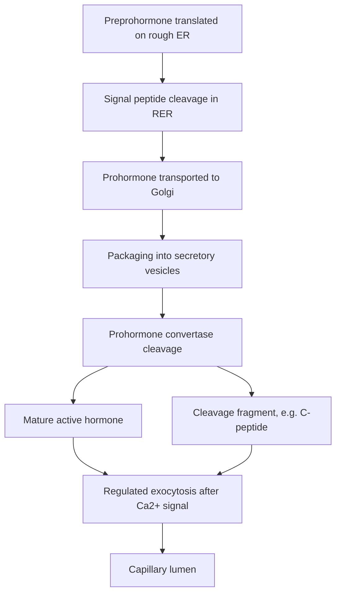
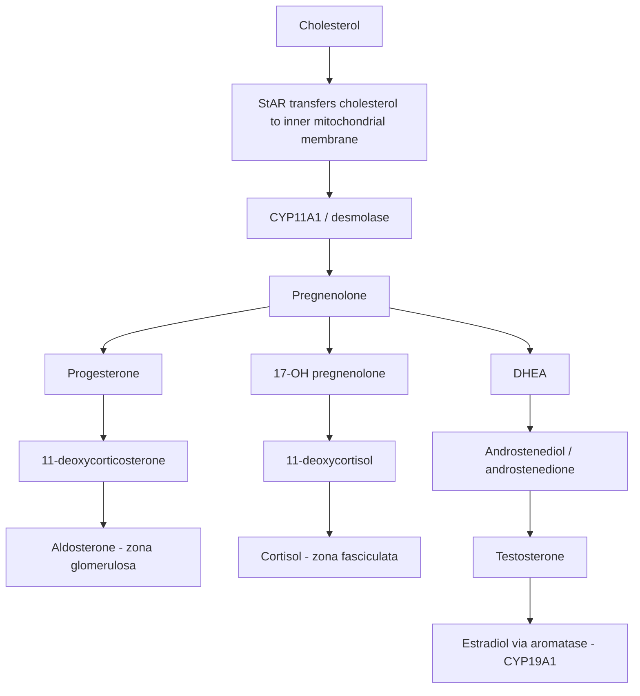
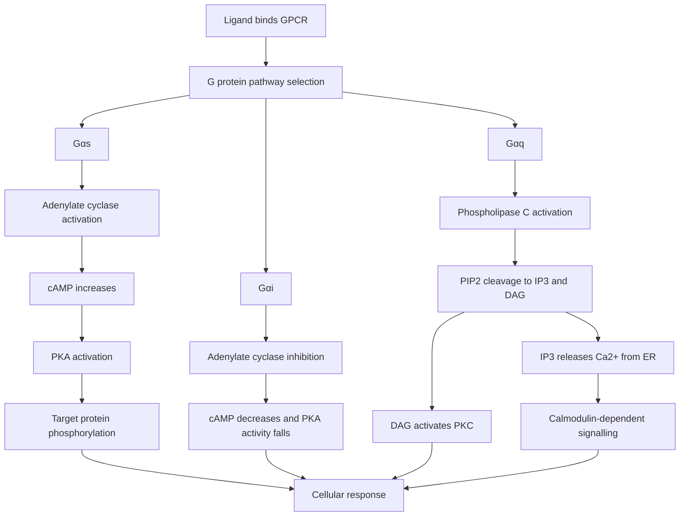
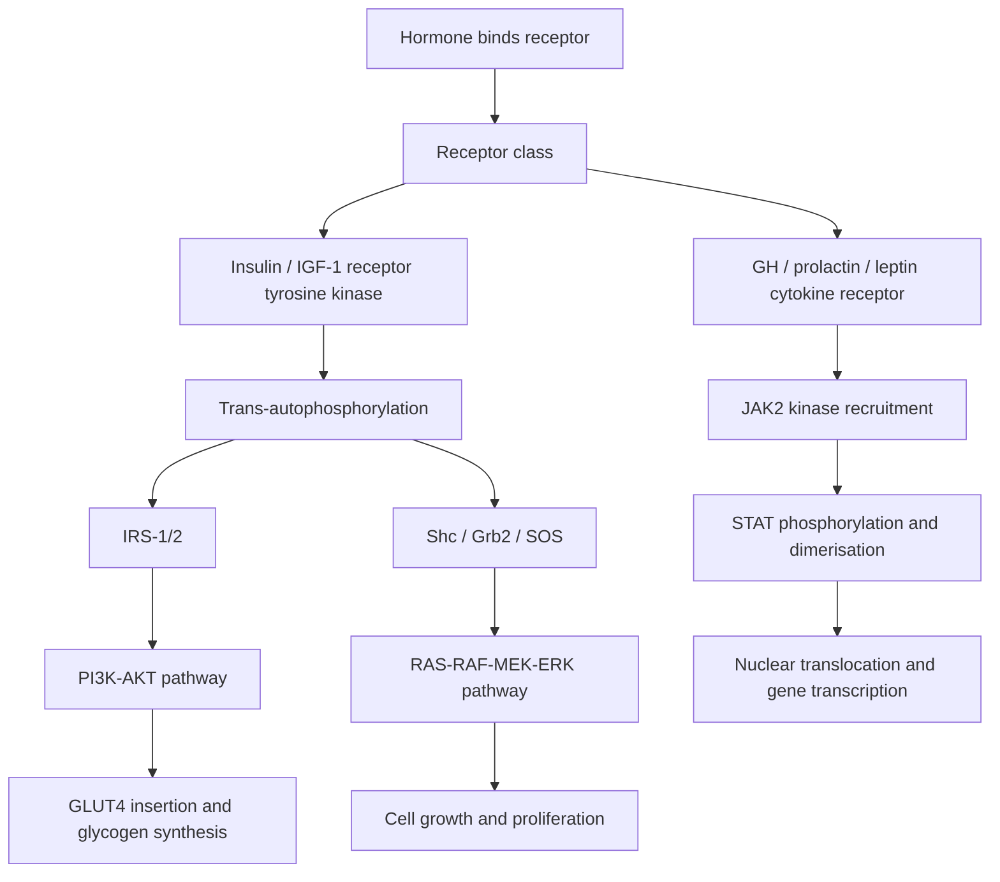
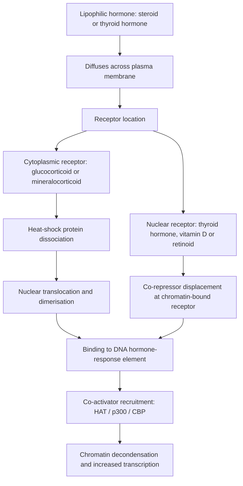

# Chapter 1: Hormone Synthesis, Secretion, Transport & Action Mechanisms

## 1.1 Classification & Biosynthesis of Hormones

Endocrine hormones are chemical messengers released by specialized ductless glands directly into the vascular circulation to modulate metabolic, developmental, and homeostatic processes in target tissues. Hormones are classified into four structural and biochemical categories:

### Structural Classification Matrix

| Hormone Class | Representative Examples | Solubility & Transport | Receptor Location | Storage & Secretion | Half-Life ($t_{1/2}$) |
| :--- | :--- | :--- | :--- | :--- | :--- |
| **Peptide / Protein** | Insulin, Glucagon, PTH, GH, TSH, ACTH, Oxytocin, Vasopressin | Hydrophilic (water-soluble); circulate unbound | Plasma membrane (GPCRs, RTKs, Cytokine receptors) | Stored in secretory vesicles; released via exocytosis | Short (3–10 minutes) |
| **Steroid** | Cortisol, Aldosterone, Testosterone, Estradiol, Progesterone, Calcitriol | Lipophilic (fat-soluble); require transport proteins (CBG, SHBG, Albumin) | Intracellular (Cytoplasmic or Nuclear) | Synthesized *de novo* upon demand; diffuse freely across membranes | Intermediate to Long (60–120 minutes) |
| **Amino Acid Derivatives** | Catecholamines (Epi, Norepi, Dopamine); Thyroid Hormones ($T_4, T_3$) | Catecholamines: Hydrophilic; Thyroid: Lipophilic (bound to TBG) | Catecholamines: Membrane GPCRs; Thyroid: Nuclear TR | Catecholamines: Stored in chromaffin granules; Thyroid: Stored as colloid in lumen | Catecholamines: Very short (1–2 min); $T_4$: 7 days; $T_3$: 1 day |
| **Eicosanoids** | Prostaglandins, Leukotrienes, Thromboxanes | Lipophilic | Membrane GPCRs | Rapid local paracrine/autocrine synthesis | Extremely short (seconds) |

---

### Biosynthesis & Processing of Peptide Hormones

Peptide hormone synthesis follows a regulated secretory pathway:
1. **Gene Transcription & Translation**: Preprohormones are translated on membrane-bound ribosomes (rough endoplasmic reticulum) containing an N-terminal hydrophobic **signal peptide**.
2. **Signal Peptide Cleavage**: The signal peptide directs the nascent peptide chain into the RER lumen, where signal peptidase cleaves the signal sequence to form a **prohormone**.
3. **Golgi Processing & Packaging**: The prohormone is transported to the Golgi apparatus and packaged into dense-core secretory vesicles.
4. **Endoproteolytic Cleavage**: Within secretory granules, endopeptidases (e.g., prohormone convertases PC1/3 and PC2) cleave specific dibasic amino acid residues, generating the active mature hormone and residual cleavage fragments (e.g., Proinsulin $\rightarrow$ Mature Insulin + C-peptide in a 1:1 equimolar ratio; POMC $\rightarrow$ ACTH + $\beta$-endorphin + $\alpha$-MSH).
5. **Exocytosis**: Regulated exocytosis is triggered by extracellular stimuli (e.g., elevation of intracellular $\text{Ca}^{2+}$ or cAMP).

---

### Steroidogenesis Pathways & Rate-Limiting Mechanisms

All steroid hormones derive from **cholesterol**. Steroidogenic cells (adrenal cortex, gonads, placenta) acquire cholesterol from circulating Low-Density Lipoproteins (LDL) via receptor-mediated endocytosis or synthesize it *de novo* from acetate.

#### Key Enzymatic Steps & Rate-Limiting Factors
* **StAR Protein (Steroidogenic Acute Regulatory Protein)**: Transfers hydrophobic cholesterol across the aqueous intermembrane space from the outer to the inner mitochondrial membrane. This transport is the **absolute rate-limiting step** in all steroidogenesis, regulated acutely by trophic hormones (ACTH, LH).
* **CYP11A1 (Cholesterol Side-Chain Cleavage Enzyme / Desmolase)**: Cleaves the 6-carbon side chain of cholesterol on the inner mitochondrial membrane to convert cholesterol (27C) into pregnenolone (21C).
* **CYP21A2 (21-$\alpha$-Hydroxylase)**: Essential for converting progesterone to 11-deoxycorticosterone (mineralocorticoid pathway) and 17-OH progesterone to 11-deoxycortisol (glucocorticoid pathway). Deficiency causes 95% of Congenital Adrenal Hyperplasia (CAH).
* **CYP11B1 (11-$\beta$-Hydroxylase)**: Converts 11-deoxycortisol to cortisol in the zona fasciculata.
* **CYP11B2 (Aldosterone Synthase)**: Exclusively expressed in the zona glomerulosa; converts 11-deoxycorticosterone to aldosterone via sequential 11-$\beta$-hydroxylation, 18-hydroxylation, and 18-oxidation.
* **CYP19A1 (Aromatase)**: Converts C19 androgens (androstenedione, testosterone) to C18 estrogens (estrone, estradiol).

---

## 1.2 Hormone Transport, Metabolism & Clearance

### Plasma Transport Proteins & The Free Hormone Hypothesis

Hydrophilic hormones (peptides, catecholamines) circulate dissolved freely in plasma. Lipophilic hormones (steroid and thyroid hormones) are insoluble in aqueous plasma and require specific high-affinity transport globulins synthesized by the liver:

1. **Thyroid-Binding Globulin (TBG)**: Binds 70% of circulating $T_4$ and $T_3$.
2. **Corticosteroid-Binding Globulin (CBG / Transcortin)**: Binds 90% of circulating cortisol.
3. **Sex Hormone-Binding Globulin (SHBG)**: Binds testosterone and estradiol with high affinity.
4. **Albumin**: Low-affinity, high-capacity non-specific binder for all lipophilic hormones.

#### The Free Hormone Hypothesis
Only the unbound (**free**) fraction of a hormone (typically <1% of total thyroid hormone and 1–2% of total steroid hormones) is biologically active, capable of crossing cell membranes, binding intracellular receptors, and exerting feedback inhibition on the hypothalamic-pituitary axis.

$$\text{Hormone}_{\text{Total}} = \text{Hormone}_{\text{Bound}} + \text{Hormone}_{\text{Free}}$$

#### Clinical Alterations in Binding Globulins
* **Increased Binding Globulins** (e.g., High Estrogen states: Pregnancy, Oral Contraceptives, HRT):
  * Elevates **Total** hormone levels ($T_4$, Cortisol).
  * **Free** hormone levels remain strictly **normal** due to intact feedback control.
* **Decreased Binding Globulins** (e.g., Nephrotic syndrome, Cirrhosis, Severe malnutrition, Androgen therapy):
  * Depresses **Total** hormone levels.
  * **Free** hormone levels remain **normal**.

---

### Hormone Clearance Mechanisms

The Metabolic Clearance Rate (MCR) is defined as the volume of plasma cleared of a hormone per unit time ($\text{mL/min}$):

$$\text{MCR} = \frac{\text{Rate of Hormone Removal}}{\text{Plasma Hormone Concentration}}$$

* **Hepatic Clearance**: Primary route for steroid and thyroid hormones. Involves phase I (hydroxylation, reduction) and phase II conjugation (glucuronidation, sulfation) to make lipophilic molecules water-soluble for biliary or urinary excretion.
* **Renal Clearance**: Primary route for peptide fragments, conjugated steroids, and water-soluble metabolites.
* **Target Cell Receptor-Mediated Endocytosis**: Binding of peptide hormones (e.g., insulin) to membrane receptors leads to clathrin-coated pit endocytosis and lysosomal degradation.

---

## 1.3 Receptors & Signal Transduction Pathways

Hormone receptors fall into two broad structural classes: **Membrane-Bound Receptors** (for hydrophilic signals) and **Intracellular/Nuclear Receptors** (for lipophilic signals).

### 1. G-Protein Coupled Receptor (GPCR) Pathways

GPCRs feature 7-transmembrane $\alpha$-helical domains coupled to heterotrimeric G-proteins ($\alpha, \beta, \gamma$ subunits).

#### A. $G_{\alpha s}$ (Gs Pathway - Cyclic AMP / PKA)
* **Mechanism**: Ligand binding $\rightarrow$ GTP replaces GDP on $G_{\alpha s}$ $\rightarrow$ Activates **Adenylate Cyclase** $\rightarrow$ Converts ATP to **cAMP** $\rightarrow$ Activates **Protein Kinase A (PKA)** $\rightarrow$ PKA phosphorylates specific serine/threonine residues on target enzymes and CREB (cAMP Response Element Binding protein).
* **Hormones**: TSH, ACTH, FSH, LH, PTH, Calcitonin, Glucagon, $\beta_1/\beta_2$ Catecholamines, CRH, GHRH, Vasopressin ($V_2$ receptors).

#### B. $G_{\alpha i}$ (Gi Pathway - Inhibitory)
* **Mechanism**: Ligand binding $\rightarrow G_{\alpha i}$ inhibits Adenylate Cyclase $\rightarrow$ Decreases cAMP $\rightarrow$ Inhibits PKA.
* **Hormones**: Somatostatin, Dopamine ($D_2$ receptors), $\alpha_2$ Catecholamines.

#### C. $G_{\alpha q}$ (Gq Pathway - Phospholipase C / $\text{IP}_3$-DAG / $\text{Ca}^{2+}$)
* **Mechanism**: Ligand binding $\rightarrow G_{\alpha q}$ activates **Phospholipase C (PLC)** $\rightarrow$ Cleaves membrane $\text{PIP}_2$ into **Inositol 1,4,5-trisphosphate ($\text{IP}_3$)** and **Diacylglycerol (DAG)**:
  * $\text{IP}_3$ opens ligand-gated $\text{Ca}^{2+}$ channels on the endoplasmic reticulum $\rightarrow$ Intracellular $\text{Ca}^{2+}$ surge $\rightarrow$ Binds **Calmodulin** $\rightarrow$ Activates Calmodulin-dependent protein kinases.
  * DAG + $\text{Ca}^{2+}$ activates **Protein Kinase C (PKC)**.
* **Hormones**: GnRH, TRH, Angiotensin II, Vasopressin ($V_1$ receptors), Oxytocin, $\alpha_1$ Catecholamines.

---

### 2. Receptor Tyrosine Kinase (RTK) & Cytokine Receptor Pathways

#### A. Receptor Tyrosine Kinase (RTK) Pathway
* **Structure**: Transmembrane proteins with intrinsic tyrosine kinase activity in their intracellular catalytic domains (e.g., Insulin receptor $\alpha_2\beta_2$ heterotetramer).
* **Mechanism**: Ligand binding induces receptor dimerization and **trans-autophosphorylation** of tyrosine residues $\rightarrow$ Recruits docking proteins (**IRS-1/2**):
  1. **PI3K / AKT (Protein Kinase B) Branch**: Activates Phosphoinositide 3-Kinase (PI3K) $\rightarrow \text{PIP}_3 \rightarrow$ Activates AKT $\rightarrow$ Promotes **GLUT4 vesicle translocation** to plasma membrane (glucose uptake), glycogen synthase activation, and protein synthesis.
  2. **RAS / RAF / MEK / ERK (MAPK) Branch**: Drives cellular proliferation, gene expression, and differentiation.
* **Hormones**: Insulin, IGF-1, EGF, FGF, PDGF.

#### B. Cytokine Receptor / JAK-STAT Pathway
* **Structure**: Transmembrane receptors **lacking** intrinsic kinase activity.
* **Mechanism**: Ligand binding induces receptor dimerization $\rightarrow$ Recruits non-covalently associated **Janus Kinases (JAK2)** $\rightarrow$ JAK2 autophosphorylates and phosphorylates receptor tails $\rightarrow$ Recruits and phosphorylates **Signal Transducers and Activators of Transcription (STAT)** proteins $\rightarrow$ Phosphorylated STATs dimerize and translocate to the nucleus to bind specific promoters.
* **Hormones**: Growth Hormone (GH), Prolactin, Leptin, Erythropoietin (EPO).

---

### 3. Intracellular / Nuclear Receptor Pathway

Nuclear receptors function as ligand-activated transcription factors. They share a conserved structure:
* **N-Terminal Domain (AF-1)**: Ligand-independent transactivation.
* **DNA-Binding Domain (DBD)**: Contains two zinc finger motifs that recognize specific palindromic or direct repeat **Hormone Response Elements (HREs)** in target gene promoters.
* **C-Terminal Ligand-Binding Domain (LBD / AF-2)**: Binds hormone ligand and interacts with co-activator/co-repressor complexes.

* **Steroid Receptors (Class I: GR, MR, AR, PR)**: Reside in the cytoplasm bound to **Heat Shock Proteins (HSP90)**. Ligand binding induces HSP dissociation, receptor dimerization, and nuclear translocation to bind HREs.
* **Thyroid & Retinoid Receptors (Class II: TR, VDR, RAR, PPAR)**: Reside **permanently inside the nucleus** bound to DNA HREs as heterodimers with Retinoid X Receptor (RXR). In the absence of ligand, they bind **co-repressor proteins** (SMRT, NCoR) and histone deacetylases (HDACs) to actively repress transcription. Hormone binding causes co-repressor dissociation and **co-activator recruitment** (p300/CBP, histone acetyltransferases [HATs]), initiating gene transcription.

---

## Section 1.5 Checklist & Quality Control

### Index Subsections Covered
- [x] 1.1 Classification & Biosynthesis of Hormones
- [x] 1.2 Hormone Transport, Metabolism & Clearance
- [x] 1.3 Receptors & Signal Transduction Pathways

### Index Corrections & Clarifications
* **Correction**: Older texts classified thyroid hormones strictly with catecholamines as amino acid derivatives that act on membrane GPCRs. *Clarification*: While derived from tyrosine, thyroid hormones act as lipophilic nuclear receptors (TR) bound to chromatin as TR-RXR heterodimers.

### Sources Insufficient / Limitations
* All standard conceptual and biochemical details of hormone synthesis, transport, and signaling are fully covered.
