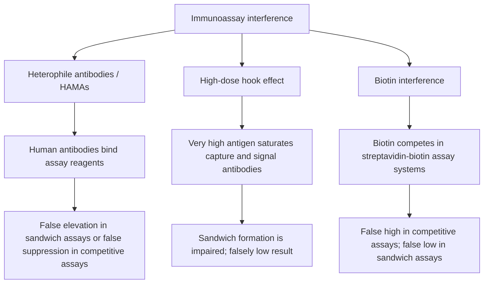

# Chapter 2: Diagnostic Endocrine Testing & Dynamic Functional Assays

## 2.1 Assay Methodologies & Pitfalls

Endocrine diagnosis relies heavily on quantifying picomolar ($10^{-12}\text{ M}$) and femtomolar ($10^{-15}\text{ M}$) concentrations of hormones in serum, plasma, urine, and saliva.

### Analytical Methodologies

| Assay Method | Basic Principle | Clinical Advantages | Key Limitations / Pitfalls |
| :--- | :--- | :--- | :--- |
| **Immunoassay (ELISA / CLIA)** | Utilizes antigen-antibody binding (sandwich or competitive) with enzymatic/chemiluminescent signal generation | Highly automated, inexpensive, high throughput | Subject to antibody cross-reactivity, heterophile antibody interference, and hook effect |
| **Radioimmunoassay (RIA)** | Competitive binding between radiolabeled ($^{125}\text{I}$) and unlabeled antigen for fixed antibody sites | Historical gold standard, sensitive | Radioactive waste disposal, hazard |
| **LC-MS/MS** (Liquid Chromatography-Tandem Mass Spectrometry) | Physical separation by chromatography followed by structural mass-to-charge ratio ($m/z$) detection | **Current Gold Standard** for steroid hormones (testosterone, aldosterone), Vitamin D, and small peptides; ultimate specificity | Expensive, requires expert technical operation, lower automated throughput |

---

### Key Immunoassay Interferences & Pitfalls

#### 1. Heterophile Antibodies & Human Anti-Mouse Antibodies (HAMAs)
* **Mechanism**: Endogenous circulating human antibodies (e.g., from animal exposure, blood transfusions, or autoimmune disease) non-specifically bridge or block the animal-derived capture and detection antibodies in two-site sandwich immunoassays.
* **Clinical Effect**: Causes **false elevation** in sandwich assays (e.g., falsely high TSH, hCG, or troponin) or **false depression** in competitive assays.
* **Resolution**: Re-test sample using heterophile antibody blocking tubes (HBT), serial dilution (non-linear recovery indicates interference), or LC-MS/MS.

#### 2. The High-Dose Hook Effect (Prozone Phenomenon)
* **Mechanism**: In two-site sandwich immunoassays (e.g., Prolactin, Calcitonin, hCG), an overwhelming excess of analyte saturates both capture and signal antibodies individually, preventing the formation of intact capture-analyte-signal "sandwiches."
* **Clinical Effect**: Produces a **falsely low or normal assay result** in the setting of massive real hormone excess (e.g., a massive prolactinoma presenting with a falsely normal prolactin level of 30 ng/mL).
* **Resolution**: Perform a **1:100 sample dilution**; true hook effect will result in a paradoxical, dramatic *increase* in measured concentration.

#### 3. Biotin (Vitamin B7) Interference
* **Mechanism**: Many modern immunoassays utilize high-affinity biotin-streptavidin binding systems. Exogenous high-dose biotin supplements displace reagent biotin.
* **Clinical Effect**:
  * **Competitive Immunoassays** ($T_4, T_3$, Cortisol): Causes **FALSE HIGH** results.
  * **Sandwich Immunoassays** (TSH, PTH, Troponin): Causes **FALSE LOW** results.
  * **Clinical Pattern**: Mimics Graves' disease (Falsely high $T_4/T_3$ + Falsely low TSH).
* **Resolution**: Discontinue biotin supplementation for at least 48–72 hours prior to blood sampling.

#### 4. Macrohormones (e.g., Macroprolactin)
* **Mechanism**: Polymerization of hormone monomers or complexing of hormone with endogenous IgG autoantibodies (e.g., Macroprolactin = Prolactin + IgG).
* **Clinical Effect**: High molecular weight macrocomplexes have prolonged clearance, leading to **hyperprolactinemia** on standard assays, but are biologically inactive *in vivo* (patient is asymptomatic without galactorrhea/amenorrhea).
* **Resolution**: **Polyethylene Glycol (PEG) precipitation test**; monomeric prolactin remains in supernatant, while macroprolactin precipitates out.

---

## 2.2 Principles of Dynamic Endocrine Testing

Basal single-sample hormone measurements are often uninformative due to pulsatile secretion, circadian rhythms, and overlapping physiological ranges. **Dynamic testing** is mandatory for accurate diagnosis:

$$\text{Rule 1: If hormone HYPERSECRETION is suspected } \longrightarrow \text{ Perform a SUPPRESSION TEST}$$

$$\text{Rule 2: If hormone DEFICIENCY is suspected } \longrightarrow \text{ Perform a STIMULATION TEST}$$

---

### Dynamic Diagnostic Protocol Matrix

| Clinical Suspicion | Dynamic Test Protocol | Normal / Intact Response | Diagnostic / Abnormal Response |
| :--- | :--- | :--- | :--- |
| **Cushing Syndrome** (Cortisol Excess) | **1 mg Overnight Dexamethasone Suppression Test (DST)**: Administer 1 mg dexamethasone PO at 11 PM; measure serum cortisol at 8 AM | Serum Cortisol **$< 1.8\ \mu\text{g/dL}$** ($50\text{ nmol/L}$) at 8 AM | Serum Cortisol **$\ge 1.8\ \mu\text{g/dL}$** (indicates autonomous non-suppressible cortisol) |
| **Acromegaly** (GH Excess) | **Oral Glucose Tolerance Test (OGTT) for GH**: Measure baseline GH; administer 75g oral glucose; measure GH every 30 min for 2 hours | Serum GH suppresses to **$< 0.4\ \mu\text{g/L}$** (or $< 1.0\ \mu\text{g/L}$) | Failure of GH to suppress below **$0.4\ \mu\text{g/L}$** (autonomous GH secretion) |
| **Adrenal Insufficiency** (Cortisol Deficiency) | **Cosyntropin / ACTH Stimulation Test**: Measure baseline cortisol; inject 250 $\mu\text{g}$ synthetic ACTH ($\text{ACTH}_{1-24}$) IV/IM; measure cortisol at 30 & 60 min | Peak Serum Cortisol **$> 18\ \mu\text{g/dL}$** ($500\text{ nmol/L}$) | Peak Serum Cortisol **$< 18\ \mu\text{g/dL}$** (confirms adrenal insufficiency) |
| **Central Adrenal / GH Deficiency** | **Insulin Tolerance Test (ITT)**: Administer 0.1 U/kg regular insulin IV to induce hypoglycemia (Symptomatic Glucose $< 40\text{ mg/dL}$); measure cortisol & GH | Cortisol rises to **$> 18\ \mu\text{g/dL}$**; GH rises to **$> 5\ \mu\text{g/L}$** | Failure of Cortisol or GH to rise (**Gold Standard** for central pituitary reserve; contraindicated in seizure/IHD) |
| **Central vs. Peripheral Precocious Puberty** | **GnRH / Leuprolide Stimulation Test**: Administer 100 $\mu\text{g}$ GnRH IV; measure LH & FSH at 30 & 60 min | Pre-pubertal: Flat response (LH remains low) | Pubertal / Central: LH surges to **$> 5\text{ IU/L}$** or LH/FSH ratio $> 1.0$ |
| **Primary Aldosteronism** (Aldosterone Excess) | **Oral or IV Sodium Loading Test**: Administer 2 L 0.9% saline IV over 4 hours | Post-saline Aldosterone suppresses to **$< 5\text{ ng/dL}$** | Post-saline Aldosterone remains **$> 10\text{ ng/dL}$** (autonomous aldosterone) |

---

## Section 2.3 Checklist & Quality Control

### Index Subsections Covered
- [x] 2.1 Assay Methodologies & Pitfalls
- [x] 2.2 Principles of Dynamic Endocrine Testing

### Index Corrections & Clarifications
* **Clarification**: While Cosyntropin (250 $\mu\text{g}$) testing is standard for primary adrenal insufficiency, it may yield a false-normal result in *acute* secondary adrenal insufficiency (within 2–6 weeks of pituitary injury) before adrenal cortical atrophy has occurred.

### Sources Insufficient / Limitations
* Diagnostic threshold values reflect international consensus guidelines (Endocrine Society).
