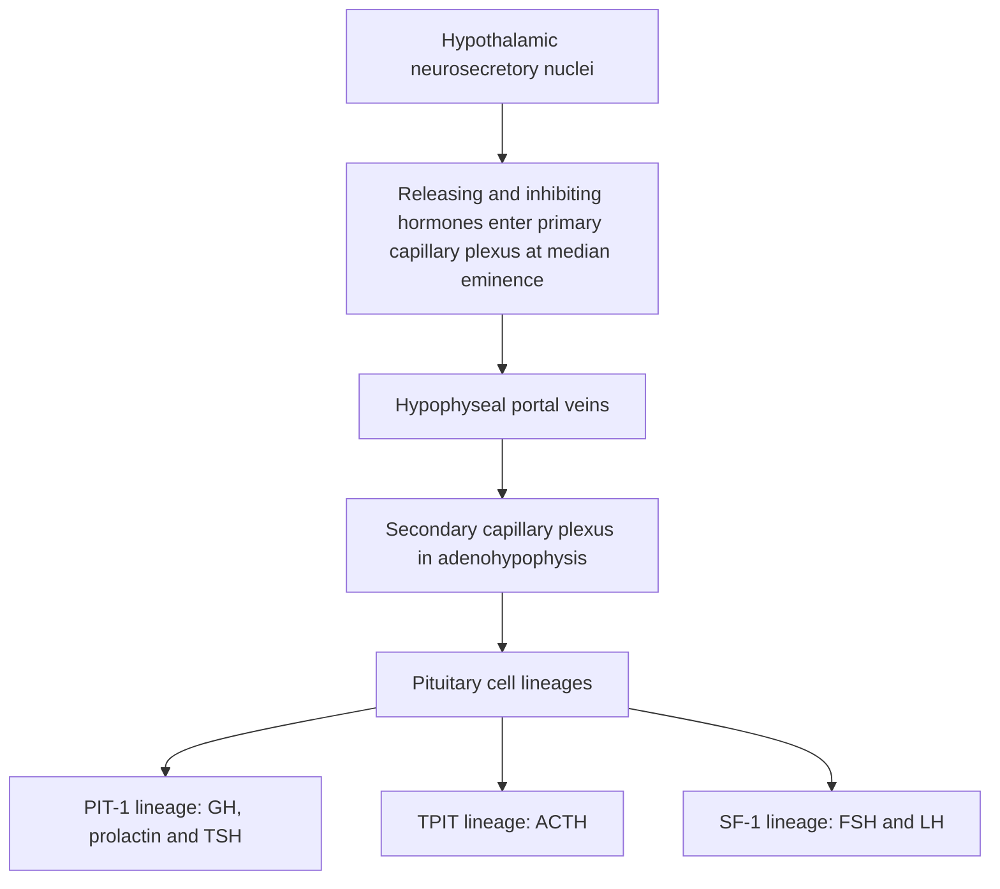
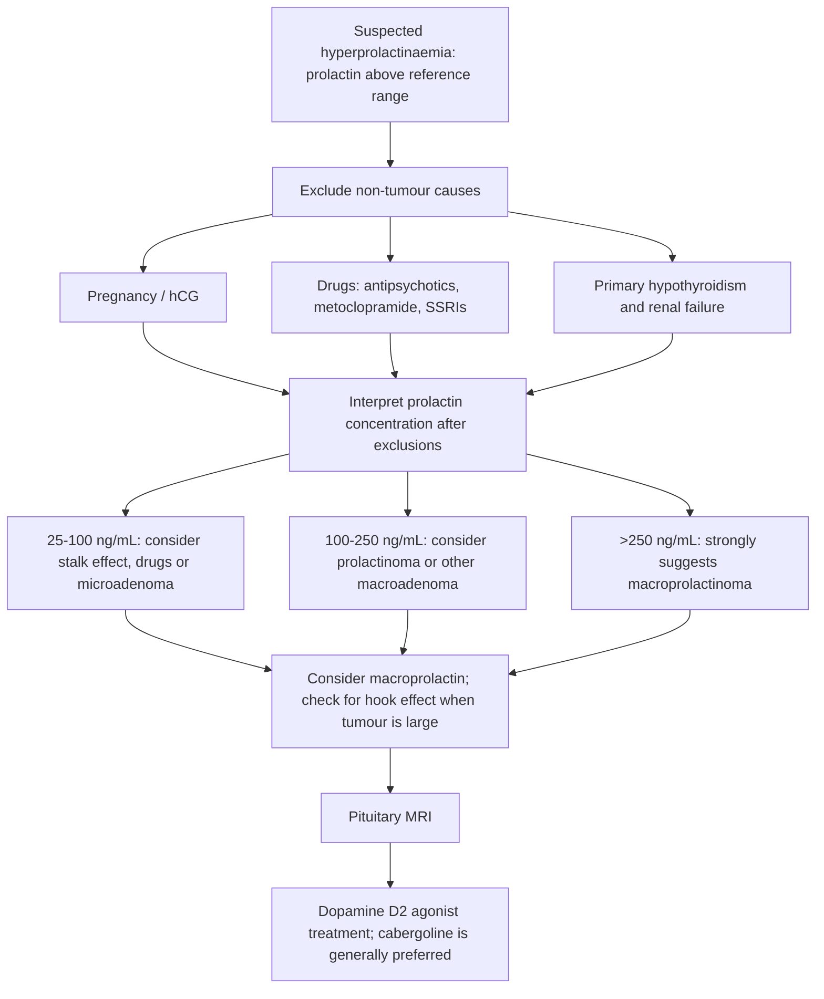
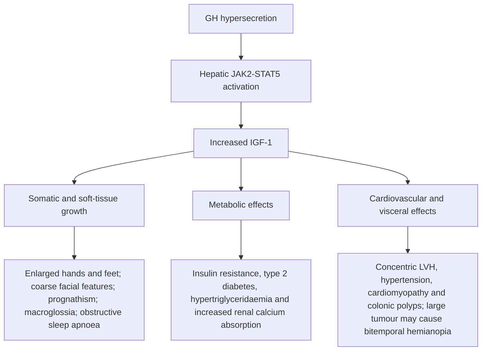
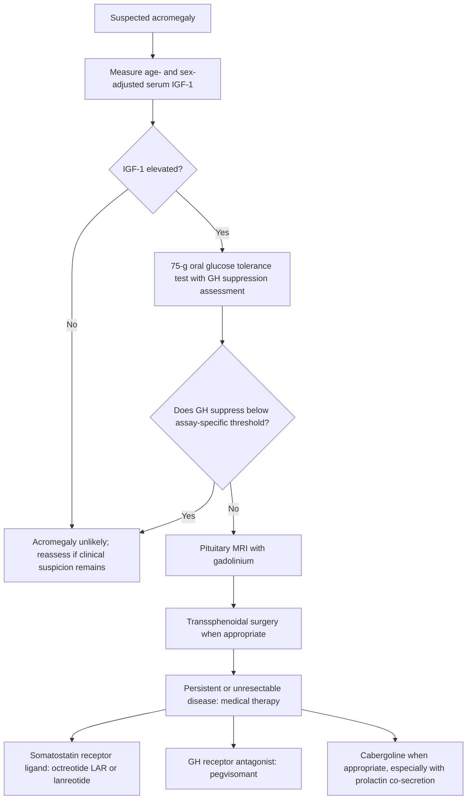

# Chapter 3: Hypothalamus & Anterior Pituitary Gland

## 3.1 Hypothalamic-Pituitary Anatomy & Portal Circulation

The hypothalamic-pituitary unit coordinates neuroendocrine control over growth, metabolism, reproduction, and stress responses.

### Anatomical Relationships & Vascular Supply
* **Anatomy & Boundaries**: The pituitary gland (hypophysis) sits within the **sella turcica** of the sphenoid bone, covered superiorly by the **diaphragma sellae**. It is bordered superiorly by the **optic chiasm** (10 mm superior) and laterally by the paired **cavernous sinuses** (containing cranial nerves III, IV, $V_1, V_2$, VI, and the internal carotid artery).
* **Anterior Lobe (Adenohypophysis - 80%)**: Derived embryologically from **Rathke's pouch** (ectodermal invagination of the primitive oral cavity / stomodeum).
* **Posterior Lobe (Neurohypophysis - 20%)**: Derived from the neural ectoderm of the floor of the third ventricle (diencephalon).
* **Hypophyseal Portal System**: Superior hypophyseal arteries (from internal carotid) form a primary capillary plexus in the **median eminence** of the hypothalamus. Hypothalamic neurosecretory peptides are carried down long portal veins to the secondary capillary plexus in the adenohypophysis.

---

### Adenohypophyseal Cell Lineages & Transcription Factors

Pituitary cytodifferentiation is governed by specific nuclear transcription factor cascades:

1. **PIT-1 (POU1F1) Lineage**:
   * **Somatotrophs** (50% of cells): Secrete Growth Hormone (GH).
   * **Lactotrophs** (15–20%): Secrete Prolactin (PRL).
   * **Thyrotrophs** (5%): Secrete Thyroid-Stimulating Hormone (TSH).
   * *Clinical Correlate*: *PIT-1* gene mutations cause combined pituitary hormone deficiency (GH, PRL, TSH deficiency).
2. **TPIT Lineage**:
   * **Corticotrophs** (15–20%): Secrete Adrenocorticotropic Hormone (ACTH) and $\beta$-endorphin from the precursor pro-opiomelanocortin (POMC).
3. **SF-1 (Steroidogenic Factor-1) & GATA-2 Lineage**:
   * **Gonadotrophs** (10%): Secrete Follicle-Stimulating Hormone (FSH) and Luteinizing Hormone (LH).

---

## 3.2 Anterior Pituitary Hyperfunction & Pituitary Adenomas

Pituitary adenomas are benign monoclonal neoplasms arising from adenohypophyseal cells. They are classified by size into **Microadenomas** ($< 10\text{ mm}$) and **Macroadenomas** ($\ge 10\text{ mm}$).

### Mass Effects of Pituitary Macroadenomas
* **Optic Chiasm Compression**: Causes classic **Bitemporal Hemianopia** (compression of decussating inferior nasal retinal fibers in the optic chiasm).
* **Cavernous Sinus Invasion**: Cranial nerve palsies (CN III, IV, $V_1/V_2$, VI); CN VI (abducens) is most vulnerable as it lies unattached inside the sinus lumen.
* **Hypopituitarism**: Compression of adjacent normal pituitary tissue or pituitary stalk (stalk effect $\rightarrow$ hyperprolactinemia due to loss of hypothalamic dopamine inhibition).

---

### 1. Prolactinoma

Prolactinomas are the most common functional pituitary tumors (40–50%).

#### Pathophysiology & Control
Prolactin synthesis is unique: it is under **tonic tonic inhibitory control** by hypothalamic **Dopamine** acting on lactotroph $D_2$ GPCRs. TRH stimulates prolactin release.

#### Clinical Presentation
* **Females** (typically present as microprolactinomas): Amenorrhea, galactorrhea, oligomenorrhea, infertility, loss of libido.
* **Males** (typically present late as macroprolactinomas): Loss of libido, erectile dysfunction, gynecomastia, infertility, visual field defects, headaches.

#### Therapeutics
* **First-Line Therapy**: **Medical Therapy with Dopamine $D_2$ Agonists** (**Cabergoline** [0.25–1.0 mg twice weekly] > Bromocriptine). Cabergoline achieves normalization of prolactin and >50% tumor shrinkage in 80–90% of cases.
* **Indications for Transsphenoidal Surgery (TSS)**: Resistance or intolerance to dopamine agonists, acute neuro-ophthalmic deterioration, or apoplexy.

---

### 2. Acromegaly & Gigantism

Acromegaly is caused by autonomous growth hormone (GH) hypersecretion from a somatotroph adenoma ($>95\%$) after epiphyseal plate closure. Gigantism occurs if GH excess occurs *before* epiphyseal closure in children.

#### Diagnostic Protocol
1. **Screening Test**: Serum **IGF-1 (Insulin-like Growth Factor-1)** (age- and sex-matched). IGF-1 reflects integrated 24-hour GH output and lacks GH's pulsatility.
2. **Confirmatory Test**: **Oral Glucose Tolerance Test (OGTT) for GH**: Administer 75g glucose PO.
   * *Normal*: GH suppresses to $< 0.4\ \mu\text{g/L}$.
   * *Acromegaly*: Failure of GH to suppress below **$0.4\ \mu\text{g/L}$** (or $< 1.0\ \mu\text{g/L}$ on traditional assays).
3. **Anatomical Imaging**: Pituitary MRI with gadolinium.

#### Therapeutics
* **First-Line Treatment**: **Transsphenoidal Surgical Resection (TSS)**.
* **Medical Therapy** (Adjuvant or for surgical failures):
  * **Somatostatin Receptor Ligands (SRLs)**: **Octreotide LAR** or Lanreotide (binds SSTR2/SSTR5 $\rightarrow$ inhibits GH release).
  * **GH Receptor Antagonist**: **Pegvisomant** (blocks peripheral GH receptor dimerization $\rightarrow$ drops IGF-1; does not shrink tumor).
  * **Dopamine Agonist**: Cabergoline (effective if tumor co-secretes prolactin).

---

## 3.3 Hypopituitarism & Pituitary Apoplexy

Hypopituitarism is the partial or complete loss of anterior and/or posterior pituitary hormone secretion.

### Order of Hormone Loss in Progressive Pituitary Compression
$$\text{GH} \longrightarrow \text{FSH/LH} \longrightarrow \text{TSH} \longrightarrow \text{ACTH} \longrightarrow \text{Prolactin}$$
*(Note: ACTH deficiency is late, but life-threatening).*

---

### Specific Clinical Syndromes

#### 1. Sheehan Syndrome (Postpartum Pituitary Necrosis)
* **Pathophysiology**: During pregnancy, prolactin cell hyperplasia doubles pituitary size without an increase in blood supply. Severe postpartum hemorrhage and shock lead to vasospasm and **ischemic necrosis** of the anterior pituitary.
* **Clinical Manifestation**: Immediate failure of postpartum lactation (loss of PRL), persistent amenorrhea/oligomenorrhea (loss of gonadotropins), severe fatigue, hyponatremia, secondary hypothyroidism, and secondary adrenal insufficiency.
* **Imaging**: MRI shows an **empty sella** (pituitary tissue replaced by CSF).

#### 2. Pituitary Apoplexy
* **Pathophysiology**: Acute hemorrhagic infarction or hemorrhage into a pre-existing pituitary macroadenoma.
* **Clinical Triad**:
  1. Sudden, excruciating **"Thunderclap" Headache**.
  2. Acute neuro-ophthalmic deterioration (diplopia, CN III/IV/VI palsies, rapid loss of vision/bitemporal hemianopia).
  3. Acute secondary **Adrenal Crisis** (severe hypotension, hyponatremia, hypoglycemia) due to sudden ACTH withdrawal.
* **Management**: **Emergency Medical Resuscitation**: Immediate high-dose IV Hydrocortisone (100 mg IV bolus) to prevent cardiovascular collapse, followed by urgent transsphenoidal surgical decompression.

---

## Section 3.4 Checklist & Quality Control

### Index Subsections Covered
- [x] 3.1 Hypothalamic-Pituitary Anatomy & Portal Circulation
- [x] 3.2 Anterior Pituitary Hyperfunction & Pituitary Adenomas
- [x] 3.3 Hypopituitarism & Pituitary Apoplexy

### Index Corrections & Clarifications
* **Clarification**: Dopamine agonists (Cabergoline) are *first-line* for prolactinomas (surgery reserved for failures), whereas Transsphenoidal Surgery is *first-line* for Acromegaly and Cushing disease.

### Sources Insufficient / Limitations
* Anatomy and diagnostic protocols conform strictly to current Endocrine Society guidelines.
