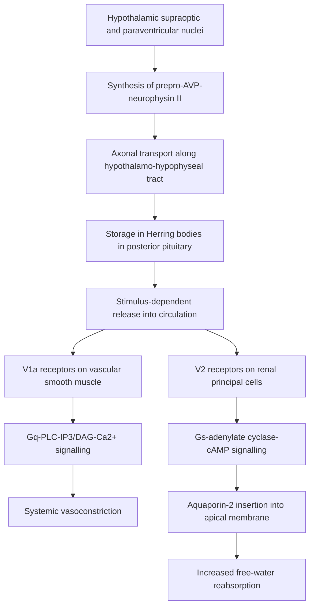
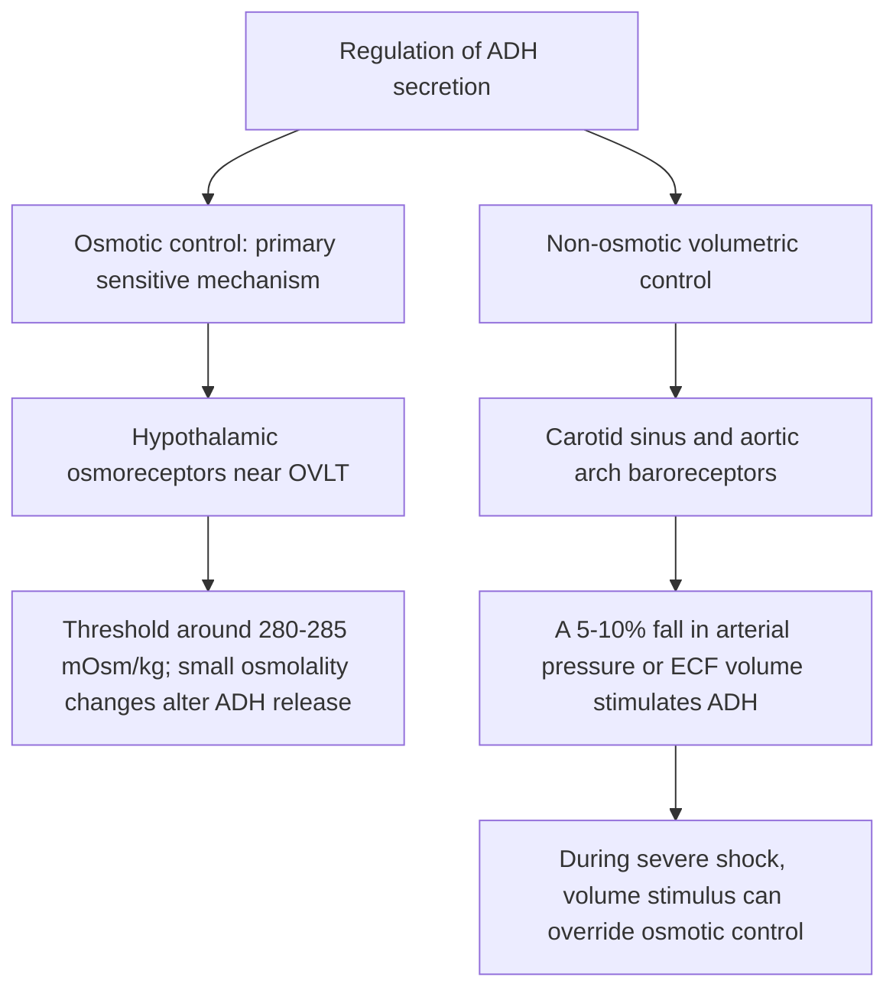
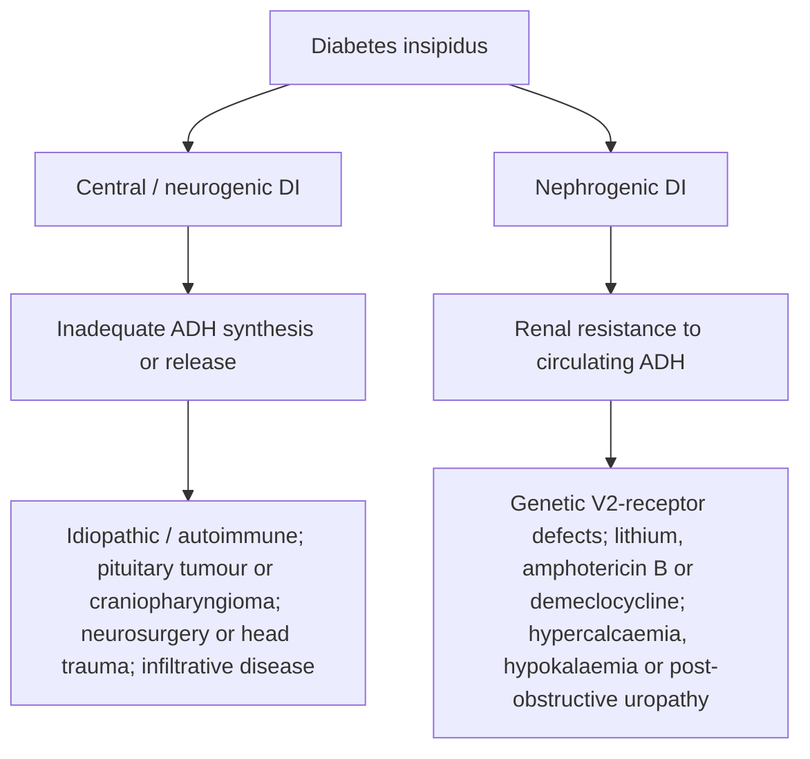
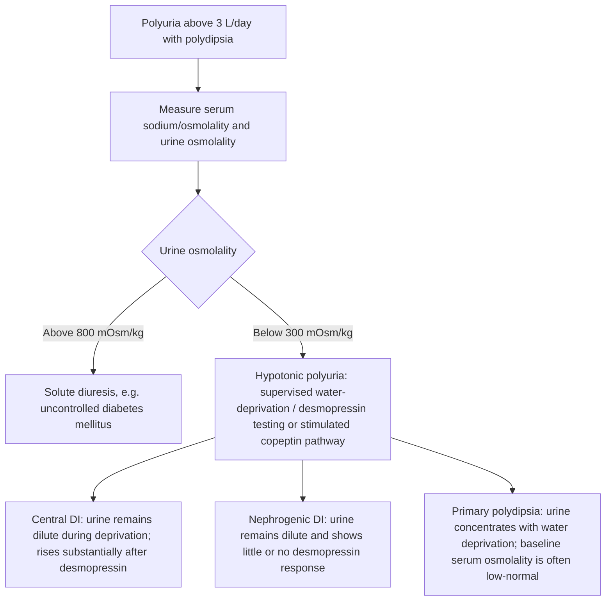
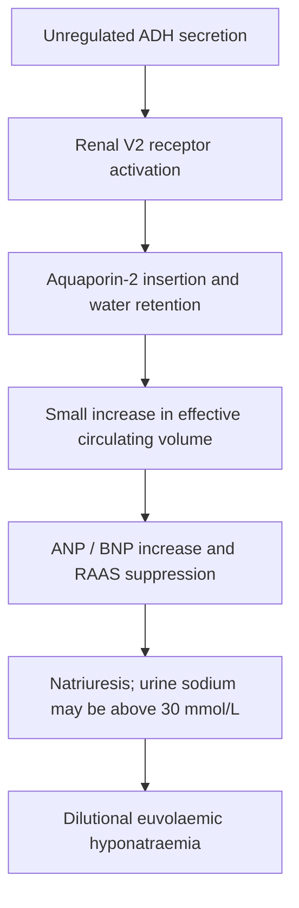
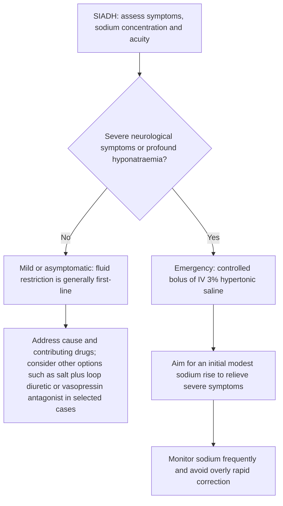

# Chapter 4: Posterior Pituitary Gland & Water Metabolism

## 4.1 Vasopressin (ADH) & Oxytocin Physiology

The posterior pituitary gland (neurohypophysis) does not synthesize hormones; it stores and secretes two nonapeptides—**Arginine Vasopressin (AVP / ADH)** and **Oxytocin**—synthesized in the hypothalamus.

### Biosynthesis & Axonal Transport
* **Synthesizing Neurons**: Magnocellular neurons in the **Supraoptic (SON)** (predominantly ADH) and **Paraventricular (PVN)** (predominantly Oxytocin) nuclei of the hypothalamus.
* **Axonal Transport**: Hormones are packaged into secretory vesicles bound to specific carrier proteins called **Neurophysins** (Neurophysin II for ADH; Neurophysin I for Oxytocin) and transported down the hypothalamo-hypophyseal tract to unmyelinated nerve terminals in the posterior pituitary.

---

### Receptor Subtypes & Actions

1. **$V_{1a}$ Receptors ($G_q / \text{PLC} / \text{IP}_3\text{-}\text{Ca}^{2+}$)**: Located on vascular smooth muscle; mediates potent vasoconstriction.
2. **$V_{1b}$ / $V_3$ Receptors ($G_q / \text{PLC}$)**: Located on anterior pituitary corticotrophs; acts synergistically with CRH to stimulate ACTH secretion.
3. **$V_2$ Receptors ($G_s / \text{cAMP} / \text{PKA}$)**: Located on the basolateral membrane of renal principal cells in the late distal convoluted tubule and inner medullary collecting ducts. PKA phosphorylation triggers the translocation and insertion of **Aquaporin-2 (AQP2)** water channels into the apical (luminal) membrane, dramatically increasing free water permeability.

---

### Regulation of ADH Secretion

---

## 4.2 Diabetes Insipidus (DI)

Diabetes Insipidus is characterized by the excretion of large volumes ($>3\text{ L/24h}$ or $>50\text{ mL/kg/24h}$) of dilute (**hypotonic**) urine.

### Classification & Etiologies

---

### Diagnostic Evaluation & Differential Diagnosis

#### Plasma Copeptin Testing
**Copeptin** is the C-terminal cleavage fragment of prepro-AVP, co-secreted in 1:1 equimolar ratio with ADH. It is highly stable in plasma.
* Baseline Unstimulated Copeptin $> 21.4\text{ pmol/L}$ is pathognomonic for **Nephrogenic DI**.
* Hypertonic Saline-Stimulated Copeptin $< 4.9\text{ pmol/L}$ confirms **Central DI**.

---

### Management Matrix

| DI Subtype | First-Line Pharmacotherapy | Adjunctive / Alternative Therapy |
| :--- | :--- | :--- |
| **Central DI** | **Desmopressin (dDAVP)** (Oral, Sublingual, or Intranasal $V_2$-selective agonist) | Ensure free access to drinking water |
| **Nephrogenic DI** | Discontinue offending drug (Lithium); Salt restriction + **Thiazide Diuretics** (induces mild ECF contraction $\rightarrow$ proximal tubular water reabsorption) | **Amiloride** (specifically blocks ENaC channels preventing lithium uptake into principal cells); Indomethacin |

---

## 4.3 Syndrome of Inappropriate Antidiuretic Hormone Secretion (SIADH)

SIADH is characterized by unsuppressed, autonomous secretion of ADH in the absence of osmotic or volumetric physiological stimuli, leading to impaired free water excretion and **euvolemic hyponatremia**.

### Major Etiologies
1. **Malignancies**: **Small Cell Lung Cancer (SCLC)** (classic ectopic production), Head & Neck carcinomas, GI malignancies.
2. **CNS Disorders**: Stroke, subarachnoid hemorrhage, head trauma, meningitis, brain abscess.
3. **Pulmonary Disorders**: Pneumonia, tuberculosis, asthma, positive-pressure mechanical ventilation.
4. **Drug-Induced**: SSRIs, Carbamazepine, Cyclophosphamide, Vincristine, MDMA (Ecstasy), NSAIDs.

---

### Pathophysiology & "Aldosterone Escape"

---

### Diagnostic Criteria (Essential Criteria)
1. **Decreased Effective Serum Osmolality** ($< 275\text{ mOsm/kg}$).
2. **Inappropriately Concentrated Urine** (Urine Osmolality $> 100\text{ mOsm/kg}$, typically $> 300\text{ mOsm/kg}$).
3. **Clinical Euvolemia** (absence of peripheral edema, ascites, or orthostatic hypotension).
4. **Elevated Urinary Sodium Concentration** ($> 30\text{ mEq/L}$) with normal dietary salt intake.
5. **Absence of Alternative Causes**: Normal thyroid (TSH) and adrenal (cortisol) function; no concurrent diuretic use.

---

### Therapeutics & Safety Protocols

#### DANGER: Osmotic Demyelination Syndrome (ODS / Central Pontine Myelinolysis)
* **Pathophysiology**: Rapid correction of chronic hyponatremia dehydrates brain cells that have adapted by extruding organic osmolytes $\rightarrow$ demyelination of oligodendrocytes in the pons.
* **Clinical Manifestation**: Flaccid paralysis, dysarthria, dysphagia, "locked-in" syndrome 2–6 days post-correction.
* **SAFETY RULE**: The rate of serum sodium correction must **NEVER exceed $8\text{--}10\text{ mEq/L}$ in any 24-hour period** (or $< 6\text{ mEq/L/24h}$ in high-risk patients).

---

## Section 4.4 Checklist & Quality Control

### Index Subsections Covered
- [x] 4.1 Vasopressin (ADH) & Oxytocin Physiology
- [x] 4.2 Diabetes Insipidus (DI)
- [x] 4.3 Syndrome of Inappropriate Antidiuretic Hormone Secretion (SIADH)

### Index Corrections & Clarifications
* **Clarification**: Primary polydipsia is distinguished from DI during water deprivation by a dramatic rise in urine osmolality *before* exogenous desmopressin administration, coupled with a low baseline serum sodium.

### Sources Insufficient / Limitations
* Diagnostic criteria for SIADH and DI correspond strictly to international Endocrine Society and Nephrology guidelines.
