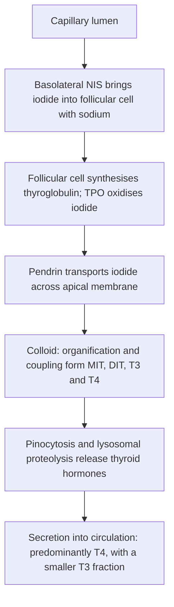
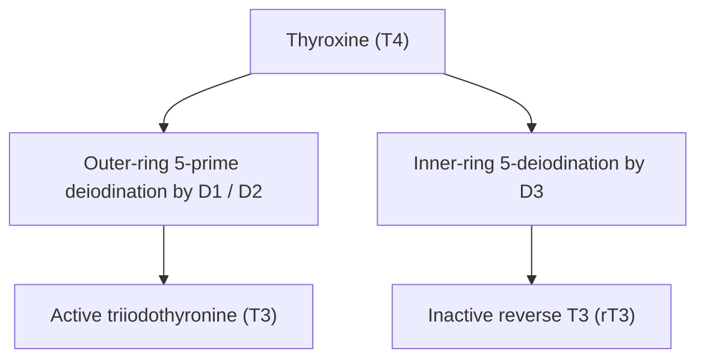
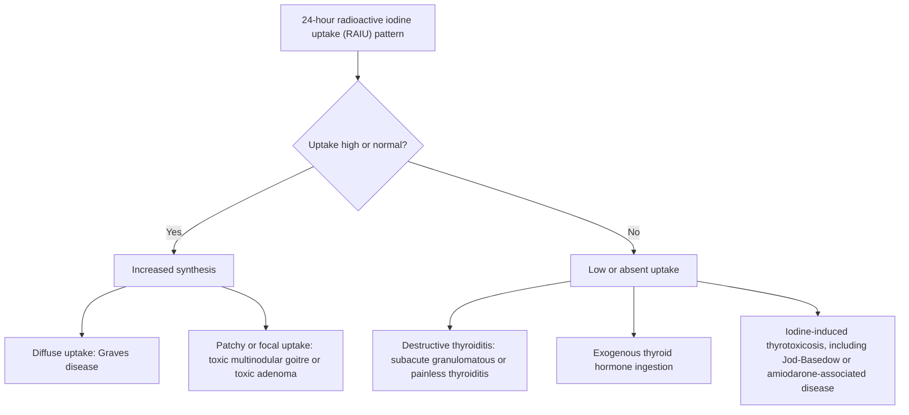

# Chapter 05: Thyroid Physiology, Biosynthesis & Diagnostic Evaluation

## 5.1 Thyroid Hormone Synthesis, Secretion & Transport

### Microanatomy of the Thyroid Follicle
The thyroid gland consists of spherical **follicles** surrounded by a single layer of cuboidal follicular epithelial cells enclosing a central lumen filled with proteinaceous **colloid**. The colloid serves as the extracellular storage site for thyroid hormones bound to **Thyroglobulin (Tg)**, a massive $660\text{ kDa}$ dimeric glycoprotein synthesized by the rough endoplasmic reticulum of follicular cells. Interspersed in the parafollicular interstitial tissue are neural crest-derived **Parafollicular C-cells**, which synthesize and secrete **Calcitonin**.

---

### Step-by-Step Biosynthesis of Thyroid Hormones

The synthesis of Thyroid Hormones ($\text{T}_4$ / Thyroxine and $\text{T}_3$ / Triiodothyronine) involves six sequential, tightly regulated enzymatic and transport steps:

1. **Iodide Trapping (Basolateral Uptake)**:
   - Inorganic iodide ($\text{I}^-$) is actively transported from extracellular fluid across the basolateral membrane of the follicular cell against an electrical and chemical concentration gradient ($30\text{--}250\times$ intracellular concentration).
   - Mediated by the **Sodium-Iodide Symporter (NIS)**, an active secondary transmembrane protein co-transporting $2\text{ Na}^+$ ions down their electrochemical gradient (maintained by basolateral $\text{Na}^+/\text{K}^+$-ATPase) for every $1\text{ I}^-$ ion.
   - *Pharmacologic Inhibition*: NIS is competitively inhibited by monovalent anions such as **Perchlorate ($\text{ClO}_4^-$)**, **Pertechnetate ($\text{TcO}_4^-$)**, and **Thiocyanate ($\text{SCN}^-$)**.

2. **Apical Iodide Efflux & Pendrin Transport**:
   - Intracellular iodide diffuses passively to the apical lumen membrane and is transported into the colloid lumen via **Pendrin**, an anion exchanger encoded by the *SLC26A4* gene.
   - *Clinical Correlation*: Inactivating mutations of Pendrin cause **Pendred Syndrome**, characterized by sensorineural hearing loss and congenital goitrous hypothyroidism.

3. **Oxidation of Iodide**:
   - At the apical colloid interface, iodide ($\text{I}^-$) is oxidized to an active iodine species ($\text{I}^0$ or $\text{I}^+$) by the heme-containing enzyme **Thyroid Peroxidase (TPO)** in the presence of hydrogen peroxide ($\text{H}_2\text{O}_2$), generated by Dual Oxidase 2 (**DUOX2**).

4. **Organification of Thyroglobulin (Iodination)**:
   - Activated iodine rapidly iodinates specific tyrosine residues on the Tg backbone at the C-3 and C-5 positions of the aromatic ring, catalyzed by TPO.
   - Monoiodotyrosine (**MIT**) is formed by single iodination; Diiodotyrosine (**DIT**) is formed by dual iodination.

5. **Coupling Reaction**:
   - TPO catalyzes the intermolecular phenolic ether coupling of iodotyrosine residues within the Tg structure:
     $$\text{DIT} + \text{DIT} \longrightarrow \text{Thyroxine } (\text{T}_4) + \text{Alanine residue}$$
     $$\text{MIT} + \text{DIT} \longrightarrow \text{Triiodothyronine } (\text{T}_3) + \text{Alanine residue}$$
   - Approximately $90\%$ of coupled product stored in colloid is $\text{T}_4$, while $10\%$ is $\text{T}_3$.

6. **Endocytosis, Proteolysis & Secretion**:
   - TSH stimulation induces apical pseudopodia formation that pinocytoses iodinated colloid droplets into endosomes.
   - Endosomes fuse with lysosomes, where endopeptidases degrade Tg, releasing free $\text{T}_4$, $\text{T}_3$, MIT, and DIT.
   - Free $\text{T}_4$ and $\text{T}_3$ are extruded across the basolateral membrane into capillaries by **Monocarboxylate Transporter 8 (MCT8)**.
   - Uncoupled MIT and DIT are rapidly deiodinated by intrathyroidal **Iodotyrosine Dehalogenase (DEHAL1)** to recycle inorganic iodide for hormone synthesis.
   - *Clinical Correlation*: MCT8 gene mutations cause **Allan-Herndon-Dudley Syndrome** (severe X-linked psychomotor retardation with elevated serum $\text{T}_3$ and low $\text{T}_4$).

---

### Peripheral Conversion & Deiodinase Isoenzymes

$\text{T}_4$ functions primarily as a circulating prohormone ($80\text{--}90\ \mu\text{g/day}$ daily glandular production). $\text{T}_3$ is the biologically active hormone with $3\text{--}5\times$ higher affinity for nuclear thyroid hormone receptors ($\text{TR}\alpha$ and $\text{TR}\beta$). Approximately $80\%$ of circulating $\text{T}_3$ is generated in peripheral tissues via outer-ring 5'-deiodination of $\text{T}_4$.

| Deiodinase Type | Primary Tissue Distribution | Ring Action | Substrate Preference | Physiological Function & Regulation |
| :--- | :--- | :--- | :--- | :--- |
| **Type 1 (D1)** | Liver, Kidney, Thyroid, Skeletal Muscle | Outer (5') & Inner (5) | $\text{rT}_3 > \text{T}_4 > \text{T}_3$ | Provides circulating $\text{T}_3$; inhibited by PTU, propranolol, systemic illness, glucocorticoids. |
| **Type 2 (D2)** | Brain, Pituitary, Brown Fat, Heart | Outer (5') | $\text{T}_4 > \text{rT}_3$ | Provides local intracellular $\text{T}_3$ for local tissue demand & TSH feedback; upregulated in hypothyroidism. |
| **Type 3 (D3)** | Placenta, Fetal Tissues, CNS, Skin | Inner (5) | $\text{T}_3 > \text{T}_4$ | Inactivates $\text{T}_4 \rightarrow \text{rT}_3$ and $\text{T}_3 \rightarrow 3,3'-\text{T}_2$; protects fetus/brain from hyperthyroidism. |

---

### Thyroid Hormone Plasma Transport & Binding Globulin Dynamics

Over $99.97\%$ of circulating $\text{T}_4$ and $99.7\%$ of $\text{T}_3$ are bound to plasma proteins. Only the **free unbound fraction** ($\text{FT}_4 \approx 0.03\%$; $\text{FT}_3 \approx 0.3\%$) is physiologically active and capable of crossing cell membranes to bind nuclear receptors and mediate pituitary TSH feedback.

1. **Thyroid-Binding Globulin (TBG)**:
   - High-affinity glycoprotein synthesized in the liver; carries $\sim 70\%$ of bound $\text{T}_4$ and $\text{T}_3$.
2. **Transthyretin (TTR / Thyretin / Prealbumin)**:
   - Binds $\sim 15\%$ of $\text{T}_4$; crosses blood-brain barrier.
3. **Albumin**:
   - Low affinity, high capacity; carries $\sim 15\%$ of $\text{T}_4$.

#### Clinical Alterations in TBG & Impact on Thyroid Function Tests:

$$\text{Total Hormone} = \text{Free Hormone} + \text{Protein-Bound Hormone}$$

- **Conditions Increasing TBG**:
  - High Estrogen states (Pregnancy, Oral Contraceptive Pills, Hormone Replacement Therapy), Tamoxifen, Acute Hepatitis.
  - *Laboratory Profile*: **High Total $\text{T}_4$ and Total $\text{T}_3$**, **Normal Free $\text{T}_4$**, **Normal TSH** (Patient remains strictly **Euthyroid**).
- **Conditions Decreasing TBG**:
  - Androgens, Anabolic Steroids, High-Dose Glucocorticoids, Nephrotic Syndrome (urinary TBG loss), Severe Cirrhosis/Liver Failure.
  - *Laboratory Profile*: **Low Total $\text{T}_4$ and Total $\text{T}_3$**, **Normal Free $\text{T}_4$**, **Normal TSH** (Patient remains strictly **Euthyroid**).

---

## 5.2 Diagnostic Evaluation of Thyroid Function

### Serum Hormone Assays

1. **Serum TSH (Thyrotropin)**:
   - **Most sensitive initial screening test** for thyroid dysfunction due to the inverse logarithmic relationship between Free $\text{T}_4$ and TSH (a $2$-fold change in $\text{FT}_4$ induces a $100$-fold change in TSH).
   - Measured using $3\text{rd-generation}$ chemiluminescent immunoassays (detection limit $<0.01\ \text{mIU/L}$).
   - Reference Range: $0.4\text{--}4.0\ \text{mIU/L}$.

2. **Free $\text{T}_4$ ($\text{FT}_4$) and Free $\text{T}_3$ ($\text{FT}_3$)**:
   - Measured directly using Equilibrium Dialysis or Automated Immunoassays.
   - Direct measurement avoids diagnostic errors caused by TBG binding alterations.
   - $\text{FT}_3$ measurement is specifically indicated when **$\text{T}_3$-Toxicosis** is suspected (suppressed TSH with normal $\text{FT}_4$).

---

### Thyroid Autoantibodies

| Autoantibody | Target Antigen | Clinical Association & Diagnostic Utility |
| :--- | :--- | :--- |
| **Anti-TPO (Anti-Thyroid Peroxidase)** | Apical enzyme TPO | Present in $>95\%$ of **Hashimoto Thyroiditis** and $70\text{--}80\%$ of Graves' disease. Predicts progression from subclinical to overt hypothyroidism. |
| **Anti-Tg (Anti-Thyroglobulin)** | Thyroglobulin backbone | Present in $70\text{--}80\%$ of Hashimoto's and $30\%$ of Graves'. Measured alongside serum Tg in differentiated thyroid cancer surveillance to prevent false-negative Tg immunoassays. |
| **TRAb / TSI (TSH Receptor Antibody)** | TSH Receptor (GPCR) | **Thyroid Stimulating Immunoglobulin (TSI)** acts as a direct agonist $\rightarrow$ Pathognomonic for **Graves' Disease**. Crosses placenta causing fetal/neonatal thyrotoxicosis. |

---

### Radionuclide Thyroid Uptake & Imaging

Radionuclide imaging provides anatomical and functional evaluation using **Sodium Iodine-123 ($^{123}\text{I}$)**, **Iodine-131 ($^{131}\text{I}$)**, or **Technetium-99m Pertechnetate ($^{99m}\text{TcO}_4^-$)**.

- **Technetium-99m ($^{99m}\text{Tc}$)** is trapped by NIS but not organified; provides rapid low-radiation anatomical imaging.
- **Iodine-123 ($^{123}\text{I}$)** is trapped and organified ($13\text{h}$ half-life, $159\text{ keV}$ gamma emission); ideal for quantitative Radioactive Iodine Uptake (RAIU) and scan.

#### Diagnostic RAIU Diagnostic Matrix (24-Hour Uptake):

- **High Diffuse Uptake ($>35\text{--}80\%$)**: **Graves' Disease** (homogeneous distribution throughout enlarged lobes).
- **High Patchy / Nodular Uptake**: **Toxic Multinodular Goiter (TMNG)** (multiple "hot" autonomous nodules suppressing surrounding normal tissue) or **Toxic Adenoma** (single intense "hot" nodule with suppressed contralateral lobe).
- **Low / Suppressed Uptake ($<2\%$)**: **Subacute Thyroiditis** (De Quervain or painless/postpartum - follicular cell destruction releases stored hormone), **Factitious Thyrotoxicosis** (exogenous levothyroxine intake), or **Iodine-Induced Hyperthyroidism (Jod-Basedow)**.

---

### High-Resolution Thyroid Ultrasonography & TI-RADS

High-resolution USG ($7.5\text{--}15\text{ MHz}$ linear transducer) is the gold standard imaging modality for evaluating thyroid morphology, goiter structure, and risk-stratifying thyroid nodules.

#### High-Risk Sonographic Features Suggestive of Malignancy:
1. **Microcalcifications** (psammoma body representation; tiny hyperechoic foci without posterior acoustic shadowing).
2. **Solid hypoechoic composition** relative to strap muscles.
3. **Irregular, lobulated, or microlobulated margins**.
4. **"Taller-than-wide" shape** (transverse diameter less than anteroposterior diameter on sagittal view).
5. **Extranodal extension or disruption of thyroid capsule**.
6. **Pathological cervical lymphadenopathy** (loss of fatty hilum, rounded shape, cystic change, microcalcifications).

#### ACR TI-RADS Risk Stratification & FNA Thresholds:

| TI-RADS Level | Classification | Sonographic Points | FNA Size Threshold | USG Follow-up Threshold |
| :--- | :--- | :--- | :--- | :--- |
| **TR1** | Benign | $0$ points | No FNA | No follow-up |
| **TR2** | Not Suspicious | $2$ points | No FNA | No follow-up |
| **TR3** | Mildly Suspicious | $3$ points | $\ge 2.5\text{ cm}$ | $\ge 1.5\text{ cm}$ |
| **TR4** | Moderately Suspicious | $4\text{--}6$ points | $\ge 1.5\text{ cm}$ | $\ge 1.0\text{ cm}$ |
| **TR5** | Highly Suspicious | $\ge 7$ points | $\ge 1.0\text{ cm}$ | $\ge 0.5\text{ cm}$ |

---

### Subsection Coverage Checklist
- [x] 5.1 Thyroid Hormone Synthesis, Secretion & Transport
- [x] 5.2 Diagnostic Evaluation of Thyroid Function

### Index Corrections & Source Grounding Notes
- No index errors detected. All structural steps of thyroid hormone biosynthesis, peripheral conversion pathways, deiodinase kinetics, binding protein dynamics, autoantibody diagnostics, RAIU algorithms, and TI-RADS risk stratification guidelines are fully aligned with current evidence-based endocrinology practice.
