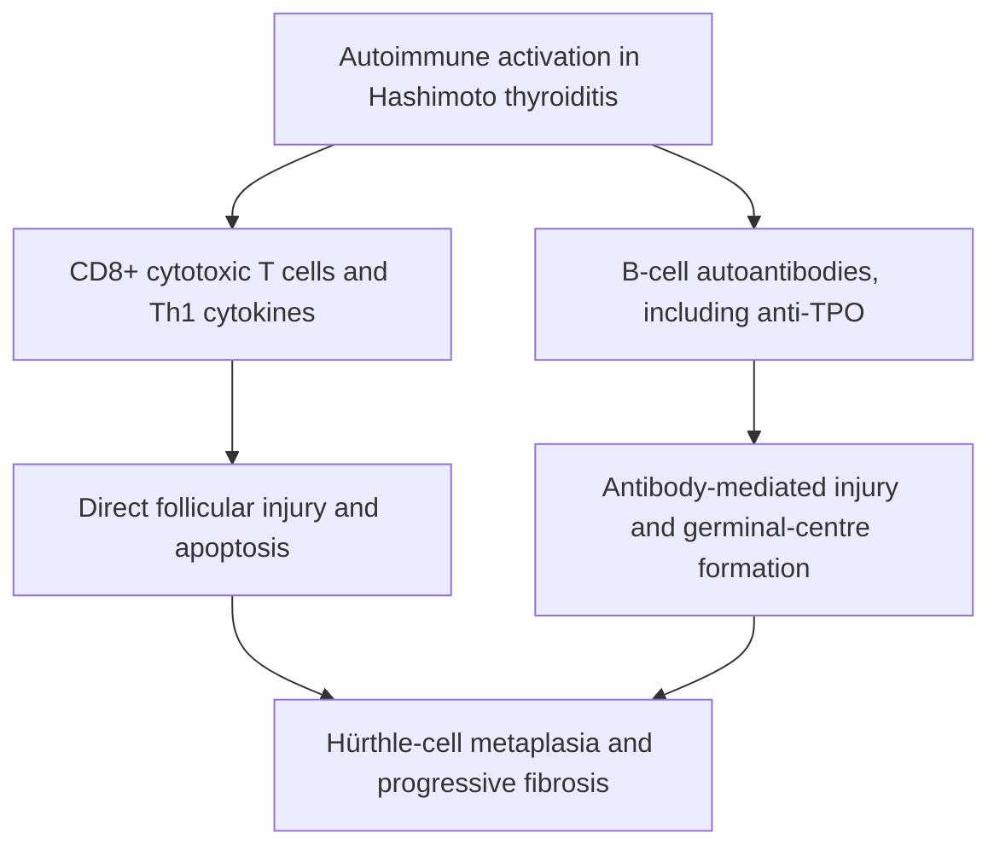
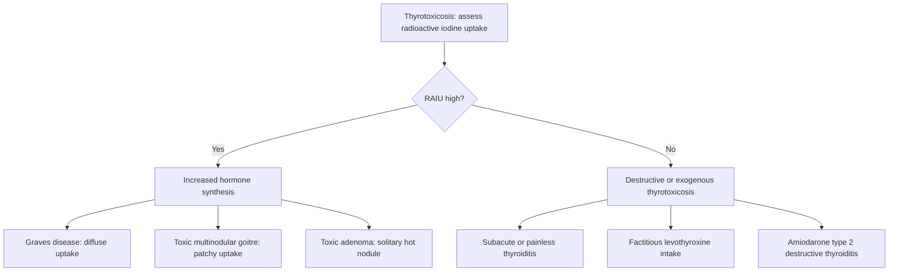
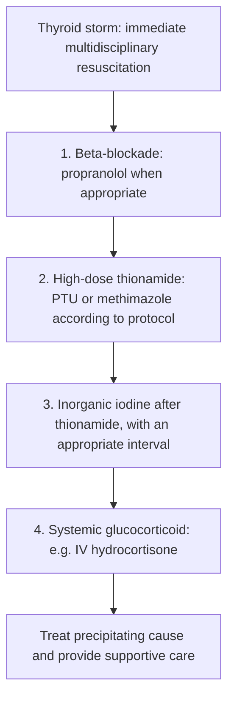

# Chapter 06: Hypothyroidism, Thyrotoxicosis & Thyroiditis

## 6.1 Hypothyroidism

### Etiology & Pathophysiologic Classification
Hypothyroidism is characterized by systemic hormone deficiency resulting in generalized metabolic slowing.

1. **Primary Hypothyroidism ($>95\%$ of cases)**:
   - Direct thyroid gland failure.
   - **Hashimoto Thyroiditis (Chronic Autoimmune Thyroiditis)**: Primary cause in iodine-sufficient regions.
   - **Iodine Deficiency**: Primary cause worldwide in non-fortified endemic regions.
   - **Iatrogenic**: Post-radioactive iodine ($^{131}\text{I}$) ablation, post-total/subtotal thyroidectomy, external beam neck irradiation.
   - **Pharmacologic**: Lithium (inhibits thyroid hormone release), Amiodarone (high iodine content; Wolff-Chaikoff blockade), Monoclonal Immune Checkpoint Inhibitors (Anti-PD-1 / Anti-CTLA-4 pembrolizumab/nivolumab thyroiditis), Tyrosine Kinase Inhibitors (sunitinib).
   - **Congenital**: Thyroid dysgenesis (agenesis, ectopy - #1 cause), dyshormonogenesis (*TPO* or *NIS* mutations).

2. **Central (Secondary / Tertiary) Hypothyroidism ($<5\%$)**:
   - Deficient TSH secretion from anterior pituitary (secondary) or deficient TRH from hypothalamus (tertiary).
   - Causes: Pituitary macroadenomas, craniopharyngioma, Sheehan syndrome, pituitary apoplexy, infiltrative granulomatous diseases, cranial radiation.

---

### Autoimmune Pathogenesis of Hashimoto Thyroiditis
Hashimoto thyroiditis involves cell-mediated and humoral autoimmune destruction of thyroid follicular architecture:
- **Genetic Susceptibility**: Strongly linked to **HLA-DR3**, **HLA-DR5**, and polymorphisms in *CTLA4* and *PTPN22*.
- **Immunological Cascade**: Defect in suppressor T-cells leads to CD4+ T-helper 1 ($\text{Th}1$) activation $\rightarrow$ secretion of Interferon-$\gamma$ (IFN-$\gamma$) and Tumor Necrosis Factor-$\alpha$ (TNF-$\alpha$) $\rightarrow$ recruitment of CD8+ Cytotoxic T-lymphocytes and macrophages causing direct follicular cell apoptosis.
- **Autoantibodies**: Humoral activation yields **Anti-TPO** ($>95\%$) and **Anti-Thyroglobulin** ($70\text{--}80\%$) antibodies, which mediate Antibody-Dependent Cell-Mediated Cytotoxicity (ADCC) and complement activation.
- **Histopathology**: Dense inflammatory infiltrate composed of lymphocytes and plasma cells forming prominent lymphoid follicles with **active germinal centers**. Follicular epithelial cells undergo metaplastic transformation into **Hürthle Cells (Askanazy Cells / Oxyphilic Cells)**—large polygonal cells with abundant, coarsely granular, deeply eosinophilic cytoplasm packed with altered mitochondria.

- *Clinical Risk Association*: Patients with Hashimoto thyroiditis carry a $60\times$ increased risk of developing **Primary Thyroid Lymphoma** (typically Extranodal Marginal Zone B-Cell MALToma or DLBCL).

---

### Multisystem Clinical Manifestations
- **Metabolic / Systemic**: Cold intolerance, weight gain despite anorexia, hypothermia, lethargy, psychomotor slowing.
- **Dermatologic**: Dry, rough, pale skin; brittle hair and nails; loss of outer third of eyebrows (**Madarosis**); non-pitting mucinous edema (**Myxedema**) caused by dermal accumulation of glycosaminoglycans (hyaluronic acid and chondroitin sulfate) binding water in dermis and soft tissues (periorbital puffiness, enlarged tongue).
- **Cardiovascular**: Bradycardia, decreased cardiac contractility, reduced stroke volume, diastolic hypertension (increased systemic vascular resistance), pericardial effusion, low-voltage ECG complexes.
- **Neuromuscular**: Delayed relaxation phase of deep tendon reflexes (**"Hung-up" reflexes / Woltman sign**), proximal muscle weakness, elevated serum Creatine Kinase (CK), Carpal Tunnel Syndrome (median nerve mucinous compression).
- **Gastrointestinal**: Severe constipation, paralytic ileus, megacolon.
- **Reproductive / Endocrine**: Anovulatory cycles, menorrhagia, infertility, secondary hyperprolactinemia (elevated TRH stimulates pituitary lactotrophs $\rightarrow$ galactorrhea).

---

### Diagnostic Profile & Subclinical Hypothyroidism

| Parameter | Primary Overt Hypothyroidism | Subclinical Hypothyroidism | Central (Secondary) Hypothyroidism |
| :--- | :--- | :--- | :--- |
| **Serum TSH** | **Markedly Elevated ($>10\ \text{mIU/L}$)** | **Elevated ($4.5\text{--}10\ \text{mIU/L}$)** | **Low or Inappropriately Normal** |
| **Serum Free $\text{T}_4$** | **Low** | **Normal** | **Low** |
| **Serum Anti-TPO** | Positive ($>95\%$ Hashimoto's) | Positive ($50\text{--}70\%$) | Negative |

#### Management of Subclinical Hypothyroidism:
Subclinical Hypothyroidism (Elevated TSH with normal $\text{FT}_4$) is treated with Levothyroxine under specific indications:
1. TSH $\ge 10\ \text{mIU/L}$ (high risk of progression to overt disease and adverse CV events).
2. TSH $4.5\text{--}9.9\ \text{mIU/L}$ WITH: Positive Anti-TPO antibodies, presence of symptomatic goiter, pregnancy / planned conception, or elevated LDL cholesterol/cardiovascular disease.

---

### Therapeutics & Myxedema Coma

#### Levothyroxine ($\text{L-T}_4$) Replacement Protocol:
- **Full Replacement Dose**: $1.6\ \mu\text{g/kg/day}$ based on *ideal body weight*.
- **Special Populations**: Elderly patients or those with underlying Ischemic Heart Disease start at a low dose ($25\ \mu\text{g/day}$) and titrate upward by $12.5\text{--}25\ \mu\text{g}$ every $6\text{--}8$ weeks to prevent precipitating acute myocardial ischemia or arrhythmias.
- **Administration**: Taken on an empty stomach with water $30\text{--}60$ minutes before breakfast. Absorption is impaired by calcium carbonate, ferrous sulfate, proton pump inhibitors, and cholestyramine.
- **Monitoring**: Re-check TSH $6\text{--}8$ weeks after initiation or dose adjustments; target TSH $0.5\text{--}2.5\ \text{mIU/L}$.

#### Myxedema Coma (Emergency Protocol):
Myxedema Coma is a life-threatening, end-stage expression of severe uncorrected hypothyroidism triggered by infection, cold exposure, stroke, or sedatives in elderly hypothyroid patients.
- **Clinical Triad**: Profound Hypothermia ($<35^\circ\text{C}$), Altered Mental Status / Coma, and Hyponatremia $\pm$ Hypoventilation/Hypercapnia & Bradycardia.
- **Emergency Management Protocol**:
  1. **Airway & Resuscitation**: Endotracheal intubation, mechanical ventilation, passive external rewarming.
  2. **Stress-Dose Glucocorticoids FIRST**: Administer **IV Hydrocortisone $100\text{ mg}$ Q8H** *prior* to thyroid hormone administration to prevent precipitating acute adrenal crisis in patients with coexisting autoimmune adrenal insufficiency (Schmidt Syndrome) or central panhypopituitarism.
  3. **Thyroid Hormone Loading**: **IV Levothyroxine ($\text{L-T}_4$) $200\text{--}400\ \mu\text{g}$ IV loading dose**, followed by $50\text{--}100\ \mu\text{g}$ IV daily $\pm$ **IV Liothyronine ($\text{L-T}_3$) $10\text{--}20\ \mu\text{g}$ loading**.

---

## 6.2 Thyrotoxicosis & Graves' Disease

### Etiology & Pathophysiologic Spectrum
Thyrotoxicosis refers to the clinical state of tissue hyper-exposure to elevated circulating thyroid hormones. Hyperthyroidism refers specifically to de novo glandular hormone hypersecretion.

---

### Graves' Disease: Pathogenesis & Unique Clinical Triad
Graves' Disease is an autoimmune disorder driven by humoral autoimmunity:
- **Immunological Mechanism**: B-cell synthesis of IgG autoantibodies against the TSH receptor (**Thyroid Stimulating Immunoglobulins - TSI / TRAb**). TSI binds the $G_{\alpha s}$-coupled TSH receptor, inducing constitutive activation of adenylate cyclase and unregulatable synthesis and release of $\text{T}_4$ and $\text{T}_3$, alongside follicular cell hyperplasia and diffuse glandular enlargement.

#### The Pathognomonic Clinical Triad:
1. **Hyperthyroidism with Diffuse Smooth Goiter**: Symmetrical non-tender gland enlargement with vascular bruits and thrills on auscultation.
2. **Graves' Ophthalmopathy (Exophthalmos / Proptosis)**:
   - *Pathophysiology*: TSI autoantibodies target the TSH receptor expressed on retro-orbital fibroblasts $\rightarrow \text{CD4}^+$ T-cell infiltration $\rightarrow$ secretion of IFN-$\gamma$, TNF-$\alpha$, and IL-1 $\rightarrow$ stimulation of fibroblasts to synthesize massive quantities of hydrophilic **Glycosaminoglycans (Hyaluronic acid)** $\rightarrow$ osmotic swelling of extraocular muscles (sparing tendons) and retro-orbital fat $\rightarrow$ proptosis, extraocular muscle entrapment (inferior and medial recti #1 $\rightarrow$ diplopia), lid retraction (Dalmple sign), periorbital edema, and optic nerve compression.
3. **Pretibial Myxedema (Infiltrative Dermopathy)**:
   - Dermal fibroblast stimulation over anterior shins yielding non-pitting, erythematous, indurated plaques with a classic **"peau d'orange" (orange-peel)** texture.

---

### Anti-Thyroid Drug (ATD) Pharmacology Comparison

| Pharmacologic Property | Methimazole (MMI) | Propylthiouracil (PTU) |
| :--- | :--- | :--- |
| **Mechanism of Action** | Inhibits TPO oxidation, organification & coupling reactions. | Inhibits TPO AND inhibits peripheral Type 1 (D1) deiodinase ($\text{T}_4 \rightarrow \text{T}_3$ conversion). |
| **Potency & Half-life** | $10\times$ more potent; long half-life (QD dosing). | Lower potency; short half-life (TID dosing). |
| **First-Line Indications** | **First-line agent for ALL non-pregnant Graves' disease** and 2nd/3rd trimesters. | **1st Trimester of Pregnancy** (less teratogenic) AND **Thyroid Storm** (blocks peripheral conversion). |
| **Teratogenicity** | Risk of **Aplasia Cutis Congenita** & Choanal Atresia (avoid in 1st trimester). | Lower teratogenic risk; preferred in 1st trimester. |
| **Severe Adverse Effects** | Agranulocytosis, cholestatic jaundice, skin rash. | **Severe Acute Fulminant Hepatic Failure** (Black Box Warning), Agranulocytosis, ANCA vasculitis. |

- *Critical Agranulocytosis Protocol*: Agranulocytosis (absolute neutrophil count $<500/\mu\text{L}$) occurs in $0.2\text{--}0.5\%$ of patients. Patients presenting with sudden **fever and severe sore throat / pharyngitis** must **immediately stop the drug** and obtain an emergency STAT Complete Blood Count (CBC).

---

### Radioactive Iodine Ablation ($^{131}\text{I}$) & Surgical Options
- **Radioactive Iodine ($^{131}\text{I}$)**: Oral administration of $\beta$-emitting isotope causing destruction of follicular cells over $6\text{--}12$ weeks.
  - *Absolute Contraindications*: **Pregnancy** and **Lactation** (destroys fetal thyroid).
  - *Relative Contraindication*: **Moderate-to-severe active Graves' Ophthalmopathy** ($^{131}\text{I}$ releases thyroid antigens $\rightarrow$ worsens orbitopathy; prevented by co-administering oral prednisone).
- **Total Thyroidectomy**: Indicated for large obstructive goiters, concomitant suspicious/malignant nodules, severe active ophthalmopathy, or ATD toxicity. Patients must be rendered euthyroid prior to surgery using ATDs and Lugol's iodine to reduce vascularity.

---

### Thyroid Storm (Thyrotoxic Crisis)

Thyroid Storm is a hypermetabolic emergency characterized by decompensated thyrotoxicosis precipitated by acute events (surgery, infection, trauma, RAI therapy, or ATD withdrawal).

- **Burch-Wartofsky Point Scale (BWPS)**: Diagnosed at score $\ge 45$ based on:
  - **Thermoregulatory**: Severe hyperpyrexia ($38.5\text{--}41.0^\circ\text{C}$).
  - **Cardiovascular**: Tachycardia out of proportion ($>140\text{ bpm}$), Atrial Fibrillation, Acute Heart Failure.
  - **CNS**: Severe agitation, delirium, psychosis, seizure, or coma.
  - **GI/Hepatic**: Severe diarrhea, vomiting, jaundice.

#### Life-Saving 4-Step Pharmacologic Protocol:

1. **Step 1: Beta-Blockade**: High-dose **Propranolol $60\text{--}80\text{ mg}$ PO Q6H or IV** to control neuromuscular/hyperadrenergic surge and inhibit peripheral 5'-deiodinase.
2. **Step 2: Antithyroid Synthesis Inhibition**: **PTU $500\text{--}1000\text{ mg}$ loading PO/PR**, then $250\text{ mg}$ Q4H to block new hormone synthesis and peripheral $\text{T}_4 \rightarrow \text{T}_3$ conversion.
3. **Step 3: Hormone Release Blockade**: **Lugol's Iodine (5 drops Q8H)** or **SSKI (5 drops Q6H)** administered **at least 1 hour AFTER PTU**.
   - *Critical Timing Rule*: Administering iodine *before* ATD provides substrate for new hormone synthesis (**Jod-Basedow effect**), worsening the storm. Given 1 hour after PTU, high inorganic iodide suppresses hormone release via the **Wolff-Chaikoff Effect**.
4. **Step 4: Glucocorticoids**: **IV Hydrocortisone $100\text{ mg}$ Q8H** to decrease peripheral $\text{T}_4 \rightarrow \text{T}_3$ conversion and treat relative adrenal insufficiency.

---

## 6.3 Thyroiditis

### Clinical & Diagnostic Matrix of Thyroiditis Subtypes

| Subtype | Etiology / Pathogenesis | Clinical Presentation | RAIU & Labs | Histopathology | Management |
| :--- | :--- | :--- | :--- | :--- | :--- |
| **Subacute Granulomatous (De Quervain)** | Post-viral (Coxsackie, Echovirus, Adenovirus); HLA-B35 link. | **Severely painful, tender thyroid gland** radiating to jaw/ears; fever, transient thyrotoxicosis. | **Low / Suppressed RAIU ($<2\%$)**; High ESR/CRP; High $\text{FT}_4$, Low TSH. | Multinucleated **giant cells**, granulomas, microabscesses, follicular destruction. | NSAIDs (first-line) or oral **Prednisone** ($40\text{ mg/day}$) for severe pain. |
| **Subacute Painless / Silent Thyroiditis** | Autoimmune Variant; transient lymphocytic destruction. | **Painless** firm enlargement; postpartum presentation (Postpartum Thyroiditis); self-limiting. | **Low / Suppressed RAIU ($<2\%$)**; Positive Anti-TPO antibodies. | Lymphocytic infiltrate without granulomas or giant cells. | Beta-blockers for thyrotoxic phase; temporary levothyroxine if hypothyroid. |
| **Acute Suppurative Thyroiditis** | Bacterial infection (*S. aureus*, *S. pneumoniae*); piriform sinus fistula #1 in children. | Unilateral painful thyroid, erythema, warmth, high fever, fluctuation. | Normal RAIU in unaffected tissue; Leukocytosis with left shift. | Polymorphonuclear neutrophilic infiltration with abscess formation. | IV Antibiotics + Surgical or percutaneous drainage. |
| **Riedel Thyroiditis** | Fibrosing disease (IgG4-Related Systemic Disease association). | **Dense, stone-hard ("woody") fixed thyroid** extending into neck; hoarseness, stridor. | Low uptake; Normal or low thyroid function. | Dense fibrous tissue replacing gland, keloid-like collagen, IgG4+ plasma cells. | Surgical decompression of airway; Tamoxifen, Glucocorticoids, Mycophenolate. |

---

### Subsection Coverage Checklist
- [x] 6.1 Hypothyroidism
- [x] 6.2 Thyrotoxicosis & Graves' Disease
- [x] 6.3 Thyroiditis

### Index Corrections & Source Grounding Notes
- No index errors detected. All autoimmune mechanisms, Hürthle cell histopathology, Myxedema coma protocols, ATD pharmacology comparison tables, Burch-Wartofsky criteria, 4-step Thyroid storm sequences, and thyroiditis differential matrices reflect established endocrinology standards.
