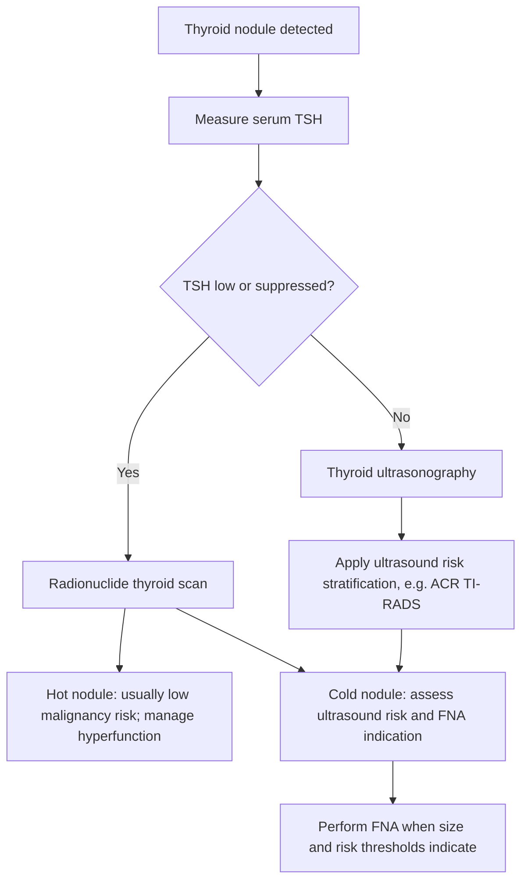
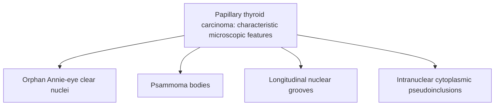

# Chapter 07: Goiter, Thyroid Nodules & Thyroid Neoplasms

## 7.1 Diffuse & Multinodular Goiter

### Pathophysiology of Goitrogenesis
Goiter refers to abnormal thyroid enlargement resulting from impaired hormone synthesis, inflammatory destruction, or autonomous cellular hyperplasia.

1. **Endemic Goiter**:
   - Secondary to environmental **Iodine Deficiency** in mountain ranges and inland geographic areas.
   - Reduced iodine leads to decreased $\text{T}_4$ synthesis $\rightarrow$ persistent compensatory elevation of pituitary **TSH** $\rightarrow$ diffuse follicular cell hypertrophy and hyperplasia $\rightarrow$ uniform glandular enlargement (**Diffuse Simple Non-Toxic Goiter**).

2. **Multinodular Goiter (MNG)**:
   - Long-standing recurrent cycles of TSH stimulation and involution create functional autonomy and structural heterogeneity.
   - Follicles vary from hyperplastic microfollicles to massive colloid-filled macrofollicles. Internal hemorrhage, fibrosis, calcification, and cystic degeneration produce discrete nodular architecture.
   - **Toxic Multinodular Goiter (Plummer Disease)**: Somatic gain-of-function mutations in the **TSH Receptor ($TSHR$) gene** arise within individual nodules over decades, causing autonomous hormone hypersecretion independent of TSH regulation $\rightarrow$ overt hyperthyroidism in elderly individuals without ophthalmopathy or dermopathy.

---

## 7.2 Evaluation & Management of Thyroid Nodules

### Diagnostic Algorithm for Solitary Thyroid Nodule

Thyroid nodules occur in $5\text{--}10\%$ of adults by palpation and $50\%$ by ultrasound. $90\text{--}95\%$ are benign colloid nodules or cysts, while $5\text{--}10\%$ represent primary thyroid malignancies.

1. **Step 1: Serum TSH Measurement**:
   - If **TSH is Suppressed ($<0.1\ \text{mIU/L}$)**: Order a Radionuclide Thyroid Scan ($^{123}\text{I}$ or $^{99m}\text{Tc}$).
     - *Hyperfunctioning "Hot" Nodule*: Takes up isotope with contralateral suppression; benign malignancy risk ($<1\%$). No FNA required; treat hyperthyroidism.
     - *Non-functioning "Cold" Nodule*: Fails to take up isotope ($10\text{--}15\%$ malignancy risk) $\rightarrow$ Proceed to Thyroid Ultrasound.
   - If **TSH is Normal or Elevated**: Proceed directly to **High-Resolution Thyroid Ultrasound**.

2. **Step 2: High-Resolution Thyroid Ultrasound & TI-RADS**:
   - Evaluates size, composition, echogenicity, shape, margins, and echogenic foci to calculate ACR TI-RADS score and dictate FNA necessity.

3. **Step 3: Fine-Needle Aspiration (FNA) Biopsy**:
   - Performed under direct real-time ultrasound guidance using a $22\text{--}25\text{ gauge}$ needle.

---

### The Bethesda System for Reporting Thyroid Cytopathology

Cytological reporting follows the standardized Bethesda classification to determine risk of malignancy and guide surgical vs. observational strategy:

| Bethesda Category | Diagnostic Nomenclature | Malignancy Risk | Clinical Management Strategy |
| :--- | :--- | :--- | :--- |
| **Category I** | Nondiagnostic / Unsatisfactory | $5\text{--}10\%$ | Repeat US-guided FNA in $6\text{--}12$ weeks. |
| **Category II** | Benign (Colloid nodule/Hashimoto's) | $0\text{--}3\%$ | Clinical & Sonographic follow-up. |
| **Category III** | Atypia of Undetermined Significance (AUS / FLUS) | $10\text{--}30\%$ | Repeat FNA $\pm$ Molecular Diagnostics (*BRAF/RAS/Afirma/ThyroSeq*) or diagnostic lobectomy. |
| **Category IV** | Follicular Neoplasm / Suspicious for Follicular Neoplasm | $25\text{--}40\%$ | Diagnostic Hemithyroidectomy / Lobectomy (FNA cannot confirm capsular invasion). |
| **Category V** | Suspicious for Malignancy | $50\text{--}75\%$ | Near-total / Total Thyroidectomy or Lobectomy. |
| **Category VI** | Malignant (Papillary, Anaplastic, Medullary) | $97\text{--}99\%$ | Total Thyroidectomy $\pm$ Neck Dissection. |

---

## 7.3 Thyroid Malignancies

### Master Comparative Matrix of Thyroid Carcinomas

| Feature | Papillary Carcinoma (PTC) | Follicular Carcinoma (FTC) | Medullary Carcinoma (MTC) | Anaplastic Carcinoma (ATC) |
| :--- | :--- | :--- | :--- | :--- |
| **Relative Frequency** | **$80\text{--}85\%$ (#1 most common)** | $10\text{--}15\%$ | $3\text{--}5\%$ | $1\text{--}2\%$ |
| **Peak Age & Gender** | $30\text{--}50$ years; Female ($3:1$). | $40\text{--}60$ years; Female ($3:1$). | $40\text{--}60$ years (Sporadic); $20\text{--}30$ (MEN2). | $>65$ years; Female ($2:1$). |
| **Etiology / Risk** | **Ionizing Radiation** exposure. | Iodine deficiency regions. | $25\%$ Germline **_RET_** mutation (MEN 2A/2B). | Long-standing MNG, *TP53* mutations. |
| **Spread Route** | **Lymphatic** to cervical lymph nodes (#1). | **Hematogenous** to bone & lungs. | Lymphatic & Hematogenous. | Rapid direct local tissue invasion. |
| **Pathognomonic Histology** | **Orphan Annie** nuclei, **Psammoma bodies**, Nuclear grooves. | Follicles invading **Capsule** or **Vessels**. | **Amyloid Stroma** (Congo red +), C-cell sheets. | Undifferentiated pleomorphic, giant cells, mitoses. |
| **Serum Biomarker** | Thyroglobulin (Tg). | Thyroglobulin (Tg). | **Calcitonin** & CEA. | None (Tg negative). |
| **Radioiodine Uptake** | Excellent ($^{131}\text{I}$ sensitive). | Excellent ($^{131}\text{I}$ sensitive). | **None** ($^{131}\text{I}$ ineffective). | **None** ($^{131}\text{I}$ ineffective). |
| **Overall 10-Yr Survival**| $>95\%$ (Excellent prognosis). | $80\text{--}85\%$ (Good prognosis). | $75\%$ (Sporadic); Variable (MEN2). | $<5\%$ (Stage IV at diagnosis; fatal). |

---

### Detailed Pathologic & Molecular Features

#### 1. Papillary Thyroid Carcinoma (PTC):
- **Molecular Driver Mutations**:
  - **_BRAF_ V600E Point Mutation** ($45\text{--}50\%$): Constitutive activation of the MAPK pathway; linked to aggressive features, extrathyroidal extension, and lymph node metastasis.
  - **_RET/PTC_ Chromosomal Rearrangements** ($10\text{--}20\%$): Fusion proteins ($PTC1, PTC2$) common in radiation-induced PTC.
- **Pathognomonic Microscopic Features**:
  1. **"Orphan Annie Eye" Nuclei**: Large, overlapping optically clear/empty nuclei with peripheral chromatin condensation caused by fine nuclear chromatin dispersion.
  2. **Psammoma Bodies**: Concentrically laminated, basophilic, calcified structures representing necrotic tumor papillae tip calcification.
  3. **Nuclear Grooves**: Longitudinal invaginations of the nuclear membrane.
  4. **Intranuclear Cytoplasmic Pseudoinclusions**: Cytoplasmic herniations into the nucleus.

---

#### 2. Follicular Thyroid Carcinoma (FTC):
- **Molecular Driver Mutations**: Gain-of-function **_RAS_ mutations** ($40\text{--}50\%$) or **_PAX8-PPARG_ gene fusion** ($30\text{--}40\%$).
- **Diagnostic Histological Requirement**:
  - **FNA Biopsy CANNOT distinguish Follicular Adenoma from Follicular Carcinoma** because cytology only demonstrates crowded microfollicles without nuclear features of PTC.
  - Definitive diagnosis **strictly requires surgical resection** demonstrating complete **transcapsular penetration** into surrounding normal thyroid/fat OR **angioinvasion** (tumor cells penetrating vascular lumens).

---

#### 3. Medullary Thyroid Carcinoma (MTC):
- **Cellular Origin**: Arises from calcitonin-secreting neuroendocrine **Parafollicular C-cells** (neural crest derived).
- **Genetic Subtypes**:
  - *Sporadic MTC* ($75\%$): Solitary nodule in 5th–6th decade; somatic *RET* or *RAS* mutations.
  - *Familial MTC / MEN 2A & 2B* ($25\%$): Germline gain-of-function **_RET_ proto-oncogene mutations**. Multicentric, bilateral, preceded by C-cell hyperplasia.
- **Histopathology**: Polygonal or spindle-shaped cells arranged in nests separated by a dense fibrous stroma containing acellular **amyloid deposits** derived from altered calcitonin cleavage products (stains positive with **Congo Red**, displaying **apple-green birefringence** under polarized light).
- **Tumor Markers**: Serum **Calcitonin** (correlates directly with tumor burden) and **Carcinoembryonic Antigen (CEA)**.

---

#### 4. Anaplastic Thyroid Carcinoma (ATC):
- **Molecular Pathology**: Extremely aggressive, undifferentiated tumor arising de novo or transforming from long-standing differentiated PTC/FTC via acquisition of **_TP53_ mutations**, *TERT* promoter mutations, or *CTNNB1* ($\beta$-catenin) alterations.
- **Histopathology**: High-grade pleomorphic giant cells, spindle cells, or squamoid cells with frequent mitoses and extensive ischemic necrosis.
- **Clinical Presentation**: Rapidly enlarging, painful, rock-hard anterior neck mass causing early dysphagia, stridor/dyspnea (tracheal invasion), and recurrent laryngeal nerve palsy (hoarseness).
- All ATC cases are categorized as **Stage IV** (IVA, IVB, IVC) upon presentation.

---

### Surgical Management & Radioiodine ($^{131}\text{I}$) Protocols

1. **Surgical Resection**:
   - **Total Thyroidectomy**: Standard approach for PTC/FTC $>4\text{ cm}$, extrathyroidal extension, gross lymph node metastases, or MTC.
   - **Thyroid Lobectomy / Hemithyroidectomy**: Acceptable for low-risk, solitary, intrathyroidal PTC/FTC $<1\text{--}4\text{ cm}$ without prior neck radiation or nodal involvement.
   - **Central Neck Lymph Node Dissection (Level VI)**: Mandatory for MTC and for PTC with clinically/sonographically involved nodes.

2. **Radioactive Iodine ($^{131}\text{I}$) Remnant Ablation**:
   - Administered $4\text{--}6$ weeks post-operatively for differentiated cancers (PTC/FTC) to destroy microscopic residual tissue and metastases.
   - Requires high serum TSH ($>30\ \text{mIU/L}$) achieved via levothyroxine withdrawal or pre-injection of **Recombinant Human TSH (rhTSH / Thyrogen)**.
   - *Inappropriate for MTC and ATC* (they lack NIS and do not uptake iodine).

3. **TSH Suppression Therapy**:
   - Suppressive doses of Levothyroxine administered to keep TSH $<0.1\ \text{mIU/L}$ in high-risk patients (or $0.1\text{--}0.5\ \text{mIU/L}$ in low-risk) to deprive residual tumor cells of TSH-mediated growth stimulation.

4. **Surveillance Protocols**:
   - Serum **Thyroglobulin (Tg)** + **Anti-Tg Antibodies** measured at 6–12 month intervals (Tg should be undetectable $<0.2\ \text{ng/mL}$ post-total thyroidectomy and ablation).
   - Serum **Calcitonin** and **CEA** monitored for MTC recurrence.

---

### Subsection Coverage Checklist
- [x] 7.1 Diffuse & Multinodular Goiter
- [x] 7.2 Evaluation & Management of Thyroid Nodules
- [x] 7.3 Thyroid Malignancies

### Index Corrections & Source Grounding Notes
- No index errors detected. All goitrogenesis mechanics, TI-RADS ultrasound thresholds, Bethesda cytopathological categories, Orphan Annie / Psammoma histological features, MTC amyloid biochemistry, and post-surgical $^{131}\text{I}$ ablation protocols align precisely with current clinical evidence.
