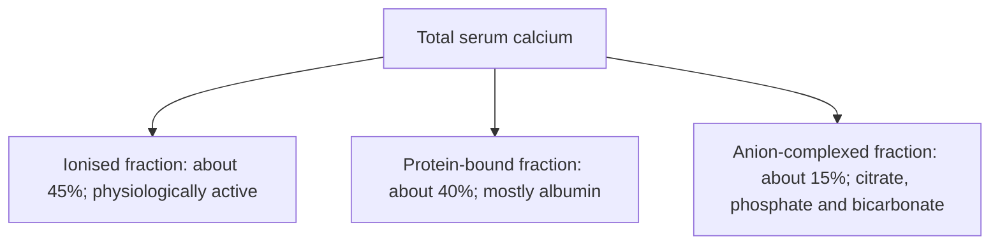
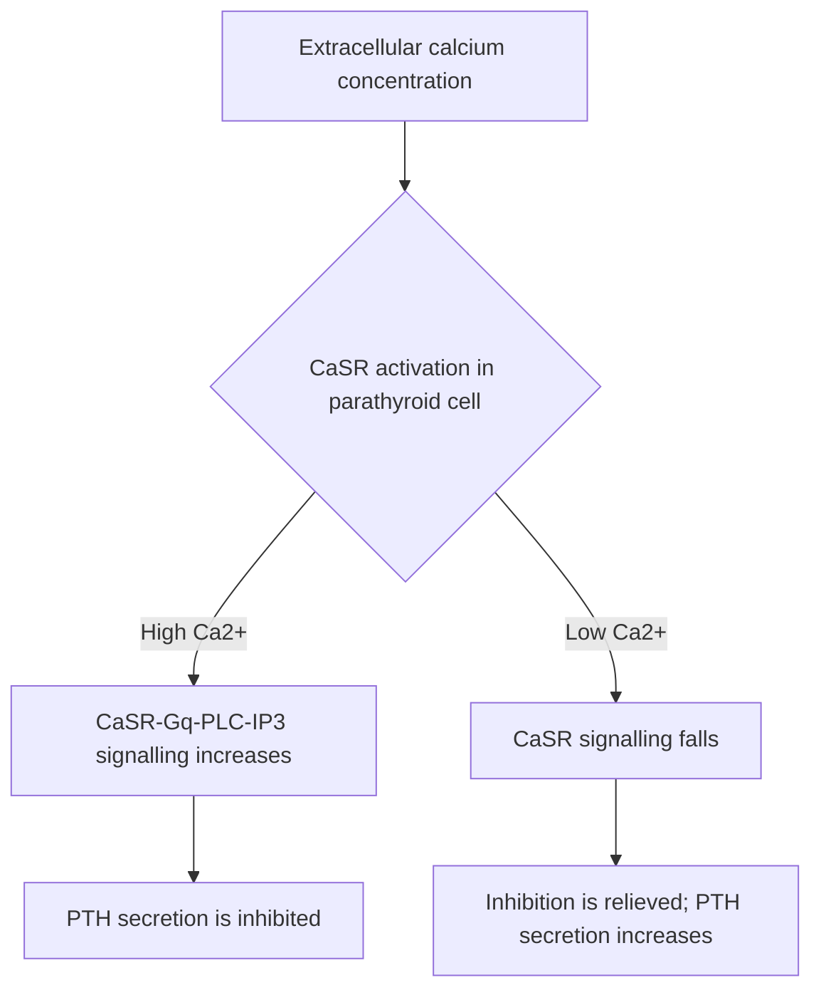
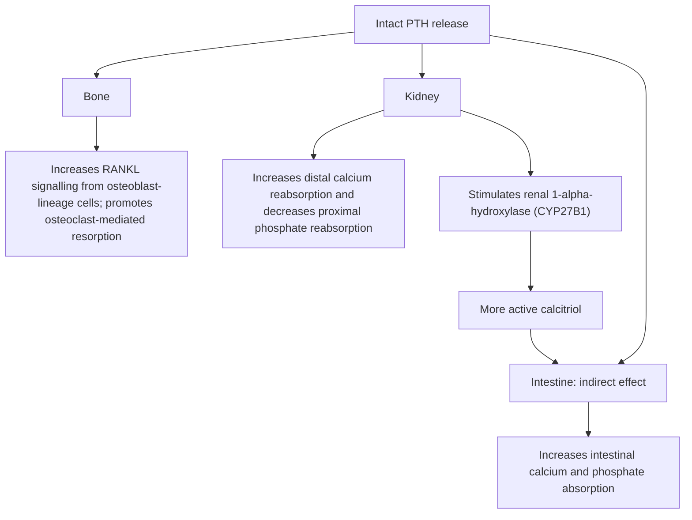
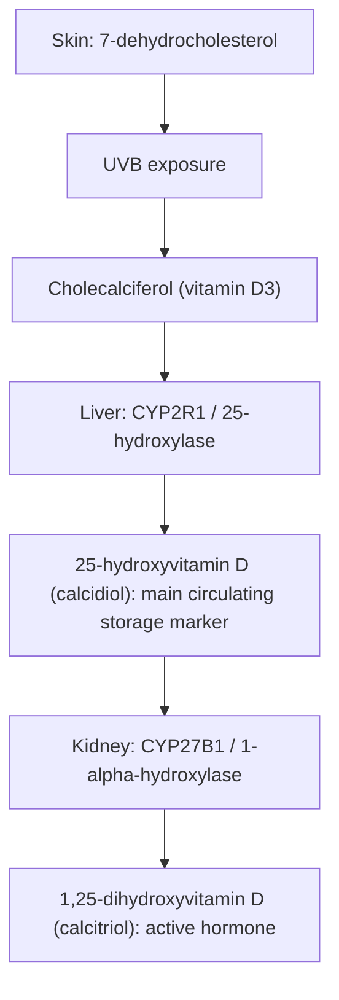
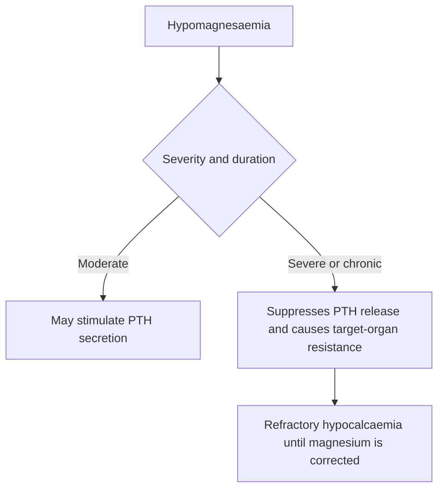

# Chapter 08: Calcium, Phosphate & Magnesium Homeostasis

## 8.1 Calcium Physiology & Regulation

### Total Body Calcium Distribution & Protein Binding

Total body calcium in a healthy adult is approximately $1000\text{--}1200\text{ g}$ ($15\text{ g/kg}$):
- **Skeletal Matrix ($99\%$)**: Stored as crystalline **Hydroxyapatite [$\text{Ca}_{10}(\text{PO}_4)_6(\text{OH})_2$]** in bone, serving as a structural framework and mineral reservoir.
- **Intracellular Fluid ($0.9\%$)**: Sequestered in endoplasmic reticulum and mitochondria; cytosolic free $\text{Ca}^{2+}$ is maintained at extremely low concentrations ($\sim 100\text{ nmol/L}$) to function as a second messenger.
- **Extracellular Fluid / Plasma ($0.1\%$)**: Serum concentration normal range $8.5\text{--}10.5\text{ mg/dL}$ ($2.12\text{--}2.62\text{ mmol/L}$).

#### Plasma Calcium Distribution Fractions:

1. **Ionized Calcium ($\text{iCa}^{2+}$)** ($45\%$ / $4.5\text{--}5.6\text{ mg/dL}$): Unbound, physiologically active fraction regulated by PTH and CaSR.
2. **Protein-Bound Calcium** ($40\%$): Bound primarily to negative carboxyl groups on **Albumin** ($80\%$) and Globulins ($20\%$). Inactive and non-diffusible.
3. **Complexed Calcium** ($15\%$): Diffusible fraction complexed with organic anions (citrate, phosphate, bicarbonate).

#### Calcium Correction Formula for Hypoalbuminemia:
Because $40\%$ of serum calcium is bound to albumin, alterations in serum albumin concentration alter total calcium without changing physiologically active ionized calcium:

$$\text{Corrected Total Calcium } (\text{mg/dL}) = \text{Measured Total Calcium } (\text{mg/dL}) + 0.8 \times \left(4.0 - \text{Serum Albumin } [\text{g/dL}]\right)$$

#### Influence of Systemic pH on Ionized Calcium:
- **Acidosis (Low pH)**: Excess hydrogen ions ($\text{H}^+$) bind albumin, displacing calcium $\rightarrow$ **Increases Ionized $\text{Ca}^{2+}$**.
- **Alkalosis (High pH)**: Decreased $\text{H}^+$ ions cause albumin carboxyl groups to deprotonate $\rightarrow$ increased binding of ionized calcium $\rightarrow$ **Decreases Ionized $\text{Ca}^{2+}$** (can trigger acute tetany in acute hyperventilation/respiratory alkalosis despite normal total calcium).

---

### Parathyroid Hormone (PTH) Synthesis & Secretion

PTH is a single-chain $84\text{--}\text{amino acid}$ polypeptide hormone synthesized by the **Chief Cells** of the four parathyroid glands located posterior to the thyroid lobes.

1. **Biosynthesis**:
   - PreproPTH ($115\text{ AA}$) $\rightarrow$ Signal peptide cleavage in ER $\rightarrow$ ProPTH ($90\text{ AA}$) $\rightarrow$ Golgi cleavage $\rightarrow$ Intact Active **PTH(1-84)** stored in secretory granules.
   - Biologic activity resides entirely in the N-terminal $\text{PTH(1-34)}$ fragment.

2. **Calcium-Sensing Receptor (CaSR) Control**:
   - The surface of parathyroid chief cells expresses the **Calcium-Sensing Receptor (CaSR)**, a $G_{\alpha q}$-coupled GPCR.
   - **High Extracellular Ionized Calcium** $\rightarrow$ Binds CaSR $\rightarrow$ Activates Phospholipase C (PLC) $\rightarrow \text{IP}_3/\text{DAG} \rightarrow$ Intracellular $\text{Ca}^{2+}$ elevation $\rightarrow$ **INHIBITS PTH Secretion & Gene Transcription**.
   - **Low Extracellular Ionized Calcium** $\rightarrow$ Unbinds CaSR $\rightarrow$ Removes tonic inhibition $\rightarrow$ **Stimulates Rapid Exocytosis of Stored PTH(1-84)**.

---

### Triple Organ Actions of Parathyroid Hormone (PTH)

PTH acts to elevate serum calcium and decrease serum phosphate through coordinated actions on three target organs:

1. **Action on Bone**:
   - *Indirect Osteoclast Activation*: PTH receptors are present on **Osteoblasts** (and stromal cells), NOT on mature osteoclasts.
   - PTH binding to osteoblasts upregulates expression of **RANKL** (Receptor Activator of Nuclear Factor $\kappa\text{B}$ Ligand) and suppresses **Osteoprotegerin (OPG)** (a soluble decoy receptor for RANKL).
   - RANKL binds **RANK** on pre-osteoclasts $\rightarrow$ differentiation and activation of multinucleated **Osteoclasts** $\rightarrow$ enzymatic degradation of bone matrix and release of $\text{Ca}^{2+}$ and $\text{PO}_4^{3-}$.

2. **Action on Kidney**:
   - **Increases Calcium Reabsorption**: Stimulates apical calcium channels (TRPV5) in the Distal Convoluted Tubule (DCT).
   - **Inhibits Phosphate Reabsorption (Phosphaturic Effect)**: Induces endocytosis and degradation of Sodium-Phosphate Cotransporters (**NaPi-IIa** and **NaPi-IIc**) in the Proximal Convoluted Tubule (PCT) $\rightarrow$ increases urinary phosphate excretion, preventing precipitation of calcium phosphate crystals in circulation.
   - **Stimulates Calcitriol Synthesis**: Upregulates expression of **1$\alpha$-Hydroxylase (CYP27B1)** in PCT cells.

3. **Action on Small Intestine**:
   - Indirectly increases duodenal/jejunal absorption of calcium and phosphate by driving renal production of active **1,25-Dihydroxyvitamin D [1,25(OH)$_2$D / Calcitriol]**.

---

### Vitamin D Synthesis & Activation Cascade

1. **Skin Synthesis & Diet**:
   - Epidermal 7-Dehydrocholesterol converts to **Cholecalciferol (Vitamin $\text{D}_3$)** under solar Ultraviolet B (UVB $290\text{--}315\text{ nm}$) radiation. Ergocalciferol (Vitamin $\text{D}_2$) is derived from plant sources.
2. **Hepatic Hydroxylation**:
   - Unbound $\text{D}_3/\text{D}_2$ travels bound to Vitamin D-Binding Protein (DBP) to the liver.
   - **25-Hydroxylase (CYP2R1)** converts Vitamin D to **25-Hydroxyvitamin D [25(OH)D / Calcidiol]**.
   - *Clinical Metric*: $25(\text{OH})\text{D}$ has a long half-life ($2\text{--}3\text{ weeks}$) and reflects total body Vitamin D stores.
3. **Renal 1$\alpha$-Hydroxylation**:
   - In renal PCT cells, **1$\alpha$-Hydroxylase (CYP27B1)** converts $25(\text{OH})\text{D}$ to active **1,25-Dihydroxyvitamin D [1,25(OH)$_2$D / Calcitriol]**.
   - *Enzymatic Regulation*: CYP27B1 is **strongly stimulated by PTH** and hypophosphatemia, and **inhibited by FGF23**, hyperphosphatemia, and active calcitriol.
4. **Calcitriol Biological Actions**:
   - Binds nuclear Vitamin D Receptor (**VDR**) in enterocytes $\rightarrow$ heterodimerizes with RXR $\rightarrow$ upregulates apical calcium channel (**TRPV6**), intracellular transport protein (**Calbindin-D9k**), and basolateral extrusion pump ($\text{PMCA1b}$) $\rightarrow$ massively increases intestinal calcium and phosphate absorption.

---

### Fibroblast Growth Factor 23 (FGF23)

FGF23 is a $32\text{ kDa}$ bone-derived hormone synthesized by **Osteocytes** in response to hyperphosphatemia and high calcitriol levels.
- **Co-Receptor**: Requires membrane-bound **Klotho** protein to bind its receptor (FGFR1c) in the kidney.
- **Renal Actions**:
  1. Downregulates NaPi-IIa/c cotransporters in PCT cells $\rightarrow$ **Potent Phosphaturic Effect**.
  2. Suppresses renal 1$\alpha$-hydroxylase (CYP27B1) and upregulates inactivating 24-hydroxylase (CYP24A1) $\rightarrow$ **Decreases Calcitriol Synthesis**.

---

## 8.2 Phosphate & Magnesium Homeostasis

### Phosphate Physiology
Total body phosphate $\sim 600\text{ g}$ ($85\%$ in bone, $14\%$ intracellular, $1\%$ ECF). Normal serum inorganic phosphate is $2.5\text{--}4.5\text{ mg/dL}$ ($0.81\text{--}1.45\text{ mmol/L}$).
- **Intestinal Absorption**: Absorbed passively and actively (via NaPi-IIb) under calcitriol stimulation.
- **Renal Excretion**: The kidney is the primary regulator of phosphate balance; $80\%$ of filtered phosphate is reabsorbed in the PCT via NaPi-IIa/c cotransporters. **PTH and FGF23 inhibit NaPi-IIa/c**, promoting renal phosphate excretion.

---

### Magnesium Physiology & The Hypomagnesemic Paradox

Serum Magnesium normal range is $1.7\text{--}2.2\text{ mg/dL}$ ($0.7\text{--}1.0\text{ mmol/L}$). $60\%$ in bone, $39\%$ intracellular, $1\%$ extracellular. Reabsorbed predominantly in the **Thick Ascending Limb (TAL) of the Loop of Henle** ($60\text{--}70\%$) via Claudin-16/19 tight junction channels driven by the lumen-positive transepithelial potential.

#### The Dual Effect of Serum Magnesium on Parathyroid Function:

1. **Mild-to-Moderate Hypomagnesemia**:
   - Stimulates PTH secretion by mimicking low calcium at the CaSR.
2. **Severe Chronic Hypomagnesemia ($<1.0\text{ mg/dL}$)**:
   - **Inhibits PTH Secretion**: Impairs intracellular $G_{\alpha s}$ protein subunit signaling required for exocytosis of PTH granules.
   - **Induces Peripheral PTH Resistance**: Impairs skeletal and renal end-organ response to circulating PTH.
   - *Clinical Imperative*: Severe hypomagnesemia results in **profound refractory hypocalcemia** that cannot be corrected by calcium administration or PTH until serum magnesium is fully restored.

---

### Subsection Coverage Checklist
- [x] 8.1 Calcium Physiology & Regulation
- [x] 8.2 Phosphate & Magnesium Homeostasis

### Index Corrections & Source Grounding Notes
- No index errors detected. All calcium distribution equations, pH binding mechanics, CaSR GPCR cascades, RANKL/OPG pathways, Vitamin D activation enzymes, FGF23/Klotho dynamics, and the hypomagnesemic parathyroid inhibition paradox reflect rigorous physiological principles.
