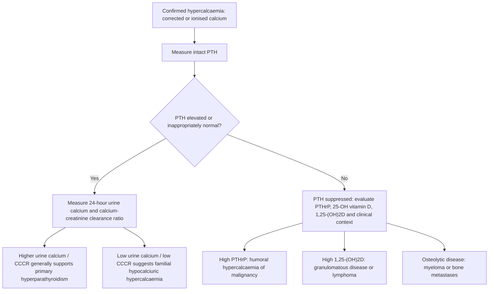

# Chapter 09: Hypercalcemia, Hypocalcemia & Parathyroid Disorders

## 9.1 Hypercalcemia & Hyperparathyroidism

### Clinical Signs & Multisystem Manifestations
Hypercalcemia is defined as total serum calcium $>10.5\text{ mg/dL}$ ($>2.62\text{ mmol/L}$) or ionized calcium $>5.6\text{ mg/dL}$ ($>1.40\text{ mmol/L}$).

#### Classic Mnemonic: *"Groans, Stones, Bones, Psychiatric Overtones, and Cardiac Moans"*
- **Renal ("Stones")**: Nephrolithiasis (calcium oxalate/phosphate stones), nephrocalcinosis, polyuria and polydipsia caused by **nephrogenic diabetes insipidus** (hypercalcemia blocks ADH-mediated Aquaporin-2 insertion in collecting ducts).
- **Gastrointestinal ("Groans")**: Constipation, anorexia, nausea, vomiting, peptic ulcer disease (calcium stimulates gastric parietal cell gastrin release), acute pancreatitis (calcium activates intra-acinar trypsinogen).
- **Musculoskeletal ("Bones")**: Bone pain, osteopenia/osteoporosis, pathologic fractures, **Osteitis Fibrosa Cystica** (subperiosteal bone resorption, brown tumors, salt-and-pepper skull).
- **Neurological ("Psychiatric Overtones")**: Lethargy, depression, memory impairment, confusion, stupor, coma.
- **Cardiovascular ("Cardiac Moans")**: Hypertension, **shortened QT interval** on ECG, cardiac arrhythmias, digitalis toxicity sensitivity.

---

### Etiology & Differential Diagnosis Algorithm

Over $90\%$ of hypercalcemia cases are caused by either **Primary Hyperparathyroidism** (outpatient #1) or **Malignancy** (inpatient #1).

1. **Primary Hyperparathyroidism (PHPT)**:
   - Inappropriate autonomous PTH hypersecretion relative to serum calcium level.
2. **Hypercalcemia of Malignancy**:
   - *Humoral Hypercalcemia of Malignancy (HHM - $80\%$)*: Tumor secretion of **PTHrP** (PTH-Related Protein) which binds PTH1 receptors in bone and kidney (squamous cell carcinomas of lung, head/neck, esophagus; renal cell carcinoma).
   - *Osteolytic Hypercalcemia ($20\%$)*: Direct tumor destruction of bone driven by local cytokine release (Multiple Myeloma, metastatic breast carcinoma).
   - *Extrarenal 1,25(OH)$_2$D Secretion*: Lymphomas expressing 1$\alpha$-hydroxylase.
3. **Granulomatous Disorders**:
   - Sarcoidosis, Tuberculosis, Beryllium disease; disease macrophages express unregulated **1$\alpha$-hydroxylase** converting 25(OH)D to active calcitriol independent of PTH regulation.
4. **Medications**:
   - Thiazide Diuretics (increase distal tubular calcium reabsorption), Lithium (shifts CaSR set-point requiring higher calcium to suppress PTH), Vitamin D or Vitamin A toxicity, Calcium Carbonate antacids (**Milk-Alkali Syndrome**).

---

### Primary Hyperparathyroidism (PHPT) & FHH

#### Pathology of Primary Hyperparathyroidism:
- **Solitary Parathyroid Adenoma ($85\%$)**: Benign clonal proliferation of chief cells in a single enlarged gland; remaining 3 glands are normal or atrophic.
- **Primary Parathyroid Hyperplasia ($15\%$)**: Hyperplasia of all four glands; associated with **MEN 1** (*MEN1* gene) and **MEN 2A** (*RET* gene).
- **Parathyroid Carcinoma ($<1\%$)**: Palpable mass, extreme hypercalcemia ($>14\text{ mg/dL}$), markedly high PTH ($>5\times$ ULN), capsular and vascular invasion.

#### Classic Bone Pathology in Severe PHPT:
- **Osteitis Fibrosa Cystica (Von Recklinghausen Disease of Bone)**: Subperiosteal cortical bone resorption (most prominent on radial aspects of 2nd and 3rd phalanges), loss of lamina dura around teeth, and osteoclast-rich fibrous tissue collections containing micro-hemorrhages and hemosiderin breakdown products forming localized **"Brown Tumors"**.

#### Familial Hypocalciuric Hypercalcemia (FHH) Differentiation:
FHH is an autosomal dominant benign condition caused by an **inactivating mutation in the CaSR gene** (*CASR* on chromosome 3q21).
- *Pathophysiology*: Parathyroid glands and renal tubules sense serum calcium as artificially low $\rightarrow$ higher serum calcium required to suppress PTH + increased renal tubular calcium reabsorption.
- *Diagnostic Distinction*:
  - Both PHPT and FHH present with mild hypercalcemia and elevated/normal PTH.
  - **Calcium-to-Creatinine Clearance Ratio (CCCR)** differentiates them:
    $$\text{CCCR} = \frac{\text{Urine Calcium} \times \text{Serum Creatinine}}{\text{Serum Calcium} \times \text{Urine Creatinine}}$$
  - **FHH**: Low Urinary Calcium Excretion ($<100\text{ mg/24h}$) and **$\text{CCCR} < 0.01$**.
  - **PHPT**: High/Normal Urinary Calcium ($>200\text{--}250\text{ mg/24h}$) and **$\text{CCCR} > 0.02$**.
- *Clinical Rule*: **Parathyroidectomy is strictly ineffective and contraindicated in FHH!**

---

### Secondary vs. Tertiary Hyperparathyroidism

| Feature | Primary HPT | Secondary HPT | Tertiary HPT |
| :--- | :--- | :--- | :--- |
| **Primary Underlying Etiology** | Parathyroid Adenoma / Hyperplasia. | **Chronic Kidney Disease (CKD)** or severe Vit D deficiency. | Long-standing end-stage CKD. |
| **Pathophysiologic Mechanism** | Autonomous intrinsic PTH hypersecretion. | Renal failure $\rightarrow \text{PO}_4^{3-}$ retention + low $1,25(\text{OH})_2\text{D} \rightarrow$ hypocalcemia $\rightarrow$ compensatory parathyroid hyperplasia. | Autonomous non-suppressible monoclonal parathyroid nodule growth. |
| **Serum Corrected Calcium** | **Elevated ($>10.5\text{ mg/dL}$)** | **Low or Normal** | **Elevated ($>10.5\text{ mg/dL}$)** |
| **Serum Inorganic Phosphate** | **Low or Normal** | **Elevated** | **Elevated** |
| **Intact Serum PTH** | **Elevated** | **Elevated (Appropriate)** | **Markedly Elevated ($>10\times$ ULN)** |
| **Treatment Approach** | Parathyroidectomy or Cinacalcet. | Phosphate binders, Calcitriol / Cinacalcet. | Subtotal or Total Parathyroidectomy. |

---

### Emergency Management Protocol for Severe Hypercalcemia

Hypercalcemic Crisis (Serum Calcium $>14.0\text{ mg/dL}$ or symptomatic) requires immediate aggressive multi-step medical therapy:

1. **Volume Resuscitation (FIRST STEP)**:
   - Administer **IV $0.9\%$ Isotonic Saline at $200\text{--}500\text{ mL/h}$** to expand ECF volume, induce natriuresis, and enhance passive renal calcium excretion.
2. **Calcitonin (Rapid Onset)**:
   - **Salmon Calcitonin $4\text{--}8\text{ IU/kg}$ IM or SC Q12H**. Rapid onset ($2\text{--}4\text{ hours}$); inhibits osteoclast resorption and promotes renal excretion. Develops **tachyphylaxis** within $48\text{ hours}$.
3. **Intravenous Bisphosphonates (Mainstay for Sustained Control)**:
   - **IV Zoledronic Acid ($4\text{ mg}$ over $15\text{ min}$)** or IV Pamidronate ($60\text{--}90\text{ mg}$). Inhibits osteoclasts; maximal effect in $2\text{--}4\text{ days}$. *Requires renal dose adjustments*.
4. **Denosumab (For Bisphosphonate-Refractory or Renal Failure)**:
   - **Denosumab $120\text{ mg}$ SC** (anti-RANKL monoclonal antibody). Ideal in severe renal impairment ($\text{eGFR} <30\text{ mL/min}$) where bisphosphonates are contraindicated.
5. **Glucocorticoids (For Granulomatous Disease & Lymphomas)**:
   - **IV Hydrocortisone $100\text{ mg}$ Q8H** or oral Prednisone $40\text{--}60\text{ mg/day}$. Inhibits macrophage 1$\alpha$-hydroxylase.

---

## 9.2 Hypocalcemia & Hypoparathyroidism

### Clinical Features & Neuromuscular Signs
Hypocalcemia is defined as total serum calcium $<8.5\text{ mg/dL}$ ($<2.12\text{ mmol/L}$) or ionized calcium $<4.5\text{ mg/dL}$ ($<1.12\text{ mmol/L}$). Low extracellular calcium lowers the threshold potential of voltage-gated sodium channels in peripheral nerves, resulting in nerve membrane instability and spontaneous repetitive firing (**tetany**).

#### Clinical Presentation:
- **Paresthesias**: Perioral numbness, tingling in fingertips and toes.
- **Neuromuscular Irritability**: Carpopedal spasm, muscle cramps, **laryngospasm** (life-threatening airway compromise), bronchospasm, generalized seizures.
- **Cardiovascular**: **QTc Interval Prolongation** on ECG (precursor to Torsades de Pointes), impaired cardiac contractility.

#### Classic Physical Examination Signs:
1. **Chvostek Sign**: Tapping the facial nerve anterior to the external auditory meatus induces involuntary twitching of ipsilateral facial muscles (facial spittle/nasolabial fold twitching).
2. **Trousseau Sign**: Inflation of a blood pressure cuff above systolic pressure for $3\text{ minutes}$ induces ischemia-enhanced neuromuscular irritability, causing carpopedal spasm (wrist flexion, MCP joint flexion, IP joint extension, thumb adduction - **"Obstetrician's Hand"**). Trousseau sign is more specific and sensitive than Chvostek sign.

---

### Etiologies & Pseudohypoparathyroidism

1. **Hypoparathyroidism (Low Calcium, Low/Inappropriate PTH)**:
   - **Iatrogenic / Post-Surgical (#1 cause)**: Inadvertent removal or ischemic injury to parathyroid glands during total thyroidectomy or radical neck dissection.
   - **Autoimmune**: Isolated or as part of **Autoimmune Polyendocrine Syndrome Type 1 (APS-1 / APECED)** caused by *AIRE* gene mutations (triad: Chronic Mucocutaneous Candidiasis, Hypoparathyroidism, Addison's Disease).
   - **Genetic / Congenital**: **DiGeorge Syndrome (22q11.2 deletion)** (failure of 3rd and 4th pharyngeal pouches to develop $\rightarrow$ parathyroid aplasia, thymic aplasia/T-cell immunodeficiency, conotruncal cardiac defects).
   - **Infiltrative / Destruction**: Hemochromatosis (iron deposition), Wilson's disease (copper), Riedel thyroiditis, radiation.

2. **Pseudohypoparathyroidism (PHP Type 1A - Albright Hereditary Osteodystrophy)**:
   - End-organ resistance to PTH despite elevated circulating PTH levels.
   - **Genetics**: Maternal inheritance of inactivating mutation in the **_GNAS1_ gene** (encoding the $G_{\alpha s}$ protein subunit coupled to PTH1 receptors in renal proximal tubules).
   - **Biochemical Profile**: **Low Calcium, High Phosphate, High PTH**.
   - **Somatic Phenotype (Albright Hereditary Osteodystrophy - AHO)**: Short stature, round facies, obesity, developmental delay, and pathognomonic **Shortening of the 4th and 5th Metacarpals and Metatarsals** (Archibald sign).
   - *Note on Pseudopseudohypoparathyroidism (PPHP)*: Paternal inheritance of identical *GNAS1* mutation; yields AHO somatic phenotype BUT **normal serum calcium, phosphate, and PTH** because renal tubular $G_{\alpha s}$ expression is maternally imprinted.

3. **Non-Parathyroid Hypocalcemia**:
   - Severe Vitamin D Deficiency, Acute Pancreatitis (fat saponification), Hungry Bone Syndrome post-parathyroidectomy, Massive Blood Transfusion (citrate binding), Severe Hypomagnesemia.

---

### Therapeutics for Acute & Chronic Hypocalcemia

#### Acute Severe / Symptomatic Hypocalcemia (Emergency Protocol):
- **Immediate IV Calcium**: Administer **IV Calcium Gluconate $1\text{--}2\text{ g}$ ($10\text{--}20\text{ mL}$ of $10\%$ solution) diluted in $100\text{ mL}$ 5% Dextrose over $10\text{--}20\text{ minutes}$.
  - *Safety Rule*: Continuous ECG monitoring required (risk of bradycardia and arrhythmias).
  - *Preference Rule*: Calcium Gluconate is preferred over Calcium Chloride because it causes significantly less tissue necrosis upon accidental extravasation.
  - *Co-Management Rule*: Always check and correct serum magnesium!

#### Chronic Hypoparathyroidism Management:
- Oral **Calcium Carbonate or Calcium Citrate** ($1\text{--}3\text{ g/day}$ elemental calcium).
- Active Vitamin D Analog: **Calcitriol [1,25(OH)$_2$D] ($0.25\text{--}1.0\ \mu\text{g/day}$)** or Alfacalcidol (necessary because patients lack PTH to activate 1$\alpha$-hydroxylase).
- *Therapeutic Goal*: Maintain serum total calcium in the low-normal range ($8.0\text{--}8.5\text{ mg/dL}$) to relieve symptoms while avoiding severe **hypercalciuria** and nephrolithiasis (since PTH-mediated renal calcium reabsorption is absent). Thiazide diuretics may be added to enhance renal tubular calcium reabsorption and reduce urinary calcium excretion.

---

### Subsection Coverage Checklist
- [x] 9.1 Hypercalcemia & Hyperparathyroidism
- [x] 9.2 Hypocalcemia & Hypoparathyroidism

### Index Corrections & Source Grounding Notes
- No index errors detected. All clinical signs (Chvostek, Trousseau), hypercalcemia differential algorithms, FHH CCCR ratios, brown tumor histopathology, secondary vs tertiary HPT profiles, emergency IV calcium/saline management protocols, and GNAS1 imprinting mechanics reflect established endocrinology evidence.
