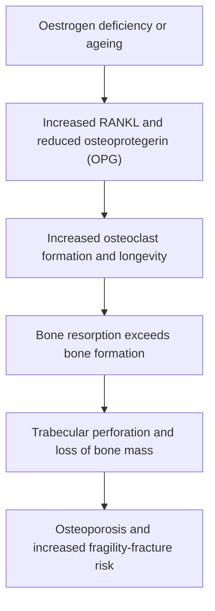
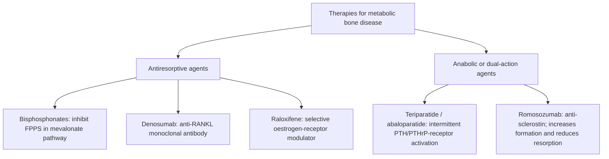
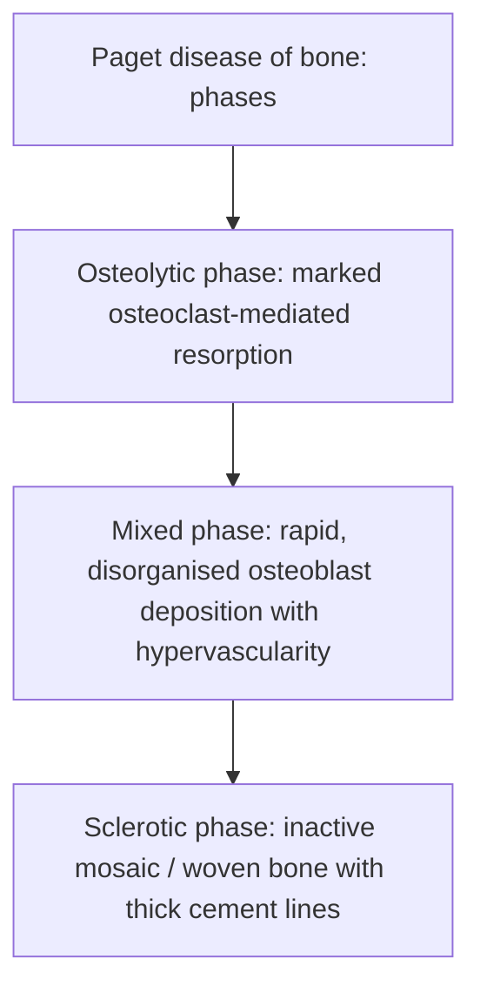
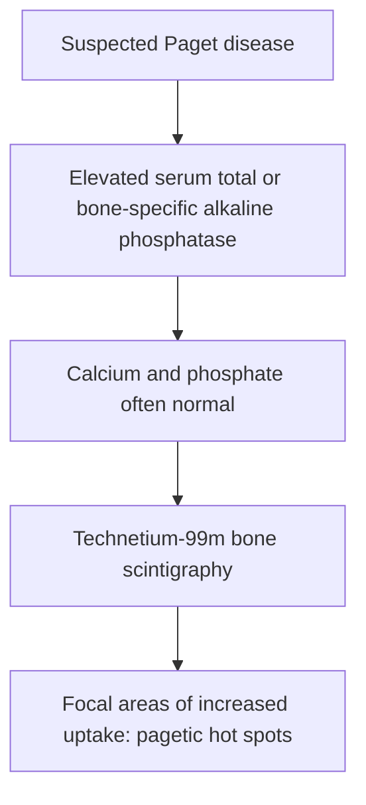

# Chapter 10: Metabolic Bone Diseases

## 10.1 Osteoporosis

### Definition & Bone Remodeling Pathophysiology
Osteoporosis is a systemic skeletal disorder characterized by low bone mineral density (BMD) and microarchitectural deterioration of bone tissue, leading to increased bone fragility and susceptibility to low-trauma fragility fractures (hip, vertebrae, distal radius).

#### Bone Remodeling Cycle & Cellular Dynamics:
Bone remodeling is driven by the balanced action of **Basic Multicellular Units (BMUs)** comprising Osteoclasts (resorption) and Osteoblasts (formation):
1. **Osteoclast Resorption**: Multinucleated osteoclasts bind bone matrix via $\alpha_v\beta_3$ integrins, forming a sealed Howship lacuna, secreting $\text{H}^+$ via vacuolar $\text{H}^+$-ATPase (dissolves hydroxyapatite) and Cathepsin K (degrades Type I collagen).
2. **Osteoblast Coupling & Formation**: Osteoblasts synthesize Type I collagen osteoid matrix, followed by mineral deposition.

- **Pathophysiology of Postmenopausal Osteoporosis (Type I)**: Estrogen loss upregulates osteoblast and T-cell expression of **RANKL** while suppressing **Osteoprotegerin (OPG)** $\rightarrow$ uninhibited RANKL binds RANK on pre-osteoclasts $\rightarrow$ massive increase in osteoclast number, activity, and lifespan $\rightarrow$ deep resorption lacunae perforate and destroy interconnected trabecular bone plates.
- **Pathophysiology of Senile Osteoporosis (Type II)**: Age-related decline in osteoblast replicative capacity and synthetic function, combined with intestinal calcium malabsorption and secondary hyperparathyroidism.

---

### DXA Interpretation & Fracture Risk Assessment

Dual-Energy X-ray Absorptiometry (**DXA**) is the gold standard diagnostic modality for measuring Bone Mineral Density ($\text{BMD}$ in $\text{g/cm}^2$) at the Lumbar Spine (L1–L4) and Femoral Neck / Total Hip.

#### WHO T-Score & Z-Score Definitions:
- **T-Score**: Number of standard deviations (SD) by which the patient's BMD falls above or below the mean BMD of a healthy young adult reference population ($20\text{--}29\text{ year old}$ same sex). Used in postmenopausal women and men aged $\ge 50$.
- **Z-Score**: Number of SDs relative to an age-, sex-, and ethnicity-matched reference population. Used in premenopausal women, men $<50$, and children ($Z\text{-Score} \le -2.0$ defined as "Below expected range for age").

| WHO DXA Classification | T-Score Criteria | Clinical Definition & Significance |
| :--- | :--- | :--- |
| **Normal** | **$\text{T-Score} \ge -1.0\text{ SD}$** | Normal bone density. |
| **Osteopenia (Low Bone Mass)**| **$-1.0 < \text{T-Score} < -2.5\text{ SD}$** | Increased fracture risk; monitor and calculate FRAX. |
| **Osteoporosis** | **$\text{T-Score} \le -2.5\text{ SD}$** | High fracture risk; initiate pharmacotherapy. |
| **Severe / Established Osteoporosis**| **$\text{T-Score} \le -2.5\text{ SD}$ WITH Fragility Fracture** | Extreme risk; consider anabolic bone agents. |

- *Clinical Diagnosis Rule*: The presence of a low-trauma **fragility fracture** (e.g., vertebral compression fracture or hip fracture from a fall from standing height) establishes the clinical diagnosis of **Osteoporosis regardless of T-score!**

---

### Pharmacotherapy of Osteoporosis

#### 1. Bisphosphonates (Antiresorptive First-Line):
- **Agents**: Oral **Alendronate** ($70\text{ mg}$ weekly), Oral Risedronate ($35\text{ mg}$ weekly), **IV Zoledronic Acid** ($5\text{ mg}$ IV once yearly).
- **Mechanism of Action**: High affinity for hydroxyapatite crystals; ingested by osteoclasts during resorption $\rightarrow$ nitrogen-containing bisphosphonates inhibit **Farnesyl Pyrophosphate Synthase (FPPS)** in the mevalonate pathway $\rightarrow$ loss of prenylated GTPase proteins $\rightarrow$ osteoclast inactivation and **apoptosis**.
- **Administration Rules**: Oral agents taken first thing in morning with full glass of plain water on empty stomach; patient must remain upright for $\ge 30\text{--}60\text{ minutes}$ to prevent upper GI mucosal ulceration.
- **Major Adverse Effects**:
  - *Esophagitis / Ulceration* (oral agents).
  - *Osteonecrosis of the Jaw (ONJ)*: Non-healing exposed jaw bone (higher risk with high-dose IV oncology regimens and dental extractions).
  - *Atypical Femoral Fractures (AFF)*: Subtrochanteric/femoral shaft transverse fractures caused by prolonged over-suppression of bone turnover.
  - *Drug Holiday*: Re-evaluate necessity after $3\text{--}5$ years of continuous therapy.

#### 2. Denosumab (RANKL Inhibitor):
- **Mechanism**: Fully human monoclonal antibody ($60\text{ mg}$ SC Q6M) that binds **RANKL** with high affinity, preventing RANKL from activating RANK on osteoclasts.
- **Clinical Utility**: Excellent efficacy in renal failure (not cleared renally).
- *CRITICAL WARNING*: Discontinuation causes rapid rebound increase in bone turnover and sudden **rebound vertebral compression fractures**. Must never be stopped without transitioning to a bisphosphonate!

#### 3. Teriparatide & Abaloparatide (Anabolic PTH/PTHrP Analogs):
- **Mechanism**: Recombinant human **PTH(1-34)** administered as daily subcutaneous injections ($20\ \mu\text{g/day}$). Intermittent daily pulsatile administration selectively activates osteoblasts over osteoclasts, stimulating new bone matrix formation.
- **Duration Ceiling**: Maximum lifetime duration limited to **$2\text{ years}$** (black box warning historically for osteosarcoma risk in rodent models). Must follow with an antiresorptive agent to maintain gained density.

#### 4. Romosozumab (Dual Anabolic & Antiresorptive Agent):
- **Mechanism**: Humanized monoclonal antibody against **Sclerostin**. Sclerostin normally inhibits the Wnt/$\beta$-catenin pathway in osteoblasts; blocking sclerostin potently **stimulates bone formation** while simultaneously reducing bone resorption.
- **Administration**: Monthly SC injection for $12\text{ months}$.
- *Contraindication*: Black box warning for major adverse cardiovascular events (avoid in patients with MI/stroke in preceding year).

---

## 10.2 Osteomalacia & Rickets

### Pathophysiology & Etiology
Osteomalacia (adults) and Rickets (children) are metabolic bone disorders characterized by **defective mineralization of newly synthesized organic bone matrix (osteoid)**.

1. **Rickets (Children prior to Epiphyseal Plate Closure)**:
   - Defective mineralization affects both the growth plate cartilage (**Physis**) and cortical/trabecular osteoid matrix.
2. **Osteomalacia (Adults after Epiphyseal Closure)**:
   - Defective mineralization affects mature cortical and trabecular osteoid remodeling.

#### Etiologies:
- **Severe Vitamin D Deficiency (#1 cause)**: Malabsorption (Celiac disease, post-bariatric surgery), inadequate sunlight/dietary intake, severe liver/renal failure.
- **Hereditary Hypophosphatemic Rickets**: X-linked Hypophosphatemic Rickets (XLH) caused by inactivating mutations in the **_PHEX_ gene** $\rightarrow$ uncontrolled overexpression of **FGF23** $\rightarrow$ renal phosphate wasting and low calcitriol.
- **Renal Tubular Acidosis (RTA)**: Type 1 RTA causes systemic acidosis $\rightarrow$ buffering by bone matrix leaching phosphate and calcium.

---

### Radiographic & Biochemical Differences

| Diagnostic Feature | Rickets (Children) | Osteomalacia (Adults) |
| :--- | :--- | :--- |
| **Skeletal Radiography** | **Metaphyseal Cupping, Fraying, and Splaying**; widening of epiphyseal growth plate; rachitic rosary (costochondral joint expansion); craniotabes; bow legs (genu varum). | **Pseudofractures / Looser's Zones / Milkman Lines** (transverse radiolucent bands perpendicular to cortex at femoral neck, pubic rami, scapula); osteopenia. |
| **Primary Clinical Symptoms** | Delayed walking, frontal bossing, bone pain, muscle weakness. | Diffuse dull aching bone pain, proximal muscle weakness (waddling gait), bone tenderness. |

#### Classic Biochemical Panel of Osteomalacia / Vitamin D Deficiency:

| Biomarker | Serum Concentration Pattern | Pathophysiologic Explanation |
| :--- | :--- | :--- |
| **25-Hydroxyvitamin D [25(OH)D]** | **Markedly Low ($<12\text{--}20\text{ ng/mL}$)** | Primary depletion of body Vitamin D stores. |
| **Serum Calcium** | **Low or Low-Normal** | Impaired enterocyte calcium absorption. |
| **Serum Inorganic Phosphate** | **Low** | Reduced intestinal absorption + PTH-induced phosphaturia. |
| **Intact Serum PTH** | **Elevated (Secondary HPT)** | Compensatory response to hypocalcemia. |
| **Serum Alkaline Phosphatase (ALP)** | **Markedly Elevated** | Unmineralized osteoid proliferation increases osteoblast ALP. |
| **24-Hour Urinary Calcium** | **Very Low ($<50\text{ mg/24h}$)** | Maximal renal tubular reabsorption under high PTH. |

---

## 10.3 Paget Disease of Bone (Osteitis Deformans)

### Pathogenesis & Three Remodeling Phases

Paget Disease is a localized disorder of bone remodeling characterized by excessive, disorganized osteoclastic bone resorption followed by chaotic osteoblastic bone formation.
- **Etiology**: Genetic susceptibility (mutations in **_SQSTM1_ gene** encoding p62 protein involved in RANKL signaling) interacting with environmental factors (paramyxovirus infection / measles virus nucleocapsid hypothesis).

1. **Osteolytic Phase**: Wave of hyperactive, abnormally large osteoclasts containing up to $100$ nuclei per cell producing aggressive bone resorption (e.g., *Osteoporosis Circumscripta* on skull X-ray).
2. **Mixed Osteolytic-Osteoblastic Phase**: Rapid, disorganized osteoblastic bone formation attempting to replace lost bone. Bone matrix is laid down in a chaotic, non-lamellar pattern.
3. **Osteosclerotic (Quiescent) Phase**: Bone cell activity declines, leaving thick, structurally weak, hypervascularized, deformed bone with a pathognomonic **"Mosaic Pattern" / "Jigsaw Puzzle" appearance** characterized by prominent, irregular **cement lines** separating units of lamellar bone.

---

### Clinical Manifestations, Complications & Imaging
- **Asymptomatic Discovery ($70\%$)**: Incidentially detected via marked isolated elevation of serum Alkaline Phosphatase (ALP) on routine blood panels.
- **Skeletal Symptoms**: Deep, aching bone pain (worse at night), bone bowing (anterior bowing of femur/tibia), joint osteoarthritis.
- **Skull Involvement**: Increasing hat size, headache, sensorineural hearing loss due to auditory nerve entrapment in narrowed internal auditory meatus or cochlear microarchitectural damage.
- **Cardiovascular**: **High-Output Heart Failure** caused by extensive hypervascular arteriovenous shunts in pagetic bone lesions.

#### Malignant Transformation (Sarcomatous Change):
- Occurs in $<1\%$ of Paget cases.
- Suspected when a patient with stable Paget disease develops a sudden surge in localized severe bone pain, a new soft tissue mass, or a rapid spike in ALP.
- Transformed lesion is most commonly an aggressive **Osteosarcoma** (or Fibrosarcoma / Undifferentiated Pleomorphic Sarcoma) carrying a dismal prognosis.

---

### Diagnostic Evaluation & Therapeutics

#### Diagnostic Panel:
- **Biochemistry**: **Markedly Elevated Serum Alkaline Phosphatase (ALP)** reflecting high osteoblast activity, alongside **strictly Normal Serum Calcium and Phosphate** (unless the patient becomes immobilized, triggering acute hypercalcemia).
- **Radiography**: Cortical thickening, coarse trabecular exaggeration, osteosclerosis, bone enlargement, and *Osteoporosis Circumscripta*.
- **Radionuclide Bone Scan ($^{99m}\text{Tc}$-MDP)**: Most sensitive modality to map full extent of pagetic lesions ("hot spots" of hypervascular uptake).

#### Therapeutics:
- **First-Line Pharmacotherapy**: Nitrogen-containing Bisphosphonates are the treatment of choice to suppress osteoclast activity.
- **Preferred Regimen**: Single IV infusion of **Zoledronic Acid $5\text{ mg}$**. Induces long-term clinical and biochemical remission ($>95\%$ normalization of ALP).
- *Indications for Treatment*: Symptomatic bone pain, involvement of weight-bearing bones, skull involvement with nerve compression, pre-operative preparation for orthopedic surgery (to reduce intraoperative blood loss from hypervascular bone).

---

### Subsection Coverage Checklist
- [x] 10.1 Osteoporosis
- [x] 10.2 Osteomalacia & Rickets
- [x] 10.3 Paget Disease of Bone (Osteitis Deformans)

### Index Corrections & Source Grounding Notes
- No index errors detected. All WHO DXA T-score thresholds, FPPS bisphosphonate biochemistry, denosumab rebound warning rules, anabolic PTH windows, osteomalacia Looser's zone features, Paget mosaic Cement line histopathology, and Zoledronic acid protocols conform strictly to evidence-based endocrinology standards.
