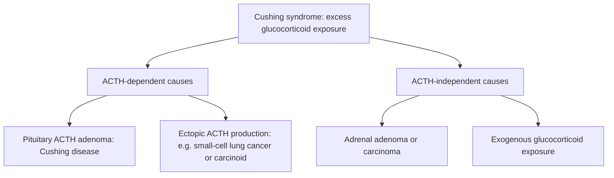
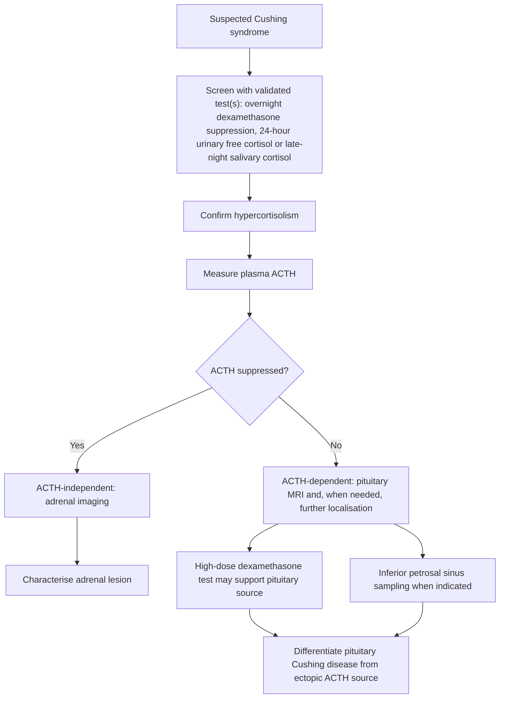
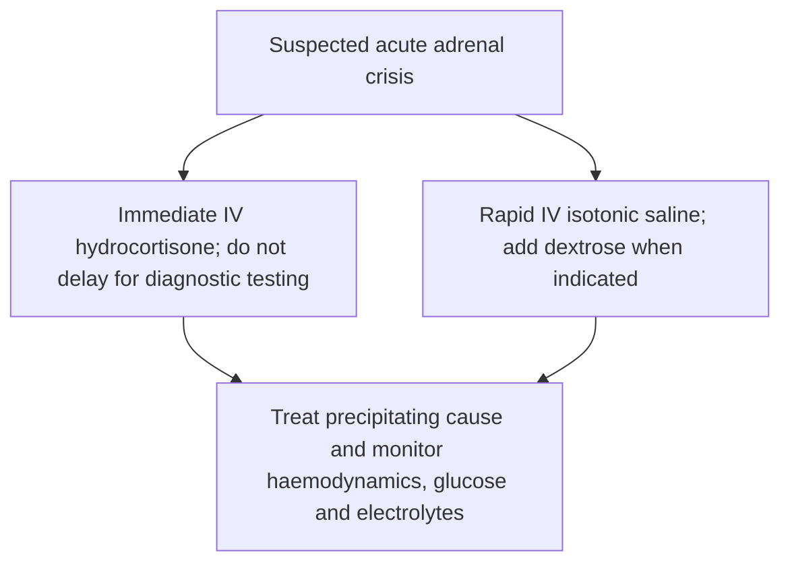

# Chapter 11: Adrenal Cortex I — Glucocorticoids, Cushing Syndrome & Adrenal Insufficiency

---

## 11.1 Adrenal Microanatomy, Zonation & Steroidogenesis

The paired adrenal (suprarenal) glands lie retroperitoneally superior to each kidney. Anatomically and functionally, the gland comprises two distinct embryological entities: the outer **Adrenal Cortex** (derived from mesoderm, producing steroid hormones) and the inner **Adrenal Medulla** (derived from neural crest cells, producing catecholamines).

| Zone | Primary Secretion | Primary Regulatory Signal |
| --- | --- | --- |
| Zona Glomerulosa | Mineralocorticoids (Aldosterone) | Angiotensin II & Serum K+ (Independent of ACTH control) |
| Zona Fasciculata | Glucocorticoids (Cortisol) | Pituitary ACTH (Diurnal pulse rhythm) |
| Zona Reticularis | Adrenal Androgens (DHEA, DHEAS) | Pituitary ACTH (Minimal feedback regulation) |
| Adrenal Medulla | Catecholamines (Epi & Norepi) | Pre-ganglionic Sympathetic; Cholinergic Fibers (ACh) |

### Steroidogenesis Pathway & Rate-Limiting Steps
1. **Cholesterol Uptake**: Circulating LDL cholesterol binds to LDL receptors and is internalized. Cholesterol is transported across the outer mitochondrial membrane into the inner mitochondrial membrane via the **Steroidogenic Acute Regulatory (StAR) Protein**—the absolute rate-limiting step of steroidogenesis.
2. **Side-Chain Cleavage**: Within the inner membrane, **CYP11A1 (Cholesterol Desmolase / Side-Chain Cleavage Enzyme)** converts cholesterol into Pregnenolone.
3. **Glucocorticoid Synthesis**:
   $$\text{Pregnenolone} \xrightarrow{\text{3}\beta\text{-HSD}} \text{Progesterone} \xrightarrow{\text{CYP17A1 (17}\alpha\text{-hydroxylase)}} \text{17-OH-Progesterone} \xrightarrow{\text{CYP21A2 (21}\alpha\text{-hydroxylase)}} \text{11-Deoxycortisol} \xrightarrow{\text{CYP11B1 (11}\beta\text{-hydroxylase)}} \text{Cortisol}$$

### Circadian Rhythm & Feedback Loop
* **Hypothalamic-Pituitary-Adrenal (HPA) Axis**: Hypothalamic paraventricular neurons release **CRH** (and Vasopressin) in a diurnal pulsatile pattern, stimulating anterior pituitary corticotrophs via $G_{\alpha s}$-coupled GPCRs to cleave Pro-opiomelanocortin (POMC) into **ACTH** (Adrenocorticotropic Hormone).
* **Diurnal Rhythm**: ACTH and Cortisol peak in the early morning ($\sim 6:00\text{--}8:00\text{ AM}$) and reach a nadir at late midnight ($\sim 23:00\text{--}24:00$).
* **Feedback Regulation**: Free plasma Cortisol exerts negative feedback on both hypothalamic CRH release and pituitary ACTH synthesis.

---

## 11.2 Cushing Syndrome (Cortisol Excess)

**Cushing Syndrome** refers to the clinical state resulting from chronic systemic exposure to excess glucocorticoids. **Cushing Disease** specifically denotes ACTH-dependent Cushing syndrome caused by a pituitary corticotroph microadenoma or macroadenoma.

### Clinical Features
* **Metabolic & Redistribution**: Truncal/central obesity, "buffalo hump" (dorsocervical fat pad), "moon facies", supraclavicular fat pad enlargement, muscle wasting (proximal myopathy).
* **Dermatologic**: Thin, fragile skin, facial plethora, broad purple/violaceous cutaneous striae ($>1\text{ cm}$ width), easy bruising (ecchymosis) due to collagen degradation.
* **Cardiovascular & Endocrine**: Systemic hypertension, secondary Type 2 Diabetes Mellitus / impaired glucose tolerance, hirsutism and oligomenorrhea in females (due to co-secreted adrenal androgens), osteoporosis and pathological fractures.
* **Psychiatric**: Emotional lability, insomnia, depression, psychosis ("steroid psychosis").

### Diagnostic Protocol & Workup
The diagnostic evaluation follows a strict 3-step sequence: **(1) Establish hypercortisolism, (2) Determine ACTH dependency, (3) Localize the anatomic source.**

#### Step 1: Confirm Hypercortisolism
* **1 mg Overnight Dexamethasone Suppression Test (DST)**: 1 mg oral dexamethasone administered at 23:00; serum cortisol measured at 08:00 the next morning. Normal response is suppression of serum cortisol to $<1.8\ \mu\text{g/dL}$ ($50\text{ nmol/L}$). Cortisol $\ge 1.8\ \mu\text{g/dL}$ indicates autonomous hypercortisolism.
* **24-Hour Urinary Free Cortisol (UFC)**: Reflects integrated free cortisol clearance. Values $>3\times$ the upper limit of normal confirm Cushing syndrome.
* **Late-Night Salivary Cortisol**: Measures free unbound cortisol at midnight nadir. Elevated levels indicate loss of normal diurnal circadian variation.

#### Step 2: Determine ACTH Dependency
* **Plasma ACTH**:
  * $\text{ACTH} < 5\text{ pg/mL}$: **ACTH-Independent Cushing Syndrome**. Proceed directly to Adrenal CT imaging.
  * $\text{ACTH} > 15\text{ pg/mL}$: **ACTH-Dependent Cushing Syndrome**. Proceed to differential testing (Cushing Disease vs. Ectopic ACTH).

#### Step 3: Differentiate Pituitary (Cushing Disease) vs. Ectopic ACTH
* **High-Dose (8 mg) Dexamethasone Suppression Test**: Corticotroph pituitary adenomas retain partial negative feedback sensitivity, whereas ectopic tumors (e.g., SCLC) are completely resistant. Serum cortisol suppression by $>50\%$ baseline confirms **Cushing Disease**.
* **CRH Stimulation Test**: Intravenous CRH induces a rise in ACTH ($>35\%$) and Cortisol ($>20\%$) in Cushing Disease, but no response in Ectopic ACTH.
* **Inferior Petrosal Sinus Sampling (IPSS)**: The definitive gold standard when imaging is equivocal. Catheters are placed in both inferior petrosal sinuses and a peripheral vein. A central-to-peripheral ACTH gradient $\ge 2.0$ at baseline or $\ge 3.0$ post-CRH stimulation proves a **pituitary source (Cushing Disease)**.

### Treatment Strategies
* **Cushing Disease**: First-line therapy is **Transsphenoidal Pituitary Microsurgery (TSS)**. Second-line options include radiation therapy or bilateral adrenalectomy.
* **Adrenal Adenoma / Carcinoma**: Surgical Laparoscopic Adrenalectomy for adenomas; Open Radical Adrenalectomy for adrenocortical carcinoma.
* **Medical Therapy** (Used pre-operatively or for unresectable disease):
  * *Adrenal Steroidogenesis Inhibitors*: **Ketoconazole** (inhibits CYP17A1 and CYP11A1), **Metyrapone** (inhibits CYP11B1), **Osilodrostat** (potent CYP11B1 inhibitor).
  * *Pituitary-Directed Agents*: Pasireotide (somatostatin receptor ligand), Cabergoline ($D_2$ agonist).
  * *Glucocorticoid Receptor Antagonist*: **Mifepristone** (RU-486).

---

## 11.3 Adrenal Insufficiency (Cortisol Deficiency)

**Adrenal Insufficiency (AI)** results from inadequate production of glucocorticoids $\pm$ mineralocorticoids.

| Feature | Primary AI (Addison's) | Secondary / Tertiary AI |
| --- | --- | --- |
| Primary Site of Defect | Adrenal Cortex | Pituitary (ACTH) /; Hypothalamus (CRH) |
| Mineralocorticoids | Deficient (Loss of; Zona Glomerulosa) | Intact (Regulated by; RAAS, not ACTH) |
| Serum Potassium & pH | Hyperkalemia, Non-Gap; Metabolic Acidosis | Normal Potassium,; Normal Acid-Base |
| Skin Mucosal Pigment | Hyperpigmentation (High ACTH / MSH cleavage) | Pale / No Pigmentation (Low/Absent ACTH) |
| Most Common Etiology | Autoimmune Adrenalitis (developed countries) | Chronic Exogenous Steroid; Withdrawal (#1 overall) |

### Etiologies
* **Primary Adrenal Insufficiency (Addison's Disease)**:
  * *Autoimmune Adrenalitis*: Identifiable by anti-21-hydroxylase autoantibodies. May occur as part of Autoimmune Polyendocrine Syndrome Type 1 (APECED) or Type 2 (Schmidt syndrome).
  * *Infectious*: Tuberculosis (most common cause in developing nations; calcified enlarged adrenals), Fungal (Histoplasmosis), HIV/CMV.
  * *Hemorrhagic / Vascular*: **Waterhouse-Friderichsen Syndrome** (bilateral adrenal hemorrhage secondary to *Neisseria meningitidis* sepsis), Antiphospholipid Syndrome.
* **Secondary / Tertiary Adrenal Insufficiency**:
  * Abrupt cessation of chronic high-dose systemic glucocorticoid therapy (causes prolonged hypothalamic-pituitary suppression).
  * Pituitary macroadenomas, craniopharyngioma, radiation, Sheehan syndrome.

### Clinical Manifestations
* **Glucocorticoid Deficiency**: Fatigue, weakness, anorexia, involuntary weight loss, nausea, vomiting, abdominal pain, hypoglycemia (loss of cortisol-stimulated gluconeogenesis), orthostatic hypotension.
* **Mineralocorticoid Deficiency (Primary AI Only)**: Craving for salt, severe hypovolemia, **hyponatremia, hyperkalemia, and non-anion gap metabolic acidosis**.
* **Hyperpigmentation (Primary AI Only)**: High unsuppressed ACTH production from POMC cleavage also generates $\alpha$-Melanocyte-Stimulating Hormone ($\alpha$-MSH), causing hyperpigmentation of palmar creases, mucosal membranes, surgical scars, and extensor surfaces.

### Diagnostic Workup
1. **Morning (08:00 AM) Serum Cortisol**:
   * Cortisol $<3\ \mu\text{g/dL}$ ($80\text{ nmol/L}$): Confirms Adrenal Insufficiency.
   * Cortisol $>15\ \mu\text{g/dL}$ ($415\text{ nmol/L}$): Rules out Adrenal Insufficiency.
   * Cortisol $3\text{--}15\ \mu\text{g/dL}$: Indeterminate; requires stimulation testing.
2. **Cosyntropin (ACTH) Stimulation Test (Gold Standard)**:
   * $250\ \mu\text{g}$ of synthetic ACTH (Cosyntropin) administered IV or IM. Serum cortisol measured at 0, 30, and 60 minutes.
   * **Normal Response**: Peak serum cortisol $>18\ \mu\text{g/dL}$ ($500\text{ nmol/L}$).
   * **Impaired Response**: Peak cortisol $<18\ \mu\text{g/dL}$ confirms adrenal insufficiency.
3. **Plasma ACTH Measurement**:
   * Elevated ACTH ($>100\text{ pg/mL}$) + Low Cortisol = **Primary AI**.
   * Low or Inappropriately Normal ACTH ($<10\text{--}20\text{ pg/mL}$) + Low Cortisol = **Secondary / Tertiary AI**.

### Management Protocols

#### Acute Adrenal Crisis (Medical Emergency)
* **Life-Threatening Features**: Refractory hypovolemic shock, severe hyponatremia, hyperkalemia, hypoglycemia, high fever, abdominal rigidity mimicking acute abdomen.
* **Emergency Sequence**:
  1. **Immediate IV Access & Blood Draw**: Draw blood for STAT cortisol and ACTH (do NOT wait for results).
  2. **Immediate High-Dose IV Hydrocortisone**: Administer **100 mg IV Hydrocortisone bolus** immediately, followed by 100 mg IV every 6 hours (or 200 mg/24h continuous infusion). High-dose hydrocortisone provides both glucocorticoid and sufficient mineralocorticoid activity.
  3. **Aggressive Volume Resuscitation**: Infuse 1 to 3 Liters of **0.9% Isotonic Saline** with **5% Dextrose** (to correct hypovolemia and hypoglycemia) within the first 12 hours.

#### Chronic Replacement Therapy
* **Glucocorticoid Replacement**: **Hydrocortisone** (15 to 25 mg daily divided into 2 or 3 doses: $2/3$ in morning upon waking, $1/3$ in early afternoon to mimic natural diurnal rhythm). Alternative: Oral Prednisone (3.0 to 5.0 mg daily).
* **Mineralocorticoid Replacement (Primary AI Only)**: **Fludrocortisone** (0.05 to 0.2 mg oral daily). Adjusted based on clinical blood pressure, serum potassium, and plasma renin activity (PRA).
* **Sick-Day Rules**:
  * *Minor Illness / Fever ($>38^\circ\text{C}$)*: Double or triple the oral hydrocortisone dose for 2 to 3 days until recovery.
  * *Major Trauma / Surgery / Severe Vomiting*: Administer 100 mg IV Hydrocortisone IM/IV self-injection immediately and seek urgent emergency care.

---

## 11.4 Summary & High-Yield Examination Checklist

- [x] **Zonation**: Glomerulosa (Aldosterone/AngII), Fasciculata (Cortisol/ACTH), Reticularis (Androgens/ACTH).
- [x] **StAR Protein**: Rate-limiting step of cholesterol transport into inner mitochondrial membrane.
- [x] **Cushing Screening**: 1 mg Overnight DST ($\ge 1.8\ \mu\text{g/dL}$ abnormal), 24h UFC ($>3\times$ ULN), Late-Night Salivary Cortisol.
- [x] **ACTH Cutoff**: ACTH $<5\text{ pg/mL}$ = Independent (Adrenal CT); ACTH $>15\text{ pg/mL}$ = Dependent (Pituitary MRI / High-Dose DST / IPSS).
- [x] **IPSS Gradient**: Central-to-peripheral ACTH ratio $\ge 2$ baseline / $\ge 3$ post-CRH confirms Cushing Disease.
- [x] **Addison's vs. Secondary**: Primary has hyperpigmentation, hyperkalemia, and low aldosterone. Secondary has pale skin, normal potassium, normal aldosterone.
- [x] **Cosyntropin Test**: Peak cortisol $<18\ \mu\text{g/dL}$ confirms Adrenal Insufficiency.
- [x] **Adrenal Crisis**: Immediate **100 mg IV Hydrocortisone + 0.9% Saline + 5% Dextrose**. Never delay treatment for lab results!
- [x] **Sick-Day Rules**: Double/triple oral dose for fever/minor illness; IV hydrocortisone for major trauma/surgery.

---
