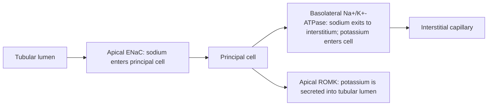
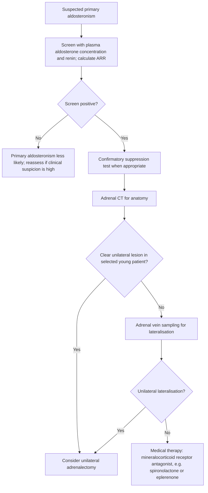
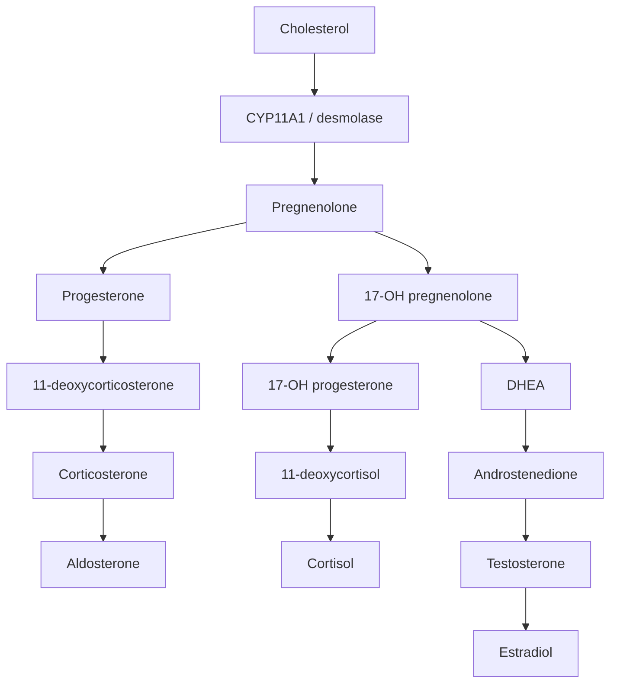

# Chapter 12: Adrenal Cortex II — Mineralocorticoids & Congenital Adrenal Hyperplasia

---

## 12.1 Primary Aldosteronism (Conn Syndrome)

**Primary Aldosteronism (PA)** is defined as autonomous, unregulatable hypersecretion of Aldosterone from the zona glomerulosa of the adrenal cortex, independent of the Renin-Angiotensin-Aldosterone System (RAAS) and sodium intake. It represents the most common cause of secondary hypertension (accounting for $5\text{--}10\%$ of all hypertensive individuals).

### Pathophysiology
Aldosterone binds to nuclear Mineralocorticoid Receptors (MR) in the principal cells of the renal cortical collecting duct. This upregulates:
1. Apical **Epithelial Sodium Channels (ENaC)** $\rightarrow$ Increases luminal $\text{Na}^+$ reabsorption.
2. Basolateral $\text{Na}^+/\text{K}^+$-ATPase pumps $\rightarrow$ Drives $\text{Na}^+$ into ECF.
3. Apical **ROMK channels** and **$\text{H}^+$-ATPase pumps** in intercalated cells $\rightarrow$ Enhances urinary $\text{K}^+$ and $\text{H}^+$ excretion.

* **Aldosterone Escape**: Despite severe sodium and water retention, overt generalized edema is typically absent due to "aldosterone escape"—increased renal perfusion pressure and atrial natriuretic peptide (ANP) release induce pressure natriuresis, limiting further net sodium retention.

### Etiologies
1. **Bilateral Idiopathic Adrenal Hyperplasia (IAH)**: Accounts for $60\text{--}65\%$ of cases.
2. **Aldosterone-Producing Adrenal Adenoma (APA / Conn Syndrome)**: Accounts for $30\text{--}35\%$ of cases; usually small, solitary unilateral benign adenomas.
3. **Primary (Unilateral) Adrenal Hyperplasia**: $2\%$.
4. **Familial Hyperaldosteronism (FH)**: Type I (Glucocorticoid-Remediable Aldosteronism [GRA]—chimeric *CYP11B1/CYP11B2* gene), Type II, Type III (*KCNJ5* mutations).

### Clinical Features
* **Secondary Hypertension**: Moderate-to-severe, often drug-resistant (uncontrolled on $\ge 3$ antihypertensive medications).
* **Hypokalemic Manifestations**: Muscle weakness, fatigue, cramps, paresthesias, polyuria/polydipsia (nephrogenic diabetes insipidus secondary to chronic hypokalemia), cardiac arrhythmias (prominent U waves on ECG). *Note*: Over $50\%$ of PA patients are normokalemic at baseline.
* **Metabolic Alkalosis**: Secondary to enhanced renal $\text{H}^+$ secretion.

### Diagnostic Protocol & Workup
Screening is recommended for patients with resistant hypertension, hypertension with hypokalemia, hypertension with an adrenal incidentaloma, or severe hypertension ($>150/100\text{ mmHg}$).

#### Step 1: Screening Test — PAC:PRA Ratio (ARR)
* **Preparation**: Discontinue Mineralocorticoid Receptor Antagonists (Spironolactone, Eplerenone) for at least 4 to 6 weeks. Correct hypokalemia prior to testing.
* **Interpretation**:
  * **Plasma Aldosterone Concentration (PAC) to Plasma Renin Activity (PRA) Ratio (ARR) $>20\text{--}30$** with a absolute **PAC $>15\text{ ng/dL}$** is a positive screening result.
  * In PA, PAC is high ($>15\text{ ng/dL}$) while PRA is suppressed ($<1.0\text{ ng/mL/h}$).

#### Step 2: Confirmatory Testing
* **IV Saline Infusion Test**: 2 Liters of $0.9\%$ Saline infused IV over 4 hours. A post-infusion $\text{PAC} >10\text{ ng/dL}$ confirms primary aldosteronism (failure to suppress aldosterone despite acute volume expansion).
* **Oral Sodium Loading Test**: High sodium diet for 3 days; 24-hour urinary aldosterone $>12\ \mu\text{g/24h}$ with urinary sodium $>200\text{ mEq/24h}$ confirms PA.

#### Step 3: Subtype Localization (Adenoma vs. Bilateral Hyperplasia)
* **Adrenal CT Imaging**: High-resolution thin-slice CT to evaluate for adrenal mass vs. bilateral nodular hyperplasia.
* **Adrenal Vein Sampling (AVS) [Gold Standard]**: Essential prior to surgery because CT often fails to detect microadenomas or misidentifies non-functional incidentalomas.
  * Catheters placed into both right and left adrenal veins and IVC to measure aldosterone and cortisol.
  * **Lateralization Ratio $>4:1$** (gradient between dominant and non-dominant adrenal vein aldosterone:cortisol ratio) confirms unilateral Aldosterone-Producing Adenoma.
  * **Lateralization Ratio $<3:1$** indicates Bilateral Idiopathic Hyperplasia.

### Treatment Strategies
* **Unilateral Adenoma (Conn Disease)**: Surgical **Laparoscopic Unilateral Adrenalectomy**. Cures hypokalemia in $100\%$ and improves or cures hypertension in $50\text{--}80\%$.
* **Bilateral Idiopathic Hyperplasia (IAH)**: Medical management with **Mineralocorticoid Receptor Antagonists**:
  * **Spironolactone**: First-line competitive MR antagonist (12.5 to 400 mg daily). Side effects: Anti-androgenic toxicity (gynecomastia, erectile dysfunction, mastodynia, menstrual irregularities).
  * **Eplerenone**: Selective MR antagonist with minimal affinity for androgen/progesterone receptors. Preferred if spironolactone side effects develop.
  * **Amiloride**: ENaC inhibitor; alternative if MR antagonists are not tolerated.

---

## 12.2 Congenital Adrenal Hyperplasia (CAH)

**Congenital Adrenal Hyperplasia (CAH)** encompasses a group of autosomal recessive disorders caused by enzymatic deficiencies in the adrenal steroidogenesis pathway. Impaired cortisol synthesis eliminates negative feedback inhibition on the pituitary, inducing unsuppressed **ACTH hypersecretion**, which drives bilateral adrenal cortical hyperplasia and accumulation of upstream steroid precursors.

---

### 12.2.1 21-$\alpha$-Hydroxylase Deficiency (*CYP21A2*)
Accounting for **$90\text{--}95\%$ of all CAH cases**, 21-$\alpha$-hydroxylase deficiency prevents the conversion of Progesterone to 11-Deoxycorticosterone (mineralocorticoid pathway) and 17-OH-Progesterone to 11-Deoxycortisol (glucocorticoid pathway). Upstream precursors are shunted into the intact **Adrenal Androgen Pathway**.

| Subtype | Enzymatic Activity | Clinical Presentation |
| --- | --- | --- |
| Classic Salt-Wasting | 0% Activity (Complete Null) | - Severe Cortisol & Aldosterone; Deficiency; - Salt-wasting crisis at 1--2 wks; - Female virilization / Ambiguous; genitalia at birth |
| Classic Simple | 1--2% Activity | - Cortisol Deficiency |
| Virilizing |  | - Intact Aldosterone (No crisis); - Female ambiguous genitalia; - Male precocious pseudopuberty |
| Non-Classic | 20--50% Activity (Mild Partial) | - Normal Cortisol & Aldosterone; - Post-pubertal Hyperandrogenism; - Hirsutism, oligomenorrhea, acne; in young females (mimics PCOS) |

#### Clinical Manifestations
* **Female Genitalia Virilization**: Exposed to high *in utero* adrenal androgens. Affected 46,XX neonates present with clitoromegaly, labial fusion, and urogenital sinus formation (**Ambiguous Genitalia** with internal normal female structures: uterus, ovaries, and fallopian tubes are present).
* **Male Neonates**: Normal external genitalia at birth (no ambiguity). Undiagnosed males with Classic Salt-Wasting CAH present at 1 to 3 weeks of life with a **salt-wasting adrenal crisis**: failure to thrive, persistent vomiting, severe dehydration, hyponatremia, hyperkalemia, hyperkalemic cardiotoxicity, and hypovolemic shock.
* **Precocious Pseudopuberty**: Early pubic hair, accelerated somatic growth, accelerated bone age maturation (leading to premature epiphyseal closure and short adult stature).

#### Diagnostic Workup
* **Newborn Screening**: Blood spot dried filter paper assay measuring **17-Hydroxyprogesterone (17-OHP)**.
* **Diagnostic Thresholds**: Markedly elevated baseline morning **17-OHP $>1000\text{ ng/dL}$** ($30\text{ nmol/L}$).
* **Cosyntropin Stimulation Test**: For borderline cases or Non-Classic CAH; 60-minute post-Cosyntropin 17-OHP $>1500\text{ ng/dL}$ confirms the diagnosis.
* **Genetic Testing**: *CYP21A2* gene mutation analysis.

#### Therapeutics
* **Glucocorticoid Replacement**: Oral **Hydrocortisone** (10 to 15 $\text{mg/m}^2/\text{day}$ divided TID in pediatric populations). Suppresses excess ACTH secretion, reducing androgen production.
* **Mineralocorticoid Replacement**: **Fludrocortisone** (0.05 to 0.2 mg daily) + Sodium Chloride oral supplementation in infants with Classic Salt-Wasting CAH.
* **Surgical Management**: Femoral-sparing clitoroplasty and vaginoplasty for severe female virilization (Prader stage IV/V) in specialized interdisciplinary centers.

---

### 12.2.2 11-$\beta$-Hydroxylase Deficiency (*CYP11B1*)
Accounts for $5\%$ of CAH cases. Blocks conversion of 11-Deoxycortisol to Cortisol and 11-Deoxycorticosterone (DOC) to Corticosterone.
* **Pathophysiological Marker**: Accumulation of **11-Deoxycorticosterone (DOC)**, a potent weak mineralocorticoid.
* **Clinical Presentation**: **Virilization + HYPERTENSION**.
  * Female 46,XX virilization (ambiguous genitalia) due to androgen shunting.
  * Mineralocorticoid excess symptoms: **Hypertension**, volume expansion, **hypokalemia**, and suppressed plasma renin activity (PRA) driven by high DOC levels.
* **Diagnostics**: Elevated **11-Deoxycortisol** and **11-Deoxycorticosterone (DOC)**.

---

### 12.2.3 17-$\alpha$-Hydroxylase Deficiency (*CYP17A1*)
Rare ($<1\%$). Blocks conversion of Pregnenolone to 17-OH-Pregnenolone and Progesterone to 17-OH-Progesterone.
* **Pathophysiological Marker**: Impaired synthesis of both Cortisol and Androgens/Estrogens. Mineralocorticoid pathway remains hyperactive, leading to massive excess of DOC and Corticosterone.
* **Clinical Presentation**: **HYPERTENSION + Phenotypic Female / Hypogonadism**.
  * **46,XY Males**: Lack of androgens leads to female external genitalia or ambiguous genitalia (Male Pseudohermaphroditism), absent prostate, and undescended testes.
  * **46,XX Females**: Normal female external genitalia at birth, but fail to undergo puberty (primary amenorrhea, lack of secondary sexual characteristics / sexual infantilism).
  * **Hypertension & Hypokalemia**: Driven by DOC excess.

| Enzymatic Defect | Mineralocorticoid; State | Blood Pressure | Sexual Phenotype (46,XX / 46,XY) |
| --- | --- | --- | --- |
| 21-a-Hydroxylase | Deficient (Salt-Wasting) | HYPOTENSION (Salt Crisis) | Virilized 46,XX /; Normal 46,XY |
| 11-b-Hydroxylase | Excess DOC | HYPERTENSION (Hypokalemic) | Virilized 46,XX /; Normal 46,XY |
| 17-a-Hydroxylase | Excess DOC | HYPERTENSION (Hypokalemic) | Sexual Infantilism; 46,XX / Female; Genitalia 46,XY |

---

## 12.3 Summary & High-Yield Examination Checklist

- [x] **Primary Aldosteronism Triad**: Resistant hypertension, hypokalemia, metabolic alkalosis.
- [x] **ARR Cutoff**: PAC:PRA ratio $>20\text{--}30$ with PAC $>15\text{ ng/dL}$ screens positive.
- [x] **AVS Indication**: Lateralization ratio $>4:1$ on Adrenal Vein Sampling proves unilateral adenoma; $<3:1$ proves bilateral hyperplasia.
- [x] **Conn Therapy**: Unilateral Adenoma $\rightarrow$ Laparoscopic Adrenalectomy; Bilateral Hyperplasia $\rightarrow$ Spironolactone / Eplerenone.
- [x] **21-Hydroxylase Deficiency**: #1 cause of CAH; high 17-OHP; virilized 46,XX female + salt-wasting crisis (hyponatremia, hyperkalemia, shock) at 1–2 weeks in males.
- [x] **11-Beta-Hydroxylase Deficiency**: High 11-DOC $\rightarrow$ Virilization + **HYPERTENSION** + Hypokalemia.
- [x] **17-Alpha-Hydroxylase Deficiency**: High 11-DOC $\rightarrow$ **HYPERTENSION** + Sexual Infantilism (46,XX) / Female external genitalia (46,XY).

---
