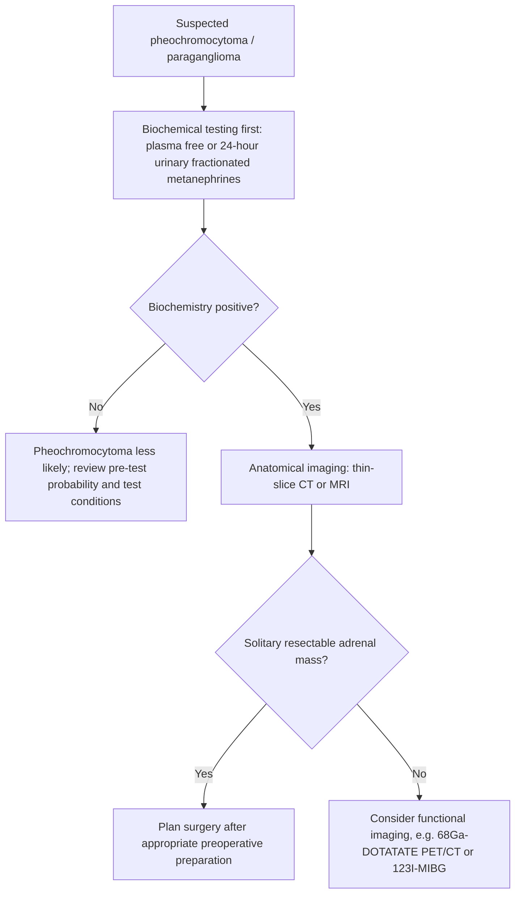
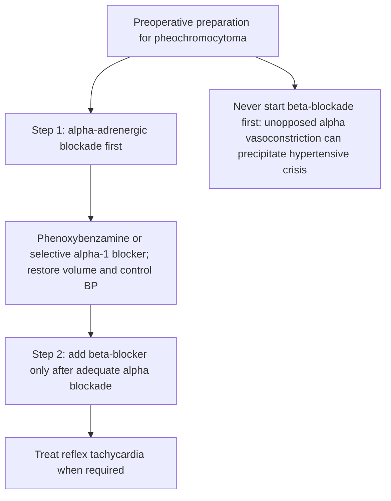
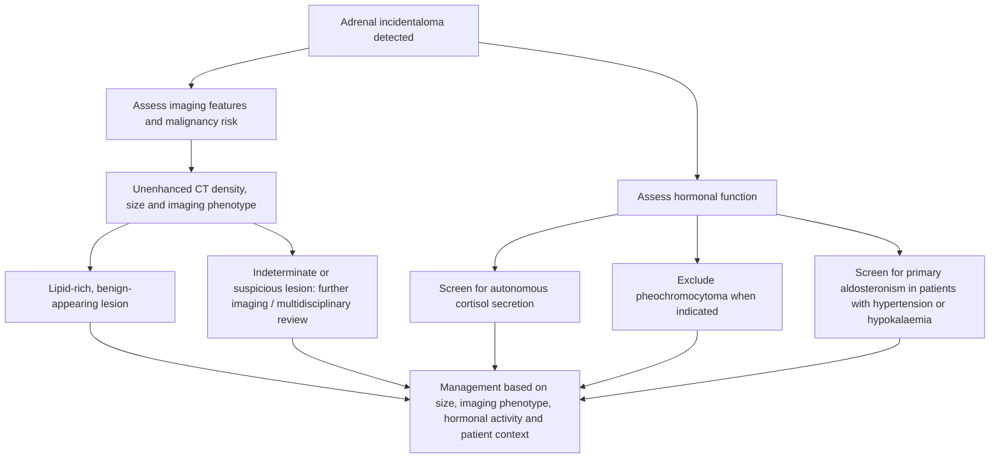

# Chapter 13: Adrenal Medulla & Incidentalomas

---

## 13.1 Pheochromocytoma & Paraganglioma (PPGL)

**Pheochromocytomas** are rare catecholamine-secreting neuroendocrine tumors arising from chromaffin cells of the adrenal medulla. **Paragangliomas (Extra-adrenal Pheochromocytomas)** arise from extra-adrenal sympathetic or parasympathetic neural crest ganglia (e.g., organ of Zuckerkandl, carotid body, glomus jugulare).

| Historical "Rule of 10s" | Modern Molecular Genetic Evidence |
| --- | --- |
| - 10% Extra-adrenal | - Extra-adrenal: 15--20% |
| - 10% Bilateral | - Bilateral: 15--20% |
| - 10% Malignant | - Malignant: 10--15% (Up to 50% in SDHB) |
| - 10% Pediatric | - Pediatric: 10--20% |
| - 10% Familial / Hereditary | - FAMILIAL / HEREDITARY: 30--40% (Germline mutations in RET, VHL, NF1,; SDHB, SDHD, SDHC, MAX, TMEM127) |

### Hereditary Syndromes Associated with PPGL
1. **Multiple Endocrine Neoplasia Type 2A/2B (MEN 2A/2B)**: Gain-of-function *RET* proto-oncogene mutation ($10q11.2$). Pheochromocytomas are bilateral in $50\%$; secrete predominantly **Epinephrine**.
2. **Von Hippel-Lindau (VHL) Disease**: Loss-of-function *VHL* gene mutation ($3p25$). Associated with clear cell RCC and CNS hemangioblastomas; secretes exclusively **Norepinephrine**.
3. **Neurofibromatosis Type 1 (NF1)**: *NF1* gene mutation ($17q11.2$).
4. **Hereditary Paraganglioma-Pheochromocytoma Syndromes**: Succinate Dehydrogenase complex subunit mutations (*SDHA, SDHB, SDHC, SDHD*). **_SDHB_ mutations** carry a extremely high risk of **malignancy ($>40\text{--}50\%$)** and distant metastases.

### Pathophysiology & Catecholamine Metabolism
* Chromaffin cells synthesize Epinephrine, Norepinephrine, and Dopamine from Tyrosine.
* Catecholamines are locally metabolized within chromaffin cells by **Catechol-O-Methyltransferase (COMT)** into **Metanephrines** (Epinephrine $\rightarrow$ Metanephrine; Norepinephrine $\rightarrow$ Normetanephrine).
* Because tumors leak metanephrines continuously regardless of episodic catecholamine release, free metanephrines serve as superior diagnostic biomarkers.

### Clinical Features
The classic clinical presentation is characterized by the **Rule of 5 Ps**:
1. **P**aroxysmal Severe Hypertension (or sustained hypertension with paroxysms).
2. **P**ounding Headache (most common symptom - $80\%$).
3. **P**erspiration / Diaphoresis ($70\%$).
4. **P**alpitations & Tachycardia ($60\%$).
5. **P**allor (secondary to intense $\alpha_1$-mediated peripheral vasoconstriction).

**Classic symptom triad:** headache, diaphoresis and palpitations. The predictive value depends on the clinical setting and pre-test probability.

* Other Manifestations: Orthostatic hypotension (secondary to chronic venoconstriction and plasma volume contraction), anxiety/panic attacks, hyperglycemia (catecholamine-induced glycogenolysis and inhibition of insulin secretion), dilated cardiomyopathy, inverted T-waves / QTc prolongation.

### Diagnostic Protocol & Workup

#### Step 1: Biochemical Confirmation
* **Plasma Free Fractionated Metanephrines**: Highest sensitivity ($>97\%$). Drawn supine after 30 minutes of rest. Values $>3\times$ upper limit of normal confirm pheochromocytoma.
* **24-Hour Urinary Fractionated Metanephrines & Catecholamines**: Highest specificity ($95\%$).

#### Step 2: Anatomical Imaging
* **Contrast CT Abdomen & Pelvis**: First-line imaging; $95\%$ of PPGLs are in the abdomen/pelvis. Pheochromocytomas appear as hypervascular, lipid-poor masses ($>10\text{ HU}$ unenhanced) with cystic or necrotic areas.
* **MRI Abdomen**: Highly sensitive; exhibits pathognomonic **intense hyperintensity on $T_2$-weighted sequences ("Lightbulb Sign")**.

#### Step 3: Functional Molecular Imaging
Indicated if CT/MRI is negative, for paragangliomas, or to stage metastatic disease:
* **$^{68}\text{Ga}$-DOTATATE PET/CT**: Gold standard imaging for somatostatin receptor-expressing PPGLs (especially *SDHx* mutations).
* **$^{123}\text{I}$-MIBG Scintigraphy**: Structural analog of norepinephrine internalized by norepinephrine transporters (NET).

### Perioperative Management Protocols (CRITICAL)
Surgical resection (Laparoscopic Adrenalectomy) is the definitive cure. However, **unprepared surgical manipulation induces catastrophic intraoperative catecholamine release**, triggering lethal hypertensive crises, pulmonary edema, and cardiac arrest.

* **Alpha-Blockade Protocol**:
  * Initiate **Phenoxybenzamine** (non-selective, irreversible $\alpha_1/\alpha_2$ blocker; 10 mg BID, titrated up to $80\text{--}120\text{ mg/day}$) or **Doxazosin** for **10 to 14 days pre-operatively**.
  * Targets: Sitting $\text{BP} < 130/80\text{ mmHg}$ and orthostatic systolic BP $>90\text{ mmHg}$. Encourage high-salt diet and hydration to expand contracted vascular volume.
* **Beta-Blockade Protocol**:
  * Add a non-selective ($\text{Propranolol}$) or $\beta_1$-selective ($\text{Atenolol/Metoprolol}$) beta-blocker **ONLY AFTER 3 to 5 days of effective alpha-blockade** to control tachyarrhythmias.
* **Intraoperative Hypertensive Crisis**: Managed with IV **Sodium Nitroprusside**, **Phentolamine** (short-acting $\alpha$-blocker), or **Clevidipine**.

---

## 13.2 Adrenal Incidentaloma

An **Adrenal Incidentaloma** is defined as an unsuspected adrenal mass ($\ge 1\text{ cm}$) discovered inadvertently on cross-sectional imaging (CT or MRI) performed for indications unrelated to suspected adrenal disease. Prevalence is $3\text{--}5\%$ in middle-aged adults, rising to $10\%$ in the elderly.

### Diagnostic Evaluation Sequence

#### Evaluation 1: Radiological Assessment of Malignancy Risk
1. **Unenhanced CT Attenuation Value (Hounsfield Units - HU)**:
   * **$\text{HU} < 10\text{ HU}$**: Pathognomonic for a lipid-rich benign cortical adenoma. No further imaging required.
   * **$\text{HU} > 10\text{ HU}$**: Lipid-poor mass. Requires contrast-enhanced CT with delayed protocol ($10\text{--}15\text{ minutes}$).
2. **Contrast Washout Parameters**:
   * **Absolute Contrast Washout $>60\%$**: Confirms benign adenoma.
   * **Absolute Contrast Washout $<50\%$**: Suspicious for Adrenocortical Carcinoma (ACC) or metastatic lesion.
3. **Size Threshold**:
   * Mass $<4\text{ cm}$: Low risk of malignancy ($<2\%$).
   * Mass $>4\text{ cm}$: High risk of Adrenocortical Carcinoma ($>10\text{--}25\%$).

#### Evaluation 2: Hormonal Hyperfunction Workup (Mandatory for ALL Patients)
Regardless of symptoms, every patient with an adrenal incidentaloma must undergo a core hormonal evaluation:
1. **1 mg Overnight Dexamethasone Suppression Test (DST)**: Screening for **Mild Autonomous Cortisol Secretion (MACS)** / Subclinical Cushing. Post-DST Cortisol $>1.8\ \mu\text{g/dL}$ is positive.
2. **Plasma Free Fractionated Metanephrines**: Screening for silent **Pheochromocytoma**.
3. **Plasma Aldosterone-to-Renin Ratio (ARR)**: Screening for **Primary Aldosteronism** (performed in patients with hypertension or hypokalemia).

| Feature | Size & CT Density | Hormonal Status | Management |
| --- | --- | --- | --- |
| Benign Non- | < 4 cm AND | Non-functional | Conservative |
| Functional | HU < 10 | (All tests normal) | Observation |
| Functional Tumor | Any Size | Functional (Pheo / MACS / PA) | Surgical Resection (Laparoscopic) |
| High Risk for ACC | > 4 cm OR; HU > 20 / Washout; < 50% | Any Status | Open Surgical; Adrenalectomy (En-bloc resection) |

* **Adrenal Biopsy Rule**: Fine-needle aspiration (FNA) biopsy of an adrenal mass is **contraindicated** until pheochromocytoma has been strictly ruled out (to avoid fatal hypertensive crisis). FNA cannot differentiate primary benign adenoma from primary adrenocortical carcinoma; its sole role is confirming metastatic disease from a known extra-adrenal primary (e.g., lung cancer).

---

## 13.3 Summary & High-Yield Examination Checklist

- [x] **Genetic Risk**: $30\text{--}40\%$ of PPGLs carry germline mutations (*RET, VHL, NF1, SDHB/D*); *SDHB* carries $>40\%$ malignancy risk.
- [x] **Triad**: Headache + Diaphoresis + Palpitations in hypertension has $>90\%$ PPV for Pheochromocytoma.
- [x] **Biochemical Screening**: Plasma Free Fractionated Metanephrines (supine) is the most sensitive test.
- [x] **MRI Feature**: Intense hyperintensity on $T_2$-weighted MRI ("Lightbulb Sign").
- [x] **Pre-op Alpha-Blockade Rule**: Always give **Alpha-blocker FIRST (Phenoxybenzamine)** for 10–14 days, then Beta-blocker SECOND. Never give beta-blocker first!
- [x] **Incidentaloma Density**: Unenhanced $\text{CT} < 10\text{ HU}$ proves benign lipid-rich adenoma.
- [x] **Incidentaloma Size**: Mass $>4\text{ cm}$ carries high risk of Adrenocortical Carcinoma.
- [x] **Hormonal Screening**: All incidentalomas require 1 mg DST, Plasma Metanephrines, and ARR (if HTN).
- [x] **Biopsy Rule**: Never biopsy an adrenal mass without ruling out Pheochromocytoma first!

---
