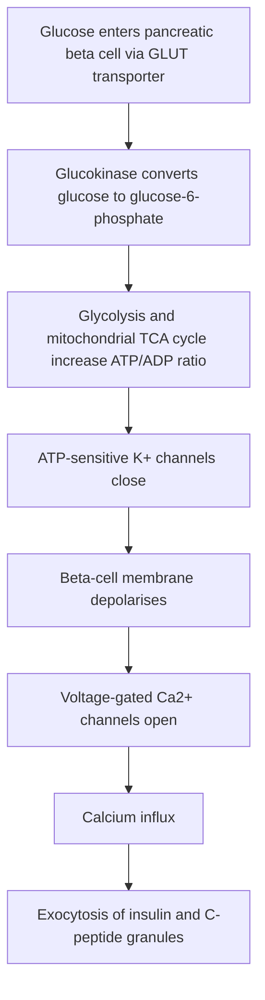
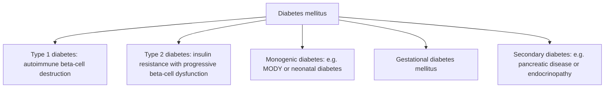

# Chapter 14: Pathophysiology & Classification of Diabetes Mellitus

---

## 14.1 Endocrine Pancreas & Physiology of Glucose Homeostasis

The endocrine pancreas comprises approximately 1 to 2 million **Islets of Langerhans** embedded within the exocrine acinar parenchyma, accounting for $1\text{--}2\%$ of total pancreatic mass.

| Cell Type | Population (%) | Primary Hormonal Product |
| --- | --- | --- |
| Beta ($\beta$) | 65--70% (Core) | Insulin, C-Peptide, Amylin (IAPP) |
| Alpha ($\alpha$) | 15--20% (Mantle) | Glucagon |
| Delta ($\delta$) | 5--10% | Somatostatin (SST-14) |
| PP (F) Cells | < 5% | Pancreatic Polypeptide |
| Epsilon ($\epsilon$) | < 1% | Ghrelin |

### Glucose-Stimulated Insulin Secretion (GSIS) Pathway
$\beta$-cells act as precise fuel sensors. Insulin exocytosis follows a tightly regulated electrophysiological sequence:

* **C-Peptide Equimolar Release**: Proinsulin is cleaved in secretory granules into mature **Insulin** and **C-Peptide** (Connecting Peptide) in a $1:1$ equimolar ratio. Because C-peptide undergoes minimal hepatic first-pass extraction (unlike insulin, which has $50\%$ hepatic clearance) and has a longer half-life ($\sim 30\text{ minutes}$ vs. $5\text{ minutes}$ for insulin), serum C-peptide serves as the gold standard clinical measure of endogenous $\beta$-cell functional capacity.

### The Incretin Effect
Oral glucose administration produces a significantly greater insulin secretory response than an equivalent dose of intravenous glucose. This phenomenon—the **Incretin Effect**—accounts for $50\text{--}70\%$ of postprandial insulin secretion and is mediated by two gut peptides:
1. **GLP-1 (Glucagon-Like Peptide-1)**: Secreted by enteroendocrine **L-cells** of the distal ileum and colon in response to nutrient ingestion. Stimulates glucose-dependent insulin secretion, suppresses glucagon, slows gastric emptying, and increases hypothalamic satiety.
2. **GIP (Glucose-Dependent Insulinotropic Polypeptide)**: Secreted by enteroendocrine **K-cells** of the duodenum and jejunum.

Both incretins are rapidly degraded within 2 minutes by the endothelial enzyme **Dipeptidyl Peptidase-4 (DPP-4)**.

---

## 14.2 Diagnostic Criteria for Diabetes Mellitus & Prediabetes

| Diagnostic Category | Fasting Plasma; Glucose (FPG) | 2-Hour 75g OGTT; Plasma Glucose | Glycated HbA1c |
| --- | --- | --- | --- |
| Normal | < 100 mg/dL (< 5.6 mmol/L) | < 140 mg/dL (< 7.8 mmol/L) | < 5.7% (< 39 mmol/mol) |
| Prediabetes | 100--125 mg/dL (Impaired Fasting) | 140--199 mg/dL (Impaired Glucose; Tolerance - IGT) | 5.7--6.4% (40--47 mmol/mol) |
| DIABETES MELLITUS | >= 126 mg/dL (>= 7.0 mmol/L) | >= 200 mg/dL (>= 11.1 mmol/L) | >= 6.5% (>= 48 mmol/mol) |

* **Fourth Diagnostic Criterion**: A patient presenting with classic symptoms of hyperglycemia (polyuria, polydipsia, polyphagia, unexplained weight loss) or hyperglycemic crisis with a **Random Plasma Glucose $\ge 200\text{ mg/dL}$ ($11.1\text{ mmol/L}$)**.
* **Confirmation Requirement**: In the absence of unequivocal symptomatic hyperglycemia, diagnosis requires two abnormal test results from the same sample or two separate test samples.

---

## 14.3 Pathophysiologic Subtypes of Diabetes Mellitus

### 14.3.1 Type 1 Diabetes Mellitus (T1DM)
T1DM results from immune-mediated selective auto-destruction of pancreatic $\beta$-cells, leading to **absolute insulin deficiency** and lifelong susceptibility to **Diabetic Ketoacidosis (DKA)**.

* **Pathogenesis**: Cell-mediated autoimmune destruction driven by $CD4^+$ and $CD8^+$ T-lymphocytes (insulitis). Environmental triggers (viral infections such as Coxsackie B, enteroviruses) acting on a genetically susceptible host.
* **Genetic Susceptibility**: Strongly linked to HLA Class II genes on chromosome $6p21$: **HLA-DR3-DQ2** and **HLA-DR4-DQ8** heterodimers.
* **Islet Autoantibodies (Diagnostic Biomarkers)**:
  1. **Anti-GAD65** (Glutamic Acid Decarboxylase 65): Most sensitive long-term marker.
  2. **Anti-IA-2** (Insulinoma-Associated Antigen 2 / Protein Tyrosine Phosphatase).
  3. **Anti-ZnT8** (Zinc Transporter 8): High specificity.
  4. **IAA** (Insulin Autoantibodies): Predominant in young infants.
* **Latent Autoimmune Diabetes in Adults (LADA)**: Slowly progressive autoimmune T1DM presenting in adults $>30$ years, initially misdiagnosed as T2DM; positive for Anti-GAD65 antibodies; progresses to insulin requirement within $1\text{--}6$ years.

---

### 14.3.2 Type 2 Diabetes Mellitus (T2DM)
T2DM arises from a complex interaction between peripheral **insulin resistance** (in skeletal muscle, liver, and adipose tissue) and progressive **$\beta$-cell secretory exhaustion**.

* **The "Ominous Octet" Pathophysiologic Defects**:
  1. *Skeletal Muscle*: Decreased peripheral glucose uptake (impaired GLUT4 translocation).
  2. *Liver*: Unsuppressed hepatic gluconeogenesis (excessive overnight glucose output).
  3. *Pancreatic $\beta$-Cell*: Progressive declination in insulin secretion and mass loss.
  4. *Pancreatic $\alpha$-Cell*: Unsuppressed hyperglucagonemia.
  5. *Adipose Tissue*: Accelerated lipolysis (high free fatty acids driving lipotoxicity).
  6. *Gastrointestinal Tract*: Deficient GLP-1/GIP incretin effect.
  7. *Kidney*: Increased renal glucose reabsorption via upregulated **SGLT2** transporters.
  8. *Brain*: Central hypothalamic insulin resistance driving dysregulated appetite.

**The ominous octet of type 2 diabetes:**

1. Impaired muscle glucose uptake.
2. Increased hepatic gluconeogenesis.
3. Impaired beta-cell insulin secretion.
4. Increased alpha-cell glucagon secretion.
5. Increased adipose lipolysis.
6. Reduced incretin effect (GLP-1).
7. Increased renal glucose reabsorption through SGLT2.
8. Hypothalamic dysfunction affecting appetite and energy balance.

---

### 14.3.3 Monogenic Diabetes / MODY
Monogenic diabetes results from single-gene loss-of-function mutations affecting $\beta$-cell development, sensing, or insulin secretion. It accounts for $1\text{--}2\%$ of all diabetes cases and is frequently misdiagnosed as T1DM or T2DM.

* **Maturity-Onset Diabetes of the Young (MODY)**:
  * Key Features: Autosomal dominant inheritance (3 generations affected), early onset ($<25$ years of age), non-insulin dependent, absence of autoantibodies, preserved endogenous C-peptide.

| MODY Subtype | Gene & Mutation | Clinical Course | Treatment of; Choice |
| --- | --- | --- | --- |
| MODY 3 | HNF1A (Transcription; Factor) | - Progressive; hyperglycemia; - Low renal threshold; for glucosuria | Low-Dose Oral; Sulfonylureas (Hypersensitive) |
| MODY 2 | GCK (Glucokinase; Glucose Sensor) | - Mild, stable, non-; progressive FPG (100--140 mg/dL); - Set-point shifted | NO TREATMENT; NEEDED (Complications; rare) |
| MODY 1 | HNF4A | - Similar to MODY 3; - Neonatal macrosomia | Low-Dose Oral; Sulfonylureas |

---

## 14.4 Summary & High-Yield Examination Checklist

- [x] **GSIS Sequence**: Glucose $\rightarrow$ GLUT1/2 $\rightarrow$ Glucokinase $\rightarrow$ ATP/ADP surge $\rightarrow$ K-ATP channel closure $\rightarrow$ Depolarization $\rightarrow$ VGCC $\text{Ca}^{2+}$ influx $\rightarrow$ Insulin exocytosis.
- [x] **C-Peptide**: Equimolar $1:1$ co-secretion with insulin; gold standard measure of endogenous $\beta$-cell reserve.
- [x] **Incretins**: GLP-1 (L-cells) & GIP (K-cells) stimulate glucose-dependent insulin secretion; degraded by DPP-4.
- [x] **Diabetes Diagnostic Cutoffs**: FPG $\ge 126\text{ mg/dL}$, 2h OGTT $\ge 200\text{ mg/dL}$, $\text{HbA}_{1c} \ge 6.5\%$, Random $\ge 200\text{ mg/dL}$ + symptoms.
- [x] **T1DM Markers**: Anti-GAD65 (#1 sensitive), Anti-IA2, Anti-ZnT8; HLA-DR3/DR4 association.
- [x] **MODY 2 (GCK)**: Mild stable non-progressive hyperglycemia; requires NO pharmacotherapy.
- [x] **MODY 3 (HNF1A)**: #1 MODY; highly sensitive to low-dose Sulfonylureas.

---
