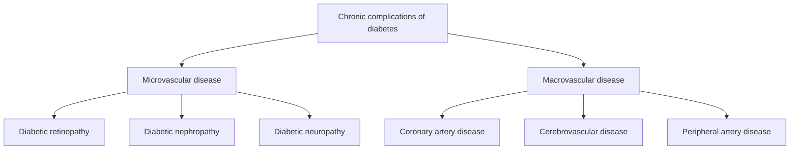

# Chapter 15: Management of Diabetes Mellitus & Chronic Complications

---

## 15.1 Antihyperglycemic Pharmacotherapy

Modern management of Type 2 Diabetes Mellitus (T2DM) prioritizes agent selection based on **Cardiovascular & Renal Risk Reduction**, weight loss efficacy, and hypoglycemia avoidance, rather than glucose lowering alone.

| Drug Class | Key Agents | Primary Mechanism | Cardiorenal & Weight Effects |
| --- | --- | --- | --- |
| Biguanides | Metformin | Activates AMPK;; suppresses hepatic; gluconeogenesis | - Weight neutral; - Neutral CV effect; - Risk: Lactic Acidosis |
| SGLT2 Inhibitors | Empagliflozin,; Dapagliflozin,; Canagliflozin | Blocks SGLT2 in PCT; --> Glucosuria &; Natriuresis | - MAJOR CV BENEFIT (HFrEF); - SLOWS CKD PROGRESSION; - Mild weight loss |
| GLP-1 Receptor | Semaglutide, | Glucose-dependent | - MAJOR MACE CV REDUCTION |
| Agonists ("-tide") | Liraglutide,; Dulaglutide | insulin, glucagon; suppression, satiety | - PROFOUND WEIGHT LOSS; - Slows albuminuria |
| Dual GLP-1 / GIP | Tirzepatide | Dual agonist at | - SUPERIOR WEIGHT LOSS |
| Agonist |  | GLP-1 & GIP receptors | - Potent HbA1c reduction |
| DPP-4 Inhibitors | Sitagliptin,; Linagliptin | Inhibits DPP-4; enzymatic GLP-1 degradation | - Weight neutral; - CV neutral |
| Sulfonylureas | Glimepiride,; Gliclazide, Glipizide | Closes K-ATP; channel --> Insulin; secretagogue | - Weight gain; - HIGH HYPOGLYCEMIA RISK |
| Thiazolidinediones | Pioglitazone | PPAR-gamma agonist; --> Insulin sensitizer | - Weight gain, Fluid retention; - Contraindicated in Heart Failure |

---

### Detailed Drug Class Mechanics

#### 1. Metformin (Biguanide)
* **Mechanism**: Activates AMP-Activated Protein Kinase (AMPK), inhibiting hepatic gluconeogenesis and increasing peripheral insulin sensitivity.
* **Benefits**: No hypoglycemia, weight neutral, long-term safety record.
* **Adverse Effects & Safety**:
  * Gastrointestinal distress (diarrhea, abdominal cramping - $20\%$).
  * Long-term use causes **Vitamin $\text{B}_{12}$ deficiency** (requires annual monitoring).
  * **Lactic Acidosis**: Rare but fatal. **Contraindicated if eGFR $<30\text{ mL/min/1.73m}^2$**. Dose reduction to $1000\text{ mg/day}$ if eGFR $30\text{--}45\text{ mL/min}$. Hold prior to IV iodinated contrast procedures in patients with eGFR $<60$.

#### 2. SGLT2 Inhibitors (*-gliflozin*)
* **Mechanism**: Inhibits Sodium-Glucose Cotransporter 2 (SGLT2) in the S1 segment of the renal proximal convoluted tubule, lowering the renal threshold for glucose from $180\text{ mg/dL}$ to $40\text{ mg/dL}$, inducing glucosuria ($70\text{--}80\text{ g/day}$).
* **Cardiorenal Indications**:
  * **Heart Failure**: Reduces hospitalizations for HFrEF and HFpEF regardless of diabetes status.
  * **Chronic Kidney Disease**: Slows eGFR decline and progression to ESKD.
* **Adverse Effects**: Mycotic genital infections (candida vulvovaginitis/balanitis), volume depletion/hypotension, Fournier's gangrene (rare necrotizing fasciitis of perineum), and **Euglycemic Diabetic Ketoacidosis (eDKA)** (DKA presenting with blood glucose $<250\text{ mg/dL}$; hold 3 days prior to elective surgery).

#### 3. GLP-1 Receptor Agonists & Dual Incretins
* **Mechanism**: Binds GLP-1 receptors driving glucose-dependent insulin secretion, glucagon suppression, delayed gastric emptying, and central hypothalamic satiety.
* **Indications**: Established Atherosclerotic Cardiovascular Disease (ASCVD - reduces MI, stroke, CV mortality) and Obesity.
* **Adverse Effects**: Nausea, vomiting, diarrhea. Contraindicated in patients with a personal or family history of **Medullary Thyroid Carcinoma** or MEN 2A/2B (thyroid C-cell hyperplasia risk) and history of pancreatitis.

---

### Insulin Formulations & Regimens

| Category | Specific Analogs | Onset of Action | Peak Effect Duration |
| --- | --- | --- | --- |
| Rapid-Acting | Lispro, Aspart,; Glulisine | 10--15 minutes | 1--2 hours /; Duration: 3--5 hours |
| Short-Acting | Regular Insulin (Humulin R) | 30--60 minutes | 2--3 hours /; Duration: 5--8 hours |
| Intermediate | NPH Insulin | 1--2 hours | 4--10 hours /; Duration: 12--18 hrs |
| Long-Acting | Glargine (U100/300); Detemir, Degludec | 1--2 hours | Peakless /; Duration: 24--42 hrs |

* **Intensive Basal-Bolus Regimen**: Gold standard for T1DM. Combines once-daily basal insulin (Glargine/Degludec - $50\%$ total daily dose) to suppress basal hepatic gluconeogenesis, with prandial rapid-acting insulin (Lispro/Aspart - $50\%$ total daily dose divided before meals) based on carbohydrate counting and blood glucose correction factor.

---

## 15.2 Chronic Microvascular & Macrovascular Complications

---

### 15.2.1 Diabetic Retinopathy
Leading cause of blindness in working-age adults ($20\text{--}74$ years).
* **Non-Proliferative Diabetic Retinopathy (NPDR)**: Retinal vascular hyperpermeability and ischemia. Features: **Microaneurysms** (earliest sign), dot-and-blot hemorrhages, hard exudates (lipid deposits), cotton-wool spots (nerve fiber layer micro-infarcts), venous beading.
* **Proliferative Diabetic Retinopathy (PDR)**: Driven by retinal ischemia releasing **VEGF** $\rightarrow$ **Neovascularization** (fragile new vessel growth on optic disc or retina). Complications: Vitreous hemorrhage, tractional retinal detachment, neovascular glaucoma.
* **Management**: Panretinal Photocoagulation (PRP) laser therapy and intravitreal **Anti-VEGF injections** (Aflibercept, Ranibizumab).

---

### 15.2.2 Diabetic Kidney Disease (DKD)
Leading cause of End-Stage Kidney Disease (ESKD) worldwide.
* **Pathophysiology**: Hyperglycemia induces afferent arteriolar vasodilation (via SGLT2 hyperreabsorption) and Angiotensin II-mediated efferent arteriolar vasoconstriction $\rightarrow$ **Glomerular Hyperfiltration** $\rightarrow$ Podocyte loss, basement membrane thickening, mesangial expansion.
* **Histopathology**: Diffuse mesangial glomerulosclerosis and nodular glomerulosclerosis (**Kimmelstiel-Wilson Lesions** - pathognomonic PAS-positive acellular nodular mesangial matrices).

**Kimmelstiel-Wilson nodular lesions** are a characteristic histological feature of diabetic nodular glomerulosclerosis.

* **Diagnostic Staging**:
  * **Persistent Albuminuria**: Urine Albumin-to-Creatinine Ratio (UACR) $30\text{--}300\text{ mg/g}$ (Microalbuminuria / Category A2) or $>300\text{ mg/g}$ (Severely increased / Category A3).
* **Renoprotective Therapy**:
  1. **ACE Inhibitors or ARBs**: First-line for hypertension with UACR $\ge 30\text{ mg/g}$ (dilates efferent arteriole, reducing intraglomerular pressure).
  2. **SGLT2 Inhibitors**: First-line for DKD with eGFR $\ge 20\text{ mL/min}$ and UACR $>200\text{ mg/g}$ (restores tubuloglomerular feedback).
  3. **Finerenone**: Non-steroidal selective mineralocorticoid receptor antagonist shown to slow DKD progression and CV events.

---

### 15.2.3 Diabetic Neuropathy
* **Distal Symmetric Polyneuropathy**: Most common form ($50\%$). Length-dependent axonal degeneration affecting longest nerve fibers first ("glove-and-stocking" distribution).
  * *Small Fiber Loss*: Pain, burning paresthesias, loss of temperature sensation.
  * *Large Fiber Loss*: Numbness, loss of vibration sense ($128\text{ Hz}$ tuning fork), loss of proprioception, loss of ankle reflex (Achilles tendon reflex).
* **Autonomic Neuropathy**: Cardiovascular (resting tachycardia, orthostatic hypotension), Gastrointestinal (**Diabetic Gastroparesis** - delayed gastric emptying, nausea, early satiety; treated with oral **Metoclopramide** or **Erythromycin**), Genitourinary (neurogenic bladder, erectile dysfunction).
* **Neuropathic Pain Therapeutics**: **Pregabalin**, **Duloxetine**, or **Gabapentin**.

---

### 15.2.4 Diabetic Foot Disease
Result of combined distal symmetric polyneuropathy (loss of protective sensation), peripheral artery disease (ischemia), and impaired wound healing.
* **Charcot Neuroarthropathy (Charcot Foot)**: Acute neuropathic microtrauma $\rightarrow$ unperceived fractures, severe inflammation, joint dislocation, and bone destruction $\rightarrow$ collapse of the foot arch (**"Rocker-Bottom Foot" deformity**).
* **Screening**: Annual **10-gram Semmes-Weinstein Monofilament Test** at 4 plantar sites per foot.

---

## 15.3 Summary & High-Yield Examination Checklist

- [x] **Metformin Cutoff**: Contraindicated if eGFR $<30\text{ mL/min}$; risk of Lactic Acidosis; causes $\text{B}_{12}$ deficiency.
- [x] **SGLT2 Inhibitor Benefits**: Reduces HFrEF hospitalizations & slows CKD; side effects include eDKA and mycotic genital infections.
- [x] **GLP-1 RA Benefits**: MACE CV reduction & profound weight loss; contraindicated in Medullary Thyroid Carcinoma (MTC).
- [x] **Insulin Regimen**: Intensive Basal-Bolus ($50\%$ basal / $50\%$ prandial) is standard for T1DM.
- [x] **Kimmelstiel-Wilson Lesions**: Pathognomonic nodular mesangial glomerulosclerosis in Diabetic Kidney Disease.
- [x] **DKD Triad Therapy**: ACEi/ARB + SGLT2 Inhibitor + Finerenone.
- [x] **Neuropathy Screening**: 10-gram monofilament test; first-line pain agents are Pregabalin / Duloxetine.

---
