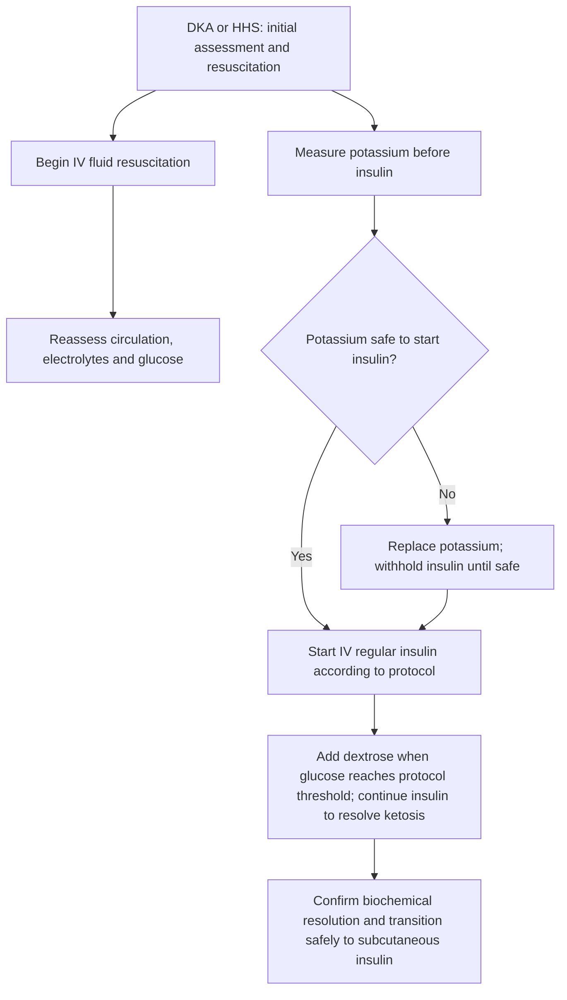

# Chapter 16: Acute Metabolic Emergencies & Islet Cell Tumors

---

## 16.1 Diabetic Ketoacidosis (DKA) vs. Hyperglycemic Hyperosmolar State (HHS)

DKA and HHS are life-threatening acute metabolic emergencies of diabetes mellitus.

| Diagnostic Feature | Diabetic Ketoacidosis (DKA) | Hyperglycemic Hyperosmolar State (HHS) |
| --- | --- | --- |
| Patient Population | Predominantly T1DM (Younger) | Predominantly Elderly T2DM (Nursing home, infection trigger) |
| Underlying Pathology | ABSOLUTE Insulin; Deficiency | RELATIVE Insulin Deficiency (Sufficient to block lipolysis) |
| Plasma Glucose | Moderate: 250--600 mg/dL | SEVERE: >= 600 mg/dL (33.3 mmol/L) |
| Arterial pH | Acidotic: < 7.30 (Severe < 7.00) | Normal: > 7.30 |
| Serum Bicarbonate | Low: < 18 mEq/L | Normal: > 18 mEq/L |
| Anion Gap | HIGH ANION GAP (>12) | Normal or Minimal Elevation |
| Serum / Urine Ketones | POSITIVE (High b-OHB) | Negative or Trace |
| Effective Osmolality | Variable | SEVERE: > 320 mOsm/kg |
| Fluid Deficit | Moderate (~6 Liters) | MASSIVE (9--12 Liters / 10-15% BW) |
| Mental Status | Alert to Drowsy | Severe Stupor / Coma / Seizures |

### Pathophysiology of DKA
1. **Absolute Insulin Deficiency + Counter-Regulatory Hormone Surge** (Glucagon, Catecholamines, Cortisol, GH).
2. **Unsuppressed Adipose Lipolysis**: Hormone-Sensitive Lipase (HSL) activation breaks down triacylglycerols into free fatty acids (FFAs) and glycerol.
3. **Hepatic Ketogenesis**: FFAs enter hepatic mitochondria $\rightarrow$ $\beta$-oxidation generates excess Acetyl-CoA $\rightarrow$ shunted into ketogenesis, producing **$\beta$-Hydroxybutyrate** (predominant circulating ketoacid) and **Acetoacetate**.
4. **Metabolic Acidosis**: Ketoacids dissociate, releasing $\text{H}^+$ ions, consuming serum bicarbonate, generating a **High Anion Gap Metabolic Acidosis**:
   $$\text{Anion Gap} = \text{Na}^+ - (\text{Cl}^- + \text{HCO}_3^-) \quad [\text{Normal } 8\text{--}12\text{ mEq/L}]$$

### Clinical Features
* **DKA**: Rapid onset ($<24\text{ hours}$). Kussmaul respiration (deep, rapid hyperventilation to exhale $\text{CO}_2$), fruity/acetone breath odor, nausea, vomiting, diffuse abdominal pain (mimicking acute surgical abdomen), hypovolemia.
* **HHS**: Insidious onset over days/weeks. Severe dehydration, altered mental status, lethargy, hemiparesis, focal seizures.

---

### Emergency Management Protocol for DKA & HHS
Treatment follows a rigid, prioritized multi-step sequence:

#### Step 1: Fluid Resuscitation (FIRST Priority)
* Infuse **0.9% Isotonic Saline** at 1.0 to 1.5 Liters ($15\text{--}20\text{ mL/kg}$) during the 1st hour to restore intravascular volume and renal perfusion.
* Switch to $0.45\%$ Saline at 250 to 500 mL/h if corrected serum sodium is normal/high.

#### Step 2: Potassium Management (CRITICAL SAFETY CHECK)
* **Rule**: **Check serum potassium BEFORE initiating insulin therapy!**
* Insulin drives potassium into cells. Administering insulin during severe hypokalemia induces lethal cardiac arrhythmias and respiratory muscle paralysis.
  * If $\mathbf{\text{K}^+ < 3.3\text{ mEq/L}}$: **HOLD INSULIN**. Administer IV KCl ($20\text{--}30\text{ mEq/h}$) until $\text{K}^+ > 3.3\text{ mEq/L}$, then start insulin.
  * If $\text{K}^+ = 3.3\text{--}5.2\text{ mEq/L}$: Administer IV KCl ($20\text{--}30\text{ mEq/L}$) in IV fluids to maintain potassium between $4.0\text{--}5.0\text{ mEq/L}$.
  * If $\text{K}^+ > 5.2\text{ mEq/L}$: Do not give potassium; check serum level Q2H.

#### Step 3: Insulin Therapy
* Continuous IV **Regular Insulin** infusion ($0.1\text{ U/kg}$ bolus followed by $0.1\text{ U/kg/h}$). Target glucose drop rate of $50\text{--}75\text{ mg/dL/h}$.

#### Step 4: Dextrose Addition & Clearance of Ketoacidosis
* When plasma glucose reaches **$200\text{ mg/dL}$ in DKA** (or **$300\text{ mg/dL}$ in HHS**), change IV fluids to **5% Dextrose in 0.45% Saline** while continuing IV insulin infusion at reduced rate ($0.02\text{--}0.05\text{ U/kg/h}$).
* *Rationale*: Insulin is required to clear ketoacidosis (stop lipolysis), NOT just lower glucose. Dextrose prevents hypoglycemia while insulin clears ketones.

#### Step 5: DKA Resolution & Subcutaneous Transition
* **Resolution Criteria**: Glucose $<200\text{ mg/dL}$ PLUS at least two of the following: Serum $\text{HCO}_3^- \ge 18\text{ mEq/L}$, Venous $\text{pH} > 7.30$, Normal Anion Gap ($\le 12\text{ mEq/L}$).
* **Transition Rule**: Administer subcutaneous basal insulin **2 hours BEFORE stopping IV insulin infusion** to prevent rebound ketoacidosis.

---

## 16.2 Hypoglycemia & Islet Cell Tumors

### 16.2.1 Non-Diabetic Hypoglycemia & Whipple Triad
Hypoglycemia in non-diabetic individuals is defined strictly by **Whipple Triad**:
1. Symptoms and signs consistent with hypoglycemia (Autonomic: tremor, palpitations, diaphoresis, anxiety; Neuroglycopenic: confusion, lethargy, seizures, coma).
2. Documented low plasma glucose concentration ($\le 55\text{ mg/dL}$ [$3.0\text{ mmol/L}$]) at the time of symptoms.
3. Prompt resolution of symptoms upon glucose administration.

---

### 16.2.2 Diagnostic Evaluation: 72-Hour Fasting Test
The gold standard diagnostic test for investigating endogenous hyperinsulinism. Patient fasts for up to 72 hours with water only. Blood drawn Q6H for glucose, insulin, C-peptide, proinsulin, $\beta$-hydroxybutyrate, and oral sulfonylurea/meglitinide screen until plasma glucose $\le 55\text{ mg/dL}$ with symptoms.

| Diagnostic Parameter | Insulinoma (NET Tumor) | Exogenous Insulin; Administration | Oral Sulfonylurea; Surreptitious Abuse |
| --- | --- | --- | --- |
| Plasma Glucose | Low (<= 55 mg/dL) | Low (<= 55 mg/dL) | Low (<= 55 mg/dL) |
| Serum Insulin | HIGH (>= 3 uIU/mL) | VERY HIGH (>= 100) | HIGH (>= 3 uIU/mL) |
| Serum C-Peptide | HIGH (>= 0.2 nmol) | SUPPRESSED (<0.2) | HIGH (>= 0.2 nmol) |
| Serum Proinsulin | HIGH (>= 5 pmol/L) | Normal / Low | HIGH |
| Sulfonylurea Screen | NEGATIVE | NEGATIVE | POSITIVE IN URINE/; PLASMA |

---

### 16.2.3 Pancreatic Neuroendocrine Tumors (PNETs)

#### 1. Insulinoma
* **Epidemiology**: Most common functional PNET ($70\%$). $>90\%$ are solitary, benign, microadenomas ($<2\text{ cm}$). $10\%$ associated with **MEN 1**.
* **Clinical Presentation**: Neuroglycopenic symptoms occurring during fasting or exercise; relieved by eating (frequent feeding leads to weight gain).
* **Biochemical Diagnosis**: Fasting hypoglycemia showing high Insulin ($\ge 3\ \mu\text{IU/mL}$), high C-Peptide ($\ge 0.2\text{ nmol/L}$), low $\beta$-hydroxybutyrate ($<2.7\text{ mmol/L}$), and negative sulfonylurea screen.
* **Localization & Treatment**: Endoscopic Ultrasound (EUS) or multiphasic CT/MRI. Surgical enucleation is curative. Medical control: **Diazoxide** (opens K-ATP channels, suppressing insulin release) or Octreotide.

#### 2. Glucagonoma
* **Epidemiology**: Rare $\alpha$-cell tumor; $60\text{--}80\%$ are malignant/metastatic at diagnosis.
* **Clinical Presentation**:
  * **Necrolytic Migratory Erythema (NME)**: Pathognomonic painful erythematous blistering rash with central necrosis affecting groin, perineum, and lower extremities.
  * Mild Type 2 Diabetes / Impaired Glucose Tolerance.
  * Severe weight loss, anemia, stomatitis/glossitis, deep vein thrombosis (DVT) and pulmonary embolism.
* **Diagnosis**: Markedly elevated fasting Plasma Glucagon ($>500\text{ pg/mL}$).
* **Treatment**: Somatostatin analogs (**Octreotide** / Lanreotide) rapidly resolve rash; Surgical resection.

#### 3. VIPoma (Verner-Morrison / WDHA Syndrome)
* **Epidemiology**: Secretes Vasoactive Intestinal Peptide (VIP); $60\text{--}80\%$ malignant.
* **Clinical Features**: **WDHA Syndrome**:
  * **W**atery **D**iarrhea: Massive, tea-colored, odorless secretory diarrhea ($>1\text{--}3\text{ Liters/day}$) persisting during strict fasting.
  * **H**ypokalemia: Severe potassium wasting in stool.
  * **A**chlorhydria / Hypochlorhydria: VIP inhibits gastric acid secretion.
* **Diagnosis**: High fasting Plasma VIP ($>75\text{ pg/mL}$).
* **Treatment**: Aggressive fluid and potassium repletion; Octreotide; Surgical resection.

#### 4. Gastrinoma (Zollinger-Ellison Syndrome)
* Secretes Gastrin $\rightarrow$ severe refractory peptic ulcer disease and diarrhea (detailed in GIT Chapter 10).

---

## 16.3 Summary & High-Yield Examination Checklist

- [x] **DKA vs. HHS**: DKA (T1DM, absolute insulin loss, pH $<7.30$, high anion gap, positive ketones); HHS (elderly T2DM, high osmolality $>320\text{ mOsm/kg}$, glucose $>600\text{ mg/dL}$, normal pH).
- [x] **Potassium First Rule**: Check $\text{K}^+$ BEFORE insulin! If $\text{K}^+ < 3.3\text{ mEq/L}$, HOLD insulin and give IV KCl.
- [x] **Dextrose Switch**: Add $5\%$ Dextrose when glucose reaches $200\text{ mg/dL}$ in DKA to allow continued insulin infusion clearing ketoacids.
- [x] **Whipple Triad**: Hypoglycemia symptoms + Glucose $\le 55\text{ mg/dL}$ + Relief with glucose.
- [x] **Insulinoma Profile**: Low glucose + High Insulin + High C-Peptide + Negative sulfonylurea screen.
- [x] **Exogenous Insulin Surreptitious Use**: High Insulin + SUPPRESSED C-Peptide.
- [x] **Glucagonoma**: Necrolytic Migratory Erythema (NME) rash + Diabetes + DVT.
- [x] **VIPoma**: WDHA Syndrome (Watery Diarrhea, Hypokalemia, Achlorhydria).

---
