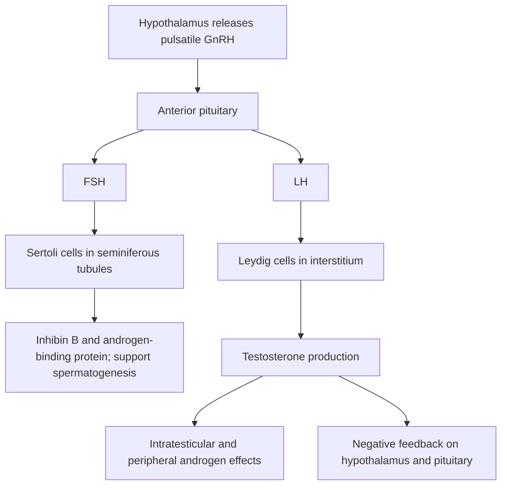
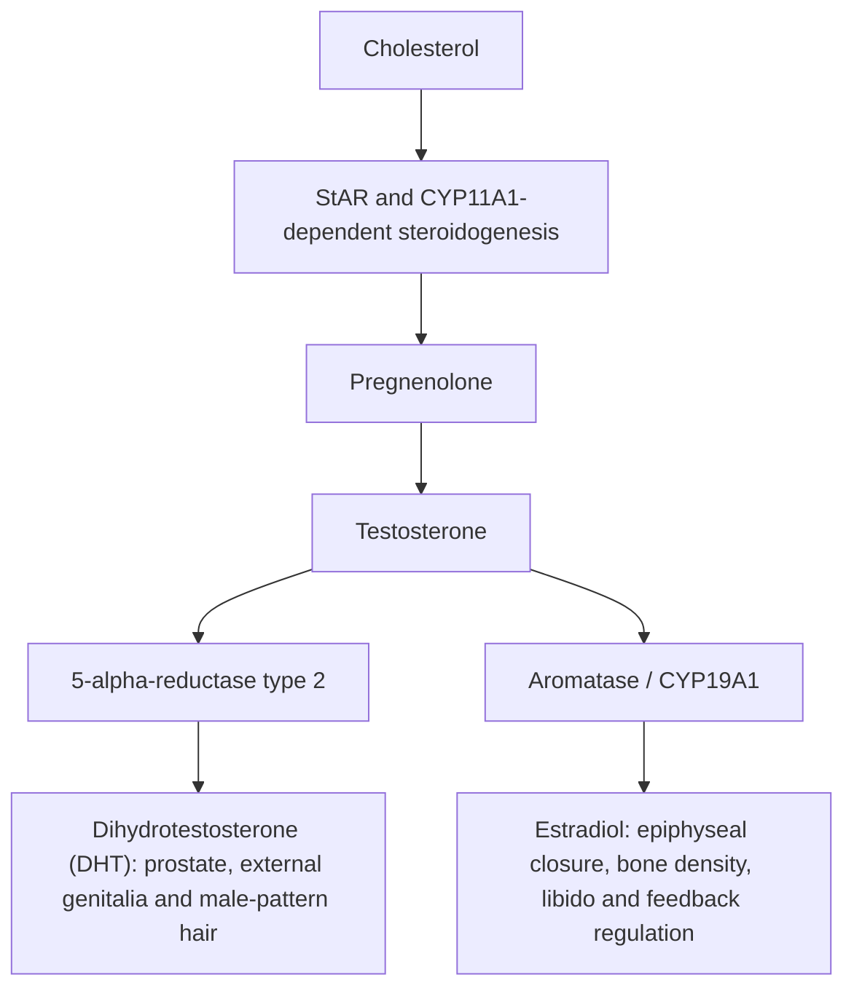
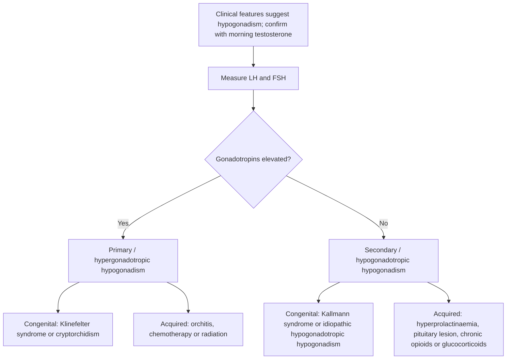

# Chapter 17: Male Reproductive Endocrinology

## 17.1 Hypothalamic-Pituitary-Testicular (HPT) Axis & Testicular Physiology

The Male Reproductive System is regulated by the Hypothalamic-Pituitary-Testicular (HPT) axis, which maintains testicular androgen production and spermatogenesis through continuous neuroendocrine feedback loops.

### 1. GnRH Pulsatility
* **Source**: Synthesized by GnRH neurons in the arcuate nucleus and preoptic area of the hypothalamus.
* **Secretion Pattern**: Pulsatile release into the hypophyseal portal circulation every 90 to 120 minutes. Continuous (non-pulsatile) administration of GnRH or long-acting GnRH agonists (e.g., Leuprolide) causes downregulation and desensitization of pituitary GnRH receptors, resulting in complete suppression of gonadotropin (FSH and LH) secretion.
* **Regulation**: Suppressed by testosterone, estradiol, dihydrotestosterone (DHT), stress, severe illness, and hyperprolactinemia.

### 2. Gonadotropin Signaling
* **Luteinizing Hormone (LH)**:
  * Binds to GPCRs ($G_{\alpha s}$) on the surface of **Leydig cells** in the testicular interstitium.
  * Stimulates cAMP/PKA signaling, upregulating the rate-limiting conversion of cholesterol to pregnenolone via the **StAR protein** and **CYP11A1** (cholesterol desmolase).
  * Synthesizes **Testosterone**, which acts locally within the testis and peripherally in target tissues.
* **Follicle-Stimulating Hormone (FSH)**:
  * Binds to GPCRs ($G_{\alpha s}$) on **Sertoli cells** lining the basement membrane of the seminiferous tubules.
  * Stimulates synthesis of **Androgen-Binding Protein (ABP)**, which maintains high intratesticular testosterone levels ($100\times$ higher than systemic serum concentrations), essential for normal spermiogenesis.
  * Stimulates production of **Inhibin B**, which selectively provides negative feedback to the anterior pituitary to inhibit FSH secretion.
  * Promotes tight junction formation (the **Blood-Testis Barrier**) and nurtures developing germ cells from spermatogonia to mature spermatozoa.

---

## 17.2 Androgen Physiology, Metabolism & Actions

Testosterone is the primary circulating male androgen, synthesized predominantly by testicular Leydig cells ($95\%$) with minor contributions from the adrenal cortex ($5\%$).

### Metabolic Conversion & Active Metabolites
1. **Dihydrotestosterone (DHT)**:
  * Converted locally in target tissues by **$5\alpha$-Reductase** (Type 1 in skin/liver; Type 2 in urogenital tract and prostate).
  * DHT has a $2\text{--}5\times$ higher affinity for the androgen receptor (AR) than testosterone and dissociates much more slowly.
  * **DHT-Mediated Effects**: Differentiation of male external genitalia *in utero* (penis, scrotum, prostate), prostate growth, facial/axillary/pubic hair growth, and temporal balding.
2. **Estradiol ($E_2$)**:
  * Converted peripherally by **Aromatase (CYP19A1)** in adipose tissue, brain, and bone.
  * **Estradiol-Mediated Effects**: Pubertal epiphyseal plate fusion, bone mineral density maintenance, regulation of LH/FSH negative feedback, and libido.

### Plasma Transport
* **Sex Hormone-Binding Globulin (SHBG)**: Binds $44\%$ of circulating testosterone with high affinity.
* **Albumin**: Binds $54\%$ with low affinity (easily dissociable).
* **Free Testosterone**: Only $1\text{--}2\%$ circulates unbound. **Bioavailable Testosterone** = Free + Albumin-bound fractions.

---

## 17.3 Male Hypogonadism: Primary vs. Secondary

Male Hypogonadism is defined as impaired testicular function involving deficient androgen production and/or impaired spermatogenesis.

### Diagnostic Comparison Matrix

| Feature | Primary Hypogonadism (Hypergonadotropic) | Secondary Hypogonadism (Hypogonadotropic) |
| :--- | :--- | :--- |
| **Site of Defect** | Testis (Leydig / Sertoli cell failure) | Hypothalamus or Anterior Pituitary |
| **Serum Testosterone** | Low ($< 300\text{ ng/dL}$) | Low ($< 300\text{ ng/dL}$) |
| **Serum LH & FSH** | **Elevated** ($\text{LH} > 10\text{ IU/L}$) | **Low or Inappropriately Normal** |
| **Spermatogenesis** | Severely impaired / Azoospermia | Impaired (potentially restorable with gonadotropin therapy) |
| **Etiologies** | Klinefelter (47,XXY), Orchitis, Radiation, Trauma | Kallmann Syndrome, Prolactinoma, Opioids, Hemochromatosis |

---

## 17.4 Specific Causes of Male Hypogonadism

### 1. Klinefelter Syndrome ($47,\text{XXY}$)
* **Genetics**: Most common genetic cause of primary hypogonadism ($1 \text{ in } 600$ live male births). Meiotic nondisjunction during maternal or paternal gametogenesis leads to classical $47,\text{XXY}$ karyotype.
* **Pathophysiology**: Progressive hyalinization and fibrosis of seminiferous tubules during puberty $\rightarrow$ loss of Sertoli cells (low inhibin B) and Leydig cell dysfunction (low testosterone with high LH/FSH).
* **Clinical Presentation**:
  * Tall eunuchoid habitus (long legs, decreased upper-to-lower segment ratio due to delayed epiphyseal closure).
  * Small, firm, fibrotic testes ($< 4\text{ mL}$ volume or $< 2\text{ cm}$ length).
  * Gynecomastia (increased estrogen-to-androgen ratio).
  * Infertility (azoospermia), sparse facial/body hair, reduced muscle mass.
  * Increased risk of extragonadal germ cell tumors (mediastinal), male breast cancer ($20\times$ risk), and autoimmune conditions.
* **Diagnostics**: Karyotype analysis ($47,\text{XXY}$); Low total/free testosterone, markedly elevated LH and FSH, elevated estradiol.

### 2. Kallmann Syndrome
* **Genetics**: Congenital hypogonadal disorder caused by mutations in *KAL1 / ANOS1* (X-linked) or *FGFR1 / PROKR2* (autosomal dominant/recessive).
* **Pathophysiology**: Defective embryological migration of GnRH-secreting neurons and olfactory receptor neurons from the olfactory placode to the hypothalamus $\rightarrow$ absence of GnRH secretion + olfactory bulb aplasia.
* **Clinical Presentation**:
  * **Hypogonadotropic Hypogonadism** (delayed or absent puberty, micropenis, cryptorchidism).
  * **Anosmia or Hyposmia** (pathognomonic clinical feature).
  * Associated features: Cleft lip/palate, renal agenesis, bimanual synkinesis (mirror movements of hands).
* **Diagnostics**: Low total testosterone with low or undetectable LH and FSH; MRI showing absent or hypoplastic olfactory bulbs/tracts.

---

## 17.5 Gynecomastia & Male Infertility

### Gynecomastia
Gynecomastia is benign proliferation of glandular breast tissue in males caused by an altered ratio of active estrogens to androgens.

* **Physiological Gynecomastia**:
  * *Neonatal*: Transplacental transfer of maternal estrogens ($60\text{--}90\%$, resolves in weeks).
  * *Pubertal*: Transient aromatization spike at Tanner stages 3–4 ($50\%$, peak age 13–14, resolves spontaneously within 12–24 months).
  * *Senile*: Age-related drop in testosterone + increased peripheral adiposity aromatization.
* **Pathological Causes**:
  * Cirrhosis (decreased hepatic clearance of estrogens + increased SHBG).
  * Primary or Secondary Hypogonadism.
  * hCG-Secreting Tumors (Testicular choriocarcinoma, bronchogenic CA $\rightarrow$ hCG stimulates Leydig cell aromatase).
  * Leydig Cell Tumors (direct estrogen secretion).
  * **Drug-Induced** (Mnemonic: *Some Drugs Create Awesome Knockers*):
    * **Spironolactone** (blocks androgen receptors + inhibits testosterone synthesis).
    * **Digitalis** (estrogen-like binding).
    * **Cimetidine** (androgen receptor antagonist).
    * **Alcohol / Ketoconazole** (inhibits $17,20$-lyase and CYP17A1).
    * **Finasteride** ($5\alpha$-reductase inhibitor).

---

## 17.6 Summary Checklist & Corrections

### Index Subsections Covered
- [x] 17.1 Hypothalamic-Pituitary-Testicular Axis
- [x] 17.2 Androgen Physiology & Metabolism
- [x] 17.3 Male Hypogonadism (Primary vs Secondary)
- [x] 17.4 Klinefelter Syndrome & Kallmann Syndrome
- [x] 17.5 Gynecomastia & Male Infertility

### Index Corrections & Clarifications
* **Correction**: Differentiated Bioavailable Testosterone (Free + Albumin-bound) from SHBG-bound testosterone, which is not readily available to peripheral tissues.
