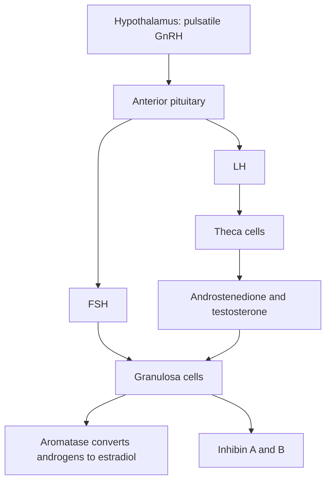
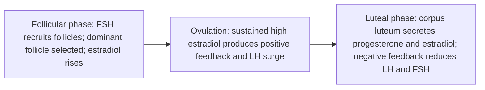
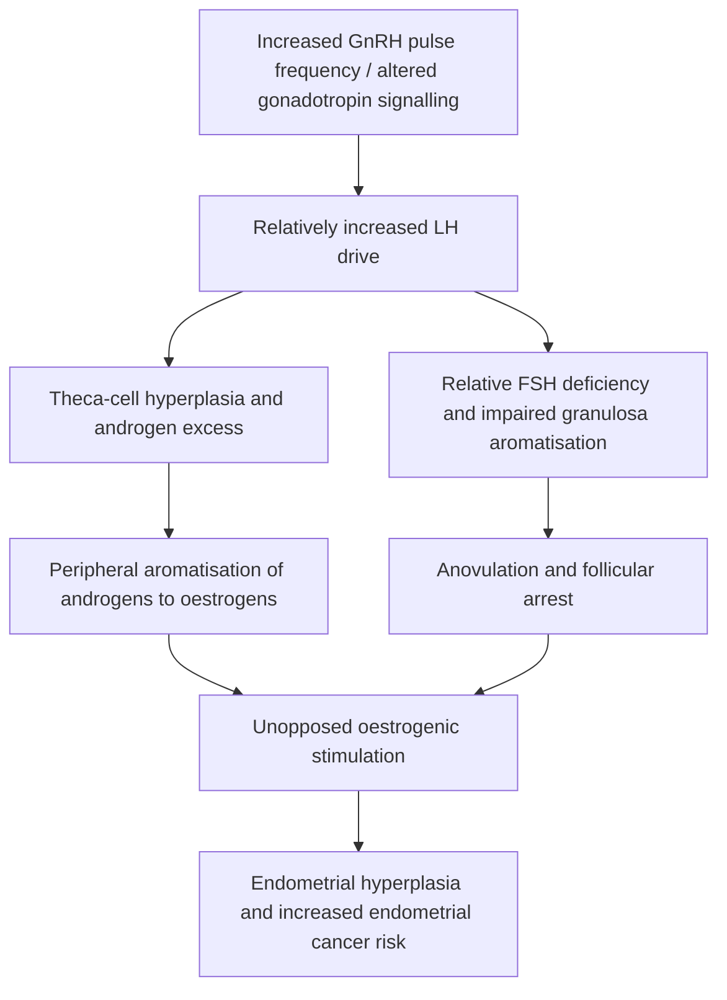
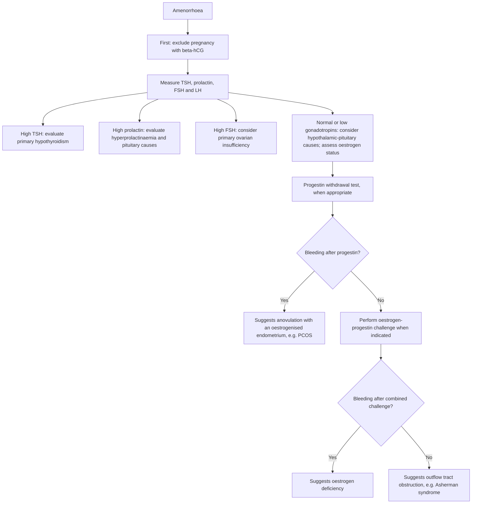

# Chapter 18: Female Reproductive Endocrinology

## 18.1 The Ovarian Cycle & Hypothalamic-Pituitary-Ovarian (HPO) Axis

The Female Reproductive System operates via rhythmic neuroendocrine interactions between the Hypothalamus (GnRH), Anterior Pituitary (FSH, LH), and Ovaries (Estrogen, Progesterone, Inhibins).

### The Two-Cell, Two-Gonadotropin Hypothesis
1. **Theca Interna Cells**:
   * Express **LH Receptors** ($G_{\alpha s}$).
   * LH stimulates cholesterol uptake and expression of **CYP11A1** and **CYP17A1** ($17\alpha$-hydroxylase / 17,20-lyase).
   * Produces **Androstenedione** and **Testosterone**. Theca cells lack aromatase and cannot convert androgens to estrogens independently.
2. **Granulosa Cells**:
   * Express **FSH Receptors** ($G_{\alpha s}$).
   * Androgens diffuse across the basement membrane from theca cells into granulosa cells.
   * FSH stimulates **Aromatase (CYP19A1)** activity, converting theca-derived androstenedione into **Estrone ($E_1$)** and testosterone into **$17\beta$-Estradiol ($E_2$)**.
   * In the late follicular phase, rising intra-follicular estradiol upregulates **LH receptors** on granulosa cells in preparation for ovulation.

---

## 18.2 Polycystic Ovary Syndrome (PCOS)

Polycystic Ovary Syndrome (Stein-Leventhal Syndrome) is the most common endocrine disorder in reproductive-aged females ($8\text{--}13\%$), characterized by hyperandrogenism, ovulatory dysfunction, and polycystic ovarian morphology.

### Pathophysiology
1. **Neuroendocrine Dysfunction**: Increased hypothalamic GnRH pulse frequency selectively favors pituitary **LH secretion over FSH**. The high LH:FSH ratio ($> 2:1$ or $3:1$) overstimulates theca cell androgen production while insufficient FSH fails to stimulate adequate granulosa cell aromatization.
2. **Insulin Resistance & Hyperinsulinemia**: Independent of BMI, $65\text{--}80\%$ of PCOS patients exhibit peripheral insulin resistance. Hyperinsulinemia:
   * Acts synergistically with LH on theca cells to augment androgen synthesis.
   * Inhibits hepatic synthesis of **Sex Hormone-Binding Globulin (SHBG)**, dramatically increasing free circulating testosterone.
   * Inhibits follicular maturation, contributing to anovulatory arrest.

### Diagnostic Criteria: The Rotterdam Criteria (2003)
Diagnosis requires at least **2 of the following 3 criteria** (after excluding mimicking pathologies such as CAH, Cushing syndrome, hyperprolactinemia, and androgen-secreting tumors):

1. **Oligo- or Anovulation**: Manifesting as oligomenorrhea (cycles $> 35$ days or $< 9$ cycles/year) or amenorrhea.
2. **Clinical and/or Biochemical Hyperandrogenism**:
   * *Clinical*: Hirsutism (**modified Ferriman-Gallwey score $\ge 4\text{--}8$** depending on ethnicity), severe recalcitrant acne, androgenic alopecia.
   * *Biochemical*: Elevated serum total or free testosterone, elevated FAI (Free Androgen Index).
3. **Polycystic Ovarian Morphology (PCOM) on Ultrasound**:
   * Transvaginal USG showing $\ge 20$ follicles per ovary measuring $2\text{--}9\text{ mm}$ in diameter ("string of pearls" sign) and/or increased ovarian volume ($> 10\text{ mL}$).

### Clinical Management Matrix

| Clinical Goal | First-Line Therapy | Mechanism / Notes |
| :--- | :--- | :--- |
| **Cycle Control & Hirsutism** | **Combined Oral Contraceptive Pills (COCPs)** | Suppresses LH/FSH, increases hepatic SHBG, reduces free testosterone. |
| **Infertility / Ovulation Induction** | **Letrozole** (Aromatase Inhibitor) | First-line over Clomiphene; blocks E2 synthesis $\rightarrow$ disinhibits pituitary FSH release without anti-estrogenic endometrial effects. |
| **Insulin Resistance & Metabolic** | **Metformin** | Activates AMPK, lowers hepatic gluconeogenesis, improves peripheral insulin sensitivity, reduces androgen production. |
| **Refractory Hirsutism** | **Spironolactone** | Anti-androgen (AR antagonist + $5\alpha$-reductase inhibitor); must be combined with effective contraception due to teratogenicity (feminization of male fetus). |

---

## 18.3 Evaluation & Management of Amenorrhea

Amenorrhea is categorized as **Primary** (no menses by age 15 in the presence of normal secondary sexual characteristics, or by age 13 in the absence of secondary sexual characteristics) or **Secondary** (absence of menses for $\ge 3$ months in previously regular females, or $\ge 6$ months in irregular females).

### Etiological Classification

1. **Hypogonadotropic Hypogonadotropin (Low/Normal FSH & LH)**:
   * **Functional Hypothalamic Amenorrhea (FHA)**: Driven by low energy availability (excessive exercise, anorexia nervosa, severe emotional stress) $\rightarrow$ suppressed hypothalamic Kisspeptin and pulsatile GnRH.
   * Hypopituitarism, Sheehan syndrome, Kallmann syndrome.
2. **Hypergonadotropic Hypogonadism (High FSH $> 40\text{ IU/L}$)**:
   * **Premature Ovarian Insufficiency (POI)**: Depletion of functional ovarian follicles before age 40. Autoimmune, idiopathic, chemotherapy/radiation, or genetic (**Turner Syndrome $45,\text{X}$**; **Fragile X premutation $FMR1$**).
3. **Outflow Tract / Uterine Defects**:
   * **Müllerian Agenesis (Mayer-Rokitansky-Küster-Hauser / MRKH Syndrome)**: $46,\text{XX}$ karyotype with normal ovaries, normal endocrine function, and female secondary sexual characteristics, but congenital absence of uterus, cervix, and upper $2/3$ of vagina.
   * **Asherman Syndrome**: Intrauterine synechiae/adhesions secondary to over-vigorous postpartum or post-abortion curettage.

---

## 18.4 Summary Checklist & Corrections

### Index Subsections Covered
- [x] 18.1 The Ovarian Cycle & HPO Axis
- [x] 18.2 Polycystic Ovary Syndrome (PCOS)
- [x] 18.3 Evaluation & Management of Amenorrhea
- [x] 18.4 Premature Ovarian Insufficiency & Outflow Tract Defects

### Index Corrections & Clarifications
* **Clarification**: Emphasized Letrozole as the preferred first-line ovulation induction agent over Clomiphene citrate in PCOS, reflecting current international clinical guidelines.
