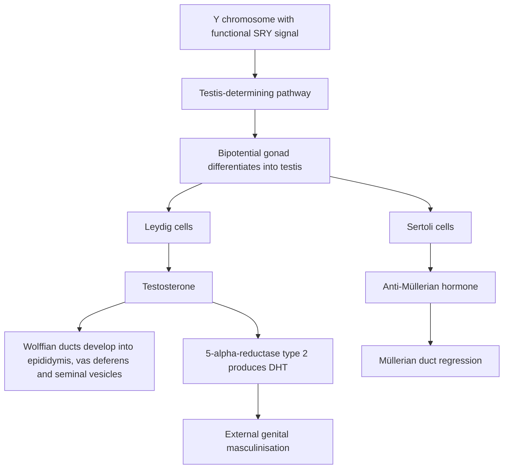
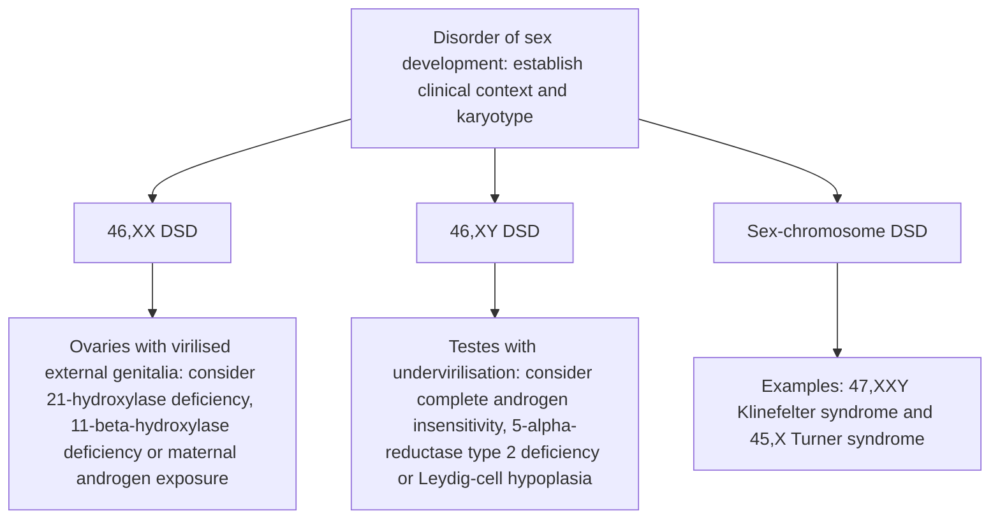

# Chapter 19: Disorders of Sex Development (DSD) & Transgender Endocrine Care

## 19.1 Embryology of Sexual Differentiation

Sexual differentiation occurs in a sequential, step-wise process: **Chromosomal Sex** ($XX$ vs. $XY$) determines **Gonadal Sex** (ovaries vs. testes), which directs **Phenotypic Sex** (internal and external genitalia).

### Hormonal Regulators
1. **Anti-Müllerian Hormone (AMH / MIS)**: Secreted by fetal Sertoli cells starting at week 7. Causes regression of ipsilateral Müllerian ducts (preventing development of uterus, fallopian tubes, and upper $1/3$ of vagina).
2. **Testosterone**: Secreted by Leydig cells under hCG and LH stimulation. Stabilizes and promotes differentiation of **Wolffian ducts** into male internal structures: Epididymis, Vas deferens, and Seminal vesicles.
3. **Dihydrotestosterone (DHT)**: Formed peripherally from testosterone by **$5\alpha$-Reductase Type 2**. Drives virilization of the urogenital sinus and genital tubercle into the prostate, scrotum, and penis.

---

## 19.2 Classification & Pathophysiology of DSDs

Disorders of Sex Development (DSD) are congenital conditions in which chromosomal, gonadal, or anatomical sex development is atypical.

### 1. $46,\text{XX}$ DSD (Female Pseudohermaphroditism)
* **Gonads**: Ovaries present; internal structures are normal female (uterus, fallopian tubes present due to absence of AMH).
* **Genitalia**: Virilized / ambiguous external genitalia (clitoromegaly, labial fusion).
* **Etiologies**:
  * **Congenital Adrenal Hyperplasia (CAH)**: $21\alpha$-Hydroxylase deficiency ($95\%$) causing glucocorticoid deficiency and massive androgen shunting.
  * Placental aromatase deficiency or maternal androgen-secreting tumor.

### 2. $46,\text{XY}$ DSD (Male Pseudohermaphroditism)
* **Gonads**: Testes present (often intra-abdominal or inguinal); Sertoli cells produce normal AMH $\rightarrow$ **Müllerian regression occurs** (absent uterus and fallopian tubes).
* **Genitalia**: Ambiguous or completely female external genitalia due to impaired androgen synthesis or action.

#### Complete Androgen Insensitivity Syndrome (CAIS)
* **Genetics**: X-linked recessive inactivating mutation in the **Androgen Receptor (AR)** gene.
* **Karyotype**: $46,\text{XY}$.
* **Pathophysiology**: Normal functional testes produce normal male levels of testosterone and AMH. AMH regression of Müllerian structures is intact. However, target end-organs are completely refractory to testosterone and DHT.
* **Phenotype**:
  * **Phenotypic female** with normal female external genitalia, well-developed breasts (from peripheral aromatization of un-utilized testosterone to estradiol).
  * **Absent uterus, fallopian tubes, and upper $1/3$ of vagina** (short, blind-ending vaginal pouch).
  * **Absent or extremely sparse pubic and axillary hair**.
  * Cryptorchid testes located in the inguinal canal or abdomen.
* **Laboratory Findings**: High/normal male testosterone, high LH, high estradiol.
* **Management**: Gonadectomy post-puberty (to allow natural pubertal breast development, followed by surgical removal to prevent gonadoblastoma/dysgerminoma malignant transformation) + estrogen replacement.

#### $5\alpha$-Reductase Type 2 Deficiency
* **Genetics**: Autosomal recessive mutation in *SRD5A2*.
* **Karyotype**: $46,\text{XY}$.
* **Pathophysiology**: Inability to convert testosterone to DHT. Internal Wolffian structures develop normally under testosterone, but DHT-dependent external genitalia fail to virilize in early embryogenesis.
* **Phenotype**: Born with female or ambiguous external genitalia (hypospadias, bifid scrotum, microphallus). At puberty, the massive surge in testicular testosterone output overcomes the enzymatic defect $\rightarrow$ **dramatic virilization at puberty** ("penis-at-12"), deepening of voice, muscle mass growth, and male gender identity transition.
* **Laboratory Findings**: High normal testosterone with markedly reduced DHT; elevated **Testosterone-to-DHT ratio ($> 20$)** post-hCG stimulation.

---

## 19.3 Gender-Affirming Endocrine Care

Gender-affirming hormone therapy (GAHT) aims to align physical secondary sex characteristics with an individual's gender identity.

### Transgender Female (Feminizing Therapy)
* **Regimen**: Estrogen (**17$\beta$-Estradiol** transdermal/oral) + Anti-androgens (**Spironolactone**, Cyproterone acetate, or GnRH agonists) to suppress endogenous testosterone.
* **Target Levels**: Serum Estradiol $100\text{--}200\text{ pg/mL}$; Serum Testosterone $< 50\text{ ng/dL}$.
* **Clinical Monitoring**: Venous Thromboembolism (VTE) risk, hyperkalemia (spironolactone), lipid panel, prolactin (risk of prolactinoma).

### Transgender Male (Masculinizing Therapy)
* **Regimen**: **Testosterone** (enanthate/cypionate IM/SC or transdermal gel).
* **Target Levels**: Serum Total Testosterone $400\text{--}1000\text{ ng/dL}$ (normal male range).
* **Clinical Monitoring**: **Erythrocytosis / Polycythemia** (monitor Hematocrit; hold/reduce if $\text{Hct} > 50\text{--}52\%$), liver function tests, lipid profile.

---

## 19.4 Summary Checklist & Corrections

### Index Subsections Covered
- [x] 19.1 Embryology of Sexual Differentiation
- [x] 19.2 Classification of DSDs ($46,\text{XX}$ vs $46,\text{XY}$)
- [x] 19.3 Complete Androgen Insensitivity Syndrome (CAIS)
- [x] 19.4 $5\alpha$-Reductase Type 2 Deficiency
- [x] 19.5 Gender-Affirming Endocrine Care

### Index Corrections & Clarifications
* **Correction**: Highlighted that CAIS patients present with normal breast development despite absent pubic hair due to peripheral aromatization of elevated circulating testosterone.
